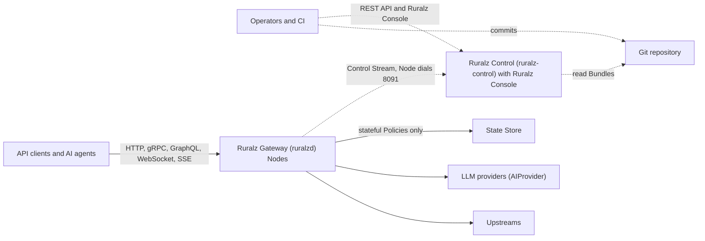

# Ruralz

Ruralz is an open-source API gateway written in Go where every feature, including the control plane and console, is free (Apache-2.0, no feature gating). Milestone M1 is in progress, and its release, `0.1.0`, is not out yet ([Status](#status)).

## What is Ruralz

Ruralz has two runtime components and one CLI:

| Component | Binary | Role |
|---|---|---|
| **Ruralz Gateway** | `ruralzd` | The stateless data plane. Each running process is a Node that terminates client protocols, matches requests to Routes, runs an ordered Filter Chain of built-in Filters and sandboxed WASM Plugins, and forwards to Upstreams, including LLM providers, with load balancing, retries and circuit breaking. |
| **Ruralz Control** | `ruralz-control` | The optional control plane. It builds Revisions from Git, delivers Rollouts to Clusters over the mTLS Control Stream that each Node dials, and hosts the **Ruralz Console** with RBAC, audit log and Drift detection. |
| `ruralz` CLI | `ruralz` | Validates, renders, diffs and builds Bundles, drives Rollouts, and builds, tests and publishes Plugins. |

Shared runtime state (Rate Limits, Quotas, Token Budgets, caches) lives in an external State Store: `redis` for Redis, Valkey or Dragonfly, or `memory` for a single Node. Nodes keep serving their active Revision while Ruralz Control is unavailable, and file mode runs them without Ruralz Control at all. Configuration is YAML (JSON accepted) in a Kubernetes-style resource model validated by a published JSON Schema ([ADR-0003](docs/adr/0003-configuration-format.md)).

*Figure 1: system context; solid arrows are on the request path, dashed arrows carry configuration.*



The [System overview](docs/architecture/01-system-overview.md) owns the full component map, request lifecycle and trust boundaries.

## Why Ruralz

Ruralz is built on four commitments:

- **Every feature is free.** Every feature, including Ruralz Control and Ruralz Console, is Apache-2.0. Authentication, stateful Rate Limits, the AI/LLM gateway, every protocol, the control plane, RBAC, audit log and Ruralz Console SSO are all planned for the same public build.
- **There is no feature gating.** No license keys, no license files, no entitlement checks and no "enterprise" build. The FIPS build has the same features and license as the default build, and nothing is limited by Node count.
- **Revenue never buys features.** Revington earns revenue only from Ruralz Cloud (a managed control plane, not yet launched) and commercial support; neither delivers a private feature, and support work lands upstream under Apache-2.0.
- **Every capability is tracked.** The [Feature Catalog](docs/features/01-feature-catalog.md) lists every Ruralz capability with its milestone, or `Not planned` with a reason.

## Four differentiators

The four differentiators are (1) **WASM plugin system**, (2) **AI/LLM gateway**, (3) **built-in control plane + GitOps**, (4) **multi-protocol native**.

| # | Differentiator | What Ruralz plans | Milestone | Design |
|---|---|---|---|---|
| 1 | WASM plugin system | Sandboxed Plugins on Plugin ABI v1 with deny-by-default Capabilities, pulled from OCI by digest and signed, in any Phase including `onChunk` | Planned (M2); proxy-wasm adapter Planned (M4) | [WASM plugin system](docs/architecture/05-wasm-plugin-system.md) |
| 2 | AI/LLM gateway | `AIProvider` and `AIModel`, an OpenAI-compatible facade plus native passthrough, Token Budgets and Semantic Cache | Planned (M3) | [AI/LLM gateway](docs/architecture/06-ai-llm-gateway.md) |
| 3 | built-in control plane + GitOps | Ruralz Control builds and signs Revisions from Git and runs canary Rollouts with automatic rollback; Ruralz Console, RBAC, audit log, Drift detection | Planned (M2); Ruralz Console SSO and SAML Planned (M5) | [Control plane and GitOps](docs/architecture/04-control-plane-and-gitops.md) |
| 4 | multi-protocol native | HTTP/1.1 to HTTP/3, gRPC, GraphQL federation, WebSocket, SSE, Kafka, NATS and MQTT | gRPC, GraphQL, WebSocket, SSE and HTTP/3 Planned (M3); Kafka, NATS, MQTT Planned (M4) | [Multi-protocol](docs/architecture/07-multi-protocol.md) |

[Vision and positioning](docs/vision/01-vision-and-positioning.md) defines the differentiators and the principles `P1` to `P10`.

## Status

Ruralz is building milestone M1 Core gateway, which release `0.1.0` completes. `0.1.0` is not out yet: until the [releases page](https://github.com/ravindu-rev/ruralz/releases) lists it, there is no archive or image to install, and `ruralzd` and the `ruralz` CLI build from source with `make build`. Its first release candidate, `v0.1.0-rc.1`, is tagged once the other [M1 exit criteria](docs/roadmap/01-roadmap-and-milestones.md#m1-exit-criteria) hold. Every capability in these documents is tagged `Planned (Mx)`, where `Mx` is a milestone from M0 to M5, even when its design is complete. Milestones have an order but no dates.

| Milestone | Scope |
|---|---|
| M0 Foundations | Repository, CI gates, license and governance, configuration contracts |
| M1 Core gateway | File-mode Ruralz Gateway with core Policies, Hot Reload and release `0.1.0` |
| M2 WASM + Control/GitOps | Differentiators (1) and (3), Kubernetes packaging, Bundle tooling commands |
| M3 AI gateway + gRPC/GraphQL/WS/SSE + HTTP/3 | Differentiator (2) and most of (4) |
| M4 Event protocols + multi-region + bench suite | Kafka, NATS and MQTT, Cells across Regions, a bench suite measured against the Performance Budgets and previous releases |
| M5 Enterprise hardening | SSO/SAML for Ruralz Console, FIPS build, monetization hooks |

The [Roadmap and milestones](docs/roadmap/01-roadmap-and-milestones.md) holds each milestone's scope and exit criteria, [Steps](docs/roadmap/02-steps.md) the work left in the current one, and the [Feature Catalog](docs/features/01-feature-catalog.md) maps every capability to its milestone.

## Install

Each release, from `0.1.0` on, publishes these artifacts on the [releases page](https://github.com/ravindu-rev/ruralz/releases), with release notes that list every verification command ([Release artifacts](docs/engineering/04-release-versioning-and-compatibility.md#release-artifacts)):

| Artifact | Name | Platforms |
|---|---|---|
| Ruralz Gateway | `ruralzd_<version>_<os>_<arch>.tar.gz`; the linux archives add `deploy/systemd/` | linux/amd64, linux/arm64; darwin/arm64 and darwin/amd64 for development only |
| CLI | `ruralz_<version>_<os>_<arch>.tar.gz`, `.zip` on Windows | linux/amd64, linux/arm64, darwin/arm64, darwin/amd64, windows/amd64 |
| Checksums | `SHA256SUMS` over the release's archives, SBOMs, schema files, `release-manifest.json` and notes, signed in `SHA256SUMS.sigstore.json` | All |
| Container image | `ghcr.io/ravindu-rev/ruralzd`, tagged `X.Y.Z`, `X.Y` and, for a release candidate, `X.Y.Z-rc.N`; no `latest` | linux/amd64, linux/arm64 |

Each archive holds the binary, `LICENSE`, `NOTICE`, this `README.md` and its own `THIRD_PARTY_LICENSES`; `ruralz-control` archives and image are Planned (M2). Every artifact is signed keylessly with Sigstore by the release's `release-build.yml` workflow run at its tag.

To install an archive, download it with `SHA256SUMS` and `SHA256SUMS.sigstore.json`, check the signature of `SHA256SUMS` with cosign 3.1.3 or newer on 3.x, then check the archive against `SHA256SUMS` and unpack it. cosign 2.6.5 or newer on 2.x also works with `--new-bundle-format` added; older versions have a verification bypass, GHSA-fx35-mq7g-6g98 ([source](https://github.com/sigstore/cosign/releases)).

```bash
version=X.Y.Z  # the release, without its v
cosign verify-blob SHA256SUMS --bundle SHA256SUMS.sigstore.json \
  --certificate-identity "https://github.com/ravindu-rev/ruralz/.github/workflows/release-build.yml@refs/tags/v${version}" \
  --certificate-oidc-issuer https://token.actions.githubusercontent.com
sha256sum --ignore-missing -c SHA256SUMS
tar -xzf "ruralzd_${version}_linux_amd64.tar.gz"
```

On macOS, check the files with `shasum -a 256 --ignore-missing -c SHA256SUMS`. A browser download carries a quarantine flag, which stops the unnotarized binary; after the checks, `xattr -d com.apple.quarantine ruralzd` (or `ruralz`) clears it, and a `curl` download never carries it. The release notes add the provenance and SBOM checks with `gh attestation verify`.

Deployments SHOULD pin the image by digest, which the release notes and `release-manifest.json` name. Check its signature, then pull it by that digest:

```bash
image=ghcr.io/ravindu-rev/ruralzd@sha256:<digest>
cosign verify "$image" \
  --certificate-identity "https://github.com/ravindu-rev/ruralz/.github/workflows/release-build.yml@refs/tags/v${version}" \
  --certificate-oidc-issuer https://token.actions.githubusercontent.com
docker pull "$image"
```

The image runs `ruralzd` as user and group 65532 and exposes ports 8080, 8443 and 9901. It needs no more than a read-only root filesystem, no capabilities and no new privileges, with its data directory `/var/lib/ruralz` on a volume, and a stop grace period above the 30 s Drain exit bound (target) ([Packaging and audit](docs/engineering/04-release-versioning-and-compatibility.md#packaging-and-audit)). [Deployment topologies](docs/operations/01-deployment-topologies.md) covers running Nodes, under systemd too.

## Quickstart

The scripted quickstart, [`examples/quickstart/quickstart.sh`](examples/quickstart/quickstart.sh), goes from a release's `ruralzd` archive to a first request proxied by a Node in 10 minutes or less (target), without Go or the CLI. It downloads the host's archive and `SHA256SUMS` from the latest release, or from the release `RURALZ_QUICKSTART_VERSION` names, such as `0.1.0` (without the `v`). It checks the signature of `SHA256SUMS` when cosign 3.1.3 or newer on 3.x, or 2.6.5 or newer on 2.x, is installed, and the archive's checksum always. It then runs one file-mode `ruralzd` with the `memory` State Store in front of a local Upstream, all on loopback:

```bash
bash examples/quickstart/quickstart.sh
```

It needs Linux or macOS on amd64 or arm64, bash 3.2 or newer, curl, tar, `sha256sum` or `shasum`, python3 for the Upstream, and ports 8080, 9000 and 9901 free on 127.0.0.1; it also runs on its own, fetched without the repository or piped into bash. It prints `first proxied request after <seconds> s`, then stops both processes; with `RURALZ_QUICKSTART_KEEP=1` it leaves them running for `curl http://127.0.0.1:8080/` until Ctrl-C. `RURALZ_QUICKSTART_ARCHIVE` names a local archive, with its `SHA256SUMS` beside it, instead of a download: `make release-dry-run` builds the archives into `dist/release/`, and `make quickstart` runs the script on the host's archive. [Quickstart](docs/operations/01-deployment-topologies.md#quickstart) describes each step.

## Documentation map

Start at the [documentation index](docs/README.md), which gives reading paths for evaluators, contributors, operators, Plugin authors and AI platform engineers.

| If you want to | Read |
|---|---|
| Judge fit and positioning | [Vision and positioning](docs/vision/01-vision-and-positioning.md), [Feature Catalog](docs/features/01-feature-catalog.md) |
| Understand the architecture | [System overview](docs/architecture/01-system-overview.md), [Configuration model](docs/architecture/02-configuration-model.md), [Data plane](docs/architecture/03-data-plane.md) |
| Plan a deployment | [Deployment topologies](docs/operations/01-deployment-topologies.md), [Scalability and distributed state](docs/architecture/11-scalability-and-distributed-state.md) |
| Contribute | [Repository layout and conventions](docs/engineering/02-repository-layout-and-conventions.md), [Tech stack and libraries](docs/engineering/01-tech-stack-and-libraries.md), [Testing and quality strategy](docs/engineering/03-testing-and-quality-strategy.md) |
| Look up commands, APIs and terms | [CLI and API surface](docs/reference/01-cli-and-api-surface.md), [Glossary](docs/glossary.md) |
| See what ships when | [Roadmap and milestones](docs/roadmap/01-roadmap-and-milestones.md), [Steps](docs/roadmap/02-steps.md) |
| Read the decisions | [Architecture Decision Records](docs/adr/README.md) |

## License and governance

- **License.** Every component is Apache-2.0: `ruralzd`, `ruralz-control`, Ruralz Console, the `ruralz` CLI, SDKs, the Helm chart and the documentation. See [LICENSE](LICENSE) and [NOTICE](NOTICE). There is no feature gating and no separate "enterprise" build ([ADR-0002](docs/adr/0002-apache-2-license-no-feature-gating.md)).
- **Copyright.** Copyright 2026 Revington ([revington.co](https://revington.co)).
- **Trademark policy.** "Ruralz" is a trademark of Revington (revington.co), and Apache-2.0 grants no trademark rights. The [trademark policy](TRADEMARKS.md), modeled on ASF nominative use, lets anyone name Ruralz truthfully, redistribute unmodified copies and say "based on Ruralz" or "compatible with Ruralz" when it is true; a modified build takes its own name.
- **Repository.** The monorepo [github.com/ravindu-rev/ruralz](https://github.com/ravindu-rev/ruralz) is owned by the GitHub account `ravindu-rev`.
- **Contributions.** Every commit carries a DCO 1.1 `Signed-off-by:` line matching its author; there is no CLA. Stage 1 checks it on every pull request; see [DCO sign-off](docs/engineering/02-repository-layout-and-conventions.md#dco-sign-off).
- **Stewardship.** Future releases stay Apache-2.0 because of principle P1 and ADR-0002; a structural safeguard such as a pledge or foundation stewardship is OQ-vision-and-positioning-9.
