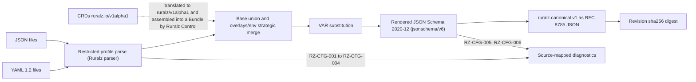

# ADR-0003: Configuration format: YAML with JSON Schema, a Kubernetes-style resource model and a Ruralz parser

## Context and problem statement

Ruralz is configured through Bundles: directories rooted at `ruralz.yaml` that render into one content-addressed Revision per Environment ([Configuration model](../architecture/02-configuration-model.md#canonical-form-and-revision), [System overview](../architecture/01-system-overview.md#configuration-lifecycle)). The same files are reviewed in Git (P5), validated by the `ruralz` CLI, re-rendered by Ruralz Control, loaded by file-mode Nodes (P2) and, Planned (M2), mirrored as CRDs ([ADR-0016](0016-kubernetes-helm-and-crds.md), proposed; [principles](../vision/01-vision-and-positioning.md#principles)).

Which format gives all of them one schema, identical parsing and no construct that expands without bound, and what parses it? Candidate formats range from one JSON file to HCL and a flat file expanded by a template language. Candidate YAML parsers read valid YAML 1.2 otherwise: `goccy/go-yaml` takes `010` as an octal ([source](https://github.com/goccy/go-yaml/issues/894)) and drops a tab inside a plain scalar ([source](https://github.com/goccy/go-yaml/issues/940)), and go-yaml v4 refuses `%YAML 1.2` documents ([source](https://github.com/yaml/go-yaml/issues/146)).

## Decision drivers

- **Reviewable Git diffs with comments** (P5).
- **One published schema** for editors, the CLI, Ruralz Control ingest and CRD admission.
- **Deterministic parsing**: equal bytes and variables yield equal Revision digests on every OS, and on every release except a recorded `v1alpha1` default change, without YAML 1.1 typing.
- **Bounded input**: nothing that can exhaust memory or change unreviewed values, with parse time and memory linear in the file.
- **One specification**: YAML 1.2.2 ([source](https://yaml.org/spec/1.2.2/)), checked against the YAML Test Suite ([source](https://github.com/yaml/yaml-test-suite/releases/tag/data-2022-01-17)), with no upstream fix to wait for.
- **Kubernetes optional**: a CRD-mappable envelope, yet `ruralzd` needs no Kubernetes (P2).
- **Libraries passing gates G1 to G3 and S2** of [Tech stack and libraries](../engineering/01-tech-stack-and-libraries.md#selection-criteria) on the Go 1.26 floor ([ADR-0001](0001-implementation-language-go.md)).

## Considered options

1. YAML 1.2 with JSON Schema (draft 2020-12), restricted profile and Kubernetes envelope, parsed by Ruralz code and validated by `santhosh-tekuri/jsonschema/v6` ([source](https://github.com/santhosh-tekuri/jsonschema/blob/boon/README.md)).
2. The same format parsed by `goccy/go-yaml` ([source](https://github.com/goccy/go-yaml/blob/master/README.md)), with Ruralz code over its tokens and AST.
3. The same format parsed by go-yaml v4 (`go.yaml.in/yaml/v4`).
4. Unrestricted YAML with a YAML 1.1 resolver, as in `sigs.k8s.io/yaml` ([source](https://github.com/kubernetes-sigs/yaml/blob/v1.6.0/yaml.go)).
5. JSON only.
6. HCL.
7. Flat file with templates.

## Decision outcome

Chosen option: "YAML 1.2 validated by a published JSON Schema (draft 2020-12), with a restricted YAML profile parsed by Ruralz code, Kubernetes-style `apiVersion`/`kind`/`metadata`/`spec` resources and strategic-merge overlays, and JSON accepted as a strict subset", because only it keeps comments and line diffs, maps one to one onto CRDs, and parses deterministically, with bounded input, under one schema. A parser written for the YAML 1.2.2 productions and narrowed by the profile reads the YAML Test Suite as YAML 1.2 does, counts depth and nodes while it reads, and waits on no library fix. The library parsers, HCL, JSON only and the flat file with templates are rejected. The rules refine [Format decision](../architecture/02-configuration-model.md#format-decision) and foundation pack sections 5 and 7:

| Rule | Value | Planned |
|---|---|---|
| Envelope | `apiVersion: ruralz/v1alpha1`, `kind` (ten kinds), `metadata`, `spec`; `camelCase` keys and `PascalCase` kinds, except `$patch` | Planned (M0) |
| Schema | Draft 2020-12 authoring view (accepts `${VAR}` strings) and strict rendered view, generated from one source, with `x-ruralz-*` keywords | Planned (M0) |
| Restricted profile | Rejects non-UTF-8, byte order marks, YAML syntax errors and oversize or over-deep input, counted while parsing (RZ-CFG-001; defaults 64 MiB of source, 20,000 resources, 64 nesting levels, 1,000,000 nodes per document and 200 nodes per resource of the resource limit across one load's files, 4,000,000 at the default (target), Node limits never below CLI defaults), duplicate keys (RZ-CFG-002), anchors, aliases, merge keys (RZ-CFG-003) and custom tags and `%TAG` (RZ-CFG-004) | Planned (M1) |
| Parser | Ruralz code in `internal/config/profile` reads the YAML 1.2.2 productions in one pass, with no token stage. Plain scalars are typed from their text by the YAML 1.2 core schema (null, true/false, decimal, `0o` and `0x` integers, floats, else string); a substituted whole-value `${VAR}`, quoted or JSON too, takes the rendered view's field type. Where libyaml-based parsers read YAML otherwise, YAML 1.2 wins: tabs never indent, the lines of a quoted scalar or flow collection are indented past their block collection, a comment needs white space before it, and reserved directives are ignored | Planned (M1) |
| JSON | `.json` files share the loader, schema and Revision digest | Planned (M1) |
| Bundle merge | Base files form a union; `overlays/<env>/` patch by `x-ruralz-list` strategic merge; `${VAR}` substitution runs once, between merge and validation | Planned (M1) |
| Libraries | `santhosh-tekuri/jsonschema/v6` with its `Vocabulary` API; `go.yaml.in/yaml/v3` only in the parser's tests, as a differential oracle | Planned (M1) |
| CRD mirror | `ruralz.io/v1alpha1`, translated by changing only the group ([ADR-0016](0016-kubernetes-helm-and-crds.md), proposed) | Planned (M2) |

An example resource; its JSON twin validates identically:

```yaml
apiVersion: ruralz/v1alpha1
kind: Route
metadata:
  name: orders-read
spec:
  match:
    hosts: ["api.shop.example"]
    path: {prefix: /v1/orders}
    methods: [GET]
  upstreams:
    - name: orders
  timeout: 2s
```

*Figure 1: where the format decision acts between source files and a Revision.*



### Consequences

- Good, because one schema source drives editors, the CLI, Ruralz Control ingest and CRD structural schemas, with identical offline diagnostics for the same overlay and variables.
- Good, because the profile removes alias expansion and YAML 1.1 coercion; size, depth and node limits bound the rest and stop a file while it is read.
- Good, because `x-ruralz-list` lets overlays patch keyed lists instead of replacing them.
- Good, because a syntax error names the YAML 1.2 rule it breaks, at the character that breaks it, in code-point columns.
- Good, because no YAML module links into a binary: `go.yaml.in/yaml/v3` (MIT and Apache-2.0, [source](https://github.com/yaml/go-yaml/blob/v3.0.5/LICENSE)) is a test dependency that depguard confines, and jsonschema/v6 passes G2 as Apache-2.0 and S2 with `go 1.21` ([source](https://github.com/santhosh-tekuri/jsonschema/blob/v6.0.3/go.mod)). G1 and G3 are Pending CI (Planned (M0)).
- Bad, because authors lose anchors, replaced by Policies by reference and overlays.
- Bad, because Ruralz alone maintains block scalars, folding, flow edge cases, tabs, positions and messages, with no external users or advisory channel, and keeps the suite runner, the differential and the fuzz targets current.
- Bad, because YAML that libyaml-based tools accept can fail here, such as a closing bracket at its key's column or `"a"#c`; the differential's list of deviation classes names each case.
- Good, because one node budget for all of a load's files, which scales with the resource limit, bounds its trees however many files hold them, while one file may use all of it: a rendered one-file Bundle of 20,000 resources may average 200 nodes each (target).
- Bad, because peak loader memory at the default size and depth limits is a hypothesis until the hostile-input fixtures measure it.
- Bad, because two schema views and seven custom keywords must stay in step, and apiVersion migration drops comments.

### Confirmation

- **Loader conformance suite**, Planned (M1): a fixture per rejection (RZ-CFG-001 to RZ-CFG-004), an alias-expansion fixture, and plain scalars `yes`, `on`, `0777`, `0b1`, `1_000` and `2026-09-23`: `0777` MUST decode as 777 raw or substituted into an integer field and stay "0777" substituted into a string field; the rest are strings.
- **Hostile input**, Planned (M1): loader fuzzing, plus size, nesting and node-count fixtures that MUST fail with RZ-CFG-001 without a crash; an input of up to 1 MiB parses within 256 MiB of heap growth and 2 s (target).
- **Upstream suites**, Planned (M1): the pinned YAML Test Suite against the Ruralz parser, failing only on a checked-in list whose every entry is a profile refusal, and the pinned JSON-Schema-Test-Suite's required draft 2020-12 tests (optional excluded, except used formats) against `jsonschema/v6`, with zero failures. Other failures or regressions fail CI.
- **Differential**, Planned (M1): over the YAML Test Suite, the fuzz seeds and generated streams, the parser and `go.yaml.in/yaml/v3` accept and refuse the same inputs and read the same trees, except inputs in a checked-in list of deviation classes, each with witnesses on which the two still differ; `FuzzYAMLv3Differential` searches for more.
- **JSON subset fixtures**, Planned (M1): tab indentation, `\/` and surrogate `\u` escapes MUST yield the digest of their YAML twins.
- **Golden corpus**, Planned (M1): the Configuration model's [example Bundle](../architecture/02-configuration-model.md#complete-annotated-example-bundle) and its JSON twin MUST reproduce one expected digest on every release, except entries recording a `v1alpha1` default change.
- **Schema generation check**, Planned (M0): CI regenerates both views from one source and fails on any drift from the published files.
- **Lint**: depguard bans `goccy/go-yaml`, `go.yaml.in/yaml/v4` and `gopkg.in/yaml`, and confines `go.yaml.in/yaml/v3` to the parser's tests.
- **Amendment trigger**: a pull request accepting a new YAML feature, file format or envelope key MUST amend this ADR.

## Pros and cons of the options

### YAML 1.2 with JSON Schema, restricted profile and Kubernetes envelope, parsed by Ruralz code

- Good, because comments, flow style and multi-document files remain.
- Good, because the specification is fixed and the profile narrows it, so the parser has one target, which the YAML Test Suite checks: YAML 1.1 boolean words are strings, and duplicate keys are RZ-CFG-002.
- Good, because depth and node counts run during the parse, where a library builds its whole tree first.
- Bad, because indentation errors remain; file, line and column diagnostics mitigate them.
- Bad, because the parser is code that only Ruralz reviews and maintains.

### Parsed by goccy/go-yaml

- Good, because it is MIT with no dependencies ([source](https://github.com/goccy/go-yaml/blob/master/LICENSE)), reads YAML 1.1 boolean words as strings, and its decoder rejects duplicate keys by default ([source](https://github.com/goccy/go-yaml/blob/v1.19.2/option.go)).
- Bad, because it reads leading-zero integers as octal ([source](https://github.com/goccy/go-yaml/blob/master/token/token.go)), so Ruralz code must reread every scalar, cut documents and bound the library's costs.
- Bad, because its fixes for quadratic parse time ([source](https://github.com/goccy/go-yaml/pull/889)), an unmatched `}` ([source](https://github.com/goccy/go-yaml/pull/900)) and tabs in double-quoted scalars ([source](https://github.com/goccy/go-yaml/pull/949)) wait without review, its last commit is from 2026-04-07 ([source](https://github.com/goccy/go-yaml/commits/master)) and its last release from 2026-01-08 ([source](https://github.com/goccy/go-yaml/releases/tag/v1.19.2)), and it has no security policy ([source](https://github.com/goccy/go-yaml/security)).

### Parsed by go-yaml v4

- Good, because the YAML organization maintains it actively ([source](https://github.com/yaml/go-yaml/commits/main)).
- Bad, because it has only release candidates ([source](https://proxy.golang.org/go.yaml.in/yaml/v4/@v/list)), with release planning open since 2026-01-04 ([source](https://github.com/yaml/go-yaml/issues/237)), and it refuses `%YAML 1.2` documents ([source](https://github.com/yaml/go-yaml/issues/146)).
- Bad, because its limits bound depth and aliases, not nodes ([source](https://github.com/yaml/go-yaml/blob/main/docs/plugin.md)), and a memory-corruption bug was closed without an advisory ([source](https://github.com/yaml/go-yaml/issues/316)).

### Unrestricted YAML with a YAML 1.1 resolver

- Good, because it matches common Kubernetes tooling and allows anchors for reuse.
- Bad, because its resolver maps `y`, `yes` and `on` to booleans ([source](https://github.com/yaml/go-yaml/blob/v2.4.2/resolve.go)), and alias edits change values outside the reviewed hunk.

### JSON only

- Good, because the syntax is unambiguous and every tool parses it.
- Bad, because it lacks comments, so authors resort to placeholder keys that the schema must tolerate.
- Bad, because large nested files diff poorly.

### HCL

- Good, because it has comments and readable diffs.
- Bad, because its schema and editor story is weak and it has no CRD path.
- Bad, because a second syntax needs its own deterministic parser and conformance suite.

### Flat file with templates

- Good, because one file with shared template partials is simple to ship.
- Bad, because the rendered output, not the reviewed source, is what loads, and a render engine that falls back to the raw file on error lets the loaded configuration differ from the reviewed intent.
- Bad, because a template language is a Configuration model non-goal.

## More information

- Owning document: [Configuration model](../architecture/02-configuration-model.md#restricted-yaml-profile).
- Evidence: the [Library catalog](../engineering/01-tech-stack-and-libraries.md#library-catalog).
- Related decisions: [ADR-0019](0019-expressions-authorization-comprehension-stop.md) and [ADR-0017](0017-artifact-signing.md).
- Open elsewhere: OQ-configuration-model-10 and OQ-configuration-model-2.
