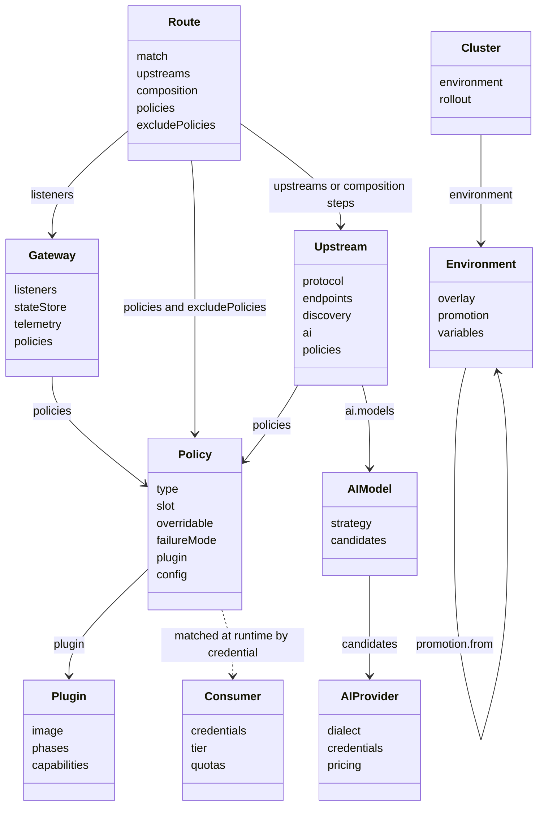
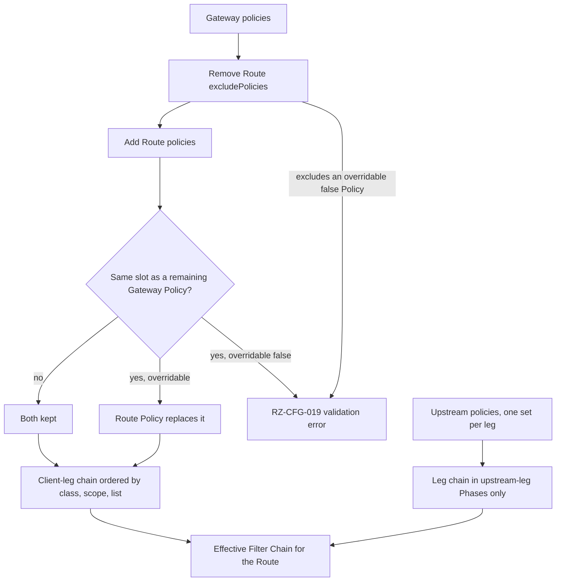
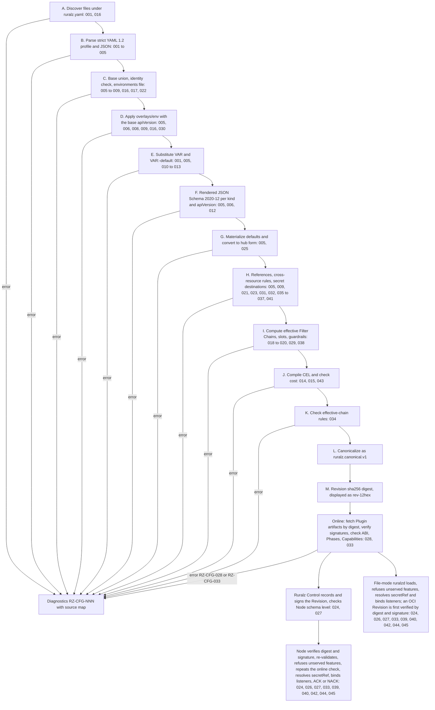

# Configuration Model

## Summary

This document defines how Ruralz is configured: YAML 1.2 resources in the Kubernetes style (`apiVersion: ruralz/v1alpha1`, `kind`, `metadata`, `spec`), validated by one published JSON Schema, grouped into a Bundle and rendered into a content-addressed Revision. It fixes the schema of all ten kinds, merge and overlay rules, slot-based Policy precedence with guardrails, where CEL may appear, `secretRef` and `${VAR}` handling, validation, the diff format, apiVersion evolution and the CRD mapping. Capabilities carry `Planned (Mx)` tags, and a rule without its own tag ships with the kind or verb that applies it. Architects, contributors and operators should read it before writing or reviewing a Bundle or schema change.

## Scope and non-goals

In scope: everything the Summary lists, including `overlays/<env>/`, the canonical form behind a Revision digest, error codes and the Kubernetes CRD mapping, `Planned (M2)` ([ADR-0016](../adr/0016-kubernetes-helm-and-crds.md), proposed).

Non-goals:

- Runtime semantics of each Policy type's `config`, owned by feature documents such as [Traffic management and resilience](09-traffic-management-and-resilience.md). Each feature document authors its type's `config` schema, and this document registers and publishes it ([foundation pack](../_meta/foundation-pack.md) section 3).
- Rollouts and the Control Stream ([Control plane and GitOps](04-control-plane-and-gitops.md), [ADR-0007](../adr/0007-control-stream-protocol.md)), and artifact signing ([ADR-0017](../adr/0017-artifact-signing.md), owned by [Security and identity](08-security-and-identity.md)); this document registers only the signature error code.
- Host Functions and Capabilities ([WASM plugin system](05-wasm-plugin-system.md)).
- Gateway API conformance, deferred by ADR-0016 (proposed), and Helm values ([Deployment topologies](../operations/01-deployment-topologies.md)).
- A built-in template language.

## Format decision

Configuration is YAML 1.2 with a published JSON Schema (draft 2020-12) and a Kubernetes-style resource model ([ADR-0003](../adr/0003-configuration-format.md)). JSON is accepted as a strict subset of YAML: `.json` files use the same loader and schema and yield the same Revision digest. Keys are `camelCase`; kinds are `PascalCase`. The published JSON Schema is `Planned (M0)`. The `ruralz bundle` verbs `validate`, `render`, `diff` and `build` are `Planned (M1)`, as in [System overview](01-system-overview.md); `push`, `import`, `export` and `audit` are `Planned (M2)` (foundation pack section 9).

### Why the Kubernetes resource model

The envelope maps one to one onto CRDs, so the CRD path in ADR-0016 (proposed) is a translation, not a second schema, and existing YAML language servers, linters and policy engines work unchanged. Kubernetes stays optional: `ruralzd` can watch a Bundle directory, pull a Revision from an OCI registry, or receive one from Ruralz Control.

| Option | Schema and editor story | CRD path | Diffs | Verdict |
|---|---|---|---|---|
| YAML 1.2 + JSON Schema, Kubernetes envelope | One schema source drives editors, CLI, admission | Direct | Good | Chosen |
| JSON only | Strong, no comments | Possible | Poor | Rejected |
| HCL | Weak | None | Good | Rejected |
| Single flat file with templates | Moderate | None | Poor at scale | Rejected |

### Restricted YAML profile

The loader rejects features that let a small edit change distant values or let a small file expand without bound. The profile is `Planned (M1)`, with the `ruralz bundle` verbs and file-mode `ruralzd`.

| YAML feature | Accepted | Reason |
|---|---|---|
| Comments, flow style, multi-document files | Yes | No effect on meaning |
| YAML 1.2 core scalars (`yes`, `on` are strings) | Yes | No YAML 1.1 typing surprises |
| Duplicate keys | No, RZ-CFG-002 | Parsers silently keep the last |
| Anchors, aliases, merge keys | No, RZ-CFG-003 | Alias expansion exhausts memory; edits leak outside the diff hunk |
| Custom tags (`!include`, `!env`) | No, RZ-CFG-004 | One mechanism each for inclusion and substitution |
| Non-UTF-8, byte order marks | No, RZ-CFG-001 | Identical bytes on every OS |

Size and depth limits are configurable; exceeding one is RZ-CFG-001 and stops the load. The defaults are 64 MiB of source text, 20,000 resources, 64 nesting levels, 1,000,000 YAML nodes per document, and a node budget of 200 YAML or JSON nodes per resource of the resource limit across every file of one load, 4,000,000 at the default (target). A whole load, stages A to E, at any of the 64 MiB, 20,000-resource and node-budget defaults, or at all three together, grows the heap by at most 1,040 MiB (target), which the hostile-input fixtures of the [configuration conformance suite](../engineering/03-testing-and-quality-strategy.md#conformance-suites) assert. The parser counts depth and nodes as it builds each tree, so the first collection or node past a limit stops the file before a larger tree exists. A Node never enforces a limit below the CLI default, so no Bundle that passes CI fails on a Node for size or depth.

The node budget counts the base files and the selected overlay's together, so the trees of one load stay bounded however many files hold them, and one file may use all of it: a rendered one-file Bundle at the resource limit averages up to 200 nodes per resource. The node past the budget is reported where it lies, counting the files in path order, the same for every worker count. The source text is every file a Bundle load reads, every `.ruralzignore` and the files of every overlay included, and an `--environments` file has a source and a node budget of its own. The resource limit bounds the base union, one overlay's documents, an `--environments` file and the rendered Bundle, and a depth limit above 10,000 counts as 10,000 in YAML as in JSON, so the parser's recursion stays bounded.

A load also reads at most 20,000 configuration files and 1,000 `.ruralzignore` patterns across its files, each at most 4,096 bytes; substitution writes at most the source limit of text in one render, and a run reports at most 10,000 diagnostics, then one RZ-CFG-001 "too many diagnostics".

The loader parses with Ruralz code in `internal/config/profile`, written for the YAML 1.2.2 productions ([source](https://yaml.org/spec/1.2.2/)) and checked against the YAML Test Suite and, in tests only, against `go.yaml.in/yaml/v3` ([ADR-0003](../adr/0003-configuration-format.md)). Where libyaml-based parsers read YAML otherwise, it follows YAML 1.2: tabs never indent, the lines of a quoted scalar or flow collection are indented past their block collection, a comment needs white space before it, and reserved directives are ignored. Schema validation, stage F of [Figure 3](#validation-and-diff-semantics), uses `github.com/santhosh-tekuri/jsonschema/v6`, whose `Vocabulary` API carries the `x-ruralz-*` keywords (foundation pack section 7).

### OpenAPI, Postman and test tooling

`ruralz bundle import openapi` builds Routes and Upstreams from an OpenAPI document; `ruralz bundle export openapi`, `ruralz bundle export postman` and `ruralz bundle export dot` publish a Bundle as an OpenAPI document, a Postman collection or a DOT graph; and `ruralz test run` executes end-to-end test cases against a Gateway. All are `Planned (M2)` (foundation pack section 9); test cases live outside the Bundle.

## Resource model

Every resource has the same envelope:

```yaml
apiVersion: ruralz/v1alpha1     # required; the first served version, Planned (M0)
kind: Route                      # required; one of the ten kinds
metadata:
  name: orders-summary           # required; RFC 1123 label, 1 to 63 chars
  labels:                        # optional; string to string
    team: commerce
  annotations:                   # optional; string to string
    shop.example/owner: commerce
spec: {}                         # required; kind-specific
```

### Identity and references

Identity is `(kind, metadata.name)`, unique within a rendered Bundle; merge, overlays, references and diff all key on it, so a rename is a removal plus an addition. RFC 1123 names are also valid CRD object names. The `ruralz.io/` label and annotation prefix is reserved. `metadata` accepts only `name`, `labels` and `annotations`, and a `status` block is rejected because only Ruralz Control writes status.

References are by name within the rendered Bundle: a string for one target (`spec.plugin: geo-block`), a list of objects keyed by `name` for several (`spec.policies: [{name: jwt-default}]`), so overlays and server-side apply merge by key. The field implies the target kind. `Route.spec.listeners` is the one list of plain strings, because it names sub-resources of the single `Gateway`, not resources. A missing target is an error and there are no cross-Bundle references, so every Revision is self-contained configuration and safe as Last-Known-Good.

### Scope of kinds

| Kind | Lives in | Planned |
|---|---|---|
| `Gateway`, `Route`, `Upstream`, `Policy`, `Consumer` | Bundle, delivered to Nodes | Planned (M1) |
| `Plugin` | Bundle, delivered to Nodes | Planned (M2) |
| `AIProvider`, `AIModel` | Bundle, delivered to Nodes | Planned (M3) |
| `Environment` | Control plane only, outside the Bundle; the CLI also reads it from `--environments` files and never sends it to Nodes | Planned (M1) for CLI renders; Planned (M2) in Ruralz Control |
| `Cluster` | Control plane only, outside the Bundle | Planned (M2) |

Each Bundle has exactly one `Gateway`, in `ruralz.yaml` (RZ-CFG-016). It holds per-Cluster singletons (admin port, State Store connection, global limits), and one Gateway removes any Route-to-Gateway binding rules.

### Schema keywords that drive tooling

The JSON Schema is the single source of truth. Seven custom annotation keywords, permitted by draft 2020-12, let one schema drive validation, merge, rendering and diff:

| Keyword | Applies to | Effect |
|---|---|---|
| `x-ruralz-ref` | Reference fields | Target kind; `${VAR}` forbidden |
| `x-ruralz-secret` | `SecretValue` fields | Only `secretRef` accepted; never rendered |
| `x-ruralz-cel` | CEL fields | Variables and result type for type-checking |
| `x-ruralz-list` | Arrays | `map` (merged and diffed by a key, sorted), `orderedMap` (merged and diffed by a key, authored order kept), `set` (sorted, replaced whole), `atomic` (ordered, replaced whole) |
| `x-ruralz-impact` | Any field | Diff impact: `routing`, `security`, `traffic`, `plugin`, `ai`, `metadata` |
| `x-ruralz-since` | Any field | Schema level that added the field, for version skew |
| `x-ruralz-validations` | Objects, including Plugin `configSchema` | CEL rules over `self` |

`orderedMap` is for keyed lists whose order carries meaning: `spec.policies` on every kind (list position orders Policies within a Filter class and scope), `AIModel.spec.candidates` (Provider Fallback order) and `Route.spec.composition.steps` (sequential order). Every other keyed list is an unordered `map`.

The schema is published in two views generated from one source. The authoring view, used by editors and for raw source files, gives the `${VAR}` alternative (a string matching `^\$\{[A-Za-z_][A-Za-z0-9_]*(:-[^}]*)?\}$`) to every value that permits substitution and that the expression would otherwise fail: a non-string scalar, or a string constrained by an enum or a pattern. A Policy whose `spec.type` is a `${VAR}` expression matches no `config` dispatch branch in the authoring view, so its `config` is checked only in the rendered view after substitution. The rendered view is strict and validates after substitution. Both carry the same keywords.

Keyword values have these shapes: `x-ruralz-ref` is the target kind as a string; `x-ruralz-secret` is `true`; `x-ruralz-cel` is `{"variables": [...], "result": "bool" | "string" | "dyn"}`; `x-ruralz-list` is `{"type": ..., "key": ...}`, with `key` only for `map` and `orderedMap`; `x-ruralz-impact` is an array of classes, as in diff output; `x-ruralz-since` is an integer, omitted for level 0; `x-ruralz-validations` is an array of `{"rule": ..., "message": ...}`. The Go types in `pkg/config/v1alpha1` are the one source of both views, and the generated schema is the normative artifact ([Repository layout and conventions](../engineering/02-repository-layout-and-conventions.md#schema-generation-from-go-types)).

Unknown fields outside labels and annotations are rejected with a nearest-match hint (RZ-CFG-006). Durations use Go syntax, byte sizes accept integers or Kubernetes quantities, and prices are decimal strings. The canonical form normalizes them (`90s` becomes `1m30s`, `10Mi` becomes `10485760`), so equivalent spellings never diff and floats never drift.

### Kubernetes mapping

Mirrored CRDs for all ten kinds are `Planned (M2)` ([ADR-0016](../adr/0016-kubernetes-helm-and-crds.md), proposed). A CRD group needs a dot, so CRDs use `ruralz.io/v1alpha1` and translate to the Bundle `ruralz/v1alpha1` by changing only the group; Bundles keep `ruralz/v1alpha1` (foundation pack section 2 Config unit row, section 7 ADR-0016 row and section 12). CRDs publish the rendered view; unconstrained string fields may still carry `${VAR}` for Ruralz Control to substitute.

| Aspect | Bundle form | CRD form |
|---|---|---|
| `apiVersion` | `ruralz/v1alpha1` | `ruralz.io/v1alpha1`, category `ruralz` |
| `metadata.namespace` | Rejected | One namespace becomes one Bundle |
| `x-ruralz-validations` | Checked by `ruralz bundle validate` | Emitted as `x-kubernetes-validations`; rules in a Plugin `configSchema` run only in Ruralz Control, because Policy `config` is schemaless in the CRD |
| `${VAR}` in non-string fields and in enum- or pattern-constrained strings | Allowed (authoring view) | Rejected by the structural schema |
| `status` | Rejected | Status subresource with conditions |
| `Environment`, `Cluster` | Outside the Bundle | Cluster-scoped CRDs read only by Ruralz Control |

Ruralz Control is the only Kubernetes controller in this path: it watches the CRDs, assembles each namespace into a Bundle and runs the Git pipeline; `ruralzd` never reads CRDs (OQ-configuration-model-2). Whether one Cluster may take both Git and CRD changes stays OQ-system-overview-8, owned by [Deployment topologies](../operations/01-deployment-topologies.md). Mirrored CRDs expose every feature, so Gateway API ([source](https://gateway-api.sigs.k8s.io/implementations/)) is a later adapter.

## Kind catalog

Sketches are normative for field names and mark required fields with `# required`; other fields are optional with schema defaults. Each list is annotated with its `x-ruralz-list` type. A field not shown does not exist; other documents propose new fields through Open questions. Secret fields take the `SecretValue` shape `{secretRef: {...}}`.

*Figure 1: the ten resource kinds and the references between them; the dotted arrow is a runtime lookup.*



### Gateway

Listeners, TLS, admin, telemetry, global limits, the State Store connection and Gateway-scoped Policies.

```yaml
kind: Gateway
spec:
  listeners:                       # required, at least one; map keyed by name
    - name: https                  # required
      protocol: https              # required: http | https
      port: 8443                   # required
      http3: true                  # https only; adds UDP on the same port
      proxyProtocol: false         # true requires PROXY protocol v2 on this listener; default false
      hostnames: ["api.shop.example"]   # set
      tls:
        minVersion: "1.3"          # "1.2" | "1.3"; default "1.3"
        certificates:              # required for https; map keyed by name
          - name: api-shop
            certificate: {secretRef: {provider: file, name: /etc/ruralz/tls/tls.crt}}
            privateKey: {secretRef: {provider: file, name: /etc/ruralz/tls/tls.key}}
  trustedProxies: ["10.0.0.0/8"]   # set of CIDRs whose forwarding headers set source.ip; default empty
  admin:
    port: 9901                     # default 9901
  telemetry:
    otlp:                          # OTLP over gRPC
      endpoint: "https://otel-collector:4317"   # http or https, host, optional port (default 4317), no path; unset: no export
      tls:                         # https only; the Upstream tls fields sni, caCertificate, clientCertificate, clientKey
        caCertificate: {secretRef: {provider: file, name: /etc/ruralz/otel/ca.crt}}
    traceSampling: 0.05            # ratio 0 to 1; default 0.01
    accessLog: {when: "response.status >= 400"}   # CEL
  limits:
    maxRequestBodyBytes: 10Mi      # default 10Mi
    maxRequestHeaderBytes: 64Ki    # default 64Ki
    maxResponseBodyBytes: 10Mi     # default 10Mi; cap on one buffered response, and on a Route's step bodies together
    maxCompositionSteps: 16        # default 16; cap on composition.steps per Route
    maxBufferedBytes: 512Mi        # default 512Mi; Node-wide budget for all buffered bodies, decoded values included
    maxPluginMemoryBytes: 1Gi      # Node-wide cap on aggregate Plugin memory; schema default 2Gi; WASM plugin system owns the value
  stateStore:
    driver: redis                  # memory | redis; default memory
    topology: cluster              # redis only: standalone | cluster | sentinel; default standalone
    url: {secretRef: {provider: env, name: RURALZ_STATE_STORE_URL}}   # required with driver redis
    tls:                           # rediss:// only; caCertificate, clientCertificate, clientKey; this connection's
      caCertificate: {secretRef: {provider: file, name: /etc/ruralz/redis/ca.crt}}
    timeout: 50ms                  # default 50ms; the default of every Policy's stateStoreTimeout
    zones:                         # redis only; map keyed by host: a server host's failure zone, compared with RURALZ_ZONE
      - {host: valkey-0.state.internal, zone: eu-west-1a}
      - {host: 10.0.2.15, zone: eu-west-1b}
    cache:                         # optional second redis connection, used only by the Response Cache
      topology: standalone         # standalone | cluster | sentinel; default standalone
      url: {secretRef: {provider: env, name: RURALZ_SECRET_CACHE_URL}}   # required; same URL form as url
      tls:                         # the cache connection's own; same shape as stateStore.tls
        caCertificate: {secretRef: {provider: file, name: /etc/ruralz/redis/ca.crt}}
      zones: [{host: cache.state.internal, zone: eu-west-1a}]   # the cache connection's own; same shape as stateStore.zones
  policies: [{name: cors-default}] # orderedMap keyed by name; Gateway-scoped Policies
```

Each listener has its own `port`: two listeners on one `port`, or a listener on the admin port (`admin.port`, else its default 9901), are RZ-CFG-005 at stage H. A Node that still meets either at activation refuses the Revision with RZ-CFG-039 ([Data plane](03-data-plane.md#listeners-and-protocols)). An `https` listener needs `tls` with at least one certificate, and `tls` on an `http` listener, which ignores it, is RZ-CFG-005 too.

`trustedProxies` and `listeners[].proxyProtocol`, Planned (M1), feed Security's [Client address](08-security-and-identity.md#ip-filtering-and-geoip) rule, which owns their semantics; a malformed CIDR is RZ-CFG-005. Every topology that puts Nodes behind a load balancer SHOULD set one or both, or `source.ip` is the balancer's address.

`stateStore.topology`, Planned (M1), selects `standalone`, `cluster` or `sentinel`. `url` uses the rueidis URL form ([source](https://github.com/redis/rueidis/blob/main/README.md)), `rediss://` outside loopback: `standalone` takes one endpoint, `rediss://[user:password@]host:port[/db]`; `cluster` takes a seed list, `rediss://host:port?addr=host:port&addr=host:port`; `sentinel` takes a sentinel seed list and the master set, `rediss://[user:password@]host:port[/db]?addr=host:port&master_set=name`, whose credentials authenticate to the primary and to the sentinels, a sentinel without a password taking them for its default user, and whose database is the primary's. A `standalone` URL names an endpoint that follows the primary through failover, such as a managed service's primary endpoint; the Node sets `ForceSingleClient`, so rueidis never guesses, and on a closed connection reconnects under Scalability's [reconnect pacing](11-scalability-and-distributed-state.md#state-client-and-rz-sts-error-codes) and reloads its scripts. A `cluster` client reads the slot map from any seed with `CLUSTER SHARDS` on servers of version 8 and later, else `CLUSTER SLOTS`, follows `MOVED` and `ASK`, and refreshes the map after a redirect, a closed connection and every 10 s (target) through `ShardsRefreshInterval` ([source](https://github.com/redis/rueidis/blob/main/rueidis.go)), so promoted replicas and new shards need no Revision. A `sentinel` client asks the sentinels for the master set's primary, checks it with `ROLE`, and asks again on a `+switch-master` event, a closed sentinel connection and every 10 s (target) through `TopologyRefreshInterval` ([source](https://github.com/redis/rueidis/blob/main/sentinel.go)), so failovers need no Revision. A resolved URL that does not fit `topology`, such as `master_set` outside `sentinel`, a `sentinel` URL without it, `addr` under `standalone` or a database under `cluster`, is RZ-CFG-026 on the Node; one the transport rules refuse is RZ-CFG-042.

`stateStore.url` is a `SecretValue` because Redis URLs often carry credentials; each Node resolves it, so each Region uses its own State Store under one Revision. `driver: redis` without `url` is RZ-CFG-005. Without `stateStore`, `ruralzd` reads `RURALZ_STATE_STORE_URL`, else uses `memory` and logs a warning at startup, because `memory` multiplies every Rate Limit and Quota by the Node count. Sketch comments give the schema defaults (target); [Body buffering and limits](#body-buffering-and-limits) enforces the limits.

`stateStore.cache`, Planned (M1), is a second `redis` connection under the rules above, used only by the Response Cache, so cache entries never evict limit keys; its deployment runs `noeviction` or `volatile-ttl` ([Response caching](09-traffic-management-and-resilience.md#response-caching)). Without it the Response Cache shares the main one under Scalability's [shared-connection rules](11-scalability-and-distributed-state.md#distributed-caches), and each activation that combines `cache` with a limit Policy type logs a warning.

`stateStore.tls` and `stateStore.cache.tls`, Planned (M1), hold the client TLS settings of the main and of the cache connection, each its own, so a cleartext loopback cache can sit beside a TLS main connection: `caCertificate` verifies each server, cluster node and sentinel of the connection for the host the Node dials, instead of the system roots, and `clientCertificate` with `clientKey` is the certificate the Node presents to each. A block has no `sni`, since the servers of one deployment differ. Without its block a connection verifies `rediss://` servers against the system roots. A Node refuses a block beside a cleartext URL of its connection (RZ-CFG-042); `clientCertificate` without `clientKey`, or the reverse, is RZ-CFG-005. A rotated value reaches new connections only.

`stateStore.zones` and `stateStore.cache.zones`, Planned (M1), map the server hosts of the main and of the cache connection to failure zones, each its own. An entry's `host` is a hostname or an IP literal, written as the URL names it or the topology announces it: a `standalone` endpoint, a cluster shard's primary in the slot map, or the primary the sentinels name; its `zone` is a name of 1 to 63 characters from `[a-z0-9-]`, the form of the Node's `RURALZ_ZONE` (foundation pack section 2). The State client labels each call's duration `same` when the server's zone equals the Node's, `cross` when they differ and `unknown` when either is missing ([State client](11-scalability-and-distributed-state.md#state-client-and-rz-sts-error-codes)). An entry for a host the connection never dials has no effect, and a server whose host has no entry is `unknown`: neither is a finding, since URLs are secrets and cluster and sentinel hosts appear at run time. Hosts compare case-insensitively and IP literals in canonical form, so two entries naming one host, a `host` that is neither a hostname nor an IP literal, a `zone` outside its form, and `stateStore.zones` beside `driver: memory` are RZ-CFG-005.

`telemetry.otlp.tls`, Planned (M1), holds the collector's TLS client settings; without it an `https` collector is verified against system roots, and an `http` one is a reported cleartext hop ([Observability](10-observability.md#telemetry-pipeline)). Beside an `http` endpoint, which ignores it, `telemetry.otlp.tls` is RZ-CFG-005. Authentication is OQ-observability-2.

[WASM plugin system](05-wasm-plugin-system.md) owns the value and the cap behavior of `limits.maxPluginMemoryBytes` (foundation pack section 8.11). `http3: true` is `Planned (M3)` and off in FIPS builds.

### Route

Match criteria, Route-scoped Policies, and one or more Upstreams, directly or through composition.

```yaml
kind: Route
spec:
  listeners: [https]               # set of Gateway listener names; default all
  match:                           # required; at least one criterion; criteria AND together
    hosts: ["api.shop.example"]    # set
    path: {template: "/v1/orders/{orderId}"}   # exactly one of exact | prefix | template | regex
    methods: [GET]                 # set
    headers: [{name: x-canary, exact: "true"}] # map keyed by name; exact | regex | present
    grpc: {service: shop.cart.v1.CartService, method: GetCart}   # method optional
    graphql: {operationType: query, operationName: GetOrder}
    topic: orders.created          # event ingress (OQ-configuration-model-11)
    when: 'request.headers["x-tenant"] == "acme"'   # CEL
  policies: [{name: jwt-default}]  # orderedMap keyed by name; Route-scoped Policies
  excludePolicies: [{name: cors-default}]   # map keyed by name; removes inherited Gateway Policies
  upstreams:                       # required unless composition is set; map keyed by name
    - name: orders
      weight: 100                  # default 1; weighted split across entries; weight 0 is never picked while another entry weighs more, and if every weight is 0 all weigh 1
  composition:                     # mutually exclusive with upstreams
    mode: aggregate                # required: aggregate | sequential | conditional
    steps:                         # required; orderedMap keyed by name
      - name: order                # required
        upstream: orders           # required
        method: GET                # default: the incoming method
        pathExpression: '"/orders/" + request.pathParams.orderId'   # CEL; or path: a literal
        target: data               # dot path; unwrap a nested value first
        select: [id, status, total]   # set; allowlist of response fields, per element of a collection
        rename: {total: amount}
        collection: false          # true when the value after target is a JSON array; needs group
        group: order               # key under which the body is merged
        maxBodyBytes: 1Mi          # at least 1 byte; default: an equal share of Gateway limits.maxResponseBodyBytes
        optional: false            # true allows a partial response
        when: "true"               # CEL; conditional and sequential modes
  timeout: 5s                      # whole-request deadline
```

Each step has exactly one of `path` or `pathExpression`; template captures reach steps only through CEL (`request.pathParams`, decoded, and `request.rawPathParams`, as received). `aggregate` runs steps in parallel and merges bodies under `group`; `sequential` runs steps in list order and exposes earlier results as `steps`; `conditional` runs the first step whose `when` is true. A `when` on an `aggregate` step, which runs whatever it says, is RZ-CFG-005, as is a `maxBodyBytes` below 1 byte in either spelling, `collection: true` without `group` or with an empty one, a `target` that is not a dot path ([Transform Policies](03-data-plane.md#transform-policies)), and a literal `path` that does not start with `/`, holds before its first `?` a `.` or `..` segment (also spelled `%2E`), `%00`, a raw or encoded backslash, another control byte or an invalid escape, or holds a raw control byte in its query; [Data plane](03-data-plane.md#composition-engine) gives a `pathExpression` result the same rule at runtime. More steps than `maxCompositionSteps` is RZ-CFG-031.

Two Routes with identical match criteria on a common listener are RZ-CFG-023, a Route without `listeners` being on every listener; other Route precedence belongs to [Data plane](03-data-plane.md#router). A `match.hosts` entry may start with one `*.` label, as in `*.shop.example`; any other `*` is RZ-CFG-005, and Data plane owns wildcard matching. `grpc` and `graphql` matching are `Planned (M3)`, `topic` `Planned (M4)`.

#### Body buffering and limits

Every body streams unless something must read it whole. Buffering is `Planned (M1)`, its AI triggers `Planned (M3)`, in two forms that fail differently:

| Form | Triggered by | Over a limit or out of budget |
|---|---|---|
| Gate: nothing is forwarded until the body is complete, so the response is still uncommitted | Steps: every `aggregate` step, since merging needs whole bodies, and any step with `target`, `select`, `rename` or `group` or read later through `steps`; the request body of a composition Route on which two or more steps may send it, since a streamed body is sent once ([Composition engine](03-data-plane.md#composition-engine)). CEL reading `request.body` or `response.body`. Policies: `authz.*` in `onRequestBody`, `validation.json-schema`, `transform.request` and `transform.response` whose `config` needs the body (`body`, `arrayOps[]`, `replace[]`, a `set[]` or `remove[]` entry with target `body`, or CEL reading a body; [Transform Policies](03-data-plane.md#transform-policies)), `ai.token-budget` and `ai.guardrail` outside `onChunk`, and the request side of `ai.semantic-cache`. An `ai` Upstream, which parses the request. A Plugin with `onRequestBody` or `onUpstreamResponseBody` in `phases` | Always before commit: 413 for the request body; a failed step, decided by `optional`; 502 for another response body; 503 with an `RZ-RT-<NNN>` code when the Node budget is spent |
| Tee: a copy is kept while the body streams on to the client | The store side of `cache` (Response Cache) and `ai.semantic-cache`, including a streamed SSE completion | Stops copying, skips the store, keeps streaming and increments `ruralz_cache_store_skipped_total` for `cache` or `ruralz_ai_semantic_cache_store_skipped_total` for `ai.semantic-cache` ([Observability](10-observability.md); a `buffer_budget` reason for the latter is proposed there) |

Limits count bytes after content decoding. A body decoded into Go values for CEL (`request.body`, `response.body`, `steps[].body`) or for a merge is charged at the size of the values the decoder builds, about 3 times the raw size for typical JSON and up to about 21 times for degenerate arrays (hypothesis), and fails as oversized above 4 times the raw limit it arrived under (target), so dense bodies fail well below the raw limit. The merged aggregate output is one more copy, capped as the client response by `maxResponseBodyBytes`.

A step without `maxBodyBytes` gets an equal share of what `maxResponseBodyBytes` leaves after explicit values, so a Route's step bodies together fit in one `maxResponseBodyBytes`; explicit values that break this are RZ-CFG-032. Per request, raw buffering is at most `maxRequestBodyBytes` plus twice `maxResponseBodyBytes` (step bodies, then the response): 30 MiB with the proposed defaults, 150 MiB counting decoded values (target). Across requests, all of it is reserved from `maxBufferedBytes`, one budget per Node: a gate that cannot reserve gets the 503 above, whose code [Data plane](03-data-plane.md) owns, and a tee skips the store.

### Upstream

A target service: Endpoints or discovery, protocol, load balancing, health checks, retries, circuit breaking and TLS.

```yaml
kind: Upstream
spec:
  protocol: http                   # required: http | grpc | graphql | websocket | kafka | nats | mqtt | ai
  endpoints:                       # required unless discovery or protocol ai; map keyed by address
    - address: "orders.shop.svc:8080"
      weight: 1                    # default 1; weight 0 is never picked while another Endpoint weighs more, and if every weight is 0 all weigh 1
  discovery:                       # alternative to endpoints
    type: kubernetes               # dns | kubernetes
    service: orders
    namespace: shop
    port: http                     # port name or number
  loadBalancing: {algorithm: ring-hash, hashKey: 'request.headers["x-user"]'}   # round-robin | least-request | ring-hash | random; default least-request
  healthCheck:
    active: {path: /healthz, interval: 10s, timeout: 2s, healthyThreshold: 2, unhealthyThreshold: 3}   # defaults /, 10s, 2s, 2, 3
    passive: {consecutiveErrors: 5, ejectionTime: 30s}   # defaults 5, 30s
    stallTimeout: 1s               # an attempt without response headers this long is stalled and its Endpoint suspect; default 1s
    pingTimeout: 5s                # an HTTP/2 connection whose ping goes unanswered this long is closed; default 5s
  retries:
    attempts: 2                    # retries after the first attempt; default 1
    perTryTimeout: 1s
    retryOn: 'error != null ? error.kind in ["connect", "reset"] : response.status in [502, 503]'   # CEL
  circuitBreaker:
    maxConnections: 1024           # in-flight attempts per Upstream per Node; default 1024
    maxPendingRequests: 256        # attempts waiting for a slot; default 256
    consecutiveFailures: 5         # run of failed legs that opens the breaker; default 5
    openDuration: 30s              # default 30s
    failureWhen: 'error != null || response.status >= 500'   # CEL
  tls:
    sni: orders.shop.svc
    caCertificate: {secretRef: {provider: file, name: /etc/ruralz/ca/ca.crt}}
    clientCertificate: {secretRef: {provider: file, name: /etc/ruralz/mtls/tls.crt}}
    clientKey: {secretRef: {provider: file, name: /etc/ruralz/mtls/tls.key}}
    handshakeTimeout: 2s           # bound of a TLS handshake; default 2s
  connectTimeout: 1s               # bound of a dial to an Endpoint, its addresses included; default 1s
  timeout: 3s
  messaging: {topic: orders.created, key: "consumer.name"}   # kafka | nats | mqtt only; key is CEL
  ai: {surface: openai, models: [{name: support-chat}]}     # protocol ai only; surface openai | native; models is a map keyed by name
  policies: [{name: headers-internal}]   # orderedMap keyed by name; upstream-leg Policies
```

`ai.models` replaces `endpoints` for `ai`, and `ring-hash` requires `hashKey`, a rule the schema states (RZ-CFG-005 at stage F). Kubernetes discovery watches EndpointSlices, avoiding DNS TTL lag. `http` and `dns` discovery are `Planned (M1)`; `kubernetes` discovery `Planned (M2)`; `grpc`, `graphql`, `websocket` and `ai` `Planned (M3)`; `kafka`, `nats`, `mqtt` and `messaging` `Planned (M4)`.

Sketch comments give the schema defaults, the static defaults of [Deadlines](09-traffic-management-and-resilience.md#deadlines) (target); computed defaults, such as the Route `timeout` its protocol sets, stay out of the canonical form. `connectTimeout`, `tls.handshakeTimeout`, `healthCheck.stallTimeout` and `healthCheck.pingTimeout` bound the dial, the TLS handshake, stall detection and the HTTP/2 ping, whose expiries [Traffic management and resilience](09-traffic-management-and-resilience.md#health-checking-and-outlier-detection) defines. The breaker's guards are fixed values, not fields: at least 20 legs in a rolling 10 s window with at least 50% of them failed, and 3 probe successes to close (target; [Circuit breakers](09-traffic-management-and-resilience.md#circuit-breakers)).

### Policy

Named, reusable configuration for a Filter (built-in) or a Plugin (WASM).

```yaml
kind: Policy
spec:
  type: ratelimit                  # required; see the type registry below
  slot: edge-ratelimit             # optional precedence key; default from the registry
  overridable: true                # when attached to the Gateway: false forbids Route replace or exclude
  failureMode: open                # open | closed; default from the registry
  stateStoreTimeout: 50ms          # default: Gateway spec.stateStore.timeout
  when: 'request.method != "OPTIONS"'   # CEL; the Policy is skipped when false
  plugin: geo-block                # required when type is plugin
  filterClass: authz               # default: the registry class (custom for plugin); only plugin may choose another
  config: {}                       # required; validated by the type's schema
```

`failureMode` applies whenever the Filter or Plugin cannot decide: a State Store call fails or exceeds `stateStoreTimeout` ([ADR-0008](../adr/0008-rate-limiting-local-bucket-and-gcra.md)), a remote dependency such as a JWKS URL fails, a Plugin traps or exceeds limits, or a CEL expression errors at runtime; for types without dependencies, such as `cors`, only CEL errors. Its effect in each Phase, before and after commit, is foundation pack section 8.10, with codes chosen per section 8.6. Each failure increments `ruralz_filter_failures_total` by Policy, Phase and mode ([Observability](10-observability.md)).

No Policy calls the State Store per chunk. `ai.token-budget` reserves in `onRequestBody`, guards the stream locally in `onChunk` and settles at `onLog`, as foundation pack section 8.9 fixes ([ADR-0014](../adr/0014-ai-api-surface.md)). An `AIModel` reachable from a Route with an `ai.token-budget` Policy and no `limits.maxOutputTokens` is RZ-CFG-034, which stage K checks from M1: a Route reaches the AIModels that the `ai.models` of each `ai` Upstream in its `upstreams` or composition steps name, and each such AIModel is reported once, at its `limits` or, without them, at the resource, with every Route whose effective chain holds an `ai.token-budget` Policy and reaches it as a related location. `quota` checks in `onRequestHeaders` and settles at `onLog`. `quota` defaults to `open` and `ai.token-budget` to `closed`, as registered.

`slot` is the precedence key. `override`-class types default to the registry slot (all client authentication types share `auth`); additive types default to their own name, so they stack unless an author sets `slot` explicitly. In the registry, a Filter class is a position within a Phase, scopes G, R and U are Gateway, Route and Upstream, and slot `name` means the Policy's own name. `failureMode` is overridable only for non-security types: `auth.*` (including the upstream types), `authz.*` and `plugin` Policies with `filterClass` auth or authz are `closed` only, and `open` there is RZ-CFG-029. `headers` and `transform.*` run only in Phases their `config` uses. Registry defaults are materialized into the canonical form like schema defaults ([Canonical form and Revision](#canonical-form-and-revision)). How one Route accepts either JWT or an API key in the single `auth` slot is OQ-configuration-model-13.

The registry below matches foundation pack section 10; its `type` strings are exact, and `rateLimit`, `rate-limit`, `apiKey`, `jwt`, `tokenBudget`, `ipfilter` and `geoip` are never valid spellings.

| `type` | Filter class | Phases | Scopes | Slot | `failureMode`: default; allowed | Planned |
|---|---|---|---|---|---|---|
| `auth.jwt`, `auth.api-key`, `auth.basic`, `auth.mtls` | auth | onRequestHeaders | G, R | `auth` | closed; closed only | Planned (M1) |
| `authz.cel` | authz | onRequestHeaders, onRequestBody | G, R | `name` | closed; closed only | Planned (M1) |
| `authz.opa`, `authz.cedar` | authz | onRequestHeaders, onRequestBody | G, R | `name` | closed; closed only | Planned (M2) |
| `authz.ip` | authz | onRequestHeaders | G, R | `name` | closed; closed only | Planned (M1) |
| `authz.geoip` | authz | onRequestHeaders | G, R | `name` | closed; closed only | Planned (M2) |
| `ratelimit` | admission | onRequestHeaders | G, R | `name` | open; either | Planned (M1) |
| `quota` | admission | onRequestHeaders, onLog | G, R | `name` | open; either | Planned (M1) |
| `validation.json-schema` | validation | onRequestBody | R | `validation` | closed; either | Planned (M1) |
| `cors` | cors | onRequestHeaders, onResponse | G, R | `cors` | closed; either | Planned (M1) |
| `cache` (Response Cache) | cache | onRequestHeaders, onResponse | R | `cache` | open; either | Planned (M1) |
| `headers` | transform | onRequestHeaders, onResponse; at U: onUpstreamRequest, onUpstreamResponseHeaders | G, R, U | `name` | closed; either | Planned (M1) |
| `transform.request` | transform | onRequestBody; at U: onUpstreamRequest | G, R, U | `name` | closed; either | Planned (M1) |
| `transform.response` | transform | onResponse; at U: onUpstreamResponseBody | G, R, U | `name` | closed; either | Planned (M1) |
| `auth.upstream-oauth2` | upstream-auth | onUpstreamRequest | U | `upstream-auth` | closed; closed only | Planned (M1) |
| `auth.upstream-sigv4` | upstream-auth | onUpstreamRequest | U | `upstream-auth` | closed; closed only | Planned (M2) |
| `ai.token-budget` | admission | onRequestBody, onChunk, onLog | G, R | `name` | closed; either | Planned (M3) |
| `ai.semantic-cache` (Semantic Cache) | cache | onRequestBody, onResponse | R | `semantic-cache` | open; either | Planned (M3) |
| `ai.guardrail` | validation | onRequestBody, onChunk, onResponse | G, R | `name` | closed; either | Planned (M3) |
| `plugin` | `filterClass` | The Plugin's `phases` | Scopes matching those Phases | `name` | closed; closed only for auth and authz classes | Planned (M2) |

The Semantic Cache has one switch: a Route caches only when it attaches an `ai.semantic-cache` Policy, which uses the selected AIModel's `cache.semantic` parameters; a model without them is never cached. The Prompt Cache is provider-side and configured on `AIModel`.

`authz.ip` allows or denies by CIDR on the client address (proxy handling: [Security and identity](08-security-and-identity.md)); `authz.geoip` by ISO 3166 country from a local MaxMind-format database, whose reader is a pending selection (foundation pack sections 7 and 10).

Each type's full `config` schema is authored by its feature document and registered and published by this document, and a registered `config` field counts as defined here (foundation pack section 3). The fields this document authors or uses in the CEL table and the example Bundle are fixed here, and feature documents MUST keep them:

| `type` | `config` fields fixed here |
|---|---|
| `cors` | `allowOrigins`, `allowMethods` |
| `auth.jwt` | `issuers[]` with `issuer`, `jwksUrl`, `audiences` |
| `auth.api-key` | `header` (default `x-api-key`; matched against Consumer `apiKeys` by hash; an invalid or Node-managed name, as for `headers`, is RZ-CFG-005) |
| `authz.cel` | `rule` (CEL; an empty rule is RZ-CFG-005) |
| `ratelimit` | `key` (CEL; absent, one partition for every request), `limits[]` with `requests`, `window` |
| `quota` | `consumerQuota` (a Consumer quota with `unit: requests`), `key` (CEL; default `consumer.name`) |
| `cache`, `ai.semantic-cache` | `key` (CEL; partitions entries, for example per Consumer) |
| `headers` | `request` and `response`, each with `set[]` (`map` keyed by `name`), `add[]` (`atomic`) and `remove[]` (`set` of names); `set[]` and `add[]` entries have `name` and exactly one of `value` or `valueExpression` (CEL) |
| `validation.json-schema` | `schema` (required): an inline JSON Schema draft 2020-12 document, an object or a boolean |
| `ai.token-budget` | `consumerQuota` (a Consumer quota with `unit: tokens`) |
| `auth.upstream-oauth2` | `tokenUrl`, `clientId`, `clientSecret` (`SecretValue`), `scopes` |
| `plugin` | Whatever the Plugin's `configSchema` defines |

A `headers` side applies `remove[]`, then `set[]` (one field line per name), then `add[]` (one more line); [Data plane](03-data-plane.md#headers-policy) owns its runtime. These are RZ-CFG-005: a name that is not an RFC 9110 token of at most 256 bytes (target), or that the Node manages (`host`, `content-length`, `expect`, the hop-by-hop fields, `traceparent`, `tracestate`); two entries of one list whose names are equal ignoring case; a `value` with a control byte other than a tab, a leading or trailing space or tab, or more than 8 KiB (target); an entry with neither a `value` nor a non-empty `valueExpression`; and more than 32 entries (target) across all lists of the Policy. Validation compiles a `validation.json-schema` `schema` as draft 2020-12 with `$ref` inside the document, `format` as an annotation and RE2 patterns, within 256 KiB and 1,024 applicator branches (target), else RZ-CFG-005.

A `consumerQuota` that no Consumer in the Bundle defines with the matching `unit` is RZ-CFG-009. At runtime, when `consumer` is null, lacks the named quota or holds it with the other `unit`, the Policy rejects the request with 403 and an `RZ-RL` or `RZ-AI` code owned by the feature document. That is a decision, so it never uses `RZ-STS`. A Route that must also serve such callers guards the Policy with `when: 'consumer != null && "daily-tokens" in consumer.quotas'`.

#### Registered from feature documents

These fields are registered as their feature documents authored them, so each counts as defined here; the authoring section owns their runtime semantics.

| `type` or kind | Registered fields | Validation | Authored in |
|---|---|---|---|
| `auth.basic` | `config`: none; reads `Authorization: Basic` | Schema only | [Basic and mTLS schemas](08-security-and-identity.md#basic-and-mtls-schemas) |
| `Consumer`, for `auth.basic` | `credentials.basic`: `map` keyed by `username`, each with `hash` (`pbkdf2-sha256:<salt>:<key>`, base64url) and `iterations`, default 600,000 (target) | A `username` in two Consumers is RZ-CFG-035; `iterations` outside 600,000 to 1,000,000 is RZ-CFG-036 | [Basic and mTLS schemas](08-security-and-identity.md#basic-and-mtls-schemas) |
| `auth.mtls` | `config.caCertificate` (required `SecretValue`), `config.subjects` (`set` of rules, each exactly one of `subject` or `uriSan`), `config.crl` (`SecretValue`) | A rule with both or neither, or with an empty `subject` or `uriSan`, is RZ-CFG-005 at stage F | [Basic and mTLS schemas](08-security-and-identity.md#basic-and-mtls-schemas) |
| `Consumer`, for `auth.mtls` | `credentials.certificates`: `map` keyed by `name`, each exactly one of `subject` or `uriSan` | A `subject` or `uriSan` in two Consumers is RZ-CFG-035 | [Basic and mTLS schemas](08-security-and-identity.md#basic-and-mtls-schemas) |
| `authz.ip` | `config.allow`, `config.deny`: `set` of CIDRs or bare addresses | Both empty, or an entry that is neither a CIDR nor an address, is RZ-CFG-005 | [IP filtering and GeoIP](08-security-and-identity.md#ip-filtering-and-geoip) |
| `authz.geoip` | `config.allow`, `config.deny`: `set` of ISO 3166-1 alpha-2 codes | Both empty is RZ-CFG-005, checked offline in every binary from M1 | [IP filtering and GeoIP](08-security-and-identity.md#ip-filtering-and-geoip) |
| `cors` | `config.allowHeaders` (`set` of request header names a preflight may ask for, `*` for any; absent allows only CORS-safelisted request headers), `config.allowCredentials` (boolean; absent means false), `config.maxAge` (duration, sent in whole seconds; absent sends no `Access-Control-Max-Age`), `config.exposeHeaders` (`set` of response header names, `*` for all; absent exposes none) | An `allowOrigins` entry that is neither `*` nor a serialized origin (`null`, or `scheme://host[:port]` in lower case without a default port or a path); an `allowMethods`, `allowHeaders` or `exposeHeaders` entry that is not an RFC 9110 token; and `allowCredentials: true` with `*` or `null` in `allowOrigins`, or with `*` in `allowHeaders` or `exposeHeaders`, are RZ-CFG-005 | [CORS](03-data-plane.md#cors) |
| `auth.upstream-sigv4` | `config.region`, `config.service` (both required), `config.payload` (`signed`, the default, or `unsigned`) | Schema only | [Upstream authentication](08-security-and-identity.md#upstream-authentication) |
| `auth.upstream-oauth2` | `config.timeout`, default `2s` (target) | `tokenUrl`, like `auth.jwt` `jwksUrl`, not `https` is RZ-CFG-037; a zero `timeout` is RZ-CFG-005 | [Upstream authentication](08-security-and-identity.md#upstream-authentication) |
| `ratelimit` | `limits[].perNodeCeiling` (integer, 1 to `requests`; unset means derived), `limits[].burst` (integer, 0 to `requests`; default `requests`), `config.localOnly` (boolean; default `false`) | Out of range is RZ-CFG-005; `localOnly` follows foundation pack section 8.8 | [Per-Node ceiling](09-traffic-management-and-resilience.md#per-node-ceiling) |
| `ratelimit` | `limits[].when` (CEL bool; absent, the entry always applies), `config.cost` (CEL int; default `1`), `config.responseHeaders` (`ietf`, the default, or `none`) | More than 8 `limits[]` entries (target), two with equal `requests` and `window`, a `window` below 1 ms or not whole milliseconds, or `window` / `requests` below 1 µs, is RZ-CFG-005 | [Rate limiting](09-traffic-management-and-resilience.md#rate-limiting) |
| `quota` | `config.cost` (CEL int; default `1`) | Schema only | [Quotas](09-traffic-management-and-resilience.md#quotas) |
| `Consumer`, for `quota` and `ai.token-budget` | `quotas[].calendar` (`month`: the UTC calendar month), in place of `window` | Both or neither of `window` and `calendar`, or a `window` below 1 s or not whole seconds, is RZ-CFG-005 | [Quotas](09-traffic-management-and-resilience.md#quotas) |
| `transform.request`, `transform.response` | `config.body` (CEL; a top-level string written as its bytes, bytes as they are, another value as JSON), `config.contentType` (an RFC 9110 media type; default `application/json`), and `atomic` lists `config.set[]` (`target`: `header`, `query` or `path` (request only), or `body`; `name`, which target `path` takes none of; `valueExpression`, CEL), `config.remove[]` (`target`, `name`), `config.arrayOps[]` (`op`: `move`, `append` or `delete`; `from`; `to`) and `config.replace[]` (`path`, optional, else the raw body; `pattern`, `replacement`, `literal`) | These are RZ-CFG-005: a `pattern` over 1 KiB (target) or not valid RE2; a `contentType` that is not a media type; a body path with an empty segment or another backslash escape than `\.`, `\*` and `\\`, or a `to` holding `*`; a `move` or `append` without `from` and `to`, or a `delete` without `from` or with `to`; a header or query `name` that breaks the `headers` name rules above, and `content-encoding` or a body digest field in a Policy that rewrites the body; a `set[]` entry with target `path` beside a `name` or another such entry, or a `remove[]` entry with target `path`; and more than 32 entries across the four lists (target) | [Transform Policies](03-data-plane.md#transform-policies) |

Each field ships with its type's Planned tag in the registry, and the `Consumer` fields with `auth.basic`, `auth.mtls` and `quota`, Planned (M1). Until they register with their features, these fields leave their types' `config` open to unknown members: `auth.api-key` `config.query`; `ai.semantic-cache` `config.embedding`; the `authz.opa` and `authz.cedar` configs (OQ-security-and-identity-13); the `auth.upstream-oauth2` `jwt-bearer` fields (OQ-security-and-identity-12).

### Plugin

A WASM artifact and what it may do; Capabilities are deny-by-default under Plugin ABI v1 ([ADR-0005](../adr/0005-plugin-abi-v1.md)).

```yaml
kind: Plugin
spec:
  image: ghcr.io/acme/ruralz-plugins/geo-block:1.4.0@sha256:fc37c2971bb6e82aa12a871aed718818afcf45ab42bd093f0cf52f4ad8045435   # required; digest required
  abi: ruralz.plugin.v1            # required; Plugin ABI v1
  phases: [onRequestHeaders]       # required; set; subset of the Filter Chain Phases, including onChunk
  capabilities: [request.headers.read, response.send, log.write]   # set; illustrative identifiers; nothing else is granted
  limits: {memoryBytes: 16Mi, timeout: 5ms}
  configSchema:                    # JSON Schema for the Policy spec.config
    type: object
    required: [denyCountries]
    properties:
      denyCountries: {type: array, items: {type: string, pattern: "^[A-Z]{2}$"}}
    x-ruralz-validations:
      - rule: "self.denyCountries.size() <= 50"
        message: "at most 50 countries"
```

An image without a full `@sha256:` digest, 64 lower-case hexadecimal characters, is RZ-CFG-021 at stage H, Planned (M1), so a Bundle pins its artifacts before any Node runs a Plugin; the tag is informational. A `plugin` Policy's `config` that violates the Plugin's `configSchema` is RZ-CFG-021 with the `plugin` Policy, Planned (M2). The inline `spec` is authoritative for offline validation and the digest; an online stage checks the artifact against it ([Validation and diff semantics](#validation-and-diff-semantics)). Capability identifiers, default limits and instance pool bounds belong to [WASM plugin system](05-wasm-plugin-system.md). Publishers sign Plugin artifacts at `ruralz plugin push` ([ADR-0017](../adr/0017-artifact-signing.md)).

### Consumer

A caller identity with credentials, a Tier, Quotas and tags.

```yaml
kind: Consumer
spec:
  tier: gold                       # free-form Tier name read by Policies
  credentials:                     # required; at least one credential
    apiKeys:                       # map keyed by name; exactly one of hash | secretRef each
      - name: primary
        hash: "sha256:d1bec0f9342e5607570b2636ed0256023b13be7d7d4bb45e1bed3cfee80dc1b6"
    jwt:                           # map keyed by issuer
      - issuer: https://login.acme.example
        subject: acme-integration  # or claims: {client_id: acme}
    oauthClients: [{clientId: acme-portal}]   # map keyed by clientId
    basic:                         # auth.basic; map keyed by username
      - username: acme-batch
        hash: "pbkdf2-sha256:p3QSJbD88BiOWUtS-PBuRA:s18LvDc4t_R93uVhQXgqaaBz1bwS7QkQFuZzsLHF95A"
        iterations: 600000         # 600000 to 1000000; default 600000
    certificates:                  # auth.mtls; map keyed by name; exactly one of subject | uriSan each
      - name: batch-client
        uriSan: spiffe://acme.example/batch
  quotas:                          # map keyed by name
    - name: daily-tokens
      unit: tokens                 # requests | tokens
      limit: 2000000
      window: 24h                  # at least 1s, whole seconds; or calendar: month, the UTC calendar month
  tags: [partner, eu]              # set
```

`basic` and `certificates` are registered from Security and identity, and `quotas[].calendar` from Traffic management and resilience ([Registered from feature documents](#registered-from-feature-documents)). API keys are stored as SHA-256 digests of high-entropy keys. A retrievable key uses `secretRef`; the Node hashes it at load and keeps only the hash in memory (foundation pack section 3, Consumer row). Because Consumers live in the Bundle, every key change is a new Revision; a runtime Consumer source is OQ-configuration-model-17.

### AIProvider

One LLM provider account ([ADR-0014](../adr/0014-ai-api-surface.md)).

```yaml
kind: AIProvider
spec:
  dialect: anthropic               # required: openai | anthropic | gemini | bedrock | mistral | ollama
  baseUrl: https://api.anthropic.com   # default per dialect; required for ollama
  credentials:                     # required except for ollama
    apiKey: {secretRef: {provider: kubernetes, name: llm-keys, key: anthropic}}
  region: us                       # used for data residency routing
  pricing:                         # used for cost attribution
    currency: USD                  # required when pricing is set; ISO 4217
    version: "2026-09-01"          # required when pricing is set
    models:                        # map keyed by model
      - model: claude-sonnet-4-5
        inputPerMillionTokens: "3.00"     # decimal strings: no float drift in diffs
        outputPerMillionTokens: "15.00"
        cachedInputPerMillionTokens: "0.30"
```

Prices are illustrative. Provider-reported usage is authoritative; pricing only converts it to currency.

### AIModel

A virtual model name (its `metadata.name`, sent by clients as `model`) mapped to ordered candidates.

```yaml
kind: AIModel
spec:
  strategy: fallback               # required: weighted | latency | cost | fallback
  candidates:                      # required; orderedMap keyed by name
    - name: primary
      provider: anthropic-prod     # required; AIProvider reference
      model: claude-sonnet-4-5     # required; provider model identifier
      weight: 1                    # weighted strategy only
      when: "ai.estimatedInputTokens < 100000"   # CEL; skip candidate when false
  limits: {maxInputTokens: 32000, maxOutputTokens: 2048}
  cache:
    prompt: {mode: passthrough}    # passthrough | disabled; Prompt Cache
    semantic: {similarityThreshold: 0.92, ttl: 1h}   # Semantic Cache parameters; enabled per Route by ai.semantic-cache
```

Under `fallback`, Provider Fallback follows list order; trigger classes belong to [AI/LLM gateway](06-ai-llm-gateway.md).

### Environment

Groups Clusters, defines a promotion path and holds non-secret variables; control plane only.

```yaml
kind: Environment
spec:
  overlay: prod                    # default: metadata.name; selects overlays/<env>/
  promotion:
    from: staging                  # required when promotion is set; the source commit must complete a Rollout there first
    requireApproval: true
  variables:                       # non-secret values for ${VAR} substitution
    OTEL_EXPORTER_OTLP_ENDPOINT: "https://otel-collector.observability:4317"
```

Every `Environment.spec` field is optional. CLI renders read only `overlay` and `variables`; `promotion` needs Ruralz Control. `promotion.from` chains MUST be acyclic (RZ-CFG-022). Promotion moves a source commit, not a digest, because each Environment renders its own Revision. `from: staging` lets Ruralz Control start a `prod` Rollout only for a Revision rendered from a commit whose `staging` Revision reached `complete`.

The CLI reads Environments from an `--environments` file, stage C: each is validated with the rendered schema view (RZ-CFG-005, RZ-CFG-006), a name declared twice is RZ-CFG-008, and every Environment on a promotion cycle is RZ-CFG-022 at its `promotion.from`. A `Cluster` in the file is skipped, so one `control/` file may hold both kinds; any other kind is RZ-CFG-007. `--env` naming an Environment the file does not declare is RZ-CFG-009, with the nearest name as the hint.

### Cluster

A Rollout target: enrolled Nodes sharing one configuration; control plane only.

```yaml
kind: Cluster
spec:
  environment: prod                # required; Environment reference
  region: eu-west-1
  rollout:
    strategy: canary               # all-at-once | canary
    canary: {percent: 10, bake: 15m}
    autoRollback: true
```

All Clusters of an Environment converge on the same Revision; during a canary Rollout they briefly differ. With `autoRollback: true` a deterministic NACK, failed gate or lagging threshold ends a Rollout in `rolled-back`; with `false` it enters `paused` (foundation pack section 8.3). In CRD form the name collides with Kubernetes clusters (OQ-configuration-model-3). Enrollment and Rollout semantics belong to [Control plane and GitOps](04-control-plane-and-gitops.md).

## Bundle layout and merge

A Bundle is a directory rooted at `ruralz.yaml`, which holds ordinary resources including the only `Gateway`. There is no Bundle kind or header, so the smallest Bundle is one `ruralz.yaml` with several `---` documents.

```text
shop-bundle/
  ruralz.yaml               Gateway "edge" (Bundle root)
  .ruralzignore             optional, gitignore syntax
  ai/models.yaml
  ai/providers.yaml
  consumers/partner-acme.yaml
  plugins/geo-block.yaml
  policies/common.yaml
  routes/cart-grpc.yaml
  routes/orders-history.draft.yaml   matched by .ruralzignore: never read
  routes/orders-summary.yaml
  routes/support-chat.yaml
  samples/orders-summary.json        matched by .ruralzignore: never read
  upstreams/services.yaml
  overlays/
    staging/models.yaml
    prod/scale.yaml
control/                    outside the Bundle: Environment and Cluster
  environments.yaml
  clusters.yaml
```

### Discovery and base merge

The loader (`internal/config/loader`, stages A to E) reads every `*.yaml`, `*.yml` and `*.json` file under the root, extensions matched case-sensitively, except the root's `overlays/`, paths with a segment that starts with a dot and `.ruralzignore` matches, in lexical byte order of the slash-separated relative path, identical on every OS. A directory without `ruralz.yaml` is not a Bundle: RZ-CFG-016, and nothing else is read. One file that holds a whole Bundle, such as a [rendered Bundle](#rendered-bundle), loads as a one-file Bundle whose file plays the role of `ruralz.yaml` whatever its name; a name without one of the three extensions reads as YAML. A missing or unreadable source has no diagnostic, and the CLI exits 2 for it.

A `.ruralzignore` file in any directory uses gitignore syntax ([source](https://git-scm.com/docs/gitignore)), matched case-sensitively on every OS, with Git's precedence: its patterns apply below its own directory and match paths relative to it, a deeper file's patterns override a shallower file's, and within a file the last match wins. `!` re-includes a path, but never one inside an excluded directory, which is not read at all, its own `.ruralzignore` included; a trailing `/` matches only directories, a pattern with a `/` before its end is anchored at its file's directory, and `*`, `?`, `[...]` and `**` match as in Git. A pattern Git cannot read matches nothing, and excluding `ruralz.yaml` is RZ-CFG-016. The walk reads each `.ruralzignore` as it enters its directory, so they count toward the source text before the configuration files.

Ruralz Control reads Git objects, so the loader refuses what a Git tree holds without file content, each RZ-CFG-001: a symbolic link, a Git submodule (a directory below the root that holds `.git`), a Git LFS pointer and any entry that is neither a regular file nor a directory, a `.ruralzignore` among them. The root path itself may be a symbolic link, which is how a watched directory is replaced atomically.

Each document needs a served `apiVersion` and `kind` (RZ-CFG-007) and a string `metadata.name` (RZ-CFG-005), its identity with the kind. `Environment` and `Cluster` are rejected inside a Bundle (RZ-CFG-017): they say where a Revision goes, not what it contains, so adding a Cluster never changes a digest. They live elsewhere, such as `control/`; ingestion belongs to [Control plane and GitOps](04-control-plane-and-gitops.md).

Base files form a union and never patch each other: `ruralz.yaml` first, then the others in path order. A duplicate identity is RZ-CFG-008, naming both locations, and the first declaration stays, so each resource lives in exactly one place. A `Gateway` outside `ruralz.yaml`, a second one and none at all are each RZ-CFG-016.

### Overlays

`overlays/<env>/` is selected by an Environment's `spec.overlay` (default: its name) or by `--env` on the CLI; at most one applies per render, in lexical file order. Overlays, `--env` and `--environments` (local `Environment` files) are `Planned (M1)`; selection by Ruralz Control is `Planned (M2)`. The rules follow Kubernetes strategic merge, driven by `x-ruralz-list`:

| Construct | Merge rule |
|---|---|
| New identity | Added; must validate alone |
| Existing identity | Deep-merged; maps merge recursively, overlay wins |
| `map` list | Merged by key; new keys added |
| `orderedMap` list | Merged by key in place; new keys appended at the end; a first entry `{$patch: replace}` replaces the whole list, which is how an overlay reorders |
| `set` or `atomic` list, scalar | Replaced |
| Value of the schema's `JSONSchemaDocument` definition (`validation.json-schema` `config.schema`) | Replaced whole as one atomic value |
| `null` | Field removed, then defaulted |
| List entry `$patch: delete` | Keyed entry removed |
| Annotation `ruralz.io/patch: replace` or `delete` | `spec` replaced whole, or resource removed |

`$patch` is the only non-`camelCase` key and is valid only in overlays: in a base document it is RZ-CFG-006, whether or not an overlay applies. One identity MUST NOT appear in two files of one overlay (RZ-CFG-008), so results never depend on file order. An overlay document MUST use the same `apiVersion` as the base resource it patches (RZ-CFG-030), so merge runs on one version's field names and `x-ruralz-list` types.

A selected directory that does not exist is an empty overlay, or RZ-CFG-009 at `spec.overlay` when the Environment names it, with the nearest overlay as the hint; a one-file Bundle has no overlays. Every overlay is read with the Bundle, so the limits cover it, but only a render that selects it parses it and reports its findings. An overlay MAY patch the `Gateway` but neither adds another nor removes it (RZ-CFG-016). When stages A to C lose a base document, an overlay document that may patch it is not added as a new resource: one of its identity, or any new one when its identity is unknown. The loss is then the only finding.

### Rendered Bundle

`ruralz bundle render --env prod` emits one YAML stream that is itself a valid one-file Bundle, `Planned (M1)`. It holds each resource as merge and substitution leave it: the overlay applied, every `${VAR}` replaced and a value that was exactly one expression re-typed by the rendered schema view, with no default materialized and no value normalized. The stream therefore validates against the rendered view as it stands, and never freezes a default that a later schema level changes. Comments and file names are dropped.

File-mode `ruralzd` applies no overlay, and no setting selects one. It loads a source Bundle directory, running stages A to M with `${VAR}` taken from its process environment and `overlays/` never applied; a rendered one-file Bundle, which the same stages read as it stands; or, Planned (M2), a Revision from an OCI registry.

Resources follow the order of the [canonical form](#canonical-form-and-revision), by kind and then name, so moving a resource between files never changes the output. Each resource starts with `apiVersion`, `kind`, `metadata` (`name`, `labels`, `annotations`) and `spec`, and every other member keeps its authored order. A string is plain when the YAML 1.2 core schema reads it back as the same string and double-quoted otherwise, so `"1.3"`, `"0777"` and `"yes"` stay strings. `--output json` writes the same resources, in the same order, as one JSON array.

Render is idempotent: in both forms it writes every literal `${` of a string value, which only a `$${` escape can leave after substitution, back as `$${`, so rendering its output again yields the same Revision and the same bytes. Keys and the envelope fields never hold `${` (RZ-CFG-011).

A `secretRef` renders as the reference itself, never as a value, because only Nodes resolve secrets. Before it writes anything, render checks every `x-ruralz-secret` position: a value that is not a well-formed reference, such as a literal, an undeclared member or a `provider` outside its enum, fails the whole render with RZ-CFG-012 at the field, naming neither the value nor any member below it.

### Canonical form and Revision

A Revision is the content-addressed digest of a Bundle rendered for one Environment, not of its source; foundation pack sections 2 (Revision row) and 8.1 fix that definition, and [System overview](01-system-overview.md) defers to this section for its detail. The canonical form and the Revision digest are `Planned (M1)`, with `ruralz bundle build`.

The digest covers a specified, versioned serialization, `ruralz.canonical.v1`, never an internal Go type. After merge and substitution, each resource is decoded with the schema of its own apiVersion, every schema default and every registry default (`slot`, `failureMode`, `filterClass`) is materialized, and the resource is converted to its hub representation. Values are then normalized, `set` lists and unordered `map` lists are sorted, `orderedMap` and `atomic` lists keep authored order, resources are sorted by kind (`Gateway`, `Upstream`, `Plugin`, `Policy`, `Consumer`, `AIProvider`, `AIModel`, `Route`) and name, comments and file names are dropped, and the result is serialized as RFC 8785 canonical JSON behind the format identifier. Because effective values are inside the digest, one Revision behaves the same on every Node that accepts it, even when its resources mix apiVersions.

Three rules keep digests stable across tool releases:

- A field added within an apiVersion (`x-ruralz-since` above 0) is written only when it differs from its default, and that default MUST reproduce the behavior from before the field existed, so older Nodes load Revisions that do not use it.
- Defaults never change in `v1beta1` or `v1`. A `v1alpha1` default change ships as a new schema level with one milestone of notice; rebuilding an affected Bundle yields a new Revision whose diff shows the changed effective value, never a silent change under an old digest.
- A golden corpus of Bundles, including the example Bundle below and its JSON twin, and their expected digests runs in CI; every release MUST reproduce it byte for byte, except entries that record such a change. Each entry holds a frozen copy of its inputs, and entries are append-only: a changed example Bundle becomes a new entry, never an edit of an old one, and the newest entry of each example equals its files under `examples/`. Expected outputs are kept per schema level, so a change ships as a new level's outputs beside the old level's unchanged bytes ([Golden tests](../engineering/03-testing-and-quality-strategy.md#golden-tests)). Changing the serialization requires a new format identifier.

The display form `rev-<12 hex>` (for example `rev-162af81f5de4`) appears only in CLI output, Ruralz Console, logs and prose; the Control Stream, OCI pulls, Last-Known-Good and every verification use the full `sha256:<64 hex>`, and content that does not hash to its digest is RZ-CFG-027 (foundation pack section 8.1). Ruralz Control records the source commit (or, for a pushed Bundle, its source tree digest), Bundle path and Environment beside each Revision, outside the digest.

## Attachment and precedence

Policies attach by forward reference: the attaching resource lists them in `spec.policies`; a `Policy` never names its targets.

### Why forward references

Kubernetes policy CRDs often attach in reverse, with a Policy naming its targets through `targetRefs`; a new Policy file could then silently change any Route. Ruralz chooses locality: a `Route` plus the `Gateway` show every Policy that can run, and `overridable: false` covers the platform-team case (OQ-configuration-model-4).

### Resolution rules

Each Route's effective Filter Chain is computed at validation time (foundation pack section 8.12):

1. Take the Gateway's `policies` minus the Route's `excludePolicies`.
2. Add the Route's `policies`. A Route Policy in the same slot as a remaining Gateway Policy replaces it (Route over Gateway); other slots stack. All client authentication types share slot `auth`. Additive types default to their own name as slot, so a Route `ratelimit` adds to the Gateway limit instead of dropping it. A slot holds one Policy per scope (RZ-CFG-018).
3. A Gateway Policy with `overridable: false` cannot be excluded or replaced (RZ-CFG-019); platform teams use it for authentication baselines, abuse limits and security headers.
4. Upstream-scoped Policies form one set per Upstream and run only in that leg's Phases (`onUpstreamRequest`, `onUpstreamResponseHeaders`, `onUpstreamResponseBody`, upstream-side `onChunk`). They never see client Phases or another leg and take no part in slot comparison. A type at a disallowed scope is RZ-CFG-020.
5. Within a Phase, order is Filter class (cors, auth, authz, admission, validation, cache, upstream-auth, transform, custom), then scope (Gateway, Route, Upstream), then position in the `orderedMap` list `spec.policies`. Response Phases run in reverse, so within one Filter class a Gateway Policy acts last on the response; across classes, class order decides. `onLog` keeps request order. Execution belongs to [Data plane](03-data-plane.md).

*Figure 2: resolving the effective Filter Chain for one Route and its Upstream legs.*



### Worked example

From the example Bundle: Gateway `edge` attaches `cors-default`, `jwt-default`, `ratelimit-global` and `headers-security` (both `overridable: false`), and `geo-block-default` (a `plugin` Policy with `filterClass: authz`). Route `orders-summary` aggregates `orders` and `inventory` and attaches `cors-partner`, `authz-orders` and `ratelimit-orders`. Upstream `orders` attaches `upstream-oauth` and `headers-internal`; `inventory` attaches `headers-internal`.

| Phase | Leg | Policy | From | Reason |
|---|---|---|---|---|
| onRequestHeaders | client | `cors-partner` | Route | Slot `cors`, replaces `cors-default`; first, so preflights skip auth |
| onRequestHeaders | client | `jwt-default` | Gateway | Slot `auth`; no Route auth Policy, so inherited |
| onRequestHeaders | client | `geo-block-default` | Gateway | Authz class; Gateway before Route |
| onRequestHeaders | client | `authz-orders` | Route | Authz class |
| onRequestHeaders | client | `ratelimit-global` | Gateway | Admission; own slot; not overridable |
| onRequestHeaders | client | `ratelimit-orders` | Route | Own slot, so both limits apply |
| onUpstreamRequest | `orders` | `upstream-oauth` | Upstream `orders` | This leg only |
| onUpstreamRequest | `orders` | `headers-internal` | Upstream `orders` | Transform, after upstream-auth |
| onUpstreamRequest | `inventory` | `headers-internal` | Upstream `inventory` | Separate leg; no OAuth token |
| onResponse | client | `headers-security` | Gateway | Reverse order: transform before cors |
| onResponse | client | `cors-partner` | Route | Response side of cors |
| none | none | `cors-default` | Gateway | Replaced in slot `cors` |

Client-leg Policies run once per request, upstream-leg Policies once per leg. On `support-chat`, `apikey-partner` (`auth.api-key`, slot `auth`) replaces `jwt-default`; `cart-grpc` excludes `cors-default`; excluding `ratelimit-global` fails with RZ-CFG-019. `ruralz bundle render --effective --route orders-summary` prints these rows in this order, `Planned (M1)`, from the chain the data plane builds its Phases from; its Reason column states the slot rule in fixed words, such as `slot cors, replaces cors-default` or `leg orders only`, instead of this table's explanations ([CLI and API surface](../reference/01-cli-and-api-surface.md#bundle-verbs-in-detail)).

## CEL expressions and allowed places

Inline expressions use CEL via `cel-go` ([ADR-0019](../adr/0019-expressions-authorization-comprehension-stop.md)); there is no Lua or template language, and OPA and Cedar sit behind `authz.opa` and `authz.cedar`. Use cases that would need a scripting language go to CEL or a WASM Plugin.

### Allowed places

CEL is allowed only in these fields, each marked `x-ruralz-cel`; elsewhere CEL-like text is a plain string. `${VAR}` is forbidden in CEL fields (RZ-CFG-011). *Base* means `request`, `source`, `route`, `consumer`, `auth` and `now`. The runtime-error column is normative and fails safe: no authentication or authorization step is skipped because an expression errored.

| Field | Result | Evaluated | Variables | On runtime error | Planned |
|---|---|---|---|---|---|
| `Route.spec.match.when` | bool | Route matching | `request` (no body), `source`, `now` | 500; no fallthrough to another Route | Planned (M1) |
| `Policy.spec.when` | bool | Once, before the Policy's first Phase | Base; `response` if that Phase is a response Phase | `closed`: Policy runs; `open`: skipped | Planned (M1) |
| `Route.spec.composition.steps[].pathExpression` | string | Before the step | Base, `steps` | Step fails; `optional` decides | Planned (M1) |
| `Route.spec.composition.steps[].when` | bool | Before the step | Base, `steps` | Step fails; `optional` decides | Planned (M1) |
| `authz.cel` `config.rule` | bool | onRequestHeaders or onRequestBody | Base | Deny | Planned (M1) |
| `ratelimit`, `quota` `config.key` | string | onRequestHeaders | Base | Policy `failureMode` | Planned (M1) |
| `ratelimit`, `quota` `config.cost` | int | onRequestHeaders | Base | Policy `failureMode` | Planned (M1) |
| `ratelimit` `config.limits[].when` | bool | onRequestHeaders | Base | Policy `failureMode` | Planned (M1) |
| `headers` `config.*.set[].valueExpression`, `config.*.add[].valueExpression` | string | The operation's Phase | Base; `response`, `upstream` on response operations | Policy `failureMode` | Planned (M1) |
| `cache` `config.key` | string | onRequestHeaders | Base | Cache bypassed | Planned (M1) |
| `transform.request` `config.body`, `config.set[].valueExpression` | dyn; string, or dyn with target `body` | onRequestBody; onUpstreamRequest at Upstream scope | Base with `request.body`; `upstream` at Upstream scope | Policy `failureMode` | Planned (M1) |
| `transform.response` `config.body`, `config.set[].valueExpression` | dyn; string, or dyn with target `body` | onResponse; onUpstreamResponseBody at Upstream scope | Base, `response` with `body`; `upstream` at Upstream scope | Policy `failureMode` | Planned (M1) |
| `ai.semantic-cache` `config.key` | string | onRequestBody | Base, `ai` | Cache bypassed | Planned (M3) |
| `Upstream.spec.loadBalancing.hashKey` | string | Endpoint selection | Base | Random Endpoint | Planned (M1) |
| `Upstream.spec.retries.retryOn` | bool | After each attempt | `request` (no body), `response`, `error`, `attempt`, `upstream` | No retry | Planned (M1) |
| `Upstream.spec.circuitBreaker.failureWhen` | bool | After each attempt | `request` (no body), `response`, `error`, `upstream` | Counted as failure | Planned (M1) |
| `Gateway.spec.telemetry.accessLog.when` | bool | onLog | Base, `response`, `upstream`, `duration` | Entry written | Planned (M1) |
| `Upstream.spec.messaging.key` | string | onUpstreamRequest | Base | 502 | Planned (M4) |
| `AIModel.spec.candidates[].when` | bool | Model routing, after onRequestBody | Base, `ai` | Candidate skipped | Planned (M3) |
| `x-ruralz-validations[].rule` | bool | Validation time only | `self` | Validation error | Planned (M2) |

### Variables

| Variable | Contents |
|---|---|
| `request` | `method`, `scheme`, `host`, `path`, `pathParams` (template captures, decoded), `rawPathParams` (the same captures as received, still percent-encoded), `query`, `headers` (lowercased names; repeated fields joined by a comma and space as in RFC 9110), `body` (JSON as `dyn`, body Phases and composition only) |
| `source` | `ip`, `port`, `tlsVersion`, `clientCertSubject` |
| `route` | `name`, `labels` |
| `consumer` | `name`, `tier`, `tags`, `labels`, `quotas` (quota names); null before auth or when anonymous |
| `auth` | `method`, `claims` (as `dyn`); null before auth |
| `response` | `status`, `headers`, `body` in body Phases; null when an attempt got no response |
| `error` | `kind` (`connect`, `timeout`, `reset`, `tls`); null when a response arrived |
| `upstream`, `attempt` | `name`, `endpoint`; attempt number from 1 |
| `steps` | Per completed step: `status`, `headers`, `body` |
| `ai` | `model`, `estimatedInputTokens`, `maxOutputTokens`, `stream` |
| `duration`, `now`, `self` | Request duration, request start time, object under validation |

Each occurrence of a field refines its place's variables by attachment. `Policy.spec.when` has `response` only when the Policy's first Phase at that attachment is a response Phase, and the transform fields have `upstream` only at Upstream scope. `request.body` is read only in the composition fields, the `transform.request` fields, the `authz.cel` rule and the `when` of a Policy that gates the request body at its attachment; `response.body` only in the `transform.response` fields and the `when` of a `transform.response` Policy. `steps` is read only in a `sequential` composition, and a constant key, as in `steps.order`, names an earlier step. Any other reference is RZ-CFG-014.

Stage J therefore compiles a Policy's fields once per attachment. A Policy that no Route's effective chain runs, because nothing attaches it or because it subscribes to no Phase where it is attached, is compiled at every scope its type allows, each with the first Phase it would run in there, and a finding is reported only when every one of those sites raises it, so an expression that some attachment accepts is never refused.

A Response Cache replay evaluates the upstream-leg fields with `request` from the saved request, `route` from the Route it names, `source` empty and `consumer` and `auth` null ([Upstream layer](03-data-plane.md#upstream-layer)).

### Limits

Expressions are parsed, type-checked against their place's environment and cost-estimated at validation; a syntax, type or unavailable-variable error (such as `response` in a Route match) is RZ-CFG-014. The standard library plus the strings and encoders extensions and the three Ruralz functions below are enabled, with no side effects, I/O or randomness, so a timestamp accessor's time zone is the literal `"UTC"` or a literal UTC offset such as `"+02:00"`: a named zone would read zone data at every evaluation. RZ-CFG-014 also covers a malformed duration, timestamp or regular-expression literal, constructing a variable's type (such as `ruralz.Request{}`), and a result type the field cannot take: a `bool` field takes `bool` or `dyn`, an `int` field `int` or `dyn`, a `string` field `string` or `dyn`, and a `dyn` result of another type fails at runtime.

`url.pathEscape(string)` and `url.queryEscape(string)`, available in every CEL place, percent-encode with uppercase hexadecimal digits ([source](https://www.rfc-editor.org/rfc/rfc3986.html#section-2.1)). `url.pathEscape` encodes every byte outside the unreserved characters, the sub-delimiters, `:` and `@`, so its result is one path segment, with `/`, `?`, `#` and `%` escaped; `url.queryEscape` encodes every byte outside the unreserved characters, so its result is one query name or value, with `&`, `=`, `+` and the space escaped. Each call costs 1 plus 0.1 unit per input byte, the string traversal factor of `cel-go` ([source](https://github.com/cel-expr/cel-go/blob/master/common/cost.go)), and the estimator sizes its result at three times its input.

`net.prefix(string, int, int)`, available in every CEL place, returns the network of an IP address in CIDR form: an IPv4 address, an IPv4-mapped one included, masked to the first length, an IPv6 address to the second. `net.prefix(source.ip, 32, 64)` gives an IPv4 client its own address as a `/32` and an IPv6 client its `/64`, such as `"2001:db8:1:2::/64"`, so a `ratelimit` key groups the addresses one client rotates through. An address that does not parse, or a length outside 0 to 32 or 0 to 128, is a runtime error. A call costs 1 plus 0.1 unit per input byte, as the `url` functions do, and the estimator sizes its result at its input plus 4 bytes.

Cost has a static bound and a runtime bound. `cel-go` treats `dyn` values and unsized strings, lists and maps as unbounded, so Ruralz supplies a size estimator: every string reached from a variable, typed or `dyn`, counts at a nominal 256 bytes and every list or map at 32 entries (target). RZ-CFG-015 rejects an expression whose estimate at nominal sizes exceeds 10,000 cost units (target), catching nested comprehensions. Every estimate also charges the unit `cel-go`'s estimator leaves out for each evaluation of a field selection on a `dyn` value, and counts a `split` result at one entry more than its string's size, so it bounds the runtime cost of inputs within its sizes. Cost growing with input size is bounded at runtime, and a Gateway limit caps every input ([Body buffering and limits](#body-buffering-and-limits)). Evaluation stops with a runtime error at 1,000,000 units through the `cel-go` cost limit (target).

Whether an expression needs that cost tracking is decided per Revision from its input caps. The client request's method, scheme, host, path, path parameters, query and headers count at the effective `limits.maxRequestHeaderBytes`, which counts the request target with the header fields ([Listeners and protocols](03-data-plane.md#listeners-and-protocols)), plus the most bytes the client-leg Policies of one Route can add to its headers, query and path, at 256 bytes per name and 8 KiB per computed value (target); `auth.claims` at four times the 16 KiB (target) token cap of `auth.jwt`; and each `route` and `consumer` field at the largest of the Revision's Routes and Consumers. Every other input counts as unbounded, such as a body, a response, `steps` and `upstream`, and so does the attempt's outgoing request at Upstream scope and in the Upstream fields. An expression whose estimate with its inputs at those caps stays within the limit cannot reach it and evaluates without cost tracking; a program is reused by a later Revision only under equal caps.

As `cel-go` cost tracking slows with the square of a comprehension's length (hypothesis), an expression that can reach the limit under those caps and holds a comprehension also stops at 50 ms or the request deadline, whichever is first (target), via `ContextEval` interrupt checks ([source](https://github.com/cel-expr/cel-go/blob/master/cel/program.go)), until the tracking is linear ([ADR-0019](../adr/0019-expressions-authorization-comprehension-stop.md)); either stop is a runtime error. The stop is fixed when the evaluation starts: a request already cancelled stops at the first interrupt check, and one cancelled during the evaluation does not stop it sooner. A comprehension that cannot reach the limit has no stop; its bound already caps its work.

The example Bundle, including the `split` and `exists` rule in `authz-orders`, is in the golden corpus and MUST pass RZ-CFG-015. Programs compile once per Revision; typical match and key expressions evaluate in under 2 µs at p99 (target).

## Secrets and environment variables

`${VAR}` is a render-time input: its value is baked into the Revision and visible in diffs. `secretRef` is a runtime reference the Node resolves: its value never appears in a Bundle, Revision, diff, `/config/dump` or log.

### secretRef

Secrets are referenced only through `secretRef`, never inline:

```yaml
password:
  secretRef:
    provider: kubernetes     # required: env | file | kubernetes | vault
    name: redis-auth         # required; meaning depends on provider
    key: password            # optional; key within the secret
```

| Provider | `name` means | `key` means | Rotation | Planned |
|---|---|---|---|---|
| `env` | `ruralzd` process variable: `RURALZ_STATE_STORE_URL` or a name starting `RURALZ_SECRET_` | Unused | Restart | Planned (M1) |
| `file` | Absolute path under `RURALZ_SECRET_ROOT` (default `/etc/ruralz`) | Optional JSON key | File watch | Planned (M1) |
| `kubernetes` | Secret in the Node's namespace | Data key | API watch | Planned (M2) |
| `vault` | Secret path | Field | Lease renewal | Planned (M2) |

Cloud secret managers are OQ-configuration-model-5. Only Nodes resolve secrets, at load and on rotation, and keep resolved values in memory across Hot Reloads. A literal in a `SecretValue` field is RZ-CFG-012; a credential-shaped literal elsewhere warns (RZ-CFG-013). An unresolvable reference, including an `env` or `file` name outside those limits, is RZ-CFG-026: the Node rejects the Revision (a NACK in Control mode) and keeps serving its active Revision.

A failed rotation keeps the last value and increments `ruralz_config_secret_rotation_failures_total`. Rotating a value needs no Rollout; changing the reference is a normal diff with impact `security`.

Last-Known-Good holds configuration only; resolved secret values are never written to disk. A Node that cold-starts from Last-Known-Good resolves every `secretRef` first, and `/readyz` fails, with retries and backoff, until all resolve. Critical secrets, such as TLS keys and the State Store URL, SHOULD therefore come from `file` or `env`. Encrypted persistence of resolved secrets under `${RURALZ_DATA_DIR}/lkg/` is OQ-configuration-model-15.

On Kubernetes, prefer `provider: file` with Secret volume mounts: no API permissions, immune to API server outages, rotated by the kubelet. `provider: kubernetes` needs `get` and `watch` in the Node's own namespace only.

### Environment substitution

String values MAY contain `${VAR}` or `${VAR:-default}`; `$${` escapes a literal, and `:-` treats empty as unset, as in POSIX shells. An undefined variable without default is RZ-CFG-010. Substitution runs once, after overlay merge and before schema validation, on parsed scalars only, so it cannot inject structure, and it is not recursive. A value that is exactly one expression is re-typed by the rendered schema view (`port: ${HTTPS_PORT:-8443}` becomes an integer), while the authoring view accepts the unrendered string.

Substitution is forbidden in keys, `apiVersion`, `kind`, `metadata.name`, reference, `SecretValue` and CEL fields (RZ-CFG-011), so references resolve statically. A variable named like `(?i)(secret|password|token|apikey)` warns (RZ-CFG-013); use `secretRef` with `provider: env` instead.

| Renderer | Source of values | Planned |
|---|---|---|
| `ruralz bundle validate`, `render`, `diff` or `build` with `--env <name>` | That Environment's `spec.variables`, read from the file named by `--environments` or fetched from Ruralz Control; never the process environment; with neither source, an error | Planned (M1) from a file; Planned (M2) from Ruralz Control |
| The same verbs without `--env` | CLI process environment, for local development; no overlay | Planned (M1) |
| Ruralz Control, including the CRD path | Target Environment's `spec.variables`, never its own process environment | Planned (M2) |
| `ruralzd` in file mode | Its process environment, only when it loads an unrendered source Bundle | Planned (M1) |

With `--env`, CI renders exactly what Ruralz Control renders and reproduces its digest. Ruralz Control never accepts a pre-rendered Revision: `ruralz bundle push --env staging` uploads the source Bundle with the CLI's digest, and Ruralz Control re-renders it with the Environment's variables, rejects a mismatch with RZ-CFG-027 and records the source tree digest in place of a Git commit, so promotion gating applies unchanged. Pushing to an OCI registry publishes the rendered Revision, signed with Sigstore ([ADR-0017](../adr/0017-artifact-signing.md)), for file-mode Nodes to pull by digest. [CLI and API surface](../reference/01-cli-and-api-surface.md#global-flags) defines the flags.

Values never come from a Cluster, so all Clusters of an Environment run one Revision; Node-local values such as a regional State Store URL use `secretRef` (OQ-configuration-model-12). When several file-mode Nodes read one source, they SHOULD load rendered Bundles or OCI Revisions; without Ruralz Control no Drift is reported, so compare Nodes' `/config/dump` with `ruralz bundle diff`. `RURALZ_CONFIG`, `RURALZ_DATA_DIR` and `RURALZ_LOG_LEVEL` never change a Revision.

## Validation and diff semantics

One validation library is linked into `ruralz`, `ruralz-control` and `ruralzd`. Given the same overlay and variables, which `--env` guarantees, a Bundle that passes `ruralz bundle validate` in CI passes the offline stages of Ruralz Control ingest and Node activation with identical diagnostics. Offline validation needs no registry, because the inline `Plugin.spec` is authoritative.

`ruralz bundle validate` is offline unless `--online` is set. After a green offline run, only codes whose [stage](#error-codes) follows the digest can fail, such as RZ-CFG-026 for a secret a Node cannot resolve or RZ-CFG-040 for an unserved feature. CI SHOULD gate merges on `ruralz bundle build` or `validate --online`, which also verify Plugin signatures; the rest depend on the target and surface as a refused Rollout or a NACK.

*Figure 3: the Bundle validation pipeline from files to a Revision, with the RZ-CFG codes each stage raises.*



Stages up to the digest run offline and report every error in one run. Each stage runs on what passed the stages before it: stage G on the resources stage F accepted, and stages H to K on the Bundle of the resources stage G built. A finding that only restates an earlier failure, such as RZ-CFG-009 for a reference to a resource that failed stage F or G, is left out. A stage that stops the load, at a limit (RZ-CFG-001), the diagnostics cap, the substitution output limit or an Environment that cannot be used, ends the run there. Stages L and M run only on a Bundle without errors, so an invalid Bundle has no Revision.

The online stage never changes the digest: it fetches each Plugin artifact by digest and checks that its ABI and exported Phases equal `spec.abi` and `spec.phases` and that its requested Capabilities are a subset of `spec.capabilities`. `ruralz bundle build` runs it unless `--offline` is set, `ruralz bundle validate` only with `--online`, Ruralz Control at ingest and Nodes at activation, where a failure is a NACK. Every failure is RZ-CFG-028. Until Plugin artifacts can be fetched, Planned (M2), the online stage fails each Plugin of the Bundle with RZ-CFG-028, naming the Plugin, and passes a Bundle without Plugins, so `ruralz bundle build` needs `--offline` for a Bundle that holds a Plugin. Signatures follow [ADR-0017](../adr/0017-artifact-signing.md) and foundation pack section 8.14; every signature failure is RZ-CFG-033, and signing never changes the digest.

Validating 10,000 resources takes under 2 seconds on a four-core laptop, and the 20,000-resource default limit under 4 seconds (target). The Node compile budget is separate ([System overview](01-system-overview.md)). On a Node the pipeline gates every Hot Reload; a failed render keeps the active Revision serving (foundation pack section 8.2). A Node that loads canonical JSON, such as Last-Known-Good, a handover candidate or a Control-mode Revision, skips stages A to E, re-runs F to M and rejects content whose recomputed canonical bytes differ (RZ-CFG-027), with peak validation memory under four times the canonical size (target).

### Error codes

Figure 3 names the stages that raise each code. Only stage I raises RZ-CFG-018, -019, -020, -029 and -038, and RZ-CFG-022 comes only from stage C's `--environments` file.

| Code | Meaning |
|---|---|
| RZ-CFG-001 | Parse error, non-UTF-8, byte order mark, or size or depth limit |
| RZ-CFG-002 | Duplicate key |
| RZ-CFG-003 | Anchor, alias or merge key |
| RZ-CFG-004 | Custom tag |
| RZ-CFG-005 | JSON Schema violation |
| RZ-CFG-006 | Unknown field |
| RZ-CFG-007 | Unknown `kind`, or unknown or unserved `apiVersion` |
| RZ-CFG-008 | Duplicate identity in base files or within one overlay |
| RZ-CFG-009 | Missing or wrong-kind reference target |
| RZ-CFG-010 | Undefined variable without default |
| RZ-CFG-011 | `${VAR}` in a forbidden position |
| RZ-CFG-012 | Literal in a `SecretValue` field |
| RZ-CFG-013 | Warning: credential-shaped literal or secret-like variable name |
| RZ-CFG-014 | CEL syntax, type or unavailable-variable error |
| RZ-CFG-015 | CEL cost ceiling exceeded |
| RZ-CFG-016 | Not exactly one `Gateway`, or `Gateway` outside `ruralz.yaml` |
| RZ-CFG-017 | `Environment` or `Cluster` inside a Bundle |
| RZ-CFG-018 | Two Policies in one slot at one scope |
| RZ-CFG-019 | Excluding or replacing an `overridable: false` Policy |
| RZ-CFG-020 | Policy type or Plugin Phases not allowed at the scope |
| RZ-CFG-021 | Plugin without digest, or `config` violates its schema |
| RZ-CFG-022 | Promotion cycle |
| RZ-CFG-023 | Two Routes with identical match criteria |
| RZ-CFG-024 | Field newer than the oldest target Node serves |
| RZ-CFG-025 | Warning: deprecated field or apiVersion |
| RZ-CFG-026 | `secretRef` unresolvable on a Node, or a resolved `stateStore.url` that does not fit `topology` |
| RZ-CFG-027 | Digest mismatch: content does not hash to its digest, or a pushed Bundle re-renders differently |
| RZ-CFG-028 | Plugin artifact unavailable, digest mismatch, or artifact disagrees with its `Plugin.spec` |
| RZ-CFG-029 | `failureMode` not allowed for the Policy type |
| RZ-CFG-030 | Overlay `apiVersion` differs from its base resource |
| RZ-CFG-031 | More composition steps than `maxCompositionSteps` |
| RZ-CFG-032 | Step `maxBodyBytes` values exceed `maxResponseBodyBytes` or leave no default share |
| RZ-CFG-033 | Signature verification failed for a Revision or Plugin artifact ([ADR-0017](../adr/0017-artifact-signing.md)) |
| RZ-CFG-034 | `AIModel` reachable from a Route with an `ai.token-budget` Policy sets no `limits.maxOutputTokens` |
| RZ-CFG-035 | A `credentials.basic` `username`, or a `credentials.certificates` `subject` or `uriSan`, declared by two Consumers |
| RZ-CFG-036 | `credentials.basic[].iterations` outside 600,000 to 1,000,000 |
| RZ-CFG-037 | `auth.jwt` `jwksUrl` or `auth.upstream-oauth2` `tokenUrl` is not an `https` URL |
| RZ-CFG-038 | Effective Filter Chain combines a `cache` Policy with an `onRequestBody` authorization, validation or Plugin auth or authz Policy, as a cache hit skips `onRequestBody` |
| RZ-CFG-039 | A listener or admin port could not be bound during activation; the active Revision keeps serving |
| RZ-CFG-040 | A resource uses a feature this Node release does not serve: a kind, field or enum value whose milestone marker (`+ruralz:planned`, [Schema generation from Go types](../engineering/02-repository-layout-and-conventions.md#schema-generation-from-go-types)) the release has not reached, present with a value other than its default, or a Policy type the Policy type registry does not serve. In M1: the kinds `Plugin`, `AIProvider` and `AIModel`; the `plugin`, `authz.opa`, `authz.cedar`, `authz.geoip`, `auth.upstream-sigv4` and `ai.*` Policy types; an Upstream `protocol` other than `http`, `kubernetes` discovery and `messaging`; a listener's `http3`; a Route's `match.grpc`, `match.graphql` and `match.topic` |
| RZ-CFG-041 | A `secretRef` is used for two destinations (secret-to-destination binding) |
| RZ-CFG-042 | A resolved State Store URL a Node refuses: a scheme other than `redis`, `rediss`, `valkey` or `valkeys`; a parameter `rueidis` does not read; a refused parameter (`skip_verify`, `client_cache` other than `0`, `protocol` other than `3`, `max_retries` other than `0`); conflicting parameters (one given twice, a database in both the path and `db`); a cleartext scheme beside its connection's TLS block (`stateStore.tls`, `stateStore.cache.tls`); or neither a user name nor a password for a host other than a loopback literal (TB-4) |
| RZ-CFG-043 | Warning: a `ratelimit` limit keyed by a constant needs more State Store calls per second than one shard sustains, so every Node can open its breaker for that shard: a Policy without `localOnly` whose `config.key` is absent or reads no variable, with a `limits[]` entry above 25,000 requests per second (hypothesis), raised at stage J ([Distributed rate limits](11-scalability-and-distributed-state.md#distributed-rate-limits)) |
| RZ-CFG-044 | A Revision did not compile within the compile deadline (transient); the active Revision keeps serving ([Activation](03-data-plane.md#activation)) |
| RZ-CFG-045 | An internal fault while compiling or activating a Revision, deterministic once reproduced; the active Revision keeps serving ([Activation](03-data-plane.md#activation)) |

This document owns the RZ-CFG registry (foundation pack section 8.6).

### Semantic validation

Stage H checks, on the Bundle stage G built, the rules the schema cannot state, so a Node never refuses at activation, under an offline code, a Bundle that `ruralz bundle validate` passed, nor ignores a setting the Bundle holds. A finding sits at the field's source location, or at its nearest authored ancestor when the field is missing or a default. Stage H also runs the offline check of each Policy type, which every binary links ([Repository layout and conventions](../engineering/02-repository-layout-and-conventions.md#package-layers)): the `config` rules of the Policy section and of [Registered from feature documents](#registered-from-feature-documents), RZ-CFG-037 among them, come from it.

Every Policy type the schema admits whose `config` rules this document registers has such a check, served or not, so `authz.geoip`'s rule applies from M1 although its Filter is Planned (M2). A rule that a Filter's Build enforces on a `config` under an offline code is always the schema's or the type's check as well; the tests of the built-in Filter tables hold every such Build refusal to a finding of stage F or of the check on the same `config`. The `configSchema` rule of RZ-CFG-021 ships with the `plugin` Policy, Planned (M2). The schema states, and stage F reports as RZ-CFG-005, `ring-hash` without `hashKey`, a `plugin` Policy without `plugin`, a step `maxBodyBytes` below 1 byte in either spelling, a step with `collection: true` and no `group`, an empty `subject` or `uriSan` in an `auth.mtls` `config.subjects` rule, and a `stateStore.zones` or `stateStore.cache.zones` `zone` outside 1 to 63 characters of `[a-z0-9-]`. Each row's code reports a resource that breaks the row's rule.

| Resource | Rule | Code |
|---|---|---|
| Every kind | Each reference field (`x-ruralz-ref`) names a resource of the kind it implies. A name that another kind holds is a wrong-kind target, reported with that resource as related location; any other missing name gets the nearest name of the right kind as hint | RZ-CFG-009 |
| `Gateway` | Distinct listener ports, apart from the admin port; `tls` with at least one certificate on an `https` listener, and no `tls` on an `http` listener, which ignores it; `hostnames` in the `match.hosts` forms; each `trustedProxies` entry a CIDR or an address; a `telemetry.otlp.endpoint` that parses as an `http` or `https` URL with a host and no empty port; `telemetry.otlp.tls` only beside an `https` endpoint, with `clientCertificate` and `clientKey` together; `stateStore.tls` and `stateStore.cache.tls` `clientCertificate` and `clientKey` together; each `stateStore.zones` and `stateStore.cache.zones` `host` a hostname or an IP literal, named once per map after case folding and IP canonicalization, and `stateStore.zones` only with `driver: redis` | RZ-CFG-005 |
| `Route` | `listeners` that name listeners of the `Gateway` | RZ-CFG-009 |
| `Route` | `match` criteria the [Router](03-data-plane.md#router) compiles: a `path` form with a valid, non-empty value; `headers` with a token name and one non-empty form; a non-empty `grpc.service` | RZ-CFG-005 |
| `Route` | No `when` on an `aggregate` step, which runs whatever `when` says | RZ-CFG-005 |
| `Route` | Each literal step `path` starts with `/` and, before its first `?`, holds no `.` or `..` segment (also spelled `%2E`), no `%00`, no raw or encoded backslash, no other control byte and no invalid escape, and its query no raw control byte, the rule [Composition engine](03-data-plane.md#composition-engine) applies to a `pathExpression` result | RZ-CFG-005 |
| `Route` | Each step `target` is a dot path of [Transform Policies](03-data-plane.md#transform-policies): no empty segment, no backslash escape other than `\.`, `\*` and `\\`, no unescaped `*` inside a longer segment; a step with `collection: true` has a non-empty `group`, an empty one being no group | RZ-CFG-005 |
| `Route` | At most `limits.maxCompositionSteps` steps, reported at the first step past it | RZ-CFG-031 |
| `Route` | Explicit step `maxBodyBytes` values that total at most `limits.maxResponseBodyBytes` in list order, reported at the step that passes it, and leave each step without one a share of at least one byte | RZ-CFG-032 |
| `Route` | No earlier Route, in canonical order, with equal criteria on a common listener: host, method and header sets compare in any order, hosts in lower case without a trailing dot and paths as the Router matches them. A Route without `listeners` is on every listener, and criteria that break a rule above take no part | RZ-CFG-023 |
| `Upstream` | `endpoints` unless `discovery` is set or `protocol` is `ai`; each `address` as `host:port`, the host an IP address or a DNS name and the port 1 to 65535; `dns` discovery with a DNS name as `service` and a `port` from 1 to 65535 or an SRV service name; `tls.clientCertificate` and `tls.clientKey` together. The Upstream layer parses addresses, names and ports with the same code | RZ-CFG-005 |
| `Plugin` | An `image` pinned by digest: `@sha256:` and 64 lower-case hexadecimal characters | RZ-CFG-021 |
| `Policy` | A `filterClass` that restates the registry class, except on `plugin` | RZ-CFG-005 |
| `Policy` | A `quota` or `ai.token-budget` `consumerQuota` that a Consumer defines with unit `requests` or `tokens` | RZ-CFG-009 |
| `Consumer` | The credential rules of [Basic and mTLS schemas](08-security-and-identity.md#basic-and-mtls-schemas) and [Consumers and tiers](08-security-and-identity.md#consumers-and-tiers) | RZ-CFG-035, RZ-CFG-036, RZ-CFG-005 |
| Every secret field | One destination per secret ([Secret-to-destination binding](#secret-to-destination-binding)) | RZ-CFG-041 |

A hint compares at most 64 names within three bytes of the reference's length, the same length first, and a reference longer than 64 bytes, which no `metadata.name` matches, gets none. A message quotes at most 64 code points of an authored value, and at most 512 bytes of another component's error text, so a hostile value never makes a diagnostic large.

### Secret-to-destination binding

Stage H gives each `secretRef` use a static destination: `auth.upstream-oauth2` `config.clientSecret` the origin of its `tokenUrl`, written `scheme://host:port` in lower case with the default port, `stateStore.url` and `stateStore.cache.url` the State Store (`state-store`), and, Planned (M3), `AIProvider` `credentials.apiKey` its `baseUrl` origin, binding as `local` until then. Every other secret, such as a TLS key, CA bundle, CRL or Consumer API key, is `local` and never leaves the Node, the `stateStore.tls` and `stateStore.cache.tls` values as the `Upstream.spec.tls` and `telemetry.otlp.tls` ones, so one CA bundle file can serve Upstreams and both State Store connections. One secret used with two destinations is RZ-CFG-041, so no Bundle can send a Consumer API key to a `tokenUrl`. Two uses name one secret when the Node reads them from one source: an `env` reference by its variable, whose `key` is unused; a `file` reference by its cleaned path and `key`, where a reference without `key` reads the whole file and so holds each of its keys; `kubernetes` and `vault` references by `name` and `key`. Each use is reported against the earliest use, in canonical order, of the same secret with another destination. The Node sends a value only to its destination, following no token redirect; adding a reference or moving a destination is a `security` change in diffs.

### Diagnostics and source map

A source map from every rendered field to its file, line and column survives merge, overlay and substitution. Diagnostics are human-readable by default and JSON with `--output json`:

```text
routes/orders-summary.yaml:23:19 error RZ-CFG-009 Route/orders-summary spec.composition.steps[name=stock].upstream: Upstream "inventroy" not found (did you mean "inventory"?)
routes/cart-grpc.yaml:11:7 error RZ-CFG-019 Route/cart-grpc spec.excludePolicies[name=ratelimit-global]: cannot exclude a Policy with overridable: false (declared in policies/common.yaml:46:3)
```

```json
{"code": "RZ-CFG-009", "severity": "error", "file": "routes/orders-summary.yaml", "line": 23, "column": 19,
 "resource": {"kind": "Route", "name": "orders-summary"},
 "path": ["spec", "composition", "steps", {"name": "stock"}, "upstream"],
 "message": "Upstream \"inventroy\" not found", "hint": "did you mean \"inventory\"?"}
```

Paths are key-aware and stable under reordering: the human form writes `map` and `orderedMap` entries as `[name=stock]`, `set` elements as `[item=request.body.read]` and `atomic` entries by index; JSON uses arrays of strings, integers and single-entry objects such as `{"name": "stock"}`, so names never need escaping.

A CEL finding of stage J (RZ-CFG-014, RZ-CFG-015) is one diagnostic per distinct issue of an expression, however many attachments compile it. When the issue has a position in the expression and the field is a plain scalar, or a quoted scalar on one line, the diagnostic sits at the file position of that character, escapes counted; otherwise it sits at the field, and its message ends with `at L:C`, the line and column within the expression. Each attaching `PolicyRef` whose site yields the issue is a related location, `attached at`, in canonical order.

### Diff semantics

`ruralz bundle diff FROM TO` compares two rendered states in that order, each a Bundle rendered for an Environment, a Revision from Ruralz Control or an OCI registry, or a live Node's `/config/dump` (how Drift is shown). Naming a different Environment per side reviews a promotion. Diffing rendered Bundles and `/config/dump` is `Planned (M1)`; Revisions fetched from Ruralz Control or an OCI registry are `Planned (M2)`. Each side is the pipeline's output: canonical content such as a dump runs stages F to M again, so both sides compare as hub trees with their effective Filter Chains. Rules:

1. Resources match by identity; renames are never inferred, so a rename is a removal plus an addition.
2. Comparison uses the canonical form, so formatting, file moves, member order, `apiVersion` and the `ruralz.io/conversion-data` annotation never appear, numbers compare by their RFC 8785 form, and a field with `x-ruralz-since` above 0 counts only where the canonical form writes it. Equal digests are equal states.
3. `map` lists compare by key and `set` lists by element, so reordering them is never a change. `orderedMap` lists (`spec.policies`, `candidates`, `composition.steps`) compare by key and report a `move` for every shared entry whose position changes, so an insertion moves the entries after it. `atomic` lists, and lists in schemaless content such as a Plugin `configSchema`, report one `replace`.
4. `SecretValue` fields show only the reference. A value the diff would show at a secret position that is not a well-formed reference, by the rule of the [Rendered Bundle](#rendered-bundle) (a literal, an undeclared member, a `provider` outside its enum), fails the diff with RZ-CFG-012, naming its path and never the value; stage F refuses such a value first.
5. Each change carries the `x-ruralz-impact` classes on its path and, for an added, removed or replaced value, those inside the value. Gateway `listeners`, Route `match`, `upstreams` and `composition`, and Upstream `endpoints` and `discovery` are `routing`, so adding a listener whose `tls` holds keys is `routing` and `security`. A change to an attachment, or to a Policy's own `spec`, carries the Policy's type class, as below. An added or removed resource carries the classes of every field it holds, its attachments and materialized defaults included, and an added or removed Policy its type class too, so adding a `ratelimit` Policy is `security` through `spec.overridable` and `traffic` through its type. Every change to a Plugin's `spec` (`phases`, `limits`, `configSchema`, `capabilities`, `image`), and adding or removing a Plugin, carries `plugin`; changes to `capabilities` or `image`, and an added Plugin, are also always flagged, because a Capability grant widens what sandboxed code may do.
6. An effective layer lists resolved Filter Chain changes per Route and Phase, because one Gateway Policy edit can alter hundreds of Routes. Per Phase and leg, a Policy only TO runs is added and one only FROM runs is removed; of the Policies both run, the fewest whose moving restores TO's order are moved. Each change names its Filter class and the Policy before it in TO's chain, or FROM's for a removal, and a Route only one side holds has its whole chain added or removed.

A Policy's type class is the impact class of its type's Filter class in the [Policy type registry](../_meta/foundation-pack.md#10-policy-type-registry), by the table below, plus `plugin` for a `plugin` Policy and `ai` for an `ai.*` Policy; a `plugin` Policy takes the row of its own `filterClass`, so `geo-block-default` is `plugin` and `security`. An attachment is any field that names a Policy (`x-ruralz-ref: Policy`): an entry of `spec.policies` on a Gateway, Route or Upstream or of a Route's `spec.excludePolicies`, or a whole such list. Its change carries the attached Policy's type class, read from TO for an addition, from FROM for a removal and from both for a move; a name the side does not hold, which stage H refuses, carries no class. A change to a Policy's `spec`, such as `jwt-default`'s issuers or a `ratelimit` Policy's `limits`, carries its type class the same way: TO's for an addition, FROM's for a removal and both for any other change, while a change to its `metadata` does not. A Plugin's own class is `plugin`, which every change to its `spec` carries, but not one to its `metadata`.

| Filter class | Policy types | Impact class |
|---|---|---|
| `cors` | `cors` | `security` |
| `auth` | `auth.jwt`, `auth.api-key`, `auth.basic`, `auth.mtls` | `security` |
| `authz` | `authz.cel`, `authz.opa`, `authz.cedar`, `authz.ip`, `authz.geoip` | `security` |
| `admission` | `ratelimit`, `quota`, `ai.token-budget` | `traffic` |
| `validation` | `validation.json-schema`, `ai.guardrail` | `security` |
| `cache` | `cache`, `ai.semantic-cache` | `traffic` |
| `upstream-auth` | `auth.upstream-oauth2`, `auth.upstream-sigv4` | `security` |
| `transform` | `headers`, `transform.request`, `transform.response` | `traffic` |
| `custom` | `plugin` without another class | `plugin` |

Exit status is 0 for no changes, 1 for changes and 2 for errors; [CLI and API surface](../reference/01-cli-and-api-surface.md) MUST match. Human-readable form:

```text
ruralz bundle diff: rev-162af81f5de4 -> rev-68f782530463 (environment: prod)

~ Route/orders-summary                          routes/orders-summary.yaml   [traffic]
    ~ spec.timeout: 5s -> 4s
    + spec.policies[name=ratelimit-orders]
~ Plugin/geo-block                              plugins/geo-block.yaml       [plugin, security]
    + spec.capabilities[item=response.send]  (Capability grant)
~ AIModel/support-chat                          ai/models.yaml               [ai]
    > spec.candidates[name=primary]: position 2 -> 1
    > spec.candidates[name=secondary]: position 1 -> 2
+ Policy/ratelimit-orders                       policies/common.yaml         [security, traffic]
- Upstream/legacy-orders                        upstreams/services.yaml      [routing, traffic]

Effective Filter Chain changes:
  Route/orders-summary onRequestHeaders: + ratelimit-orders (admission, after ratelimit-global)

5 resources changed: 1 added, 1 removed, 3 modified; 1 Route chain changed; impact: ai, plugin, routing, security, traffic
```

The header names both Revisions and the Environment, or `(environment: staging -> prod)` when the sides name two. Resources come modified, added, then removed, each in kind catalog order and then by name. The identity column is at least 48 characters wide and the source column at least 29, each widened to its longest cell plus two spaces; the source is TO's file, else FROM's, and blank for canonical content. Operations follow, indented: `~` replace, `+` add, `-` remove and `>` move, in that order, each in document order.

A value follows a colon unless the path shows it, as for a set element or a keyed entry holding only its key. A string prints bare when it is made of `[A-Za-z0-9_./:@*-]` and does not read as a number, `true`, `false` or `null`, else quoted; objects and lists print as RFC 8785 JSON. An upstream-leg change names its leg, as in `Route/orders-summary onUpstreamRequest leg inventory: + upstream-oauth (upstream-auth, first)`, and a Policy that runs first says `first`. Runes that are not printable, such as a newline or U+202E, are escaped, so no authored text can forge a line or reorder a reviewer's terminal. A diff without changes prints the header and the summary, whose impact reads `none`.

JSON form (`--output json`), versioned by `format` independently of the apiVersion:

```json
{
  "format": "ruralz.diff.v1",
  "from": {"revision": "rev-162af81f5de4",
           "digest": "sha256:162af81f5de482d540e09cf25205ffe39b705fd2dcf5eca88eb42e92b098a85e"},
  "to": {"revision": "rev-68f782530463", "bundle": "./shop-bundle",
         "digest": "sha256:68f782530463d5c1f0e2b9a7c4d8e6f1a3b5c7d9e0f2a4b6c8d0e2f4a6b8c0d2"},
  "environment": "prod",
  "resources": [
    {"kind": "Route", "name": "orders-summary", "change": "modified", "source": "routes/orders-summary.yaml",
     "impact": ["traffic"], "ops": [
      {"op": "replace", "path": ["spec", "timeout"], "from": "5s", "to": "4s"},
      {"op": "add", "path": ["spec", "policies", {"name": "ratelimit-orders"}], "to": {"name": "ratelimit-orders"}}
    ]},
    {"kind": "Plugin", "name": "geo-block", "change": "modified", "source": "plugins/geo-block.yaml",
     "impact": ["plugin", "security"], "flags": ["capabilityGrant"], "ops": [
      {"op": "add", "path": ["spec", "capabilities", {"item": "response.send"}], "to": "response.send"}
    ]},
    {"kind": "AIModel", "name": "support-chat", "change": "modified", "source": "ai/models.yaml",
     "impact": ["ai"], "ops": [
      {"op": "move", "path": ["spec", "candidates", {"name": "primary"}], "from": 1, "to": 0},
      {"op": "move", "path": ["spec", "candidates", {"name": "secondary"}], "from": 0, "to": 1}
    ]},
    {"kind": "Policy", "name": "ratelimit-orders", "change": "added", "source": "policies/common.yaml", "impact": ["security", "traffic"]},
    {"kind": "Upstream", "name": "legacy-orders", "change": "removed", "source": "upstreams/services.yaml", "impact": ["routing", "traffic"]}
  ],
  "effective": [
    {"route": "orders-summary", "phase": "onRequestHeaders", "op": "add", "policy": "ratelimit-orders",
     "filterClass": "admission", "after": "ratelimit-global"}
  ],
  "summary": {"changed": 5, "added": 1, "removed": 1, "modified": 3, "routeChainsChanged": 1,
              "impact": ["ai", "plugin", "routing", "security", "traffic"]}
}
```

The [golden corpus](../engineering/03-testing-and-quality-strategy.md#golden-tests) holds this example as an entry. TO is the example Bundle rendered for `prod`; FROM is the earlier state the entry freezes, which listed `secondary` first, did not grant `response.send`, set a 5s timeout, held an Upstream `legacy-orders` with endpoints and a timeout and lacked `ratelimit-orders`. Both blocks equal the entry's outputs, the text byte for byte and the JSON once both are compacted, so their digests are those two Revisions'.

The Route's `traffic` comes from its timeout and from attaching `ratelimit-orders`, an `admission` Policy; the added Policy's `security` from `spec.overridable` and its `traffic` from its type; the removed Upstream's `routing` from its endpoints. JSON carries the full `sha256:<64 hex>` digest beside each `rev-<12 hex>` ([CLI and API surface](../reference/01-cli-and-api-surface.md)). The CLI writes it indented by two spaces, one member or element per line, with no HTML escaping; the example is compacted. Its bytes depend only on the two states, never on the toolchain or the worker count.

Field operations are `add` (with `to`), `remove` (with `from`), `replace` (with both) and `move`; values are in canonical form, and a `move` carries zero-based list positions in JSON and one-based positions in the human form, where `>` marks it. Applied to FROM's canonical form of a resource, the operations yield TO's: a path resolves by key, `map` entries and `set` elements take their sorted place, and in an `orderedMap` an entry neither moved nor added keeps its position while added entries fill the free positions in order. Added and removed resources carry identity only. An effective change omits `after` for a first Policy and names the leg of an upstream-leg change in `leg`. Ruralz Control attaches the JSON to each Revision for Rollout approval in Ruralz Console.

### Status conditions in the CRD path

Related objects reach Kubernetes admission in any order, so admission enforces only the structural schema and `x-kubernetes-validations`; Ruralz Control runs the full pipeline and writes Gateway API-style conditions:

| Condition | True when | False reasons |
|---|---|---|
| `Accepted` | Schema and semantic checks pass | `InvalidSpec`, `GuardrailViolation` |
| `ResolvedRefs` | Every reference resolves | `RefNotFound`, `PluginDigestMissing` |
| `Programmed` | Its Revision's Rollout reached `complete` on every target Cluster | `RolloutPending` (`pending`, `canary` or `progressing`), `RolloutPaused` (`paused`), `RolledBack` (`rolled-back`), `RolloutFailed` (`failed`), `NodeNack` |

A failing object blocks the namespace's Revision and Nodes keep the previous one; the REST API exposes the same conditions for Git sources.

## apiVersion versioning and migration

The first served version is `ruralz/v1alpha1`, `Planned (M0)`; it names the schema, not the product. The lifecycle follows Kubernetes API conventions:

| Version | Promise | Field removal | Conversion |
|---|---|---|---|
| `ruralz/v1alpha1` | Fields and defaults may change with one milestone of notice, each change a new schema level | Allowed, with conversion | Hub round trip |
| `ruralz/v1beta1` | Deprecation, not removal; defaults never change | Only in the next version | Automatic, lossless |
| `ruralz/v1` | Stable; additive only; defaults never change | Never | Automatic from beta |

Deprecation windows and beta timing belong to [Release, versioning and compatibility](../engineering/04-release-versioning-and-compatibility.md).

### Hub-and-spoke conversion

Every served version converts to and from one internal hub type per kind, with round trips property-tested for every field; newer-only fields survive down-conversion in the annotation `ruralz.io/conversion-data`. A Bundle MAY mix versions; each resource is merged and defaulted under its own apiVersion before hub conversion. Because the digest covers effective values, converting a Bundle from `ruralz/v1alpha1` to `ruralz/v1beta1` MUST yield the same Revision and an empty `ruralz bundle diff`; the converter writes a field explicitly whenever the source version's default differs from the target's. Deprecated versions and fields raise RZ-CFG-025. `ruralz bundle render --api-version ruralz/v1beta1 --output-dir DIR --environments FILE` writes converted resources and drops comments, as [CLI and API surface](../reference/01-cli-and-api-surface.md) specifies.

### Version skew

Each field added within an apiVersion carries `x-ruralz-since`, an integer schema level, and Nodes advertise their highest schema level per apiVersion on the Control Stream. Ruralz Control refuses to start a Rollout whose Revision uses a field newer than the oldest Node in the target Cluster serves (RZ-CFG-024); a Node that receives one anyway NACKs. Skew checks are `Planned (M2)`; a file-mode Node rejects an unserved field at load with RZ-CFG-024. On Kubernetes, CRDs serve all versions with one storage version and Ruralz Control serves the conversion webhook.

## Complete annotated example Bundle

The `shop-bundle` from Bundle layout and merge: REST aggregation, a gRPC Route, an AI Route with `AIProvider` and `AIModel`, a WASM Plugin and a Consumer, using only Kind catalog fields. Model identifiers and prices are illustrative.

The repository holds this Bundle as `examples/shop-bundle/`, with `examples/control/` beside it, each file byte for byte as shown below, so the commands under Working with it run from `examples/`. A Go test fails when the two differ, renders the Bundle without `--env` and for each Environment below with no diagnostic, checks that the draft and the sample stay out only because `.ruralzignore` matches them, and checks the [Worked example](#worked-example) table and the diagnostics of [Diagnostics and source map](#diagnostics-and-source-map) against it ([Repository layout and conventions](../engineering/02-repository-layout-and-conventions.md#generator-rules)). The [REST example Bundle](#rest-example-bundle) is the part of it an M1 Node serves.

`ruralz.yaml`, the Bundle root:

```yaml
apiVersion: ruralz/v1alpha1
kind: Gateway
metadata:
  name: edge
  labels:
    team: platform
spec:
  listeners:
    - name: http
      protocol: http
      port: 8080
    - name: https
      protocol: https
      port: 8443
      http3: true                       # HTTP/3 on UDP 8443
      hostnames: ["api.shop.example"]
      tls:
        minVersion: "1.3"
        certificates:
          - name: api-shop
            # Mounted from a Kubernetes Secret volume; never inline.
            certificate: {secretRef: {provider: file, name: /etc/ruralz/tls/tls.crt}}
            privateKey: {secretRef: {provider: file, name: /etc/ruralz/tls/tls.key}}
  admin:
    port: 9901
  telemetry:
    otlp:
      # Render-time value from Environment variables; the default keeps local runs working.
      endpoint: ${OTEL_EXPORTER_OTLP_ENDPOINT:-https://otel-collector:4317}
    traceSampling: 0.05
    accessLog:
      when: 'response.status >= 400 || duration > duration("1s")'   # CEL
  limits:
    maxRequestBodyBytes: 10Mi
    maxRequestHeaderBytes: 64Ki
  stateStore:
    driver: redis
    # Runtime value: each Node reads its own regional URL, so every Region shares one Revision.
    url: {secretRef: {provider: env, name: RURALZ_STATE_STORE_URL}}
    timeout: 50ms
  # Gateway-scoped Policies reach every Route.
  policies:
    - name: cors-default
    - name: jwt-default
    - name: ratelimit-global            # overridable: false
    - name: headers-security            # overridable: false
    - name: geo-block-default
```

`.ruralzignore`, in gitignore syntax: a glob without a slash matches at any depth, and a trailing slash matches a directory and everything below it:

```text
# Kept beside the resources, never loaded into a Revision.
*.draft.yaml
samples/
```

`upstreams/services.yaml`:

```yaml
apiVersion: ruralz/v1alpha1
kind: Upstream
metadata:
  name: orders
spec:
  protocol: http
  discovery:                            # EndpointSlices of Service shop/orders
    type: kubernetes
    service: orders
    namespace: shop
    port: http
  loadBalancing: {algorithm: least-request}
  healthCheck:
    active: {path: /healthz, interval: 10s, timeout: 2s}
  retries:
    attempts: 2
    perTryTimeout: 1s
    retryOn: 'error != null ? error.kind in ["connect", "reset"] : response.status == 503'
  circuitBreaker: {consecutiveFailures: 5, openDuration: 30s}
  timeout: 3s
  policies:                             # upstream leg only
    - name: upstream-oauth
    - name: headers-internal
---
apiVersion: ruralz/v1alpha1
kind: Upstream
metadata:
  name: inventory
spec:
  protocol: http
  endpoints:
    - address: "inventory.shop.svc:8080"
  timeout: 2s
  policies:
    - name: headers-internal
---
apiVersion: ruralz/v1alpha1
kind: Upstream
metadata:
  name: cart
spec:
  protocol: grpc
  endpoints:
    - address: "cart.shop.svc:9000"
  tls:
    sni: cart.shop.svc
    caCertificate: {secretRef: {provider: file, name: /etc/ruralz/ca/ca.crt}}
  timeout: 2s
---
apiVersion: ruralz/v1alpha1
kind: Upstream
metadata:
  name: llm
spec:
  protocol: ai
  ai:
    surface: openai                     # OpenAI-compatible facade
    models:
      - name: support-chat              # the AIModel clients may request
```

`routes/orders-summary.yaml`, REST aggregation:

```yaml
apiVersion: ruralz/v1alpha1
kind: Route
metadata:
  name: orders-summary
spec:
  match:
    hosts: ["api.shop.example"]
    path: {template: "/v1/orders/{orderId}/summary"}
    methods: [GET]
  policies:
    - name: cors-partner                # slot cors: replaces cors-default
    - name: authz-orders
    - name: ratelimit-orders            # own slot: adds to ratelimit-global
  composition:
    mode: aggregate                     # both steps run in parallel
    steps:
      - name: order
        upstream: orders
        pathExpression: '"/orders/" + request.pathParams.orderId'
        select: [id, status, total]
        group: order
      - name: stock
        upstream: inventory
        pathExpression: '"/stock?order=" + request.pathParams.orderId'
        target: items
        collection: true
        group: stock
        optional: true                  # partial response if inventory fails
  timeout: 4s
```

`routes/cart-grpc.yaml`, a gRPC Route:

```yaml
apiVersion: ruralz/v1alpha1
kind: Route
metadata:
  name: cart-grpc
spec:
  match:
    hosts: ["api.shop.example"]
    grpc:
      service: shop.cart.v1.CartService   # every method of the service
  excludePolicies:
    - name: cors-default                # not a browser API
  upstreams:
    - name: cart
  timeout: 2s
```

`routes/support-chat.yaml`, an AI Route:

```yaml
apiVersion: ruralz/v1alpha1
kind: Route
metadata:
  name: support-chat
spec:
  match:
    hosts: ["api.shop.example"]
    path: {exact: /v1/chat/completions}
    methods: [POST]
  policies:
    - name: apikey-partner              # auth.api-key, slot auth: replaces jwt-default
    - name: token-budget-partner        # no ai.semantic-cache: this Cell's State Store holds Token Budget keys
  upstreams:
    - name: llm
  timeout: 120s                         # long-running streamed completions; onChunk per token chunk
```

`routes/orders-history.draft.yaml`, a Route still being written, which the `*.draft.yaml` pattern keeps out of every Revision:

```yaml
apiVersion: ruralz/v1alpha1
kind: Route
metadata:
  name: orders-history
spec:
  match:
    hosts: ["api.shop.example"]
    path: {template: "/v1/orders/{orderId}/history"}
    methods: [GET]
  upstreams:
    - name: order-history               # not written yet: loaded, this draft would fail with RZ-CFG-009
```

`samples/orders-summary.json`, a response of `orders-summary` kept for reference; discovery reads `.json` files, so only `samples/` keeps it out:

```json
{"order": {"id": "o-1001", "status": "shipped", "total": 42.5}, "stock": [{"sku": "s-1", "available": 3}]}
```

`ai/providers.yaml` and `ai/models.yaml`:

```yaml
apiVersion: ruralz/v1alpha1
kind: AIProvider
metadata:
  name: anthropic-prod
spec:
  dialect: anthropic
  baseUrl: https://api.anthropic.com
  credentials:
    apiKey: {secretRef: {provider: kubernetes, name: llm-keys, key: anthropic}}
  region: us
  pricing:                              # illustrative values, not vendor quotes
    currency: USD
    version: "2026-09-01"
    models:
      - model: claude-sonnet-4-5
        inputPerMillionTokens: "3.00"
        outputPerMillionTokens: "15.00"
        cachedInputPerMillionTokens: "0.30"
---
apiVersion: ruralz/v1alpha1
kind: AIProvider
metadata:
  name: openai-prod
spec:
  dialect: openai
  credentials:
    apiKey: {secretRef: {provider: kubernetes, name: llm-keys, key: openai}}
  region: us
---
apiVersion: ruralz/v1alpha1
kind: AIModel
metadata:
  name: support-chat                    # virtual model name sent by clients
spec:
  strategy: fallback                    # Provider Fallback in list order
  candidates:
    - name: primary
      provider: anthropic-prod
      model: claude-sonnet-4-5
    - name: secondary
      provider: openai-prod
      model: gpt-4.1-mini
      when: "ai.estimatedInputTokens < 100000"
  limits: {maxInputTokens: 32000, maxOutputTokens: 2048}
  cache:
    prompt: {mode: passthrough}         # keep provider cache_control blocks
    semantic: {similarityThreshold: 0.92, ttl: 1h}   # harmless until a Route attaches ai.semantic-cache
```

`plugins/geo-block.yaml`, a WASM Plugin and the Policy that configures it:

```yaml
apiVersion: ruralz/v1alpha1
kind: Plugin
metadata:
  name: geo-block
spec:
  image: ghcr.io/acme/ruralz-plugins/geo-block:1.4.0@sha256:fc37c2971bb6e82aa12a871aed718818afcf45ab42bd093f0cf52f4ad8045435
  abi: ruralz.plugin.v1
  phases: [onRequestHeaders]
  capabilities: [request.headers.read, response.send, log.write]   # response.send rejects a denied country; nothing else is granted
  limits: {memoryBytes: 16Mi, timeout: 5ms}
  configSchema:
    type: object
    required: [denyCountries]
    properties:
      denyCountries: {type: array, items: {type: string, pattern: "^[A-Z]{2}$"}}
    x-ruralz-validations:
      - rule: "self.denyCountries.size() <= 50"
        message: "at most 50 countries"
---
apiVersion: ruralz/v1alpha1
kind: Policy
metadata:
  name: geo-block-default
spec:
  type: plugin
  plugin: geo-block
  filterClass: authz                    # runs with authz, after auth
  failureMode: closed                   # a Plugin trap or timeout rejects the request
  config:
    denyCountries: ["AQ"]
```

`consumers/partner-acme.yaml`:

```yaml
apiVersion: ruralz/v1alpha1
kind: Consumer
metadata:
  name: partner-acme
  labels:
    partner: acme
spec:
  tier: gold
  credentials:
    apiKeys:
      - name: primary                   # SHA-256 of the issued key; the key itself is never stored
        hash: "sha256:d1bec0f9342e5607570b2636ed0256023b13be7d7d4bb45e1bed3cfee80dc1b6"
    jwt:
      - issuer: https://login.acme.example
        subject: acme-integration
  quotas:
    - name: daily-tokens
      unit: tokens
      limit: 2000000
      window: 24h
  tags: [partner, eu]
```

`policies/common.yaml`, every other referenced Policy:

```yaml
apiVersion: ruralz/v1alpha1
kind: Policy
metadata: {name: cors-default}
spec:
  type: cors
  config: {allowOrigins: ["https://shop.example"], allowMethods: [GET, POST]}
---
apiVersion: ruralz/v1alpha1
kind: Policy
metadata: {name: cors-partner}
spec:
  type: cors
  config: {allowOrigins: ["https://portal.acme.example"], allowMethods: [GET]}
---
apiVersion: ruralz/v1alpha1
kind: Policy
metadata: {name: jwt-default}
spec:
  type: auth.jwt
  config:
    issuers:
      - issuer: https://auth.shop.example
        jwksUrl: https://auth.shop.example/.well-known/jwks.json
        audiences: [shop-api]
---
apiVersion: ruralz/v1alpha1
kind: Policy
metadata: {name: apikey-partner}
spec:
  type: auth.api-key
  config: {header: x-api-key}           # looked up against Consumer apiKeys by hash
---
apiVersion: ruralz/v1alpha1
kind: Policy
metadata: {name: authz-orders}
spec:
  type: authz.cel
  config:
    rule: 'auth.claims.scope.split(" ").exists(s, s == "orders:read")'
---
apiVersion: ruralz/v1alpha1
kind: Policy
metadata: {name: ratelimit-global}
spec:
  type: ratelimit
  overridable: false                    # platform guardrail: Routes cannot drop it
  failureMode: open                     # ADR-0008 default, stated explicitly
  config:
    key: "source.ip"
    limits: [{requests: 1000, window: 1s}]
---
apiVersion: ruralz/v1alpha1
kind: Policy
metadata: {name: ratelimit-orders}
spec:
  type: ratelimit
  config:
    key: 'consumer == null ? source.ip : consumer.name'
    limits: [{requests: 50, window: 1s}]
---
apiVersion: ruralz/v1alpha1
kind: Policy
metadata: {name: token-budget-partner}
spec:
  type: ai.token-budget
  failureMode: closed
  stateStoreTimeout: 30ms
  config:
    consumerQuota: daily-tokens         # the Consumer quota with unit tokens
---
apiVersion: ruralz/v1alpha1
kind: Policy
metadata: {name: semantic-cache-support}   # attached nowhere: see the note after this file
spec:
  type: ai.semantic-cache
  config:
    key: "consumer.name"                # one partition per Consumer: no cross-tenant hits
---
apiVersion: ruralz/v1alpha1
kind: Policy
metadata: {name: headers-security}
spec:
  type: headers
  overridable: false
  config:
    response:
      set: [{name: strict-transport-security, value: "max-age=31536000"}]
---
apiVersion: ruralz/v1alpha1
kind: Policy
metadata: {name: headers-internal}
spec:
  type: headers
  config:
    request:
      set:
        - name: x-shop-consumer
          valueExpression: 'consumer == null ? "anonymous" : consumer.name'
---
apiVersion: ruralz/v1alpha1
kind: Policy
metadata: {name: upstream-oauth}
spec:
  type: auth.upstream-oauth2
  config:
    tokenUrl: https://auth.shop.example/oauth2/token
    clientId: gateway-edge
    clientSecret: {secretRef: {provider: kubernetes, name: upstream-oauth, key: client-secret}}
    scopes: [orders.read]
```

`semantic-cache-support` stays unattached: a Cell whose State Store holds `ai.token-budget` keys MUST NOT attach `ai.semantic-cache` ([Scalability and distributed state](11-scalability-and-distributed-state.md#distributed-caches)), and this Gateway's single `stateStore` serves `token-budget-partner`. Combining the two on `support-chat` needs a separate deployment for the Semantic Cache (OQ-ai-llm-gateway-18), which `stateStore.cache` is not, since it serves only the Response Cache; until then, attach the Policy only in a Bundle without `ai.token-budget`.

`overlays/prod/scale.yaml`, applied only when rendering for Environment `prod`:

```yaml
apiVersion: ruralz/v1alpha1
kind: Upstream
metadata:
  name: orders
spec:
  retries:
    attempts: 3                         # scalar replaced; other retry fields kept
  circuitBreaker:
    consecutiveFailures: 10
---
apiVersion: ruralz/v1alpha1
kind: AIModel
metadata:
  name: support-chat
spec:
  candidates:
    - name: secondary                   # orderedMap: merged in place by name, position kept
      when: "ai.estimatedInputTokens < 50000"
```

`overlays/staging/models.yaml`, which removes the fallback candidate in staging:

```yaml
apiVersion: ruralz/v1alpha1
kind: AIModel
metadata:
  name: support-chat
spec:
  candidates:
    - name: secondary
      $patch: delete                    # Kubernetes strategic-merge directive
```

`control/environments.yaml` and `control/clusters.yaml` sit outside the Bundle and are applied to Ruralz Control:

```yaml
apiVersion: ruralz/v1alpha1
kind: Environment
metadata:
  name: staging
spec:
  variables:
    OTEL_EXPORTER_OTLP_ENDPOINT: "https://otel-collector.observability:4317"
---
apiVersion: ruralz/v1alpha1
kind: Environment
metadata:
  name: prod
spec:
  promotion:
    from: staging                       # a commit must complete a staging Rollout first
    requireApproval: true
  variables:
    OTEL_EXPORTER_OTLP_ENDPOINT: "https://otel-collector.observability:4317"
---
apiVersion: ruralz/v1alpha1
kind: Cluster
metadata:
  name: staging-eu-west
spec:
  environment: staging
  region: eu-west-1
  rollout:
    strategy: all-at-once
    autoRollback: true
---
apiVersion: ruralz/v1alpha1
kind: Cluster
metadata:
  name: prod-eu-west
spec:
  environment: prod
  region: eu-west-1
  rollout:
    strategy: canary
    canary: {percent: 10, bake: 15m}
    autoRollback: true
```

Working with it:

```bash
CONTROL="--control https://control.shop.example:8090 --token-file /run/secrets/ruralz-ci-token"
ruralz bundle validate --env prod --environments control/environments.yaml ./shop-bundle
ruralz bundle render --env prod --environments control/environments.yaml --effective --route orders-summary ./shop-bundle
ruralz bundle diff $CONTROL rev-162af81f5de4 ./shop-bundle --env prod --environments control/environments.yaml --output json
ruralz bundle build --env prod --environments control/environments.yaml ./shop-bundle
ruralz bundle push $CONTROL --env staging ./shop-bundle
```

`ruralz bundle build` produces the Revision and runs the online Plugin check, including Plugin signatures; until that check can fetch artifacts, Planned (M2), it fails `geo-block` with RZ-CFG-028, so this Bundle builds with `--offline`. `ruralz bundle push` sends the source Bundle to Ruralz Control, which re-renders it with the `staging` variables, checks the digest, records and signs the Revision and rolls it out to `staging-eu-west`. `prod` follows through `promotion.from`: once that staging Rollout reaches `complete`, an approver runs `ruralz rollout approve --env prod`, and only then does a Rollout deliver the `prod` Revision to `prod-eu-west`. A direct `--env prod` push is refused under `requireApproval` unless process configuration allows it ([Control plane and GitOps](04-control-plane-and-gitops.md)).

## REST example Bundle

The `shop-rest-bundle` is the part of the [example Bundle](#complete-annotated-example-bundle) an M1 Node serves: the `orders-summary` aggregation and a partner API, using only kinds, fields and Policy types that are `Planned (M1)`, so no resource is RZ-CFG-040, and every `secretRef` uses the `env` or `file` provider within its name limits ([secretRef](#secretref)). Against the `shop-bundle` it leaves out the gRPC and AI Routes with their Upstreams, `AIProvider`, `AIModel`, the Plugin with `geo-block-default`, HTTP/3, and `kubernetes` discovery and `secretRef`s: `orders` uses `dns` discovery and the OAuth client secret is a `file` reference. The Consumer holds an API key and a `requests` quota, which the partner Route `partner-orders` charges.

The repository holds it as `examples/shop-rest-bundle/`, each file byte for byte as shown below, beside the `shop-bundle`, so it renders for the Environments of `control/environments.yaml`; `prod` applies the `orders` patch below, and `staging` has no overlay. The Go test that checks the `shop-bundle` also renders this Bundle without `--env` and for each Environment with no diagnostic, checks that no resource uses a feature tagged after M1, and checks both effective chains below. The end-to-end suite serves this Bundle in M1 ([Testing and quality strategy](../engineering/03-testing-and-quality-strategy.md#end-to-end-tests), scenario 2).

`ruralz.yaml`, the Bundle root:

```yaml
apiVersion: ruralz/v1alpha1
kind: Gateway
metadata:
  name: edge
  labels:
    team: platform
spec:
  listeners:
    - name: http
      protocol: http
      port: 8080
    - name: https
      protocol: https
      port: 8443
      hostnames: ["api.shop.example"]
      tls:
        minVersion: "1.3"
        certificates:
          - name: api-shop
            # Files under RURALZ_SECRET_ROOT on each Node; never inline.
            certificate: {secretRef: {provider: file, name: /etc/ruralz/tls/tls.crt}}
            privateKey: {secretRef: {provider: file, name: /etc/ruralz/tls/tls.key}}
  trustedProxies: ["10.0.0.0/8"]        # the load balancers' network: their forwarding headers set source.ip
  admin:
    port: 9901
  telemetry:
    otlp:
      # Render-time value from Environment variables; the default keeps local runs working.
      endpoint: ${OTEL_EXPORTER_OTLP_ENDPOINT:-https://otel-collector:4317}
    traceSampling: 0.05
    accessLog:
      when: 'response.status >= 400 || duration > duration("1s")'   # CEL
  limits:
    maxRequestBodyBytes: 10Mi
    maxRequestHeaderBytes: 64Ki
  stateStore:
    driver: redis
    # Runtime value: each Node reads its own URL.
    url: {secretRef: {provider: env, name: RURALZ_STATE_STORE_URL}}
    timeout: 50ms
  # Gateway-scoped Policies reach every Route.
  policies:
    - name: cors-default
    - name: jwt-default
    - name: ratelimit-global            # overridable: false
    - name: headers-security            # overridable: false
```

`upstreams/services.yaml`:

```yaml
apiVersion: ruralz/v1alpha1
kind: Upstream
metadata:
  name: orders
spec:
  protocol: http
  discovery:                            # A and AAAA records of orders.shop.internal
    type: dns
    service: orders.shop.internal
    port: 8080
  loadBalancing: {algorithm: least-request}
  healthCheck:
    active: {path: /healthz, interval: 10s, timeout: 2s}
  retries:
    attempts: 2
    perTryTimeout: 1s
    retryOn: 'error != null ? error.kind in ["connect", "reset"] : response.status == 503'
  circuitBreaker: {consecutiveFailures: 5, openDuration: 30s}
  timeout: 3s
  policies:                             # upstream leg only
    - name: upstream-oauth
    - name: headers-internal
---
apiVersion: ruralz/v1alpha1
kind: Upstream
metadata:
  name: inventory
spec:
  protocol: http
  endpoints:
    - address: "inventory.shop.internal:8080"
  timeout: 2s
  policies:
    - name: headers-internal
```

`routes/orders-summary.yaml`, the `shop-bundle` file unchanged:

```yaml
apiVersion: ruralz/v1alpha1
kind: Route
metadata:
  name: orders-summary
spec:
  match:
    hosts: ["api.shop.example"]
    path: {template: "/v1/orders/{orderId}/summary"}
    methods: [GET]
  policies:
    - name: cors-partner                # slot cors: replaces cors-default
    - name: authz-orders
    - name: ratelimit-orders            # own slot: adds to ratelimit-global
  composition:
    mode: aggregate                     # both steps run in parallel
    steps:
      - name: order
        upstream: orders
        pathExpression: '"/orders/" + request.pathParams.orderId'
        select: [id, status, total]
        group: order
      - name: stock
        upstream: inventory
        pathExpression: '"/stock?order=" + request.pathParams.orderId'
        target: items
        collection: true
        group: stock
        optional: true                  # partial response if inventory fails
  timeout: 4s
```

`routes/partner-orders.yaml`, a partner API that authenticates by API key:

```yaml
apiVersion: ruralz/v1alpha1
kind: Route
metadata:
  name: partner-orders
spec:
  match:
    hosts: ["api.shop.example"]
    path: {template: "/partner/v1/orders/{orderId}"}
    methods: [GET]
  policies:
    - name: apikey-partner              # auth.api-key, slot auth: replaces jwt-default
    - name: quota-partner               # charges the Consumer's daily request quota
  excludePolicies:
    - name: cors-default                # a server-to-server API
  upstreams:
    - name: orders
  timeout: 5s
```

`consumers/partner-acme.yaml`:

```yaml
apiVersion: ruralz/v1alpha1
kind: Consumer
metadata:
  name: partner-acme
  labels:
    partner: acme
spec:
  tier: gold
  credentials:
    apiKeys:
      - name: primary                   # SHA-256 of the issued key; the key itself is never stored
        hash: "sha256:d1bec0f9342e5607570b2636ed0256023b13be7d7d4bb45e1bed3cfee80dc1b6"
  quotas:
    - name: daily-requests
      unit: requests
      limit: 100000
      window: 24h                       # fixed window, resets at midnight UTC
  tags: [partner, eu]
```

`policies/common.yaml`, every referenced Policy:

```yaml
apiVersion: ruralz/v1alpha1
kind: Policy
metadata: {name: cors-default}
spec:
  type: cors
  config: {allowOrigins: ["https://shop.example"], allowMethods: [GET, POST]}
---
apiVersion: ruralz/v1alpha1
kind: Policy
metadata: {name: cors-partner}
spec:
  type: cors
  config: {allowOrigins: ["https://portal.acme.example"], allowMethods: [GET]}
---
apiVersion: ruralz/v1alpha1
kind: Policy
metadata: {name: jwt-default}
spec:
  type: auth.jwt
  config:
    issuers:
      - issuer: https://auth.shop.example
        jwksUrl: https://auth.shop.example/.well-known/jwks.json
        audiences: [shop-api]
---
apiVersion: ruralz/v1alpha1
kind: Policy
metadata: {name: apikey-partner}
spec:
  type: auth.api-key
  config: {header: x-api-key}           # looked up against Consumer apiKeys by hash
---
apiVersion: ruralz/v1alpha1
kind: Policy
metadata: {name: authz-orders}
spec:
  type: authz.cel
  config:
    rule: 'auth.claims.scope.split(" ").exists(s, s == "orders:read")'
---
apiVersion: ruralz/v1alpha1
kind: Policy
metadata: {name: ratelimit-global}
spec:
  type: ratelimit
  overridable: false                    # platform guardrail: Routes cannot drop it
  failureMode: open                     # ADR-0008 default, stated explicitly
  config:
    key: "source.ip"
    limits: [{requests: 1000, window: 1s}]
---
apiVersion: ruralz/v1alpha1
kind: Policy
metadata: {name: ratelimit-orders}
spec:
  type: ratelimit
  config:
    key: 'consumer == null ? source.ip : consumer.name'
    limits: [{requests: 50, window: 1s}]
---
apiVersion: ruralz/v1alpha1
kind: Policy
metadata: {name: quota-partner}
spec:
  type: quota
  config:
    consumerQuota: daily-requests       # the Consumer quota with unit requests; 429 once spent
---
apiVersion: ruralz/v1alpha1
kind: Policy
metadata: {name: headers-security}
spec:
  type: headers
  overridable: false
  config:
    response:
      set: [{name: strict-transport-security, value: "max-age=31536000"}]
---
apiVersion: ruralz/v1alpha1
kind: Policy
metadata: {name: headers-internal}
spec:
  type: headers
  config:
    request:
      set:
        - name: x-shop-consumer
          valueExpression: 'consumer == null ? "anonymous" : consumer.name'
---
apiVersion: ruralz/v1alpha1
kind: Policy
metadata: {name: upstream-oauth}
spec:
  type: auth.upstream-oauth2
  config:
    tokenUrl: https://auth.shop.example/oauth2/token
    clientId: gateway-edge
    clientSecret: {secretRef: {provider: file, name: /etc/ruralz/oauth/client-secret}}
    scopes: [orders.read]
```

`overlays/prod/scale.yaml`, applied only when rendering for Environment `prod`:

```yaml
apiVersion: ruralz/v1alpha1
kind: Upstream
metadata:
  name: orders
spec:
  retries:
    attempts: 3                         # scalar replaced; other retry fields kept
  circuitBreaker:
    consecutiveFailures: 10
```

`orders-summary` runs the [Worked example](#worked-example) chain without `geo-block-default`. `partner-orders` runs:

| Phase | Leg | Policy | From | Reason |
|---|---|---|---|---|
| onRequestHeaders | client | `apikey-partner` | Route | Slot `auth`, replaces `jwt-default` |
| onRequestHeaders | client | `ratelimit-global` | Gateway | Admission; not overridable |
| onRequestHeaders | client | `quota-partner` | Route | Admission, after the Gateway limit; reserves one request |
| onUpstreamRequest | `orders` | `upstream-oauth` | Upstream `orders` | This leg only |
| onUpstreamRequest | `orders` | `headers-internal` | Upstream `orders` | Transform, after upstream-auth |
| onResponse | client | `headers-security` | Gateway | Not overridable |
| onLog | client | `quota-partner` | Route | Settles the reservation |
| none | none | `jwt-default` | Gateway | Replaced in slot `auth` |
| none | none | `cors-default` | Gateway | Excluded: a server-to-server API |

Working with it, from `examples/`:

```bash
ruralz bundle validate --env prod --environments control/environments.yaml ./shop-rest-bundle
ruralz bundle render --env prod --environments control/environments.yaml --effective --route partner-orders ./shop-rest-bundle
```

## Open questions

| ID | Question | Options | Owner | Blocking? |
|---|---|---|---|---|
| OQ-configuration-model-2 | Should file-mode `ruralzd` watch Ruralz CRDs without Ruralz Control? | (a) No; (b) Optional CRD source, `Planned (M2)`; (c) A separate watcher process that writes Bundle directories | deployment-topologies | No |
| OQ-configuration-model-3 | Which CRD short names avoid confusion with Gateway API `Gateway` and Kubernetes clusters? | (a) `rzgw`, `rzcluster`; (b) Prefixed CRD kinds | deployment-topologies | No |
| OQ-configuration-model-4 | Should Policies gain `targetRefs` or selectors for platform-wide rules? | (a) Never; guardrails suffice; (b) Gateway API adapter only; (c) Native field | configuration-model | No |
| OQ-configuration-model-5 | Which cloud secret managers get a `secretRef` provider, and when? | (a) `aws`, `gcp`, `azure`; (b) Only via `vault`; (c) A secret-provider Plugin interface | security-and-identity | No |
| OQ-configuration-model-11 | How is event ingress declared for `match.topic`, given `http` and `https` listeners only? | (a) A Gateway `eventSources` list, `Planned (M4)`; (b) Consumer groups on Upstream `messaging`; (c) A new kind | multi-protocol | No |
| OQ-configuration-model-12 | Do Clusters need per-Cluster render-time values? | (a) No; Node-local `secretRef` suffices; (b) `Cluster.spec.variables`, one Revision per Cluster; (c) One Environment per Region | control-plane-and-gitops | No |
| OQ-configuration-model-13 | Can one Route accept JWT or API key in the single `auth` slot? | (a) Distinct slots with exclusive `when`; (b) An `auth.any` type; (c) Multi-method auth types | security-and-identity | No |
| OQ-configuration-model-15 | Should Nodes persist resolved secrets, encrypted, under `${RURALZ_DATA_DIR}/lkg/` and with which key source? | (a) Never; `/readyz` fails until secrets resolve (current); (b) Opt-in, key from a local file or KMS; (c) Only for `file` and `env` providers, which need none | security-and-identity | No |
| OQ-configuration-model-17 | Should Consumers also come from a runtime source, so key churn needs no Revision and the resource limit does not cap them? | (a) Bundle only; (b) A Ruralz Control Consumer API delivered over the Control Stream; (c) An external identity store behind an auth Policy | security-and-identity | No |
