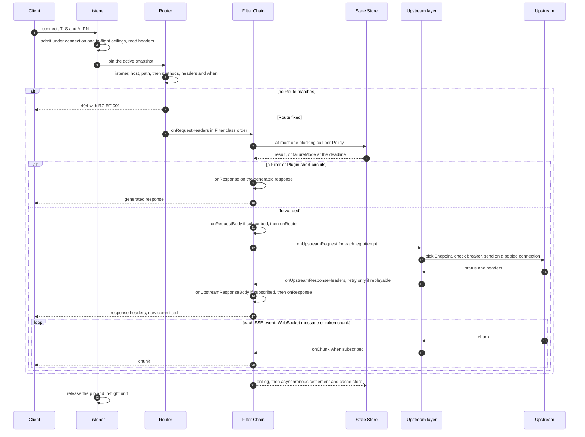
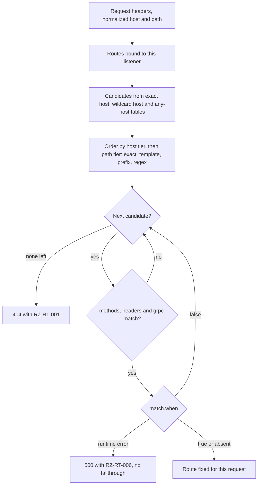
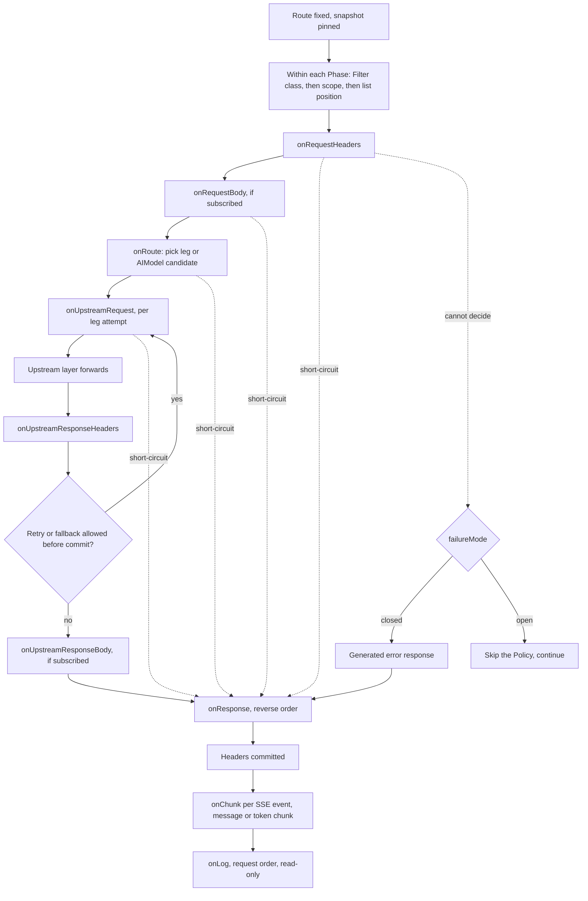
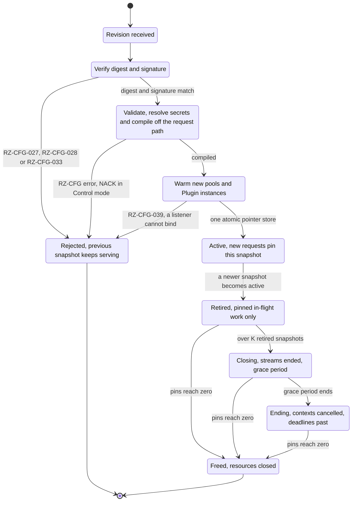

# Data Plane

## Summary

This document specifies Ruralz Gateway (`ruralzd`), the stateless data plane: concurrency bounds, listeners, Route matching, Filter Chain execution through the fixed Phases, Upstream composition and balancing, and configuration snapshot swaps during Hot Reload that drop no in-flight request. It fixes routing precedence, the `transform.request` and `transform.response` `config` schema, the admin API on port 9901, the error format, the `RZ-RT` registry and fail-open or fail-closed behavior per Filter class. Ruralz Gateway is Planned (M1).

## Scope and non-goals

In scope: one Node, from socket accept to the last `onLog` call, plus configuration activation on it. "Pack N" cites the [foundation pack](../_meta/foundation-pack.md); boundaries come from the [System overview](01-system-overview.md), and kinds and fields from the [Configuration model](02-configuration-model.md), which wins on conflict.

Non-goals, with owners: Policy `config` semantics and retry tuning ([Traffic management and resilience](09-traffic-management-and-resilience.md) and feature documents); Plugin ABI v1 ([WASM plugin system](05-wasm-plugin-system.md)); protocol Phase mappings ([Multi-protocol](07-multi-protocol.md)); AI dialects and Token Budgets ([AI/LLM gateway](06-ai-llm-gateway.md)); the Control Stream ([Control plane and GitOps](04-control-plane-and-gitops.md)); upgrade procedures ([Zero-downtime upgrades and hot reload](../operations/02-zero-downtime-upgrades-and-hot-reload.md)); performance values ([Performance budgets and benchmarking](12-performance-budgets-and-benchmarking.md)).

## Process and concurrency model

A Node is one `ruralzd` process, identified by `node.id` (a ULID), built with `CGO_ENABLED=0` ([ADR-0001](../adr/0001-implementation-language-go.md)) on `net/http` ([ADR-0009](../adr/0009-http-stack-net-http-quic-go.md)). It runs in exactly one configuration mode chosen at boot: a watched Bundle directory, an OCI-pulled Revision or the Control Stream.

### Durable and shared state

Ruralz Gateway keeps no durable local state other than its enrollment identity, its Last-Known-Good configuration and disposable caches (pack 8.11). All shared or durable runtime state (Rate Limits, Quotas, Token Budgets, cache entries, sessions) lives in the State Store, so Nodes join and leave without coordinating.

| State | Location | Lost on restart? |
|---|---|---|
| `node.id` in `identity/node-id`, written at first boot; Enrollment identity, Planned (M2) | `${RURALZ_DATA_DIR}/identity/` | No |
| Last-Known-Good and candidate | `${RURALZ_DATA_DIR}/lkg/` ([files](#last-known-good-files)) | No |
| Coordination: `lock` (`flock`), [`holder.json`](../reference/01-cli-and-api-surface.md#rollout-promotion-and-node-verbs) and `handover.sock` | `${RURALZ_DATA_DIR}/` | Rewritten by each lock holder |
| Plugin artifacts, Planned (M2) | `${RURALZ_DATA_DIR}/cache/oci/sha256/` | Disposable; refetched and verified |
| Snapshots, compiled Plugin code, token buckets, Endpoint health, breakers, pools | Memory | Yes |

Only the lock holder writes `holder.json` and `lkg/`, with directories 0700 and files 0600. `ruralzd` creates `${RURALZ_DATA_DIR}`, `identity/` and `lkg/` with mode 0700 when missing, and refuses to start when any is not a directory, not owned by the effective user, or world-writable (mode bit 0002, sticky or not), since another user could replace the lock, `holder.json` or Last-Known-Good; group write access is accepted as the operator's choice. This document owns the cache layout. Compiled Plugin code stays in memory, in one wazero `NewCompilationCache()`, never a cache directory, because no signature covers persisted native code; a restart recompiles verified artifacts ([ADR-0004](../adr/0004-wasm-runtime-wazero.md), [WASM plugin system](05-wasm-plugin-system.md#runtime)). Pack 8.11 still lists compiled modules as disposable caches (OQ-wasm-plugin-system-16).

### Goroutines

The goroutine `net/http` or quic-go assigns to each request, HTTP/2 stream or HTTP/3 stream pins the snapshot, matches the Route and runs the Filter Chain synchronously. Every goroutine Ruralz starts recovers panics as cannot decide, a failed step or an ended stream.

The request goroutine recovers a fault in request handling outside the Filter Chain itself: it logs the panic with its stack and the request's trace ID at error, releases the pin, the in-flight unit and the pooled request state, and answers 500 `RZ-RT-025` with a problem document when nothing was written yet, else aborts with `http.ErrAbortHandler`, which resets the HTTP/2 stream or closes the HTTP/1.1 connection. The 500 counts in the request, listener and Node response metrics and ends the server span; `onLog`, the access record and `/tap` do not run on the state a fault left. A request that finds no published snapshot, possible only around shutdown, gets 503 `RZ-RT-016`.

| Goroutine | Count | Bound |
|---|---|---|
| Request handler | One per request, HTTP/2 stream or HTTP/3 stream | [Bounded resources](#bounded-resources) |
| Listener accept loop and server shards | One dispatching accept loop per listening socket, and one `Serve` loop for each of its K = 8 server shards (target) | Listeners plus lingering sockets, K + 1 each |
| TLS handshake observer | One per TLS connection until its handshake ends | Client connections per Node |
| Composition step | One per parallel `aggregate` step | `limits.maxCompositionSteps`; one in-flight unit each |
| Stream pump | One per direction of a WebSocket or bidirectional gRPC stream | One in-flight unit each |
| Post-commit writer | Fixed pool | Queue capacity ([Scalability and distributed state](11-scalability-and-distributed-state.md)) |
| Background | Config loader, discovery, health, secret, JWKS, telemetry, admin | Fixed set |

No request waits on another Node or Ruralz Control, and the request path holds no global lock across I/O: the snapshot pointer, pins and counters are atomics; Endpoint sets and the credential index are copy-on-write; local token buckets sit in 256 shards (target), each a short mutex with CLOCK eviction ([ADR-0008](../adr/0008-rate-limiting-local-bucket-and-gcra.md)).

The `ruralzd` supervisor treats a part that stops after boot as fatal: a Node-wide Component whose `Run` returns, the admin server's `Serve` failing outside shutdown, the retirer, the Upstream manager or another background loop returning, or a panic in a background goroutine is logged at error, starts a Drain on the normal timeline and ends with exit 1, so the process manager restarts the Node.

### Plugin host

Plugins run under wazero ([ADR-0004](../adr/0004-wasm-runtime-wazero.md)) with Plugin ABI v1 ([ADR-0005](../adr/0005-plugin-abi-v1.md)). The config loader compiles each digest once, since wazero's cache does not lock during compilation ([source](https://github.com/wazero/wazero/blob/main/cache.go)). `api.Function.Call` is not goroutine-safe, so each call takes its own instance from a bounded, pre-instantiated pool ([source](https://github.com/wazero/wazero/blob/main/api/wasm.go)), or rejects with `RZ-PLG-<NNN>` after at most 1 ms (target). Each instance gets a memory page limit, since the default allows 4 GiB ([source](https://github.com/wazero/wazero/blob/main/config.go)); pool sizing belongs to [WASM plugin system](05-wasm-plugin-system.md).

### Anatomy of a request

*Figure 1: a request through Ruralz Gateway from listener to Upstream and back.*



### Bounded resources

Every queue, buffer, pool, connection and stream has a ceiling, so overload yields a fast `RZ-RT-<NNN>` or `RZ-RL-<NNN>` rejection. `http.Server` fields are set once at start (configurability: OQ-data-plane-1).

| Resource | Ceiling |
|---|---|
| `ReadHeaderTimeout` | 10 s (target) |
| `IdleTimeout` | 120 s (target) |
| Body reads and response writes | 10 s deadlines (target) from admission through `http.ResponseController` ([source](https://pkg.go.dev/net/http#ResponseController)), then the Route `timeout`; server `ReadTimeout` and `WriteTimeout` unset. Expiry resets the HTTP/2 stream or closes the HTTP/1.1 connection, so a blocked handler, even an `RZ-RT-005` one, frees its pin, unit and goroutine |
| Pre-routing responses | `RZ-RT-001`, `RZ-RT-002`, `RZ-RT-005`, `RZ-RT-006` and `RZ-RT-017` get a 5 s write deadline (target); past 2,000 such writes at once (target), the handler aborts with `http.ErrAbortHandler` without writing. `RZ-RT-005` writes no access record and no `/tap` event, so overload adds no log work ([Access logs](10-observability.md#access-logs)) |
| Client connections per Node | 20,000 connections (target); a counting `net.Listener` takes a slot after each `Accept` returns, so an idle listener holds none; at the ceiling it holds the connection it accepted until a slot frees and calls `Accept` again only then, so each listener waits with at most one connection beyond the ceiling |
| HTTP/2 streams per connection | `HTTP2Config.MaxConcurrentStreams` 250 (target) |
| HTTP/2 unread request data | `HTTP2Config.MaxReceiveBufferPerConnection` 256 KiB and `MaxReceiveBufferPerStream` 64 KiB (target) ([source](https://go.dev/doc/go1.24)) |
| HTTP/2 frame read buffer | `HTTP2Config.MaxReadFrameSize` 16 KiB (target), the protocol minimum; flow control does not cover HEADERS frames ([source](https://raw.githubusercontent.com/golang/go/master/src/net/http/http.go)) |
| Per-connection memory | About 592 KiB before a handler runs (hypothesis): header ceiling, HTTP/2 receive buffer, frame buffer, 16 KiB of serve and frame-reader stacks, 48 KiB of TLS and `bufio` buffers |
| HTTP/3 connections | Each QUIC connection takes 16 of the 20,000 connection slots (target), so at most 1,250 are open; at the ceiling a new QUIC connection is refused before any stream, and its client stays on TCP. Idle QUIC connections close after `IdleTimeout` |
| HTTP/3 streams per connection | 32 incoming bidirectional streams (target); incoming unidirectional streams only for the control and QPACK streams |
| HTTP/3 unread request data | 1 MiB connection receive window (target); QUIC flow control counts every stream byte, HEADERS frames included (RFC 9000) |
| HTTP/3 header reads | quic-go reads a stream's headers before the handler runs ([ADR-0009](../adr/0009-http-stack-net-http-quic-go.md)), so each stream gets a header-read deadline of `ReadHeaderTimeout` from stream open, and expiry resets the stream. Body and write deadlines follow the row above, pending quic-go support (OQ-data-plane-14) |
| HTTP/3 per-connection memory | About 9.25 MiB before a handler runs (hypothesis): 32 streams at the 256 KiB header ceiling, the 1 MiB receive window, and 256 KiB of QUIC, TLS and packet buffers; this equals 16 × 592 KiB |
| Per in-flight unit | Its header block with the request target, at most `limits.maxRequestHeaderBytes`, plus 64 KiB of copy buffers (hypothesis) |
| In-flight units per Node | 20,000 (target): one per request, parallel step and stream pump, taken by an atomic add; when full, 503 `RZ-RT-005` at once, never queued |
| Header block | `Server.MaxHeaderBytes` 256 KiB (target), counting the request target: `net/http` counts the HTTP/1.1 request line, and in HTTP/2 every field of the header list, pseudo-header fields included |
| Upstream response header block | `Transport.MaxResponseHeaderBytes` 256 KiB, the same ceiling (target); a larger block fails the attempt as a protocol error (error kind `reset`) |
| Bodies and buffered bytes | `limits.maxRequestBodyBytes`, `limits.maxResponseBodyBytes`, step `maxBodyBytes`; `limits.maxBufferedBytes` reserved as bytes arrive |
| One streamed chunk | 1 MiB (target), reserved from the stream share while held |
| Plugin memory | Plugin `limits.memoryBytes`, Gateway `limits.maxPluginMemoryBytes` |
| Upstream connections and queue | `circuitBreaker.maxConnections`, `maxPendingRequests` |
| Post-commit writes, `/tap` buffers | Fixed capacity, dropped with a counter |
| Retired snapshots | K = 2 (target), plus at most one closing or ending |
| File descriptors | Go raises the soft `RLIMIT_NOFILE` to the hard limit at start ([source](https://go.dev/doc/go1.19)); at start and at each activation `ruralzd` logs a warning when it is below the client and admin connection ceilings, 20,256 (target), plus the active Revision's summed `circuitBreaker.maxConnections` and a 1,024 reserve (target). The T5 unit sets `LimitNOFILE=65536` ([T5](../operations/01-deployment-topologies.md#t5-and-t6-vms-with-systemd-and-edge-sites)) |

Worst-case Node memory sums connections at 592 KiB (about 11.3 GiB), in-flight units at 320 KiB under the header maximum of OQ-data-plane-1 (about 6.1 GiB), 2,000 pre-routing rejections at 256 KiB (about 0.5 GiB), `maxBufferedBytes`, `maxPluginMemoryBytes` and (K + 2) snapshots: about 19 GiB plus snapshots, fitting a 32 GiB Node (hypothesis) per [Capacity planning](../operations/03-capacity-planning.md), else the connection ceiling is lowered first. A QUIC connection costs at most its 16 slots of 592 KiB (hypothesis), so `http3: true` leaves this sum unchanged.

## Listeners and protocols

Listeners come from `Gateway.spec.listeners` with `protocol` `http` or `https`, a required `port`, `hostnames` and `tls`; Routes bind through `Route.spec.listeners` (default all). A listener binds every interface; with `RURALZ_BIND_LOOPBACK=true` ([pack section 2](../_meta/foundation-pack.md#2-canonical-names)) it binds 127.0.0.1 and, where the host has IPv6, ::1, one socket per address, and the admin listener does the same. Sockets use `SO_REUSEPORT` for Zero-Downtime Upgrades ([ADR-0015](../adr/0015-zero-downtime-upgrades-so-reuseport.md)). A lock holder that is not a handover successor first binds each listener port and the admin port it does not serve yet without `SO_REUSEPORT`, closing that probe at once without listening, so a port another process listens on, such as a second `ruralzd` with another `RURALZ_DATA_DIR`, refuses the boot (exit 1) or the Revision (RZ-CFG-039) instead of joining that process's reuseport group; the probe sets `SO_REUSEADDR`, as every listening socket does, so connections an earlier process left in `TIME_WAIT` never fail it. A Hot Reload never mutates a running server: an added or changed listener binds a new socket before the swap, without listening on Linux, and listens on a new server right after it; a bind failure rejects the Revision with the transient RZ-CFG-039. A changed client-certificate request mode starts a new server on the same socket. Validation refuses two listeners on one `port`, or one on the admin port, with RZ-CFG-005 ([Gateway](02-configuration-model.md#gateway)); activation refuses either with RZ-CFG-039 as a backstop. An accept error other than a closed socket, such as running out of file descriptors, is retried after 5 ms, doubling up to 1 s (target).

| Protocol | Detection | Implementation | Planned |
|---|---|---|---|
| HTTP/1.1 | Default | `net/http` `Server` | Planned (M1) |
| HTTP/2 over TLS | ALPN `h2` on `https` | `net/http`, `HTTP2Config` | Planned (M1) |
| h2c | Prior knowledge on `http`; no `Upgrade: h2c` | `net/http` `UnencryptedHTTP2` | Planned (M1) |
| HTTP/3 | UDP on the `https` port when `http3: true` | quic-go `http3`, off in FIPS builds | Planned (M3) |
| gRPC, gRPC-Web, Connect | Content-Type | `connectrpc.com/connect` generic handlers | Planned (M3) |
| WebSocket | `Upgrade: websocket` on a matched Route | `coder/websocket` | Planned (M3) |
| SSE | `text/event-stream` response | `http.ResponseController` flushing | Planned (M3) |
| GraphQL | `match.graphql` | `graphql-go-tools` engine | Planned (M3) |
| Kafka, NATS, MQTT ingress | `match.topic` (OQ-configuration-model-11) | `franz-go`, `nats.go`, `paho.golang` | Planned (M4) |

h2c is prior knowledge only ([source](https://go.dev/doc/go1.24)); the `x/net/http2` `Server` is deprecated ([source](https://github.com/golang/go/issues/78064)), so HTTP/2 is configured only through `HTTP2Config`.

A header block above the 256 KiB process ceiling (target) is refused by `net/http` before any handler, with a plain 431. Below it, the handler returns 431 `RZ-RT-002` as a problem document for a block over the pinned snapshot's `limits.maxRequestHeaderBytes` or more than 256 field lines (target); a larger Revision value is capped, as a degraded state. Both limits count the request target with the fields: the HTTP/1.1 request line, or the HTTP/2 and HTTP/3 pseudo-header fields, so one number bounds the method, host, path and query with the headers, as every CEL expression reads them ([Limits](02-configuration-model.md#limits)). The handler counts one size for every protocol, the field-list size of RFC 9113 ([source](https://www.rfc-editor.org/rfc/rfc9113.html#section-6.5.2)): each field line's name and value plus 32 bytes, with `:method`, `:scheme`, `:authority` and `:path` counted as four field lines, also for HTTP/1.1, so the 32 bytes also cover the comma and space that join repeated fields in CEL's `request.headers`. The 256-line cap counts the field lines `net/http` parsed, pseudo-header fields excluded and a joined `Cookie` as one.

Conflicting framing (both `Transfer-Encoding` and `Content-Length`, or a coding other than `chunked`) and hop-by-hop fields are never forwarded; conflicting framing that reaches the handler gets 400 `RZ-RT-017`. `CONNECT` and the asterisk form `OPTIONS *` match no Route, so they get 404 `RZ-RT-001`; client listeners set `http.Server.DisableGeneralOptionsHandler`, so `net/http` never answers `OPTIONS *` itself ([source](https://pkg.go.dev/net/http#Server)). Multi-protocol's [HTTP intermediary behavior](07-multi-protocol.md#http-intermediary-behavior) gives the other HTTP/1.1 and HTTP/2 cases: expectations, upgrades, 1xx, trailers, `Via`, request-target forms, `Host` and `HEAD`.

HTTP/3 uses quic-go, pre-1.0 with `http3` API breaks in v0.63.0, behind an internal interface ([source](https://github.com/quic-go/quic-go/releases/tag/v0.63.0)), with 0-RTT off ([ADR-0009](../adr/0009-http-stack-net-http-quic-go.md)). The quic-go settings enforcing the HTTP/3 rows of [Bounded resources](#bounded-resources), and its deadline support, are OQ-data-plane-14. Binary upgrades lose in-flight QUIC connections (OQ-system-overview-18), and so does a Hot Reload that replaces an `https` listener with `http3: true` (OQ-data-plane-16).

With `http3: true`, the `https` listener adds `Alt-Svc: h3=":<port>"; ma=3600` (target) to every HTTP/1.1 and HTTP/2 response after `onResponse`. HTTPS DNS records are left to operators, and a balancer mapping UDP to another port needs another advertised port (OQ-data-plane-15). A FIPS build never advertises HTTP/3. When a Revision turns `http3` off, the header stops at once; a client with a cached entry falls back to TCP after a failed QUIC attempt until `ma` expires.

Each `https` listener picks a certificate by SNI from `tls.certificates`; `GetCertificate` reads `secretRef` values from the secret store and other TLS settings from the current snapshot, so reloads and rotations reach new handshakes only.
The Route `timeout` bounds a whole SSE stream or WebSocket, so streaming Routes need a large value. Time-to-first-byte and idle limits are OQ-data-plane-10.

## Router

The Router maps a request to exactly one Route from pre-body data only: listener, host, path, method, headers, gRPC service and method, and CEL `match.when` over `request` (without body), `source` and `now` (pack 4). GraphQL operation matching needs the body (OQ-system-overview-5, Planned (M3)).

### Compiled structure

The config loader compiles one Router per listener into the snapshot:

1. **Host tables.** An exact-host hash map (lowercased, port stripped), a wildcard table of `*.` suffixes by length, and an any-host list. A `match.hosts` entry holds at most one leading `*.` label and no other `*`, else RZ-CFG-005; `*.` matches one or more leading labels, never the bare suffix. Listener `hostnames` take the same forms and bound every Route of the listener: a host outside them reaches no Route.
2. **Path index per host entry.** A segment trie for `exact`, `template` and `prefix` (on segment boundaries), then `regex` with the standard `regexp` package, then Routes without `path`.
3. **Candidate filters.** `methods`, `headers`, `grpc` (exact `/service/method`, or a `/service/` prefix without `method`) and the compiled `when` ([ADR-0019](../adr/0019-expressions-authorization-comprehension-stop.md)). A CORS preflight, an `OPTIONS` request with `Origin` and `Access-Control-Request-Method` fields, meets `methods` when they list the method it asks for (the first field line) or `OPTIONS`, so it reaches the Route of the actual request, whose `cors` Policy answers it ([CORS](#cors)), and a Route that serves `OPTIONS` itself still receives it; `when` still sees `request.method` `OPTIONS`.

Paths are normalized first, from the escaped target, for the Router, CEL, `authz.*`, logs, `/tap` and the forwarded request. `%00`, a raw or encoded backslash, another control byte or an invalid escape is 400 `RZ-RT-017`; otherwise unreserved escapes are decoded and dot segments removed (RFC 3986), clamping at `/`, and `%2F` never splits a segment. Hosts are case-insensitive, paths case-sensitive; repeated and trailing slashes are kept, significant for `exact` and `template`.

### Precedence

Two Routes with identical match criteria on a common listener are rejected at validation (RZ-CFG-023); each listener's Router compiles only its own Routes. Other overlaps resolve by this total order, highest first:

| Rank | Criterion | Order within the criterion |
|---|---|---|
| 1 | Host tier | Exact host, then wildcard host with the longer suffix first, then no `hosts` |
| 2 | Path tier | `exact`, then `template`, then `prefix`, then `regex`, then no `path` |
| 3 | Within `template` | Segment by segment from the left; a literal beats a `{param}` |
| 4 | Within `prefix` | Longer prefix first |
| 5 | Constraint count | More of `methods`, `headers`, `grpc`, `when` set first |
| 6 | Tie-break | `metadata.name` in byte order |

Regex specificity is undecidable, so `regex` paths are ordered only by ranks 5 and 6. The Router picks the first candidate whose remaining criteria match, falling through when `methods`, `headers` or `grpc` fails or `when` is false; none left gives 404 `RZ-RT-001`. `when` sees the candidate's template captures as `request.pathParams`. A `match.when` runtime error returns 500 `RZ-RT-006` without fallthrough, so an erroring guard cannot divert traffic to a less protected Route. The span is `ruralz.route.match`.

*Figure 2: Route selection from a request's headers.*



### Worked example: routing precedence

Six Routes share the `https` listener:

| Route | `hosts` | `path` | `methods` |
|---|---|---|---|
| `orders-export` | `api.shop.example` | `exact: /v1/orders/export` | GET |
| `orders-get` | `api.shop.example` | `template: /v1/orders/{orderId}` | GET |
| `orders-summary` | `api.shop.example` | `template: /v1/orders/{orderId}/summary` | GET |
| `orders-any` | `api.shop.example` | `prefix: /v1/orders` | Any |
| `tenant-wild` | `*.shop.example` | `prefix: /v1` | Any |
| `fallback` | Any host | `prefix: /` | Any |

| Request | Winner | Why |
|---|---|---|
| `GET api.shop.example/v1/orders/export` | `orders-export` | Exact beats template (`orderId=export`) |
| `POST api.shop.example/v1/orders/export` | `orders-any` | Both GET Routes fail `methods` |
| `GET api.shop.example/v1/orders/42` | `orders-get` | Template beats prefix |
| `GET api.shop.example/v1/orders/42/summary` | `orders-summary` | Only the four-segment template matches |
| `GET eu.shop.example/v1/orders/42` | `tenant-wild` | The wildcard host matches |
| `GET shop.example/v1/orders` | `fallback` | `*.shop.example` never matches the bare suffix |
| `OPTIONS api.shop.example/v1/orders/42/summary` with `Origin` and `Access-Control-Request-Method: GET` | `orders-summary` | A CORS preflight meets `methods` that list the method it asks for or `OPTIONS` |

## Filter Chain execution

A Filter is a built-in Go implementation and a Plugin a sandboxed WASM one; a Policy configures either. Each Route's effective Filter Chain is resolved at validation by pack 8.12 ([Attachment and precedence](02-configuration-model.md#attachment-and-precedence)) into one ordered array per Phase, plus one per Upstream leg. A Phase with no subscriber costs one nil check.

### Phases

The fixed Phases run in this order: `onRequestHeaders → onRequestBody → onRoute → onUpstreamRequest → onUpstreamResponseHeaders → onUpstreamResponseBody → onResponse → onLog`, plus the streaming hook `onChunk`.

| Phase | Runs | May short-circuit? |
|---|---|---|
| `onRequestHeaders` | Once, after the Route is fixed | Yes |
| `onRequestBody` | Once, if subscribed, within the gate caps | Yes |
| `onRoute` | Once; picks an Upstream leg or `AIModel` candidate | Yes |
| `onUpstreamRequest` | Per leg attempt, including retries and steps | Yes; ends that leg |
| `onUpstreamResponseHeaders` | Per leg attempt | No; may request a retry or Provider Fallback before commit |
| `onUpstreamResponseBody` | Per leg, if subscribed | No |
| `onResponse` | Once, before headers reach the client | No; last status change |
| `onLog` | Always, after the response; read-only | No; failures reach telemetry only |
| `onChunk` | Per chunk, if subscribed | No; may end the stream |

`onUpstreamResponseHeaders` runs for every attempt that was sent, also one that got no response (a connect, TLS, reset or timeout error), so a Policy can request a retry or Provider Fallback after a failed attempt too: there, CEL `response` is null and `error.kind` names the failure, the Policy's message is an empty response (status 0, header edits reach nothing), and a closed failure ends the leg with 502 `RZ-RT-012`. An attempt the client cancelled runs it not. After `onResponse` the request handler writes the `RateLimit-Policy` and `RateLimit` fields the `ratelimit` and `quota` Policies recorded, on every response, generated ones included ([RateLimit response headers](09-traffic-management-and-resilience.md#ratelimit-response-headers)).

### Ordering

Within a Phase, Policies run by Filter class (cors, auth, authz, admission, validation, cache, upstream-auth, transform, custom), then scope (Gateway, Route, Upstream), then position in `spec.policies` (pack 8.12). Response Phases run in reverse; `onLog` keeps request order. A Policy's `when` is evaluated once, before its first Phase.

### Short-circuit

Any Filter or Plugin in a request Phase (`onRequestHeaders` through `onUpstreamRequest`) MAY produce a response; execution skips to `onResponse` and `onLog`. `onResponse` runs the full response chain on generated responses, so CORS and security headers reach a 401, except `transform.response`, `cache` and `ai.semantic-cache`; `cache` still runs on a response the Node generates for a failed Upstream leg, to serve stale under `stale-if-error`. After a request-path revalidation, the `cache` Policy may serve a stored response in place of the leg's response or failure before any `onResponse` Policy runs: the stored response a selecting 304 refreshed, or a `stale-if-error` answer to a 500, 502, 503 or 504. A response the Response Cache serves, a hit, a stale or coalesced reuse, such a revalidated or `stale-if-error` answer, a 206 range answer or a client-validation 304, is no generated error, unlike its 416 `RZ-RT-026` problem document for an unsatisfiable range: the cache stores the leg's response before any client `onResponse` Policy changed it, so such a response runs the whole response chain, `transform.response` included, and every client response Policy acts on it as on an Upstream response ([Response caching](09-traffic-management-and-resilience.md#response-caching)). In `onUpstreamRequest` a short-circuit ends only that leg, refining pack 4 for multi-leg Routes: a composition step records the generated response as its result, and a non-2xx one fails a merged or non-final step with its own status and code ([Failures and partial responses](#failures-and-partial-responses)).

*Figure 3: Filter Chain execution with ordering, short-circuit and failureMode.*



### CORS

A `cors` Policy answers the CORS protocol of the Fetch standard in its Filter class, first in a Phase, so a preflight never reaches authentication. A request without `Origin` is no CORS request. A CORS preflight, an `OPTIONS` request with `Origin` and `Access-Control-Request-Method`, is answered in `onRequestHeaders`: 204 with `Access-Control-Allow-Origin`, `Access-Control-Allow-Methods` (`allowMethods`), `Access-Control-Allow-Headers` (`allowHeaders`), `Access-Control-Allow-Credentials` (when `allowCredentials`), `Access-Control-Max-Age` (`maxAge` in whole seconds) and `Vary: Origin, Access-Control-Request-Method, Access-Control-Request-Headers` when the origin is allowed, the requested method is in `allowMethods` and every field name in `Access-Control-Request-Headers` is in `allowHeaders` (ignoring case), else 403 `RZ-RT-008` without CORS fields. A browser lists only CORS-unsafe request headers there, so without `allowHeaders` only requests whose headers are all CORS-safelisted pass. With `*` in `allowHeaders` any field names pass and `Access-Control-Allow-Headers` is `*`, followed by `Authorization` when the preflight asks for it, because a browser never lets `*` cover `Authorization`. Any other request with `Origin` passes on whatever its origin, and the browser withholds the response unless it allows the origin: when the origin is allowed and the method is in `allowMethods`, `onResponse` sets `Access-Control-Allow-Origin`, replacing an Upstream's value, `Access-Control-Allow-Credentials` when `allowCredentials`, and `Access-Control-Expose-Headers` (`exposeHeaders`, or `*` when it holds `*`), generated responses included.

An origin is allowed when `allowOrigins` lists it byte for byte, `null` included, or holds `*`; `Access-Control-Allow-Origin` is `*` when `allowOrigins` holds `*`, else the request's origin. The wildcards `*` and the `null` origin are for requests without credentials: a browser does not honor them for credentialed requests, so validation refuses them with `allowCredentials: true`. Methods match byte for byte. `onResponse` adds `Origin` to `Vary` on every response of the Route, CORS request or not, unless `Vary` lists `Origin` or `*`, so caches keep the variants apart. The fields and their validation are registered in the [Configuration model](02-configuration-model.md#registered-from-feature-documents).

### Streaming

Bodies stream unless the gate and tee rules of [Body buffering and limits](02-configuration-model.md#body-buffering-and-limits) require reading them whole. A declared `Content-Length` above `limits.maxRequestBodyBytes` gets 413 `RZ-RT-003` at once; otherwise `limits.maxBufferedBytes` is reserved in 32 KiB increments as bytes arrive (target), and for decoded values when built. A failed reservation fails a gate with 503 `RZ-RT-004`, or a step under its `optional` rule. Gates cannot take the stream share, 25% of `limits.maxBufferedBytes` (target), so gate traffic never ends a stream.

A streamed request body is cut where it passes `limits.maxRequestBodyBytes`, also while an attempt sends it: that attempt ends without retry and counts as no Upstream failure, in neither the breaker nor passive ejection, and the client gets 413 `RZ-RT-003` before commit, an HTTP/1.1 connection closing after it since the body was not read to its end, or a reset stream after commit.

The handler copies an unsubscribed response body as it arrives and flushes after every Upstream read when the response has no `Content-Length` or is `text/event-stream`; any other response it leaves to the buffering of `net/http` ([source](https://pkg.go.dev/net/http#ResponseController.Flush)).

`onChunk` is the streaming hook for three sources, each Planned (M3):

- **SSE.** One chunk per event, Upstream to client, flushed through `http.ResponseController`.
- **WebSocket.** One chunk per reassembled message: client messages run the chain in request order, Upstream messages in response order.
- **LLM token streams.** One chunk per provider event after dialect normalization ([AI/LLM gateway](06-ai-llm-gateway.md)). The Token Budget guard counts output tokens locally and ends the stream past the output cap ([ADR-0014](../adr/0014-ai-api-surface.md), pack 8.9).

A subscribed stream reserves 32 KiB (target) from the stream share before commit, else fails with 503 `RZ-RT-004`; the default 128 MiB share admits about 4,000 (hypothesis). Each chunk is processed on its stream's goroutine and forwarded before the next is read, so a slow reader applies flow control. A larger chunk grows the reservation toward the 1 MiB cap (target), from the stream share, then free general budget; if neither covers it, the stream pauses reading until bytes free up, within the Route `timeout`. A chunk over the cap ends the stream under any `failureMode` (SSE `error` event, WebSocket close 1009, HTTP/2 `RST_STREAM`) with `RZ-RT-013` (cap field: OQ-data-plane-5). Unsubscribed streams copy through one 32 KiB buffer per direction (target); `onChunk` never calls the State Store (pack 8.7).

### Error handling

A Filter returns continue, respond, or cannot decide (a failed or timed-out State Store call or remote dependency, a Plugin trap or limit, or a runtime error in a Policy `config` CEL field), and `failureMode` then applies ([Failure semantics](#failure-semantics)). Other CEL fields follow the Configuration model's [CEL table](02-configuration-model.md#allowed-places). Each failure increments `ruralz_filter_failures_total` ([Observability](10-observability.md)) and marks the span `ruralz.filter.<name>`.

### Headers Policy

A `headers` Policy, Planned (M1), removes, sets and adds header fields with the `config` and validation the [Configuration model](02-configuration-model.md#policy) fixes. Each side runs only when it holds an entry, in the Phase of its scope:

| Side | Gateway and Route scope | Upstream scope |
|---|---|---|
| `config.request` | `onRequestHeaders`, on the client request | `onUpstreamRequest`, on each attempt's outgoing request |
| `config.response` | `onResponse`, on the client response, generated responses included | `onUpstreamResponseHeaders`, on each attempt's response; an attempt that got no response is left alone, since its edits reach nothing |

A side evaluates every `valueExpression` first, over the message as it reached the Policy, then applies `remove[]`, `set[]` and `add[]`, so no entry reads another's output and a failure edits nothing. Names compare ignoring case and are written in canonical form; lines a header map holds for one field under keys that differ only in case are first merged under the canonical key, its own lines first, so `remove[]` leaves no line behind and `add[]` appends after every line. A computed value is trimmed of spaces and tabs, and an empty result sets an empty field. A CEL runtime error, or a computed value with a control byte other than a tab or over 8 KiB (target), is cannot decide: under `closed`, 503 `RZ-RT-011` in a request Phase and 502 `RZ-RT-012` in a response Phase; under `open`, the Policy is skipped. The Policy never calls the State Store.

### Transform Policies

`transform.request` and `transform.response`, both Planned (M1), rewrite bodies, headers, the query string and the request path with CEL and regular expressions instead of a template language. This section authors their `config` schema (pack 3) for registration by the [Configuration model](02-configuration-model.md#policy), with a CEL row per expression field. A transform whose `config` needs the body is a gate ([Body buffering and limits](02-configuration-model.md#body-buffering-and-limits)): one with `body`, `arrayOps[]`, `replace[]`, a `set[]` or `remove[]` entry with target `body`, or a CEL field that reads `request.body` or `response.body`. Any other transform runs at its Phase while the body streams on.

| Field | Contents | `transform.request` | `transform.response` |
|---|---|---|---|
| `body` | CEL; a top-level string is written as its UTF-8 bytes, bytes as they are, any other value as JSON | Builds the forwarded request body | Builds the response body |
| `contentType` | An RFC 9110 media type, else RZ-CFG-005; default `application/json` | Sets `Content-Type` whenever `body` is set, so a string result such as a SOAP envelope names its own, as `text/xml` | Same |
| `set[]` | `target`, `name`, `valueExpression` (CEL) | `target` is `header`, `query`, `body` or `path`; copies body fields into headers or the query string, or rewrites the path | `target` is `header` or `body` |
| `remove[]` | `target`, `name` | Drops a header, query parameter or body path | Drops a header or body path |
| `arrayOps[]` | `op` (`move`, `append` or `delete`), `from`, `to` | Array operations on body paths | Same; the Flatmap row |
| `replace[]` | `path`, `pattern`, `replacement`, `literal` | Replaces matches in the string at `path`, or in the raw body when `path` is absent | Same |

**JSON writing.** `body` writes a result other than a top-level string or bytes in the transform body form of the CEL module: map keys in ascending byte order, int, uint and bool keys written as strings, the numbers of a map or list decoded from a body verbatim, int, uint and double as JSON numbers, so a number selected on its own, as CEL reads it, is written as its int or double, nested bytes as base64, timestamps as RFC 3339 and durations as proto3 JSON strings. NaN, an infinity, invalid UTF-8 in a string, a duplicate key or a value without a JSON form is cannot decide (`result_type`), and a string or bytes result under a JSON `contentType`, `application/json` or a `+json` type, must parse as one JSON value as a body is read (valid UTF-8, no duplicate member name, at most 64 levels deep), else cannot decide (`invalid_value`). Body operations edit a copy of the decoded body that keeps each object's member order and each number's text, a new member going to the end of its object, and write it compactly without HTML escaping; a body no operation changed keeps its bytes, and a body they write where there was none takes `Content-Type: application/json`.

**Paths.** A body `name`, `path`, `from` or `to` is a dot path into the JSON body, the syntax composition `target` uses too ([Merge rules](#merge-rules)). `.` separates segments, and `\.`, `\*` and `\\` write a literal dot, star or backslash; an empty segment, an unescaped `*` inside a longer segment, or another backslash escape, is RZ-CFG-005. A numeric segment, all digits, indexes an array and names a key on an object, so `items.007` is element 7 of an array. `*` matches every element of an array, in order, so `move` from `items.*.sku` to `skus` flattens each item's `sku` into one array: in `name`, `path` and `from` an operation acts on each match, over a missing or empty array `*` matches nothing, and in `to` it is RZ-CFG-005. `set[]` creates missing objects; `remove[]`, `replace[]`, `move` and `delete` on a missing path do nothing, and so does an `append` whose `from` matches nothing. A path through a scalar, `*` on a value that is not an array, a member name on an array or an index past an array's end in the path `set[]`, `move` or `append` writes, and a `replace[]` path at a value that is not a string are cannot decide (`path_error`).

**Operations.** A Policy applies `body`, then `arrayOps[]`, `set[]`, `remove[]` and `replace[]`, each list in order. Every CEL field reads the body as it reached the Policy, so no entry reads another's output, and a later Policy in the chain sees the rewritten body.

- `set[]` with target `body` writes its `valueExpression`'s `dyn` result as `body` writes a nested value; with target `header`, `query` or `path` the result is a string.
- `move` takes the value at `from`, or the array of a `*` path's matches, out of the body and writes it at `to`, replacing what `to` held. `append` adds the value or matches at `from` to the end of the array at `to`, creating the array when `to` is missing and keeping `from`; a `to` that holds something other than an array is cannot decide (`path_error`). `delete` removes the elements `from` names from their array, later elements moving up, and a member it names from its object. `move` and `append` need `from` and `to`, `delete` only `from`; anything else is RZ-CFG-005.
- `pattern` is RE2 syntax, compiled at validation by the standard `regexp` package, which has no backreferences and matches in time linear in the input; `replacement` refers to groups as `$1`; the `${1}` form needs the `$${1}` escape of [Environment substitution](02-configuration-model.md#environment-substitution). With `literal: true`, `pattern` and `replacement` are plain strings.

**Headers and query.** In both types, a `set[]` or `remove[]` entry with target `header` follows the [headers Policy](#headers-policy) rules the Configuration model fixes: a `name` that is not an RFC 9110 token of at most 256 bytes (target), or that the Node manages, is RZ-CFG-005, and so are `content-encoding` and the body digests (`Content-Digest`, `Repr-Digest`, `Digest`, `Content-MD5`) in a Policy that rewrites the body; names compare ignoring case, lines held under keys that differ only in case merge into the canonical key, `set[]` leaves one field line and `remove[]` none; a computed value is trimmed of spaces and tabs, an empty one sets an empty field, and one with a control byte other than a tab, or over 8 KiB (target), is cannot decide. A `transform.request` entry with target `query` takes the same name and value caps. Query names compare after decoding, as `request.query` reads them (percent escapes and `+` decoded): `remove[]` drops every occurrence of the name, and `set[]` replaces every occurrence with one parameter at the first one's place, else appends it. Names and values a Policy writes are percent-encoded per RFC 3986, every byte outside the unreserved set, a space as `%20`; untouched parameters keep their bytes.

**Path target.** A `transform.request` `set[]` entry with target `path`, at most one per Policy, takes no `name` and rewrites the forwarded path with its string result. The result starts with `/`, holds no `?` or `#`, is at most 8 KiB (target), and passes the hardening of the client path ([Router](#router)): a longer result, or one with a `.` or `..` segment, also spelled `%2E`, `%00`, a raw or encoded backslash, another control byte or an invalid escape, is cannot decide (`invalid_value`). The path is forwarded in the Router's normalized form, which is at most 8 KiB too. `remove[]` with target `path` is RZ-CFG-005. At Gateway or Route scope the rewrite reaches every plain `upstreams` leg and the `request.path` that later Policies' CEL and composition `pathExpression`s read, a step still sending its own path; at Upstream scope it rewrites only its attempt's path. The Router's match, `authz.*` decisions taken before it, the access log and `/tap` keep the client's path.

| Type and scope | Phase | CEL variables | Output cap |
|---|---|---|---|
| `transform.request` at Gateway or Route | `onRequestBody`, once | Base, with `request.body` | `limits.maxRequestBodyBytes` |
| `transform.request` at Upstream | `onUpstreamRequest`, per leg attempt, from the same buffered input each time | Base, with `request.body`; `upstream` | `limits.maxRequestBodyBytes` |
| `transform.response` at Gateway or Route | `onResponse`, after any composition merge | Base; `response`, with `body` | `limits.maxResponseBodyBytes` |
| `transform.response` at Upstream | `onUpstreamResponseBody`, per leg | Base; `response`, with `body`; `upstream` | Step `maxBodyBytes`, else `limits.maxResponseBodyBytes` |

*Base* is the Configuration model's set ([Variables](02-configuration-model.md#variables)). `request.body` and `response.body` are JSON as `dyn`, and null for a body that is empty, not valid JSON, or whose one `Content-Type` field line is not `application/json` or a `+json` type. On a body that is null but not empty only `replace[]` without `path`, header, query and path operations and a `body` that ignores it apply. In `onUpstreamRequest`, `request` describes the attempt's outgoing request as it reached the Policy: its headers, query, path and current body. Reading an XML response is OQ-data-plane-17.

**Absent and empty bodies.** On a response that cannot have content, to a HEAD or with status 1xx, 204 or 304, `body` and every body operation are skipped and header operations still apply, as they are on a 206 or a response with `Content-Range`, whose body is never rewritten. On any other empty body, `remove[]`, `replace[]` with `path`, `move` and `delete` do nothing, and `set[]` and `append` start from an empty object.

**Validators.** A response whose body a transform rewrote turns a strong `ETag` weak, prefixing `W/`, and loses `Accept-Ranges`, as its bytes no longer equal the Upstream's.

**Limits.** Each CEL field has the Configuration model's [cost bounds](02-configuration-model.md#limits), 10,000 units at validation (RZ-CFG-015) and 1,000,000 at runtime (target). A `pattern` over 1 KiB (target) or invalid is RZ-CFG-005, and a Policy holds at most 32 entries across its four lists (target). The header and query caps above bound the bytes such entries add to a message. The rewritten body is reserved from `limits.maxBufferedBytes` like a decoded value; the Node recomputes `Content-Length` and drops `Content-Encoding`, since limits count decoded bytes, and the body digests (`Content-Digest`, `Repr-Digest`, `Digest`, `Content-MD5`). An Upstream-scope rewrite changes only its attempt's body. Transform Policies never call the State Store. [Performance budgets](12-performance-budgets-and-benchmarking.md#per-stage-latency-budget) measure every transform Phase on the `orders-shape` example below.

**Failures.** A CEL runtime error, a JSON operation on a body that is null but not empty, a path error, an invalid result or an output over its cap is cannot decide: under `closed`, 503 `RZ-RT-011` in a request Phase or 502 `RZ-RT-012` in a response Phase; under `open`, the Policy is skipped and the message passes unchanged. A spent buffer budget stays 503 `RZ-RT-004`.

The schema serves the [Feature catalog](../features/01-feature-catalog.md) rows for body extraction, CEL body templating, response queries, regular expression replacements, flatmap array operations and URL rewrite on plain `upstreams`, plus prompt templates on an `ai` Upstream, Planned (M3), and SOAP request envelopes, Planned (M5).

```yaml
apiVersion: ruralz/v1alpha1
kind: Policy
metadata:
  name: orders-shape
spec:
  type: transform.response
  config:
    arrayOps:
      - op: move
        from: items.*.sku
        to: skus
    set:
      - target: header
        name: x-order-total
        valueExpression: 'string(response.body.total)'
    remove:
      - target: body
        name: internal
    replace:
      - path: customer.email
        pattern: '^[^@]+'
        replacement: '***'
```

## Composition engine

A Route with `composition` instead of `upstreams` calls several Upstreams for one request. One step executor runs every mode; each step is an upstream leg with its own Upstream-scoped Policies, retries and breaker, under the Route `timeout`. A Route has at most `limits.maxCompositionSteps` steps (proposed default 16, target); the Node takes one in-flight unit per parallel step before the first.

| Mode | Execution | Response |
|---|---|---|
| `aggregate` (aggregation) | All steps in parallel, one goroutine each | Bodies merged into one JSON object |
| `sequential` | Steps in list order; later steps read earlier results through the CEL variable `steps`; a step whose `when` is false is skipped | The last executed step's response, streamed unless that step sets `target`, `select`, `rename` or `group`; then every executed step that sets one merges, in list order |
| `conditional` | The first step whose `when` is true runs; none true returns 404 with `RZ-RT-010` | That step's response, streamed unless transformed |

Each step sends one request to its Upstream. The method is `method`, else the incoming method. The target is `path` or the `pathExpression` result: the first `?` starts the raw query, sent as is, and without one the client's raw query is forwarded. The path must start with `/` and pass the hardening of the client path ([Router](#router)): a `.` or `..` segment, also spelled `%2E`, `%00`, a raw or encoded backslash, another control byte or an invalid escape fails the step with `RZ-RT-015`, as does a raw control byte in the query, which no request line can carry, and validation refuses a literal `path` that breaks these rules with RZ-CFG-005. As `request.pathParams` holds decoded captures, a `pathExpression` escapes what it splices with `url.pathEscape` or `url.queryEscape`, or reads `request.rawPathParams`, the captures as received ([Variables](02-configuration-model.md#variables)). A step whose method is the incoming one sends the client body and any other sends none; a Route on which two or more steps may send the body gates it, so each step reads it from its first byte ([Body buffering and limits](02-configuration-model.md#body-buffering-and-limits)).

### Merge rules

Merging applies to `aggregate` steps and to any step that sets `target`, `select`, `rename` or `group`. Such a body is decoded under the [Transform Policies](#transform-policies) rule, so a body that is empty, not valid JSON or not a JSON type fails the step. `target`, a dot path as in Transform Policies, unwraps a nested value. With `collection: true` that value must be a JSON array, which needs `group` (RZ-CFG-005), and `select` and `rename` apply to each of its elements, which must be objects; without it the value must be an object. `select` keeps only the named fields and `rename` renames fields; the value then merges under `group` or, for an object without `group`, at the top level. When two steps write one key, the later in list order wins, and members are written in step list order, then in each body's order. A missing `target`, an array without `collection: true`, an object with it, or a collection element that is not an object fails the step with `RZ-RT-015`. Dot-path field removals and flatmap array operations belong to a Route-scoped `transform.response`, which runs on the merged body.

A merged response has status 200 and carries `Content-Type: application/json`, `Content-Length`, `ruralz-partial: true` when a step was left out, and the most restrictive caching of the steps it merges; no other step field reaches it, and the Response Cache stores it under these fields ([Response caching](09-traffic-management-and-resilience.md#response-caching)):

| Field | Merged value |
|---|---|
| `Cache-Control` | `no-store` when any merged step has `no-store` or lacks explicit freshness ([source](https://www.rfc-editor.org/rfc/rfc9111.html#section-4.2.1)). Otherwise `private` when any step has `private` or a `Set-Cookie` field, `public` only when every step has it and none is `private`, and `no-cache`, `must-revalidate` or `proxy-revalidate` when any step has it. `max-age` is the least, over the steps, of the freshness a step has left: its lifetime from `max-age`, else `Expires` minus `Date`, less its current age ([source](https://www.rfc-editor.org/rfc/rfc9111.html#section-4.2.3)); when any step sets `s-maxage`, `s-maxage` is the same least over shared lifetimes, `s-maxage` first. `stale-while-revalidate` and `stale-if-error` appear only when every step sets them, at their least value |
| `Vary` | The union of the steps' `Vary` names, compared ignoring case; `*` when any step has it |

The access log's `upstream`, `endpoint` and `attempts` describe the last step, in list order, that ran ([Access logs](10-observability.md#access-logs)).

### Failures and partial responses

A step fails on an Upstream error, a timeout, a CEL runtime error, a computed path or a body the rules above refuse, a body over its `maxBodyBytes`, or a non-2xx result of a merged or non-final step: an Upstream's fails it with 502 `RZ-UP-011`, a leg Filter's generated response with that response's status and code. The final step of `sequential` or `conditional`, when it merges nothing, returns its result, Upstream or generated, whatever its status.

`maxBodyBytes` caps every step body, the streamed final step's included: a step's leg reads its response within it, in `onUpstreamResponseBody` too, where a plain `upstreams` leg uses `limits.maxResponseBodyBytes`; a declared `Content-Length` over it fails the step before commit, and a streamed body that passes it after commit is cut and ends with `RZ-UP-009`.

A failed non-optional step cancels its siblings through their shared context and fails the request with its code at that code's registered status: an Upstream cause's `RZ-UP-<NNN>` (504 `RZ-UP-003`; 503 `RZ-UP-005`, `RZ-UP-006` and `RZ-UP-008`; 502 the others), 504 `RZ-RT-007` for a step started past the Route deadline, 502 `RZ-RT-015` for a CEL error, a refused path or body, an oversized body or a fault recovered in the step's goroutine, 503 `RZ-RT-004` when the buffer budget is spent, or a generated response's own status and code. The first step to fail in time decides, ties going to list order, and the siblings it cancels report nothing.

A failed `optional: true` step is left out, and the response carries `ruralz-partial: true`; an optional step whose `when` errs counts as false. An `aggregate` whose every step failed optionally answers 200 `{}` with `ruralz-partial: true`, and a `sequential` composition that ran no step answers 404 `RZ-RT-010`, as `conditional` does when no `when` is true. A final step that streams answers its own failure even when optional, since nothing is left to return.

### Workflow composition

The executor models every mode as a step graph, so a workflow (a dependency graph of parallel and sequential stages) needs only declared edges, which the Configuration model lacks (OQ-data-plane-3); meanwhile linear workflows use `sequential` with per-step `when`, Planned (M1).

## Upstream layer

The Upstream layer forwards with its own loop on `http.Transport`, not `httputil.ReverseProxy`, because retries, per-attempt Phases and `onChunk` need per-attempt control.

Endpoints come from `endpoints` or `discovery` (`dns` Planned (M1); `kubernetes` EndpointSlices Planned (M2), client: OQ-tech-stack-and-libraries-23), swapped copy-on-write beside the snapshot, never a new Revision; a failing source keeps the last set and reports a degraded state. `loadBalancing.algorithm` selects `round-robin` (weighted), `least-request` (two random choices), `random` or `ring-hash` over the CEL `hashKey`; `healthCheck.active` probes with jitter and `healthCheck.passive` ejects for `ejectionTime`. When every Endpoint is unhealthy, the Node balances across all and reports a degraded state (threshold: OQ-data-plane-7).

Three deadlines nest: the Route `timeout` bounds the request, the Upstream `timeout` one leg including retries, and `retries.perTryTimeout` one attempt. `retryOn` decides after each attempt under the replay rule: a leg is retried or falls back only if its request body is empty or buffered and no response byte is committed. An open breaker (`consecutiveFailures`, `openDuration`, `failureWhen`) or a full `maxPendingRequests` queue fails the attempt at once with an `RZ-UP-<NNN>` code; each attempt emits `ruralz.upstream.<name>`.

Connection pools are keyed by protocol, TLS settings (SNI, secret references and `tls.handshakeTimeout`), `connectTimeout`, `healthCheck.pingTimeout` and Endpoint; idle connections close after 90 s, and pools are carried across Hot Reloads when the key is unchanged; `HTTP2Config.StrictMaxConcurrentRequests` is false ([source](https://go.dev/doc/go1.26)), so an HTTP/2 Upstream's stream limit opens another connection, within `circuitBreaker.maxConnections` ([ADR-0009](../adr/0009-http-stack-net-http-quic-go.md)). `grpc`, `websocket`, `graphql` and `ai` Upstreams are Planned (M3); `kafka`, `nats` and `mqtt` Planned (M4).

The client response carries the Upstream's trailers after its body, without hop-by-hop and framing fields (`Transfer-Encoding`, `Content-Length`, `Trailer`): the fields the Upstream declared are announced in the response's `Trailer` field, which on HTTP/1.1 makes the body chunked, and undeclared ones the Upstream sent follow too; an HTTP/1.0 client, which cannot receive a trailer section, gets none, and a generated or cached response carries none. A 103 Early Hints response of a Route with `upstreams` is relayed to an HTTP/1.1 or later client before the final response, without hop-by-hop fields, while the attempt that received it is the leg's current one and no final response was committed ([source](https://www.rfc-editor.org/rfc/rfc8297.html)); a composition step's 103 is not relayed, and other 1xx responses stay on their hop.

Response Cache revalidation replays a saved request through `internal/gateway/replay`, the `filter.Replayer` of the [Response caching](09-traffic-management-and-resilience.md#response-caching) workers. A replay pins the published snapshot and takes one in-flight unit, holding both until the caller closes the response body. A Route or Upstream the snapshot no longer holds, a Route that no longer has the entry's kind (a composition Route for an entry without an Upstream, a Route with `upstreams` for one with an Upstream), a full in-flight ceiling, no published snapshot, or a snapshot the [ending protocol](#why-no-in-flight-request-is-dropped) has already ended is `filter.ErrNotAvailable`. On a Route with `upstreams` it runs one leg to the named Upstream, with that Upstream's upstream-leg Policies, breaker, bulkhead and retries; on a composition Route it runs the whole composition, every step under the [Composition engine](#composition-engine) rules. Its deadline is the call's start plus the Route `timeout`; the worker's own 5 s bound (target) still cancels it, and so does the ending protocol, like any pinned request.

A replay starts a new, unsampled root trace, whatever `traceparent` the saved request carries, and writes no access record and no Route request metrics, so only the Upstream metrics count it. Its CEL `request` is the saved request, `route` the named Route, `source` empty and `consumer` and `auth` null; forwarding fields are removed and none are added, and with no client hop it adds no `Via` entry. A response the Node generates instead of an Upstream, such as a leg Filter's 401 `RZ-AUTH-020`, a closed failure's 502 `RZ-RT-012` or a failed composition, returns as an error, as a replay without a response does, so the entry is kept.

## Configuration snapshots and hot reload

A snapshot is the compiled, immutable form of one Revision: Routers, Filter Chains, CEL programs, Plugin pool handles, Upstream settings, literal Consumer API key hashes and TLS settings. Beside it live resolved secrets, Endpoint sets and an index of `secretRef`-held key hashes, each replaced copy-on-write, so rotation never mutates a snapshot. New requests see only the active snapshot, published through one `atomic.Pointer`.

The snapshot compiler checks every resource of the Revision for unserved features and resolves every `secretRef` it holds, whether or not a Route reaches it, but builds Filters, Upstream runtimes (with their health checks, Endpoint sources and pools) and metric label sets only for what some Route reaches: a Policy that some Route's effective Filter Chain runs, once per attachment, and an Upstream that some Route names in `upstreams` or a composition step. An unattached Policy or an unreferenced Upstream therefore costs no probe, DNS lookup, JWKS fetch or label set.

### Activation

The config loader activates a Revision off the request path, in the order of [Compile before swap](01-system-overview.md#compile-before-swap):

1. Verify the full `sha256` digest (RZ-CFG-027; RZ-CFG-028 for a Plugin artifact) and the signature ([ADR-0017](../adr/0017-artifact-signing.md); RZ-CFG-033); a watched directory is unsigned (pack 8.14), and trust policy `off` is a degraded state.
2. Validate, refuse every feature this release does not serve (RZ-CFG-040), resolve every `secretRef` (RZ-CFG-026; RZ-CFG-042 for a State Store URL the Node refuses), build Routers and chains, compile CEL under the Revision's input caps ([Limits](02-configuration-model.md#limits)) and Plugins by digest.
3. Carry over unchanged pools, Plugin instances and token buckets by identity and hash; warm only new ones; bind added or changed listeners (RZ-CFG-039).
4. Publish the snapshot with one atomic pointer store: the Hot Reload.
5. ACK over the Control Stream in Control mode ([ADR-0007](../adr/0007-control-stream-protocol.md)); the ACK means active, not durable.
6. Write the Revision's canonical form to `${RURALZ_DATA_DIR}/lkg/` as a candidate ([files](#last-known-good-files)).
7. Retire the previous snapshot.

A failure before step 4 NACKs in Control mode, logs in file mode, and leaves the running snapshot untouched. In file mode each rejected load writes one warn record with the code of its first error, the number of diagnostics and up to 10 of them (target), the rest at debug, and counts once in `ruralz_config_activations_total` with that code, parse and schema failures included, its retries logging at info ([Validation gate](../operations/02-zero-downtime-upgrades-and-hot-reload.md#validation-gate)); `/debug/snapshots` keeps the last rejection as `lastRejected` ([Admin endpoints](#admin-endpoints)). Building Routers and chains for 10,000 Routes takes 2 s or less on one core, excluding cold Plugin compilation (target).

The step that fails reports every finding it makes, sorted as diagnostics: the serve check each unserved feature, secret resolution each failing use and the compile each Filter, Router and Upstream it refuses; it ends the activation, and its first error's code is the NACK's. Steps 1 to 3 run under one compile deadline of 60 s (target), the Control-mode ACK timeout: a Revision not ready to publish when it expires is rejected with the transient RZ-CFG-044. A panic, or an error without an RZ code, while the Node validates, compiles or activates a Revision is recovered at the activation boundary and logged with its stack, and it rejects the Revision with RZ-CFG-045, deterministic once reproduced, so a Node never crashes on a Revision, nor loops on it at restart in file mode. Either way the active Revision keeps serving, and the rejected compile closes every Filter, Upstream set and State Store handle it opened.

### Why no in-flight request is dropped

In-flight requests complete on the snapshot they started on; retirement ends only a request that outlives K + 1 further activations and then a full grace period. A **stream** is an upgraded WebSocket, a bidirectional gRPC call, an SSE response or a response with `onChunk` subscribed; anything else is a **request**, bounded by its Route `timeout`.

1. **One pin per request.** The request goroutine pins the snapshot before routing and keeps it until `onLog`. Pins are cache-line-padded counter stripes: a goroutine loads the pointer, increments its stripe and re-loads it, undoing and retrying if it changed. The retirer swaps the pointer, then waits for the stripes to sum to zero, so no request runs on a freed snapshot.
2. **Close only resources.** The garbage collector reclaims snapshot memory; at zero pins the retirer closes only pools and Plugin instances no newer snapshot shares.
3. **Listeners stay bound.** An added or changed listener binds before the swap and listens right after it; a removed one stops accepting after the swap while its connections finish; a socket replaced on the same port keeps accepting for ADR-0015's 3 s linger (target) after its port is steered to the new socket.
4. **Bounded retirement.** At most K = 2 retired snapshots are kept (target). When a third would be retired, the oldest becomes closing: its streams end at once (WebSocket close 1001, gRPC `UNAVAILABLE` trailers, an SSE end event with a retry hint). After a grace period of 30 s (target) it becomes ending, and anything still pinned ends with `RZ-RT-014`, counted by `ruralz_snapshot_retirement_ended_total` ([Observability](10-observability.md)).
5. **Ending protocol.** At pin time each request registers a callback on its pin stripe's retirement context, run on its own goroutine because a handler blocked in I/O cannot reach a panic. At grace end the retirer cancels those contexts; each callback:
   1. Under a per-request mutex the handler also takes, sets past read and write deadlines through `http.ResponseController` (before commit, a write deadline 5 s ahead (target) so the handler can write 503 `RZ-RT-014`), resetting the HTTP/2 stream or closing the HTTP/1.1 connection; a hijacked WebSocket is closed directly.
   2. Then cancels the request's root context, aborting Upstream and State Store I/O.
   3. Leaves guest calls to the Plugin `limits.timeout`, enforced by [WASM plugin system](05-wasm-plugin-system.md), since wazero stops a running guest only with `WithCloseOnContextDone`, reported 10 to 20x slower on loop-heavy guests ([source](https://github.com/wazero/wazero/issues/2466)).

   Zero pins are expected within 5 s plus the largest Plugin `limits.timeout` plus 1 s (target); a snapshot pinned longer stays ending as a degraded state, never freed early.
6. **Grace never cut short.** At most one snapshot is closing or ending. The loader keeps only the latest pending Revision and activates it once that snapshot is freed, so a burst of activations delays the last by at most the grace period, the ending bound and compile time (target).

GOAWAY is not used for retirement, since it is connection-wide and lets streams finish. Resources close, and a pending Revision compiles, only at zero pins, so no goroutine reaches a freed snapshot and peak configuration memory is (K + 2) snapshots (hypothesis).

*Figure 4: a configuration snapshot through a Hot Reload.*



### Sources, Last-Known-Good and Drain

In file mode the loader acts on an atomic directory replacement or after a settle debounce, or pulls an OCI Revision by digest (Planned (M2)), and promotes the candidate to Last-Known-Good on activation; in Control mode it promotes when the active digest equals the Cluster's promoted digest. Boot order follows pack 8.2 and System overview's [Last-Known-Good](01-system-overview.md#last-known-good), with a Control-mode boot wait of up to 5 s (target).

The file-mode watcher polls `RURALZ_CONFIG` every 1 s (target) with the standard library alone, since `golang.org/x/sys` stays confined ([Banned imports](../engineering/02-repository-layout-and-conventions.md#banned-imports)). A replaced root, a directory renamed into place or a new symbolic-link target, loads at once; any other change to the walked file names, sizes or modification times loads once the next poll sees no further change, which is the settle debounce; and a tree that changes while it loads is discarded and loaded again. SIGHUP loads the source at once, skipping the settle.

A load whose every failure is transient in the [validation gate](../operations/02-zero-downtime-upgrades-and-hot-reload.md#validation-gate), RZ-CFG-026, RZ-CFG-039, RZ-CFG-042 or RZ-CFG-044, is retried with full-jitter backoff from 1 s to 60 s (target) until it activates or the source changes. A Node booting on such a source activates Last-Known-Good meanwhile when it passes, under degraded reason `lkg_boot`, so a secret file that appears later or a port that frees reaches service without a restart.

A Drain, on SIGTERM (which `ruralz node drain` sends) or SIGINT, fails `/readyz`, releases the data-directory lock, stops accepting, shuts its server shards down one at a time across the 10 s jitter window (target), and ends remaining work at its deadline with `RZ-RT-016` through the ending protocol ([Drain timeline](../operations/02-zero-downtime-upgrades-and-hot-reload.md#drain-timeline-defaults)). Each client listener serves through K = 8 `http.Server` shards (target) that share the handler: a dispatching listener accepts every connection and hands it round-robin to the shards' channel-fed listeners, and stopping accepting closes the dispatching listener. A shard's `Shutdown`, at its jittered time, sends one HTTP/2 GOAWAY on each of its connections and closes its idle HTTP/1.1 ones, and each of its busy HTTP/1.1 connections gets `Connection: close` on its next response, so clients reconnect in K waves. A Zero-Downtime Upgrade Drains the old process once a new one on the same ports is ready ([ADR-0015](../adr/0015-zero-downtime-upgrades-so-reuseport.md)). Both are Planned (M1).

At Drain start the source stops: nothing more activates and a pending Revision is dropped, since the lock and Last-Known-Good pass to any successor. A second stop signal jumps to the deadline and later ones do nothing. SIGHUP never Drains; SIGPIPE is ignored, so a closed stdout only drops log lines, counted in `ruralz_telemetry_logs_dropped_total` with reason `export_error`; SIGQUIT keeps the Go runtime's stack dump and exit.

### Last-Known-Good files

| File in `lkg/` | Contents |
|---|---|
| `sha256-<64 hex>.json` | One Revision's exact `ruralz.canonical.v1` bytes, never resolved secrets |
| `candidate.json`, `lkg.json` | Pointers: `{"format":"ruralz.lkg.v1","digest":"sha256:<64 hex>","writtenAt":"<RFC 3339 UTC>","version":"<ruralzd version>"}` |

Writes use a temporary file, `fsync`, `rename` and a directory `fsync`, content before pointer, so a crash keeps the previous pointer valid; unnamed files are deleted. A failed write retries with backoff from 1 s to 60 s (target) under degraded reason `lkg_write_failed`; an unknown `format` counts as absent. At boot the Node re-hashes the content (a mismatch boots nothing, RZ-CFG-027), re-validates it from the schema stage (newer-release content is RZ-CFG-024) and serves it under degraded reason `lkg_boot` until a source Revision activates or a source load renders the Revision it serves.

## Admin endpoints

The admin listener binds `Gateway.spec.admin.port`, default 9901, on all interfaces, or on loopback under `RURALZ_BIND_LOOPBACK`, with its own `net/http` server of at most 256 connections (target). Before the first activation it binds the `admin.port` of the Bundle it is booting when that Bundle's Gateway parses, else the Last-Known-Good Revision's, else 9901, so a Node whose ports a test render or `ruralz dev run --ephemeral-ports` rewrote never binds 9901. It uses the `http.Server` ceilings of Bounded resources without `ReadTimeout` or `WriteTimeout`, and serves HTTP/1.1, plus HTTP/2 over TLS when `RURALZ_ADMIN_TLS_DIR` is set. [CLI and API surface](../reference/01-cli-and-api-surface.md) MUST match this table. Only `/healthz` and `/readyz` MAY be unauthenticated (pack 8.4); other paths need an [admin credential](08-security-and-identity.md#admin-ports), else 401 `RZ-AUTH-001` or `RZ-AUTH-002`.

| Path on 9901 | Method | Returns | Authentication | Used by | Planned |
|---|---|---|---|---|---|
| `/healthz` | GET | 200 `{"status":"ok"}` while the process responds | MAY be open | Liveness probes | Planned (M1) |
| `/readyz` | GET | 200 only with an active validated Revision, every `secretRef` resolved, listeners bound and no Drain, else 503; never fails for a lost Control Stream | MAY be open | Readiness probes | Planned (M1) |
| `/metrics` | GET | `ruralz_<component>_<name>_<unit>` metrics (exporter: [ADR-0018](../adr/0018-telemetry-opentelemetry-prometheus-exporter.md)) | Metrics token, operator token or client certificate | Scrapers | Planned (M1) |
| `/debug/*`: `/debug/pprof/` | GET | Go runtime profiles, including the goroutine leak profile, GA in Go 1.27 ([source](https://go.dev/doc/go1.27)); mutex and block profiling only during a `?seconds=` request, at a mutex profile fraction of 1 and a block profile rate of 1, recording every event | Operator token or client certificate | Profiling | Planned (M1) |
| `/debug/snapshots` | GET | Active, retired, closing and ending snapshots with digests and pin counts | Same | Hot Reload debugging | Planned (M1) |
| `/debug/upstreams` | GET | Endpoint sets, health, ejections and breaker states | Same | Incident response | Planned (M1) |
| `/config/dump` | GET | The active Revision in `ruralz.canonical.v1` form with its full digest and the Last-Known-Good digest; `secretRef` shown, secrets omitted; 503 `RZ-RT-024` before the first activation | Same | `ruralz node dump`, `ruralz bundle diff`, Drift detection | Planned (M1) |
| `/tap` | GET, streaming | Sampled request and response metadata, credentials redacted; a fifth subscriber gets 503 `RZ-RT-019` | Same | `ruralz dev tap` | Planned (M1) |

`/debug/*` names every path under `/debug/`; a new one MUST be added here. Paths compare exactly. Other paths are 404 `RZ-RT-020` whatever the method, and other methods on an endpoint, `HEAD` included, are 405 `RZ-RT-021` with `Allow: GET`, as problem documents. The `requestId` of an admin problem document is the trace ID of the request's valid `traceparent`, else a new trace ID drawn as for a data-plane request without one. Admin endpoints never change configuration, so a leaked admin token cannot alter routing. The activation loader serves `/config/dump` and `/debug/snapshots`, which need the active, pending and Last-Known-Good digests it holds. Only `/config/dump` needs an active Revision: until the first activation it answers 503 `RZ-RT-024`, while every other endpoint answers, `/readyz` with `no_revision`, `/debug/snapshots` and `/debug/upstreams` listing no active snapshot or Upstream, and `/tap` streaming no event until traffic flows. Every response to an authenticated request carries `ruralz-version`, the Node's build version, from which the CLI warns about [version skew](../engineering/04-release-versioning-and-compatibility.md#control-plane-and-data-plane-version-skew).

Bodies are versioned: members are only added, and readers ignore unknown ones.

| Path | Body |
|---|---|
| `/readyz` | `{"status":"ready","revision":"rev-<12 hex>"}`, or `{"status":"not_ready","reasons":[{"reason","code","detail"}]}` with `reason` `no_revision`, `secrets_unresolved`, `listeners_unbound` or `draining`, and a non-secret `detail`. While no Revision is active, `reasons` lists beside `no_revision` each unresolved `secretRef` (`secrets_unresolved`, RZ-CFG-026) and each unbound listener (`listeners_unbound`, RZ-CFG-039) of the boot load being retried; once a Revision is active, a newer one that fails never changes readiness |
| `/debug/snapshots` | `{"snapshots":[{"state","revision","digest","pins","activatedAt","retiredAt","graceEndsAt"}],"pending","lastKnownGood","lastRejected"}`; `pending` and `lastKnownGood` hold a digest or null; `lastRejected` is null or `{"digest","code","at"}`: the last rejected load's digest, null when it failed before one, the code of its first error and its time in RFC 3339 UTC |
| `/debug/upstreams` | `{"upstreams":[{"name","source":{"type","lastRefresh","stale","failures","error"},"breaker":{"state","openedAt","openUntil","windowLegs","windowFailures","consecutiveFailures"},"inFlight","pending","retryBudget":{"originals","retries"},"panic","balancers":[{"algorithm","effective","virtualNodes","fallback","bytes","endpoints","built","stale"}],"endpoints":[{"identity","weight","healthy","ejected","ejectedUntil","ejections","consecutiveErrors","suspect","stalled","failures1s","inFlight","addresses"}]}]}`, one entry per Upstream runtime a live snapshot holds, in name order. Times are RFC 3339 UTC, or null when unset, and lists `[]` when empty; `source.type` is `static` or `dns` and `source.error` the last refresh failure or null; `breaker.state` is `closed`, `open` or `half_open`; `addresses` are an Endpoint's cached `ip:port` values in answer order |
| `/config/dump` | RFC 8785 JSON of `{"content","digest","lastKnownGood","revision"}` |
| `/tap` | `application/x-ndjson`, one event per sampled exchange: `time`, `traceId`, `listener`, `protocol`, `route`, `method`, `host`, `path` (normalized, no query), `status`, `code`, `durationMs`, `requestBytes`, `responseBytes`, `upstream`, `endpoint`, `consumer`, `requestHeaders`, `responseHeaders` |

Each `/tap` subscriber samples exchanges at its own `?sample=` rate in (0, 1], default 1; any other value is 400 `RZ-RT-022`. Credential headers and those whose names contain `token`, `secret`, `key`, `password`, `session` or `auth` read `[REDACTED]`; bodies, queries and secrets never appear. At most 4 subscribers hold 1 MiB buffers (target); a laggard loses events, counted by `ruralz_tap_events_dropped_total`, and gets one `{"dropped":N}` line before its next event. Each write to a subscriber has a 10 s deadline (target); a subscriber that misses it is dropped and its slot freed.

## Failure semantics

`failureMode` applies when a Filter or Plugin cannot decide (pack 8.10), except for CEL fields with their own rule ([Error handling](#error-handling)). Security types are closed only (RZ-CFG-029). Codes are `RZ-<AREA>-<NNN>` from the area's registry (pack 8.6):

| Filter class | Policy types | Default; allowed | Request Phase, `closed` | Request Phase, `open` | Response Phase before commit |
|---|---|---|---|---|---|
| cors | `cors` | closed; either | 503 `RZ-RT-011` | Skip; no CORS headers | `closed`: 502 `RZ-RT-012`; `open`: skip |
| auth | `auth.jwt`, `auth.api-key`, `auth.basic`, `auth.mtls`; `plugin` with `filterClass: auth` | closed; closed only | 401 `RZ-AUTH-<NNN>`, or `RZ-PLG-<NNN>` on a Plugin trap | Not allowed | Not applicable |
| authz | `authz.*`; `plugin` with `filterClass: authz` | closed; closed only | 403 `RZ-AUTH-<NNN>`, by default `RZ-AUTH-015`, or `RZ-PLG-<NNN>` on a Plugin trap | Not allowed | Not applicable |
| admission | `ratelimit`, `quota`, `ai.token-budget` | open, but closed for `ai.token-budget`; either | 503 `RZ-STS-<NNN>`; `RZ-RL-<NNN>` or `RZ-AI-<NNN>` on a CEL error | Admit unchecked | Not applicable |
| validation | `validation.json-schema`, `ai.guardrail` | closed; either | 503 `RZ-RT-011` or `RZ-AI-<NNN>` | Skip the check | `ai.guardrail`: 502 `RZ-AI-<NNN>` or skip |
| cache | `cache`, `ai.semantic-cache` | open; either | 503 `RZ-STS-<NNN>`, or `RZ-AI-<NNN>` for a failed embedding call (pack 8.7); a `config.key` error always bypasses | Bypass the cache | Store skipped |
| upstream-auth | `auth.upstream-oauth2`, `auth.upstream-sigv4` | closed; closed only | 401 `RZ-AUTH-020` (pack 8.10) | Not allowed | Not applicable |
| transform | `headers`, `transform.request`, `transform.response` | closed; either | 503 `RZ-RT-011` | Skip | `closed`: 502 `RZ-RT-012`; `open`: skip |
| custom | `plugin` with `filterClass: custom` (the default) | closed; either | 503 `RZ-PLG-<NNN>` | Skip | `closed`: 502 `RZ-PLG-<NNN>`; `open`: skip |

A `plugin` Policy with another `filterClass` takes that class's position and row, with `RZ-PLG-<NNN>` on a trap or limit (pack 8.6); its `failureMode` defaults to `closed`, and `open` is allowed except for auth and authz (pack 10). After commit, an `onChunk` failure ends the stream under `closed` (SSE `error` event, WebSocket close 1011, HTTP/2 `RST_STREAM`) and passes the chunk under `open`. A decision never uses `RZ-STS-<NNN>`. A Filter that cannot decide without supplying a code, such as after a recovered panic, takes 401 `RZ-AUTH-002` (auth) or 503 `RZ-RT-011` (admission, cache). Dependency failures follow System overview's [boundary table](01-system-overview.md#failure-semantics-at-component-boundaries), each a degraded-state metric (P10).

A fault outside any request, while the Node validates, compiles or activates a Revision, never reaches traffic: it rejects that Revision with RZ-CFG-045 and the active Revision keeps serving ([Activation](#activation)).

### Error response format

This document owns the error response format (pack 8.6): an RFC 9457 problem document (`application/problem+json`) with extension members `code` and `requestId`, the request's OpenTelemetry trace ID ([ADR-0018](../adr/0018-telemetry-opentelemetry-prometheus-exporter.md)).

```json
{"title": "No matching Route", "status": 404, "code": "RZ-RT-001", "requestId": "4bf92f3577b34da6a3ce929d0e0e4736"}
```

gRPC requests get the matching `grpc-status` and upgraded WebSockets a close code, as [Multi-protocol](07-multi-protocol.md) maps them. The body never echoes request content.

### RZ-RT registry

`RT` covers request and response handling on a Node outside Upstream legs (pack 8.6).

| Code | Status | Meaning |
|---|---|---|
| RZ-RT-001 | 404 | No Route matched on this listener |
| RZ-RT-002 | 431 | Request target and headers exceed `limits.maxRequestHeaderBytes` |
| RZ-RT-003 | 413 | Request body exceeds `limits.maxRequestBodyBytes` |
| RZ-RT-004 | 503 | The buffer budget cannot cover a gate, step body or stream reservation |
| RZ-RT-005 | 503 | The Node in-flight ceiling is full |
| RZ-RT-006 | 500 | `match.when` runtime error; no fallthrough |
| RZ-RT-007 | 504 | Route `timeout` expired before any Upstream attempt |
| RZ-RT-008 | 403 | Rejected by a `cors` Policy |
| RZ-RT-009 | 400 | Rejected by a `validation.json-schema` Policy |
| RZ-RT-010 | 404 | A composition ran no step: no `conditional` or `sequential` step's `when` is true |
| RZ-RT-011 | 503 | A Policy could not decide under `closed` without a code of its own: `cors`, `validation.json-schema`, `headers`, `transform.*`, or a recovered fault in an admission or cache Policy |
| RZ-RT-012 | 502 | A response-Phase Policy failed under `closed` |
| RZ-RT-013 | None; stream ended | A streamed chunk exceeded its cap |
| RZ-RT-014 | 503 before commit; stream ended after | The pinned snapshot's grace period ended |
| RZ-RT-015 | 502 | A composition step failed on a CEL runtime error, a computed path request hardening refuses, a body over `maxBodyBytes`, a body the merge rules cannot take or a recovered fault |
| RZ-RT-016 | 503 before commit; stream ended after | The Drain deadline was reached |
| RZ-RT-017 | 400 | Request target or framing rejected by request hardening |
| RZ-RT-018 | 504 | An `only-if-cached` request missed the Response Cache |
| RZ-RT-019 | 503 | The admin `/tap` subscriber limit is reached |
| RZ-RT-020 | 404 | No admin endpoint at this path |
| RZ-RT-021 | 405 | Method not allowed on this admin endpoint |
| RZ-RT-022 | 400 | The admin `/tap` `?sample=` value is not a number in (0, 1] |
| RZ-RT-023 | 400 | A WebSocket upgrade on a Route whose Upstream protocol is `http` |
| RZ-RT-024 | 503 | No Revision is active yet, so this admin endpoint has nothing to serve |
| RZ-RT-025 | 500 before commit; stream ended after | An internal fault in request handling outside the Filter Chain |
| RZ-RT-026 | 416 | A Range request that the stored Response Cache entry cannot satisfy |

## Performance budgets

Latency, allocation, throughput and memory budgets live in [Performance budgets and benchmarking](12-performance-budgets-and-benchmarking.md), which wins on conflict; this section restates none. Its suite also verifies this document's constants: Bounded resources ceilings, K and the grace period.

## Open questions

| ID | Question | Options | Owner | Blocking? |
|---|---|---|---|---|
| OQ-data-plane-1 | Should the Bounded resources defaults be configurable, and should `limits.maxRequestHeaderBytes` have a 256 KiB schema maximum (target)? | (a) Fixed defaults and that maximum (current); (b) fields under `Gateway.spec.listeners[]`; (c) `RURALZ_*` settings | configuration-model | No |
| OQ-data-plane-3 | How are workflow compositions declared? | (a) `sequential` with per-step `when` (current); (b) a `workflow` mode with dependencies; (c) nested composition by Route reference | data-plane | No |
| OQ-data-plane-5 | What caps one chunk (SSE event, WebSocket message, LLM event)? | (a) The fixed default in Bounded resources (current); (b) a Gateway `limits` field; (c) WebSocket frames without reassembly | multi-protocol | No |
| OQ-data-plane-7 | Does health panic mode need a threshold? | (a) All-or-nothing (current); (b) a panic percentage field; (c) fail with an `RZ-UP-<NNN>` code | traffic-management-and-resilience | No |
| OQ-data-plane-10 | Should streams get time-to-first-byte and idle limits besides the Route `timeout`? | (a) No (current); (b) new stream fields; (c) a fixed idle default | traffic-management-and-resilience | No |
| OQ-data-plane-14 | Which quic-go settings enforce the HTTP/3 Bounded resources rows, and does quic-go `http3` support `http.ResponseController` deadlines and a per-stream header-read deadline? | (a) quic-go settings and deadlines, verified by the HTTP/3 conformance cases (current); (b) an internal per-stream timer that resets streams where deadlines are missing; (c) `http3: true` refused until both are verified | data-plane | Yes, for HTTP/3 (M3) |
| OQ-data-plane-15 | How do clients discover HTTP/3? | (a) `Alt-Svc` on `https` responses with the listener port (current); (b) an advertised port or `ma` field on the listener; (c) HTTPS DNS records only, published by operators | data-plane | Yes, for HTTP/3 (M3) |
| OQ-data-plane-16 | Should a Hot Reload that replaces an `http3` listener keep its QUIC connections? | (a) No; they are lost and clients reconnect (current); (b) keep the UDP socket and QUIC transport when only non-socket settings change; (c) connection-ID steering to the new server | data-plane | No |
| OQ-data-plane-17 | How does `transform.response` read an XML response body for SOAP integration? | (a) A `plugin` Policy for XML responses (current); (b) an XML decoder exposing XML bodies to CEL as `dyn`, a Configuration model change | data-plane | Yes, for the SOAP integration row (M5) |
