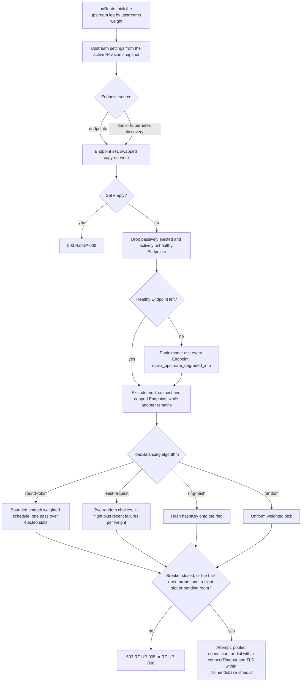
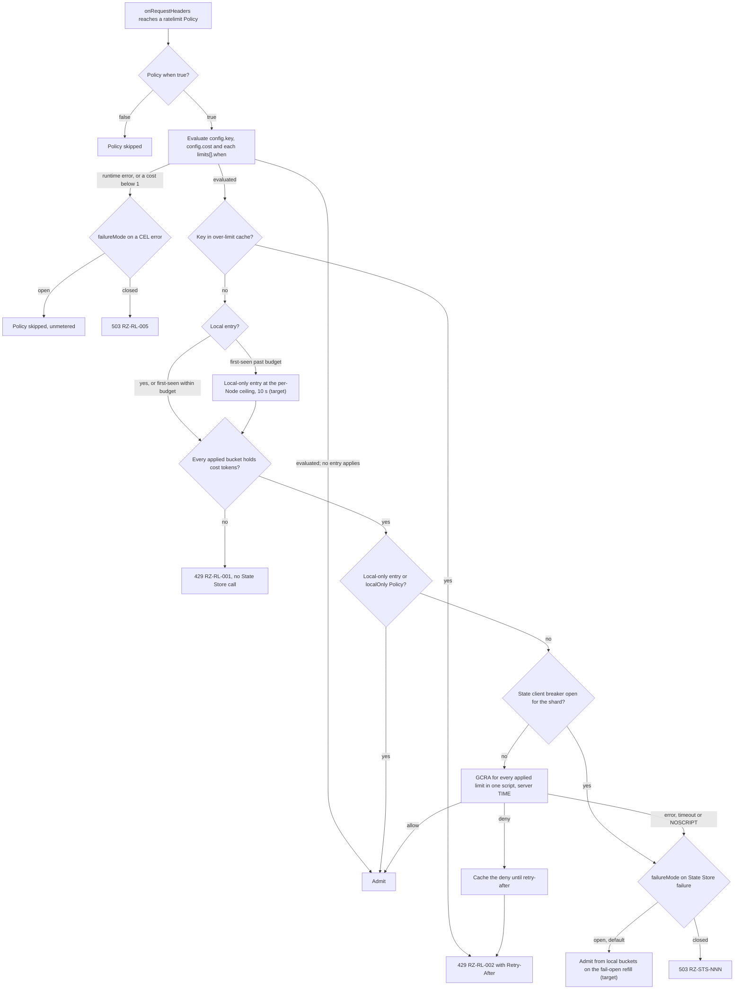
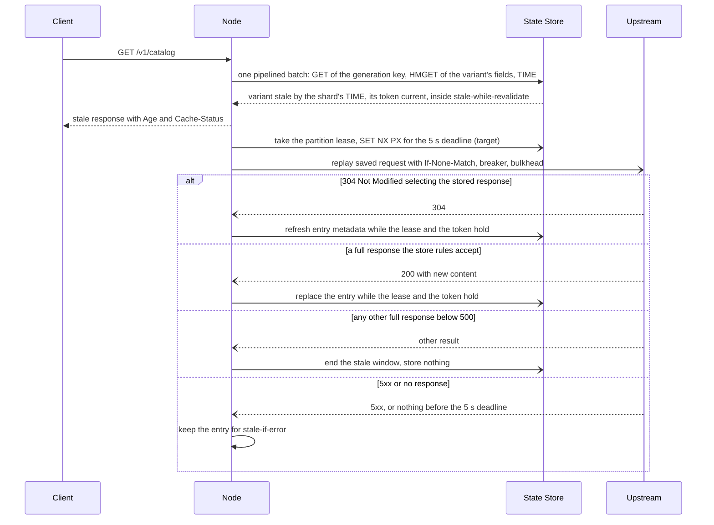

# Traffic Management and Resilience

## Summary

This document fixes how a Ruralz Gateway Node selects and ejects Endpoints, bounds time and retries, breaks circuits, enforces Rate Limits and Quotas, serves the Response Cache and sheds overload. It defines runtime behavior of `Upstream` resilience fields and `ratelimit`, `quota` and `cache` Policies, and owns the `RZ-UP` and `RZ-RL` registries. Rate limiting follows [ADR-0008](../adr/0008-rate-limiting-local-bucket-and-gcra.md): local token bucket, then State Store GCRA, fail-open by default. For architects, operators and contributors.

## Scope and non-goals

In scope: the Summary's subjects and Policy `config` ([Configuration model](02-configuration-model.md#policy)), `Route.spec.timeout`, weighted `upstreams` and IETF RateLimit headers. "Pack 8.8" is a [foundation pack](../_meta/foundation-pack.md) section.

Non-goals, with owners: kinds and fields ([Configuration model](02-configuration-model.md)); precedence, error format, buffer budgets ([Data plane](03-data-plane.md)); accuracy bounds, State Store sizing, Cells ([Scalability](11-scalability-and-distributed-state.md)); Token Budgets ([ADR-0014](../adr/0014-ai-api-surface.md)), Provider Fallback ([AI/LLM gateway](06-ai-llm-gateway.md)); `authz.ip`, `authz.geoip`, pre-authentication limits ([Security](08-security-and-identity.md)); streams ([Multi-protocol](07-multi-protocol.md)); authoritative numbers ([Performance budgets](12-performance-budgets-and-benchmarking.md), which wins).

## Load balancing

Endpoint selection runs per attempt between `onRoute` and `onUpstreamRequest` on Node-local state, Planned (M1) for `http` Upstreams. A Route picks an `upstreams` entry per request by `weight`, under the Endpoint weight rule: an entry of weight 0 is never picked while another weighs more, and if every weight is 0 all weigh 1. When the picked entry's leg is refused before any attempt is sent (`RZ-UP-005`, `RZ-UP-006` or `RZ-UP-008`), the request picks again by weight among the entries it has not tried, under the same rule, so a weight-0 entry serves once every weighted entry was refused; each entry is tried at most once, and the request answers with the last refusal when none is left. A leg that sent an attempt is final, even when a retry attempt is refused. The Upstream picks an Endpoint by `loadBalancing.algorithm`, weighted by `endpoints[].weight` or SRV weights.

| Algorithm | Selection | Best for |
|---|---|---|
| `round-robin` | Smooth weighted rotation over a precomputed schedule | Uniform, short requests |
| `least-request` | Two random candidates; fewer in-flight per weight wins, counting failures of the last 1 s (target) | Mixed latency; proposed default |
| `ring-hash` | Required CEL `hashKey` onto a ring, skipping ejected or tried Endpoints | Cache affinity |
| `random` | Uniform weighted pick | Very large Endpoint sets |

A `round-robin` schedule holds min(65,536, 64 × Endpoints) 4-byte slots, weights normalized to fit: 768 bytes for 3 Endpoints, 256 KiB at most (target). A `ring-hash` ring holds min(65,536, v × Endpoints) 16-byte virtual nodes, at most 1 MiB (target; hash: OQ-traffic-management-and-resilience-15); other algorithms keep arrays linear in Endpoints. Structures rebuild off the request path at most every 10 s per Upstream, 8 at a time per Node, swapping copy-on-write (target). A pick skips ejected slots for one pass, then panics.

Balancer structures share a 256 MiB budget per Node (target), planned when a Revision compiles, not per rebuild: every ring uses v = clamp(floor((256 MiB − schedules − 16 MiB copy-on-write reserve) / (16 B × Endpoints summed over rings)), 64, 1,024) virtual nodes per Endpoint (target). If v = 64 does not fit, rings fall back to weighted `random`, largest first, with degraded reason `balancer_budget` (proposed to [Observability](10-observability.md)). Endpoint-set changes lower v at once on overflow and raise it only when it can double (target). 1,000 rings of 64 Endpoints, 1 GiB at full size, all build at v = 244, about 238 MiB (hypothesis). Reporting and sizing are OQ-traffic-management-and-resilience-23.

Health, ejection and breaker state survive Hot Reloads.

*Figure 1: load-balancing Endpoint selection per attempt.*



## Service discovery

| Source | Fields | Behavior | Planned |
|---|---|---|---|
| Static | `endpoints[].address`, `weight` | Host names resolve every 30 s (target), keeping the last good answer | Planned (M1) |
| DNS | `discovery.type: dns`, `service`, `port` | Numeric `port`: A and AAAA; named: SRV `_<port>._tcp.<service>`. Every 30 s, 10% jitter (target) | Planned (M1) |
| Kubernetes | `discovery.type: kubernetes`, `service`, `namespace`, `port` | EndpointSlice watch (client: OQ-tech-stack-and-libraries-23) | Planned (M2) |

Kubernetes discovery uses serving, non-terminating Endpoints, or terminating ones if all are ([source](https://kubernetes.io/docs/concepts/services-networking/endpoint-slices/)).

On lookup failure or an unreachable Kubernetes API the Node keeps its last set, raises `ruralz_upstream_degraded_info` (reason `discovery_stale`) and retries with full-jitter backoff, 1 s to 60 s (target). NXDOMAIN or an empty answer counts as a failure until 3 consecutive refreshes repeat it (target); only an EndpointSlice with zero serving Endpoints empties the set at once (`RZ-UP-008`). Registry-specific clients are Not planned, each adding a dependency to every build; SRV-capable registries use `discovery.type: dns`.

## Health checking and outlier detection

Each Node judges health alone (P3 in [Vision](../vision/01-vision-and-positioning.md#principles)), Planned (M1):

| Mechanism | Fields | Rule |
|---|---|---|
| Passive ejection, on by default | `healthCheck.passive.consecutiveErrors`, `ejectionTime` | That many attempts matching `circuitBreaker.failureWhen` eject the Endpoint for `ejectionTime` × its ejection count, at most 10 (target) |
| Active checks, when set | `healthCheck.active.path`, `interval`, `timeout`, `healthyThreshold`, `unhealthyThreshold` | `GET path` every `interval`, 10% jitter (target); 200 to 399 within `timeout` succeeds; new Endpoints start healthy |
| Stall and suspect detection, always on | `healthCheck.stallTimeout` | An attempt without response headers after `stallTimeout` is stalled and its Endpoint suspect, as below |
| HTTP/2 ping, on except for gRPC Upstreams | `healthCheck.pingTimeout` | A connection silent for 1 s is pinged and closed once the ping goes unanswered for `pingTimeout`, as below |

At most 50% of Endpoints are passively ejected at once (target), so a bad deploy cannot empty the set; active removals, connect errors (dial timeouts, ping closes) and timeouts on suspect Endpoints bypass the cap, so a lost zone leaves rotation. With no healthy Endpoint the Node uses all (panic mode, reason `panic`); all-or-nothing panic at M1 is recommended for OQ-data-plane-7 (threshold: OQ-traffic-management-and-resilience-7). [Observability](10-observability.md) defines `ruralz_upstream_ejections_total` (reason `passive` or `active`).

An attempt without response headers after `healthCheck.stallTimeout`, 1 s by default (target), is stalled; an Endpoint holding one and sending no headers for `stallTimeout` is suspect until it does: selection skips it while another remains, and an attempt timeout on it ejects it. Any black-holed Endpoint, `http` or gRPC, pooled or not, thus stops getting attempts within about `stallTimeout` (target).

Go leaves HTTP/2 health checks off by default ([source](https://pkg.go.dev/golang.org/x/net/http2#Server)), so `HTTP2Config` pings a connection silent for 1 s, a fixed value, and closes it, resetting its streams, once the ping goes unanswered for `healthCheck.pingTimeout`, 5 s by default (target). A 2 s garbage-collection pause or two TCP retransmission timeouts only suspend new attempts: the default `pingTimeout` gives no false positives below 5 s (hypothesis). gRPC Upstreams, Planned (M3), send no keepalive pings, so `pingTimeout` does not apply to them, as a default grpc-go server answers frequent pings with GOAWAY `too_many_pings` ([source](https://github.com/grpc/grpc-go/blob/master/internal/transport/http2_server.go)); in-flight attempts on a black-holed gRPC connection thus end at `perTryTimeout` as 504 `RZ-UP-003`, since default `retryOn` omits `timeout`.

Probe slots per Node are min(256, ceil(probes per second × `timeout`)) (target), shared across Upstreams; skipped probes count in `ruralz_upstream_probes_skipped_total` and, above 10% for 1 minute, raise degraded reason `probes_skipped` (target), both proposed to Observability. Beyond about 1,280 Endpoints per Node at `interval: 10s`, `timeout: 2s` (target), stalls, ejection and dial timeouts handle zone loss. gRPC checks use `grpc.health.v1`, Planned (M3).

## Timeouts, deadlines, retries and hedging

### Deadlines

Each bound clamps those below:

| Bound | Field | On expiry |
|---|---|---|
| Request, streamed body included | `Route.spec.timeout` | `RZ-RT-007` before any attempt, `RZ-UP-003` during one, `RZ-UP-009` after commit |
| Leg, attempts and backoff included, to the final response headers | `Upstream.spec.timeout` | `RZ-UP-003` |
| Attempt, to the last response header byte | `retries.perTryTimeout` | Error kind `timeout`; `retryOn` decides |
| Dial, every address of the Endpoint included; TLS handshake | `Upstream.spec.connectTimeout`; `Upstream.spec.tls.handshakeTimeout` | Error kind `connect`; `tls` |
| State Store round trip | `Policy.spec.stateStoreTimeout`, clamped by the Route's largest (pack 8.7) | `failureMode` |

Only attempt, leg or Route deadlines yield kind `timeout`, so a black-holed dial fails fast as `connect` and retries elsewhere. After commit only the Route `timeout` and the idle limit below bound the body: an SSE or `ai` Upstream's `timeout: 3s` never ends a stream. gRPC sends the remaining deadline as `grpc-timeout`.

The defaults follow. A static default is a schema default; a computed default, the Route and Upstream `timeout` and `retries.perTryTimeout`, is a runtime rule kept out of the canonical form, as are the CEL defaults of `retryOn` and `failureWhen` ([Canonical form and Revision](02-configuration-model.md#canonical-form-and-revision)):

| Field | Default |
|---|---|
| `Route.spec.timeout` | Computed from the Route's protocol: 15 s; 1 h for WebSocket, GraphQL subscription, gRPC streaming and `protocol: ai` Routes (target) |
| `Upstream.spec.timeout` | The Route's `timeout` (target) |
| `retries.perTryTimeout` | Leg time left divided by (retries left + 1) (target) |
| `retries.attempts` | 1 retry |
| `retries.retryOn` | GET, HEAD, OPTIONS, PUT, DELETE: `connect` or `reset` errors, or 503; other methods: `connect` errors |
| `circuitBreaker.failureWhen` | `error != null \|\| response.status in [502, 503, 504]` |
| `circuitBreaker` limits | `maxConnections` 1,024, `maxPendingRequests` 256, `consecutiveFailures` 5, `openDuration` 30 s (target) |
| `healthCheck.passive` | `consecutiveErrors` 5, `ejectionTime` 30 s (target) |
| `connectTimeout`; `tls.handshakeTimeout` | 1 s; 2 s (target) |
| `healthCheck.stallTimeout`; `healthCheck.pingTimeout` | 1 s; 5 s (target) |

OQ-data-plane-10: a fixed 60 s inter-chunk idle limit is recommended (target).

### Retries

`retries.attempts` counts retries: `attempts: 2` allows three attempts. A retry needs `retryOn` true (a runtime error means no retry) and all of:

1. A replayable body, empty or buffered within the `onRequestBody` cap, nothing committed.
2. Attempts and deadline left.
3. A breaker not open, and retry budget room.
4. Any Upstream `Retry-After` at most 10 s (target) and ending before the leg deadline.

Backoff is full-jitter exponential from 25 ms to 250 ms (target), or a longer `Retry-After`; each retry reruns `onUpstreamRequest`. A retried response gives back its in-flight slot when the retry is decided and is drained (up to 64 KiB, within the leg deadline) when the retry attempt runs; if that attempt cannot start, the leg returns it unchanged. A leg whose last attempt got a response returns it unchanged, else the [code selection rule](#error-codes-this-document-owns) applies.

### Retry budget

Each Node keeps a retry budget per Upstream: in-flight retries, backoff included, MUST NOT exceed max(3, 20% of in-flight originals) (target). Over budget, the original failure returns, counted in `ruralz_upstream_retry_budget_exhausted_total`. From 15 originals in flight, amplification is at most 1.2 times (target); fields are OQ-traffic-management-and-resilience-5.

### Hedging

A hedge sends a second attempt to another Endpoint after a delay, only for idempotent methods with replayable bodies; the first response wins, the loser is cancelled, and hedges spend retry budget. Planned (M4) with `hedgeDelay` (proposed, OQ-traffic-management-and-resilience-5).

*Figure 2: retry and circuit breaker states.*

```mermaid
stateDiagram-v2
    state "Retry loop, per upstream leg" as RetryLoop {
        [*] --> Attempt
        Attempt --> Returned: retryOn false or runtime error
        Attempt --> Evaluate: retryOn true
        Evaluate --> Backoff: attempts, budget, deadline, replayable body, breaker not open, Retry-After fits
        Evaluate --> Exhausted: any condition fails
        Backoff --> Attempt: jittered delay, untried Endpoint
        Returned --> [*]
        Exhausted --> [*]
    }
    state "Circuit breaker, per Upstream per Node" as Breaker {
        state "Half-open" as HalfOpen
        [*] --> Closed
        Closed --> Open: consecutiveFailures failed legs and at least 50% of at least 20 legs in 10 s (target); connect errors only past 50% ejected (target)
        Open --> HalfOpen: jittered openDuration elapsed
        HalfOpen --> Closed: 3 consecutive probe successes (target)
        HalfOpen --> Open: a probe fails
    }
```



## Circuit breakers

Each Node keeps one breaker and one in-flight ceiling per Upstream, Planned (M1); ejection isolates Endpoints. The breaker counts legs whose final result matches `failureWhen`; connect errors count only while over 50% of Endpoints are ejected (target), so a bad Endpoint or lost zone never opens it. Its guards are fixed values, not fields: it may open only once a rolling 10 s window holds at least 20 legs and at least 50% of them failed, together with `consecutiveFailures`, and 3 consecutive probe successes close it when half-open (target).

| Field | Role | When exceeded |
|---|---|---|
| `consecutiveFailures` | Opens the breaker once that many consecutive legs and at least 50% of at least 20 legs in a rolling 10 s window failed (target) | 503 `RZ-UP-005` at once, no retry |
| `openDuration` | Open time, jittered ±20% (target) | Half-open: one probe at a time, others get 503 `RZ-UP-005`; 3 consecutive successes close it, a failure reopens (target) |
| `failureWhen` | CEL failure class, such as 429; a runtime error counts as failure | Not applicable |
| `maxConnections` | In-flight attempts per Upstream per Node: a semaphore taken before `RoundTrip`, so HTTP/2 streams count | Attempts wait |
| `maxPendingRequests` | Waiters for that semaphore, each bounded by its attempt context | 503 `RZ-UP-006` at once |

At 10% independent failures, a 20-leg window reaches 50% with probability about 7 × 10^-6 (hypothesis). Below 20 legs per 10 s per Node the breaker never opens, whatever `consecutiveFailures` says: at 100 Nodes, for any Upstream under about 200 legs per second (hypothesis). Ejection, the retry budget and `maxPendingRequests` protect those.

An Endpoint holds at most max(8, min(2 × its weighted share, 50%) of `maxConnections`) in-flight attempts; once stalled attempts hold 50%, selection skips every Endpoint holding one (target). As detection takes about `healthCheck.stallTimeout`, `maxConnections` SHOULD exceed the attempts per Node in one `stallTimeout`, the attempts per second at its 1 s default (target), or a multi-Endpoint zone can fill the slots first.

Streaming and WebSocket legs hold a slot for life, up to the Route `timeout`, so the default allows 1,024 streams per Upstream and Node (target); stream Routes SHOULD get their own Upstream. [Observability](10-observability.md) defines `ruralz_upstream_breaker_state_info`; post-close ramp, locality and slow start are OQ-traffic-management-and-resilience-8.

## Rate limiting

A Rate Limit is a `ratelimit` Policy (admission class, `onRequestHeaders`, default `failureMode: open`), Planned (M1). `config.key` (CEL) partitions traffic; without it every request of the Policy shares one partition, a service limit. Every applied `config.limits[]` entry must allow `requests` per `window`, plus its `burst`. Route limits stack on Gateway limits (pack 8.12). Limits apply per Cell, so R Regions allow R × each. Auth runs first.

These fields, registered in the [Configuration model](02-configuration-model.md#registered-from-feature-documents) beside those of [Per-Node ceiling](#per-node-ceiling), shape a limit:

| Field | Type; default | Rule |
|---|---|---|
| `config.key` | CEL string over Base; absent | The partition key; absent, or an empty result, is one partition for every request |
| `config.limits[]` | List of 1 to 8 entries (target) | Each holds `requests`, at least 1, per `window`; two entries with equal `requests` and `window` would share one GCRA key and are RZ-CFG-005 |
| `limits[].window` | Duration of at least 1 ms, in whole milliseconds | `window` / `requests`, the GCRA emission interval T, is at least 1 µs, so it stays above the TAT resolution; else RZ-CFG-005 |
| `limits[].when` | CEL bool over Base; absent, the entry always applies | A false entry is skipped for the request: no local bucket, no GCRA limit and no RateLimit field |
| `config.cost` | CEL int over Base; `1` | The tokens a request takes from every applied limit, at least 1 |
| `config.responseHeaders` | `ietf` or `none`; `ietf` | `none` records no [RateLimit fields](#ratelimit-response-headers) for the Policy; its 429s still carry `Retry-After` |

Notation: N_published is the Node count Ruralz Control publishes (`HeartbeatReply` `clusterNodeCount`); N_serving, or N, counts serving Nodes; N_frozen, a count frozen by a Ruralz Control outage; N_countless, Nodes without a count; TAT, the GCRA theoretical arrival time per key; τ, the GCRA burst tolerance; B, the Cell-wide first-seen call budget.

### Algorithm choice

[ADR-0008](../adr/0008-rate-limiting-local-bucket-and-gcra.md) chooses a hybrid of the common algorithms:

| Algorithm | Accuracy | State Store cost per request | Multi-Node behavior | Burst handling | Reference |
|---|---|---|---|---|---|
| Fixed window counter | Up to 2 × limit across a boundary | One `INCR` | Per Node unless counters are shared | Full limit per window | Simplest; boundary bursts |
| Sliding window counter | Approximate; assumes even arrivals in the previous window | Two counters | Counters per location | Smoothed | Weighted previous-window count |
| Token bucket | Exact within one store | Tokens and refill time | Local, or one shared bucket | Bucket size | Stripe ([source](https://stripe.com/blog/rate-limiters)) |
| GCRA | Exact within one store | One timestamp (TAT) per key | Global when shared | τ; τ = window allows 2 × limit | redis_rate ([source](https://github.com/go-redis/redis_rate)), Brandur ([source](https://brandur.org/rate-limiting)) |
| Local bucket plus GCRA (chosen) | GCRA for spread keys; per-Node ceiling for a pinned client | None for local denials, else one script | Bucket shields hot keys; GCRA enforces the Cell limit | Ceiling per Node; τ globally | [ADR-0008](../adr/0008-rate-limiting-local-bucket-and-gcra.md) |

### Decision path

1. `when` false skips the Policy. The Policy evaluates `config.key`, `config.cost` and each `limits[].when` once; a runtime error in any of them, or a cost below 1, applies `failureMode` without a bucket: `open` admits unmetered, `closed` returns 503 `RZ-RL-005`. Entries whose `when` is false take no part in the steps below, and a Policy left with no applied entry admits.
2. A key whose last GCRA answer denied stays denied from a per-Node over-limit cache until its retry-after.
3. A key with no local entry is first-seen, spending a unit of a per-Node budget all Policies share: min(500, B / N_published) per second with a count, else 200 (target), with B = 20,000 per Cell, 20% of a shard (hypothesis). Within budget it gets full buckets; past it, a 10 s local-only entry (target) in the key table's local-only segment, at the per-Node ceiling, capacity and refill alike, which decides without GCRA.
4. Each applied `limits[]` entry has a local token bucket at its per-Node ceiling; the request takes `cost` tokens from every one of them or from none, else 429 `RZ-RL-001`, so a cost above an entry's ceiling, which never fits its bucket, is always denied there. Local-only entries and `localOnly` Policies then admit, within N_serving × ceiling per window.
5. Otherwise one `EVALSHA` runs GCRA for every applied limit with server `TIME`, charging `cost` emission intervals and updating TATs only if all allow; a deny is 429 `RZ-RL-002`. Nodes `SCRIPT LOAD` every script at connect, reconnect and failover; `NOSCRIPT` applies `failureMode` and schedules a reload, so no request makes a second round trip (pack 8.7 rule 1).
6. A failed or unattempted call, or an open State client breaker, applies `failureMode`: `open` admits within the local buckets, which switch to the fail-open refill of [Per-Node ceiling](#per-node-ceiling); `closed` returns 503 `RZ-STS-<NNN>` ([Scalability](11-scalability-and-distributed-state.md)).

Two cases admit on local buckets alone, as pack 8.8 fixes: a `localOnly` Policy, and a first-seen key past the budget during its local-only entry, each at most N_serving × ceiling per window (target), even while the State Store is healthy. First-seen calls are at most min(B × N_serving / N_published, 500 × N_serving) per second per Cell, B at steady state; without a count, as in file mode, 200 × N, 200,000 at 1,000 Nodes (hypothesis), so large file-mode Clusters SHOULD run Control mode or size the State Store.

A Node new from scale-out, a restart or a Zero-Downtime Upgrade starts empty and warms at its budget: 50,000 active keys take about 250 s at N_published = 100 (hypothesis), while past-budget keys admit from local-only entries at the per-Node ceiling. In Control mode, Planned (M2), a Zero-Downtime Upgrade hands its successor the Node count (pack 8.8); handing over the key table is OQ-traffic-management-and-resilience-22.

Keys are `rz:rl:<policy>:<requests>/<window>:{<SHA-256 of the key value>}`: the tag keeps a partition in one slot, so consumptive calls with equal keys share one script (pack 8.7); `PEXPIRE` at TAT − now + τ drops idle keys. A Policy on several Routes shares one counter; per-Route limits add `route.name` to `config.key`. A changed limit starts fresh GCRA state, briefly allowing `requests` + `burst`.

Buckets, local-only and over-limit entries share a Node-wide 1,048,576 entries, about 64 MiB (target), in [Data plane](03-data-plane.md)'s CLOCK-evicted shards, surviving Hot Reloads. Local-only entries get their own 131,072-entry segment (target), so a key-rotation flood never evicts a key with a GCRA answer.

A key reaches the State Store at most min(offered, 2 × N × ceiling) times per window (target), a full bucket plus one window's refill per Node ([ADR-0008](../adr/0008-rate-limiting-local-bucket-and-gcra.md)); pack 8.8's N × ceiling bounds fail-open admission, not calls. A shard serves about 100,000 calls per second (hypothesis; Valkey 8 measured 1.19 million `SET`, not `EVAL`, per second, [source](https://valkey.io/blog/unlock-one-million-rps-part2/)); hotter keys, like a busy service limit's, need `localOnly`, and validation warns about a constant key above that rate (RZ-CFG-043, [Scalability](11-scalability-and-distributed-state.md#distributed-rate-limits)). The State client breaker is per shard per Node; GCRA takes 1 ms at p99 within a zone (hypothesis).

*Figure 3: rate-limit decision, local token bucket then State Store GCRA.*



### Per-Node ceiling

Three `ratelimit` fields, registered in the [Configuration model](02-configuration-model.md#registered-from-feature-documents), govern ceilings:

| Field | Type; default | Rule |
|---|---|---|
| `limits[].perNodeCeiling` | Integer, 1 to `requests`; unset | Each Node's bucket capacity and refill per `window` |
| `limits[].burst` | Integer, 0 to `requests`; `requests` | τ = `burst` × `window` / `requests`: a window admits `requests` + `burst` |
| `config.localOnly` | Boolean; `false` | Local buckets alone decide, without State Store calls, over-limit cache or first-seen budget: at most N_serving × ceiling per window, even healthy (target), for keys too hot for one shard ([Scalability](11-scalability-and-distributed-state.md#distributed-rate-limits)), as pack 8.8 allows |

Without `perNodeCeiling` the ceiling derives from N_published in Control mode as min(`requests`, max(10, ceil(2 × `requests` / N_published))) (target), pack 8.8's rule: the factor 2 absorbs uneven spread, the floor serves pinned clients. A Control-mode Node without a count uses the full limit, degraded reason `node_count_unknown` ([Observability](10-observability.md)); so does file mode (pack 8.8), not degraded.

While GCRA fails, a key's buckets refill per epoch-aligned `window` instead of continuously: each window brings the key's fail-open allowance, without carry-over, released in 60 equal steps for a window past 1 minute (target). A key switches from its first failed or unattempted call, or open breaker, until its next GCRA answer; at the switch each bucket keeps the tokens it holds, at most the allowance, for the rest of the window in progress, so tokens already taken stay taken. The allowance is the ceiling, except that a derived ceiling's bucket holds max(1, 2 × `requests` / N_published) tokens, since the floor alone would break the fail-open bound (10 per `1s` on 100 Nodes admits 1,000 per second), and a Control-mode Node without a count holds max(1, `requests` / 100) (target), so the Cell admits N_countless × that. Per key and aligned window, fail-open admission is then at most N_serving × the allowance.

[Control plane](04-control-plane-and-gitops.md#replica-roles) counts ready Nodes that ACKed a Revision and stayed connected 10 minutes (target); large decreases publish at once, increases at most 10% per minute. In Control mode, Planned (M2), a Node keeps the last count while Ruralz Control is down, persists it under `${RURALZ_DATA_DIR}`, uses it flagged stale after a restart until the next arrives, and hands it to its successor in a Zero-Downtime Upgrade (pack 8.8, 8.11), so only a Node that never received one is without a count. As a larger N tightens ceilings, lag is unsafe: hot keys reach GCRA N_serving / N_published times as often, and fail-open admits that multiple of 2 × limit. A lost Ruralz Control leader or Raft quorum freezes it at N_frozen while stale replicas still serve new Nodes, so autoscaled Control-mode Clusters SHOULD set `perNodeCeiling`.

### Service and tiered limits

A service limit uses a constant or absent `key`; a tiered limit is one Policy per Tier, guarded by `when`:

```yaml
apiVersion: ruralz/v1alpha1
kind: Policy
metadata: {name: ratelimit-gold}
spec:
  type: ratelimit
  when: 'consumer != null && consumer.tier == "gold"'
  config:
    key: "consumer.name"
    limits:
      - {requests: 100, window: 1s}
      - {requests: 5000, window: 1m}
---
apiVersion: ruralz/v1alpha1
kind: Policy
metadata: {name: ratelimit-free}
spec:
  type: ratelimit
  when: 'consumer == null || consumer.tier != "gold"'
  config:
    key: 'consumer == null ? source.ip : consumer.name'
    limits:
      - {requests: 10, window: 1s}
```

One Policy can hold every Tier instead, its `limits[].when` selecting each Tier's entries. Keying anonymous clients by `net.prefix(source.ip, 32, 64)` ([Configuration model](02-configuration-model.md#limits)) gives an IPv4 client its address and an IPv6 client its /64, so rotating addresses within that prefix shares one bucket:

```yaml
apiVersion: ruralz/v1alpha1
kind: Policy
metadata: {name: ratelimit-tiers}
spec:
  type: ratelimit
  config:
    key: 'consumer == null ? net.prefix(source.ip, 32, 64) : consumer.name'
    limits:
      - {requests: 100, window: 1s, when: 'consumer != null && consumer.tier == "gold"'}
      - {requests: 5000, window: 1m, when: 'consumer != null && consumer.tier == "gold"'}
      - {requests: 10, window: 1s, when: 'consumer == null || consumer.tier != "gold"'}
```

### RateLimit response headers

Ruralz Gateway emits Internet-Draft `draft-ietf-httpapi-ratelimit-headers-11` fields as RFC 9651 Structured Field lists, Planned (M1) ([source](https://datatracker.ietf.org/doc/html/draft-ietf-httpapi-ratelimit-headers)). Each `ratelimit` and `quota` Policy records the limits it applied to a request, and the request handler writes the fields after `onResponse`, on every response of that request, generated responses included. They replace any `RateLimit-Policy` and `RateLimit` an Upstream or a Policy set, so a response states this Node's limits only; a response of a request without an applied limit keeps the Upstream's. A limit a skipped Policy, or a `limits[].when` that was false, did not apply is not listed, nor any limit of a `ratelimit` Policy with `config.responseHeaders: none`:

| Field | Content | When |
|---|---|---|
| `RateLimit-Policy` | Per applied limit, in chain order: the Policy name as a String, suffixed `.1`, `.2` by the entry's position in `limits[]` when the Policy holds several entries; `q` = `requests` or the quota `limit`; `w` = `window` in seconds, rounded up, or the length of the current calendar month | Every response of a request with an applied limit |
| `RateLimit` | Per applied limit whose count is known, in the same order: `r` remaining and `t` seconds until it is whole again, rounded up; on a 429, the denied limit only, `t` then being the seconds until it admits | Same |
| `Retry-After` | Equal to the denied limit's `t`, taking precedence over `RateLimit` as the draft requires | Every 429 (`RZ-RL-001` to `RZ-RL-003`), `config.responseHeaders: none` included |

On an admitted request a GCRA limit reports the remaining count and reset its script returned, a local-only entry or a `localOnly` Policy its Node's bucket, and a quota the units left in its window and the seconds to the window's end; a limit admitted without a count, unmetered, from the local buckets while the State Store fails, or by a `quota` Policy taking an earlier Policy's decision for its counter, appears in `RateLimit-Policy` only. On a 429, `RZ-RL-001` gives `r=0` and `t` until the local bucket holds the request's `cost`; `RZ-RL-002` the GCRA or cached retry-after; `RZ-RL-003` the units left and `t` to the jittered window end. A 429 from a `responseHeaders: none` Policy carries `Retry-After` and the other Policies' `RateLimit-Policy` items, but no `RateLimit`. `q` is the sustained rate; default `burst` allows 2 × `q` per window. `pk`, which would disclose a client address or Consumer name, `qu` and `ai.token-budget` fields are omitted, and no `X-RateLimit-*` field is sent.

```text
HTTP/1.1 429 Too Many Requests
Content-Type: application/problem+json
RateLimit-Policy: "ratelimit-global";q=1000;w=1, "ratelimit-gold.1";q=100;w=1, "ratelimit-gold.2";q=5000;w=60
RateLimit: "ratelimit-gold.1";r=0;t=1
Retry-After: 1
```

```text
HTTP/1.1 200 OK
RateLimit-Policy: "ratelimit-global";q=1000;w=1, "ratelimit-gold.1";q=100;w=1, "ratelimit-gold.2";q=5000;w=60
RateLimit: "ratelimit-global";r=998;t=1, "ratelimit-gold.1";r=97;t=1, "ratelimit-gold.2";r=4980;t=60
```

## Quotas

A Quota is a long-window Consumer allowance (a Consumer quota's `limit` per `window`, or per UTC calendar month), checked before commit, settled asynchronously:

| Unit | Policy | Admission | Settlement | Planned |
|---|---|---|---|---|
| `requests` | `quota` (`config.consumerQuota`, `config.key`, `config.cost`) | `onRequestHeaders`: one atomic script reserves `cost` units if the window has that many left | `onLog`: refunds the reserved units when a later Filter rejected the request (`Final.RejectedAfter`), or when no attempt reached an Upstream (`Final.UpstreamReached` false): none was made, or every one failed to connect or to finish TLS, as for `RZ-UP-001`, `RZ-UP-002`, `RZ-UP-005`, `RZ-UP-006`, `RZ-UP-008` and a Node rejection before any attempt, such as 413 `RZ-RT-003`, 503 `RZ-RT-004`, 504 `RZ-RT-007`, `RZ-RT-014` or `RZ-RT-016`; cache hits are charged | Planned (M1) |
| `tokens` (LLM input plus output) | `ai.token-budget` (`config.consumerQuota`) | `onRequestBody`: reserves estimated input plus output cap C (pack 8.9) | `onLog` (pack 8.9): provider-reported usage, else all of R with a degraded-state metric | Planned (M3) |

`config.cost` (CEL int over Base; default `1`) is the units a request reserves, and a refund returns them; a runtime error or a cost below 1 applies `failureMode` like a `config.key` error (`closed`: 503 `RZ-RL-005`), and a cost above the window's remaining units is denied (429 `RZ-RL-003`), reserving nothing.

A Consumer quota's `window` is at least 1 s, in whole seconds, else RZ-CFG-005; `calendar: month` replaces it with the UTC calendar month, which starts at 00:00 UTC on the month's first day and lasts 28 to 31 days, for `tokens` quotas too. Windows are fixed and epoch-aligned in UTC: `24h` resets at midnight, `720h` every 30 days. Each key and window costs one counter, `rz:qt:<consumerQuota>:<window>:<window start>:{<SHA-256 of the key value>}`, `<window>` being `month` for a calendar quota, expiring a window after it closes. A request charges each counter once: a later `quota` Policy whose counter, the Consumer quota, window and key value, an earlier Policy charged in the same request takes that Policy's decision without a call, and only the charging Policy refunds. Renaming a Consumer resets usage under the default `key`. Scripts get `KEYS` for the Node clock's window and its nearer neighbor, pick by server `TIME` and tolerate skew up to half the window (target), half the shorter month for a calendar quota. Quotas apply per Cell.

```yaml
apiVersion: ruralz/v1alpha1
kind: Consumer
metadata: {name: partner-acme}
spec:
  tier: gold
  credentials:
    apiKeys:
      - name: primary
        hash: "sha256:d1bec0f9342e5607570b2636ed0256023b13be7d7d4bb45e1bed3cfee80dc1b6"
  quotas:
    - {name: monthly-requests, unit: requests, limit: 3000000, calendar: month}
    - {name: daily-tokens, unit: tokens, limit: 2000000, window: 24h}
---
apiVersion: ruralz/v1alpha1
kind: Policy
metadata: {name: quota-monthly}
spec:
  type: quota
  config:
    consumerQuota: monthly-requests
    cost: 'request.method == "POST" ? 5 : 1'   # a write costs five units
```

An exhausted quota returns 429 `RZ-RL-003` with `Retry-After` at the window end plus up to 1% of it, at most 60 s (target). Nodes cache the denial with the units the window had left, keyed with the limit, up to 60 s and never past the window end (target), and deny from the cache only a request whose cost exceeds those units: a raised limit applies at once, refunds within 60 s, costing one script per minute per key per Node, about 17 per second at 1,000 Nodes (hypothesis). Before exhaustion each request costs one script: 20,000 per second on one key take 20% of a shard (hypothesis) unless a `ratelimit` sharing the script (pack 8.7) bounds it. A null Consumer, one lacking the quota, or one whose quota of that name counts `tokens`, gets 403 `RZ-RL-004`, before `config.key` and `config.cost` are evaluated.

Dropped refunds only over-charge. `quota` fails open and `ai.token-budget` closed, as unmetered tokens are provider spend.

## Response caching

The Response Cache is the `cache` Policy: Route scope, lookup in `onRequestHeaders` after auth, authz and admission, store in `onResponse`, default `failureMode: open`, Planned (M1): an RFC 9111 shared cache plus RFC 5861 `stale-while-revalidate` and `stale-if-error`. Its entries live on Gateway `stateStore.cache` when the Gateway sets it, else on the main State Store connection beside the limit keys.

| Rule | Behavior |
|---|---|
| Methods | GET, and HEAD from GET entries; a request with a body, a `Content-Length` above 0 or a `Transfer-Encoding`, bypasses. Only GET and HEAD record a result in `ruralz_cache_requests_total` and the access log's `cache` field; an unsafe request, which the Policy handles only to invalidate, records none |
| URI | U is the SHA-256 of the scheme; the host in lower case without a trailing dot, with its port when not the scheme's default; the Router's normalized path; and the query with its escapes normalized, unreserved bytes decoded and hex digits in upper case, its parameters kept in order, an empty query equal to none |
| Partition | P is the SHA-256 of the Route name, a NUL byte and the partition value, so Routes never share entries while an invalidation by U reaches each of them. The value is `config.key`'s result; else, on a Route with an `auth.*` Policy, the request's principal (OQ-security-and-identity-25); else empty |
| Layout | A generation key `rz:rc:{<U>}:gen` holding a 128-bit random token, and per partition a tag `{<U>:<P>}` holding `Vary` names, a fill lease and at most 8 variants (target), each entry recording the token it was written under, in the [layout](11-scalability-and-distributed-state.md#response-cache-layout) of Scalability. The Node generates a fresh token for each creation and bump of the key and passes it to the script; creation, bump and every store under the key set its TTL to 26 h (target), longer than any variant's 25 h. A lookup hits only when the generation key exists and holds the token the entry records, so a URI whose key expired or was evicted misses, and eviction of any key can cost hits but never serve an invalidated entry; a counter or a time, which could repeat once the key is gone, would not give that |
| Storable | Explicit freshness; a final status RFC 9111 section 3 lets a shared cache store, except 206 and 304; no `no-store`, `no-cache` (never stored at M1), `private`, `Vary: *` or `Set-Cookie`; with `Authorization`, only under `public`, `s-maxage` or `must-revalidate`; never a partial (`ruralz-partial: true`) composition response |
| Freshness | `s-maxage`, `max-age`, then `Expires` minus `Date` (the receipt time without one), at most 24 h, stale windows at most 1 h (target); an invalid or conflicting value reads as stale (RFC 9111 section 4.2.1); the age follows RFC 9111 section 4.2.3, its resident time measured on the State Store's clock; hits carry `Age` |
| Cache-Status | On every GET or HEAD response the Policy handled, one `ruralz` member (RFC 9211) is appended to any `Cache-Status` the response carries: `hit` with `ttl`, the seconds of freshness left, negative when stale, for a hit, a stale hit, a client-validation 304 or a range answer, 206 or 416; `fwd=uri-miss`, or `fwd=vary-miss` when the URI held entries but no matching variant, for a miss; `fwd=request` when a request directive forced the Upstream path, else `fwd=stale` when a stored response was validated; `fwd-status` with the forwarded status for a revalidated or `stale-if-error` answer, adding `ttl` when stale content was served; `fwd=bypass` for a bypass; `stored` when the Node started storing the response and `collapsed` for a coalesced reuse. It never carries `key` or `detail` |
| Stale limits | `must-revalidate`, `proxy-revalidate` and `s-maxage` (implying `proxy-revalidate`, RFC 9111 section 5.2.2.10) forbid stale (section 4.2.4), overriding RFC 5861 |
| Request directives | `no-cache` or `max-age=0` revalidates; a larger `max-age` bounds the age a stored response may have and `min-fresh` the freshness it must have left, neither accepting a stale one without `max-stale`, which accepts staleness up to its value, or any without one (RFC 9111 section 5.2.1); a request `stale-if-error` widens that window for its request, at most 1 h (target, RFC 5861 section 4); the stale limits hold against every request directive; `no-store` bypasses; `only-if-cached` misses with 504 |
| Revalidation | `If-None-Match` with the stored entity tag and `If-Modified-Since` with its `Last-Modified`, or its `Date` without either (RFC 9110 section 13.1.3), replacing the request's own preconditions and `Range`; a 304 whose validators select the stored response (RFC 9111 section 4.3.4), or that carries none, as the conditional request named only that response's validators, refreshes metadata (section 3.2), its `Age` and `Date` restarting the age |
| Client validation | A GET or HEAD the stored response can serve gets a 304 from it when its `If-None-Match` lists `*` or the stored entity tag by weak comparison, or, without `If-None-Match`, its one valid `If-Modified-Since` is no earlier than the stored `Last-Modified`, else `Date`, else the receipt time (RFC 9111 section 4.3.2, RFC 9110 sections 13.1.2 and 13.1.3), before any `Range` applies; `If-Match` and `If-Unmodified-Since` never apply to a cache, and `If-Range` applies only to a range. The 304 carries the stored `Cache-Control`, `Content-Location`, `Date`, `ETag`, `Expires` and `Vary`, `Last-Modified` without an `ETag` (RFC 9110 section 15.4.5), plus `Age` and `Cache-Status` as a hit |
| Range | A GET hit with one satisfiable `bytes` range gets a 206 built from the stored complete response when it has no `If-Range`, or its `If-Range` matches: an entity tag equal to the stored one by strong comparison, or a date equal to a stored `Last-Modified` at least 1 s before the stored `Date` (RFC 9110 section 13.1.5). Several ranges, another range unit, an invalid `Range` or a failed `If-Range` get the whole 200, and a HEAD ignores `Range`. The 206 carries the stored header fields with `Content-Length` set to the part's length, `Content-Range: bytes <first>-<last>/<length>`, `Accept-Ranges: bytes`, `Age` and `Cache-Status`. An unsatisfiable range gets 416 `RZ-RT-026`, the problem document of [Data plane](03-data-plane.md#error-response-format) with `Content-Range: bytes */<length>`. On a miss a `Range` request is forwarded unchanged, never leads a coalesced flight, and its 206 is never stored |
| Composition | Stored and served like any response; a merged response takes its freshness from the most restrictive step `Cache-Control` ([Merge rules](03-data-plane.md#merge-rules)), a partial response is never stored, and background revalidation replays the whole Route |
| Invalidation | After the leg's final response, a 2xx or 3xx to an unsafe method, every method other than GET, HEAD, OPTIONS and TRACE, bumps the URI's generation key to a fresh token (RFC 9111 section 4.4), so no entry written under an earlier token hits again. It ignores the cache Policy's `when` and applies even when the client left before commit. Hot-entry layers may serve the old generation 1 s longer (target) |
| Invalidating Routes | Every Route with a `cache` Policy, and every Route that could match a URI a cache Route serves: the snapshot compiler counts a Route as such unless its listeners, its hosts, or an `exact`, `prefix` or `template` path provably share no URI with each cache Route; a `regex` path or a `match.when` proves nothing. A Route without a `cache` Policy bumps on the cache Route's State Store connection with that Policy's `stateStoreTimeout`, the largest when several cache Routes overlap it |
| Size | An entry is at most 128 KiB (target) encoded, its header blocks and saved request included, within the Node buffer budget; the tee copies at most what the encoded header blocks and saved request leave |

A hit skips `onRequestBody`, so validation rejects an effective Filter Chain combining `cache` with an `onRequestBody` authz, validation, or `plugin` auth or authz Policy (RZ-CFG-038).

A lookup is one pipelined batch of read-only commands (pack 8.7 rule 3): a `GET` of the generation key; an `HMGET` of the partition's `Vary` names `n` and of the variant's entry `e:<V>` and store time `t:<V>`; and `TIME` on the partition's shard. The Node computes V from the `Vary` names it last learned for the URI, kept per URI in a bounded LRU, or from no names. A hit needs the partition's names to equal those V was computed from, and the generation key to exist and hold the token the entry records, else the Node misses and learns the names; per-principal partitions spread over shards. An entry's resident time is that shard's `TIME` minus `t:<V>`, so Node clock skew never changes an age: a store records `t:<V>` as its script's `TIME` minus the time the write waited since the response arrived, which the Node passes with the write, and a refresh does the same for its 304.

A store, queued post-commit (pack 8.7) with TTL of freshness plus the larger stale window, runs as two scripts, since the generation key and the partition hash to different Redis Cluster slots. The generation step, on the generation key's shard, checks that the key still holds the token the store's lookup read and refreshes its TTL; when the lookup found no generation key, it creates one with the fresh token the Node passes (`SET NX`) and fails when a key appeared meanwhile. Only when it applied, the partition step takes the partition's fill lease (`SET NX PX`, 1 s (target)) and writes the entry, which records that token, only under the lease. An invalidation landing between the steps leaves the entry under a token the generation key no longer holds, so a store racing an invalidation never hits; a cold miss costs up to N origin fetches (hypothesis) but one store. It saves the response as the leg delivered it, before any client `onResponse` Policy changed it, which the exchange keeps for the cache, so a hit or a coalesced reuse runs the whole client response chain, `transform.response` included ([Data plane](03-data-plane.md#short-circuit)).

Generation bumps get a reserved 10% of that queue and one retry (target); a drop counts in `ruralz_state_writes_dropped_total` (`kind` `cache_invalidate`, [Observability](10-observability.md)), leaving the old variant up to 25 h (target).

The State Store holding limit keys MUST run `maxmemory-policy noeviction`, so when full it refuses writes: Rate Limits fail open and every `ai.token-budget` returns 503 Cell-wide. The size cap and rule 1 hold on either connection; rules 2 and 3, which keep cache stores from filling the shards of limit keys, hold only while entries share the main connection:

1. A 64 MiB per-Node hot-entry layer keeps, by LRU, entries and generation keys read twice within 1 s, for up to 1 s (target): a hot entry or URI costs at most N reads per second, about 131 MB/s for 128 KiB at 1,000 Nodes, 10% of a 10 Gb/s shard link (hypothesis).
2. Nodes read `INFO memory` per shard off the request path every 10 s, or 1 s above 50% of `maxmemory` (target), at most N reads per second per shard. They skip stores above 70%, and to a shard that grew over 10% of `maxmemory` between reads until growth falls under 2% (target).
3. Between reads, each Node caps store bytes per shard at c = min(2% of `maxmemory` per 10 s / N_c, 4 MiB per second), N_c being N_published, or 1,000 without a count (target). The Cell adds at most N_serving × c × the read interval, 2% × N_serving / N_c of `maxmemory` per 10 s read, so from a read under 50% a shard stays under 100% while N_serving / N_c < 25, as for 25,000 count-less Nodes; a scale-out from 2 to 40 Nodes adds 40% (hypothesis).

While entries share the main connection, two rules also bind operators ([Scalability](11-scalability-and-distributed-state.md#distributed-caches)): where N_serving can exceed 25 × N_c, as when a Cluster may scale 25-fold during a Ruralz Control outage, they MUST set `stateStore.cache` or leave `cache` off, and a Cell whose State Store holds `ai.token-budget` keys MUST NOT attach `cache`. Each activation of a Revision that attaches `cache` and a limit Policy type (`ratelimit`, `quota` or `ai.token-budget`) without `stateStore.cache` logs one warning. Generation keys, about 110 bytes each with their token (hypothesis), exist for every URI with entries or a write in the last 26 h; a store counts the key it creates in its own bytes, and bumps bypass rules 2 and 3, as invalidations must not drop: 1,000 distinct written URIs per second hold about 10.3 GB of them (hypothesis). Shards MUST fit them, or `cache` goes on a safe-methods-only Route, leaving invalidation to TTLs.

On a dedicated `stateStore.cache` connection rules 2 and 3 are off, so stores and generation bumps fill its deployment up to `maxmemory`. It runs `noeviction` or `volatile-ttl`: under `noeviction` a full deployment refuses writes, a refused store being skipped and a refused bump a dropped invalidation; under `volatile-ttl`, which evicts the keys nearest expiry first, an evicted entry or lease costs a hit or a duplicate fetch, and an evicted generation key turns its URI's entries into misses, never into stale hits, as no entry hits without the token it was written under. Any other policy on a connection a `cache` Policy uses raises `state_store_eviction_policy`.

On the main connection, uncapped, 1.3 GB/s of 128 KiB misses would fill a 16 GiB shard's 30% headroom in under 4 s (hypothesis). Keys there never evict and live up to 26 h (target): recovery means waiting out TTLs or purging `rz:rc:` keys with the State Store's tools. `stateStore.cache` is recommended whenever `ai.token-budget` and `cache` share a Cell.

`ruralz_cache_store_skipped_total` reasons are `size_limit`, `buffer_budget` and `memory` ([Observability](10-observability.md)); rules 2 and 3 count as `memory`. The data plane counts `size_limit` when it refuses a tee, the response being known to exceed the room the entry leaves it, and `size_limit` or `buffer_budget` when it stops one it started; the `cache` Filter counts `size_limit` only when the encoded header blocks and saved request alone pass 128 KiB, so it starts no tee. A hit first reserves its size from `limits.maxBufferedBytes`, else bypasses.

A store saves the upstream request as the request Phases left it. A request carrying credentials, `Authorization`, `Proxy-Authorization`, `Cookie` or the `auth.api-key` field, saves none of them, and its entry is credentialed: it is never revalidated in the background, a stale hit inside `stale-while-revalidate` or a request's `max-stale` revalidating on the request path instead, with the client's own request and the stored validators, and it serves stale only under `stale-if-error`. When the Node serves any other entry stale, under `stale-while-revalidate` or a request's `max-stale`, it serves it at once and queues a revalidation for four workers on a 256-entry queue that drops when full (target). A Node keeps one revalidation per partition queued or running and none for 5 s after its lease attempt, whatever the outcome, so it makes at most one lease call per partition per lease period (target). It tracks at most 4,096 such partitions, dropping new ones past that, and drops a job that waited over 5 s in the queue unrun (target), so a saturated queue does not replay against a slow Upstream long after the stale hits.

A worker takes the partition's lease with a random token for the 5 s deadline (target), which bounds the replay and every lease write, so one Node revalidates, replaying the request with the stored validators through the Replayer, whose pin, in-flight unit, deadline, trace, telemetry and CEL variables [Data plane](03-data-plane.md#upstream-layer) fixes: the Upstream's leg with its upstream-leg Policies, breaker, bulkhead and retries. The worker sends the take, refresh, replace and end-stale writes itself, off the request path, each with the Policy's `stateStoreTimeout` cut to the time left, since the take needs its answer and every write must land within the lease. On a composition Route the replay runs the whole composition, every step and the merge, as [Data plane](03-data-plane.md#upstream-layer) states, and the stored validators go on the step whose response the entry holds, the last executed step of a `sequential` or `conditional` Route; an entry without validators, such as a merged `aggregate` response, replays unconditionally. Plain and composition Routes then end alike, every write first checking, in a generation step like a store's, that the generation key still holds the entry's token:

- A 304 that selects the stored response refreshes its metadata when the result is still storable under the same `Vary` names with TTL left.
- A full response that the request-path store rules accept, storable, within the size cap and the memory rules, under the same `Vary` names, replaces the entry under the lease as the leg delivered it.
- Any other full response, a partial one included, ends the stale window unstored.
- A 5xx, a failed non-optional step, a replay without a response, or a response the Node generated instead of an Upstream, which the Replayer returns as an error, leaves the entry as it is, so `stale-if-error` still serves it, also while the breaker is open.

Each job that ran counts `ruralz_cache_revalidations_total` on the Route that queued it: `refreshed` for a refresh or a replacement, `ended`, `kept`, or `skipped` when it changed nothing (another Node held the lease, a lease call failed, or the lease no longer held its token). `ruralz_cache_revalidation_drops_total` counts the Node's drops by `reason`: `queue_full` for the full queue, `queue_wait` for the 5 s wait and `partitions_full` for the 4,096 tracked partitions ([Observability](10-observability.md)). The degraded reason `cache_revalidation_saturated` is raised while those drops exceed 10% of the revalidations offered over the last minute (target), re-checked every second, so it clears once drops stop; it raises a ticket, never a page.

Concurrent misses for one key on one Node, up to 4,096 keys (target), reuse the first fetch like a hit through their own response chain, if storable with matching `Vary`-selected values, and record the result `coalesced`; otherwise each fetches itself. The key is the partition's URI and partition digests plus the generation token the miss's lookup read, or none, so no miss reuses a fetch from before an invalidation, and a HEAD or `Range` miss only follows, as a HEAD response has no body for GET misses and a 206 is never stored. A follower waits for the leader's response headers as long as its own request lives; once the leader starts copying a storable response, a new miss leads a new flight, and the follower waits for the body at most 1 s more (target) and fetches alone as soon as the copy stops without completing, past the copy limit or the buffer budget, which the leader's tee signals at once.

```yaml
apiVersion: ruralz/v1alpha1
kind: Policy
metadata: {name: cache-catalog}
spec:
  type: cache
  config:
    key: 'consumer == null ? "anonymous" : consumer.tier'   # one partition per Tier
```

*Figure 4: a stale Response Cache hit revalidated in the background.*



## Traffic shaping

Weighted splits and blue-green use `upstreams[].weight` per request; header, cookie or query canaries a higher-ranked Route with `match.headers` or `match.when`; spike arrest a short-`window` `ratelimit`; the bulkhead `circuitBreaker.maxConnections`, all Planned (M1). Splits stick only through a client-sent header or cookie (percentage-sticky: OQ-traffic-management-and-resilience-17). Mirroring is OQ-traffic-management-and-resilience-12.

```yaml
apiVersion: ruralz/v1alpha1
kind: Route
metadata: {name: orders-split}
spec:
  match:
    hosts: ["api.shop.example"]
    path: {prefix: "/v1/orders"}
  upstreams:
    - {name: orders-v1, weight: 95}
    - {name: orders-v2, weight: 5}
  timeout: 3s
```

Routing features build on Route matching and composition, all free and Planned (M1) unless noted. A catch-all fallback is a Route matching only `when: "true"`, ranked by [precedence](03-data-plane.md#precedence); header and query routing use `match.headers`, `match.when` over `request.query` or `composition.mode: conditional` with CEL ([ADR-0019](../adr/0019-expressions-authorization-comprehension-stop.md)); wildcard routes use `match.path` `prefix`, `template` or `regex` (wildcard hosts: [Data plane](03-data-plane.md#compiled-structure)); virtual hosts use `match.hosts` with listener `hostnames`. URL rewrite is a composition step `path` or `pathExpression`, or, for plain `upstreams`, a `transform.request` `set[]` entry with target `path` ([Data plane](03-data-plane.md#transform-policies)). Upstream 3xx responses pass through; Route-issued redirects use a `plugin` Policy, Planned (M2), with built-in fields under OQ-traffic-management-and-resilience-13. A service-wide Rate Limit is a `ratelimit` with a constant or absent `config.key`, and a tiered one is one `ratelimit` whose `limits[].when` select each Tier's entries, or one per Tier guarded by `when`. IP filtering is `authz.ip`, Planned (M1), and GeoIP `authz.geoip`, Planned (M2) ([Security](08-security-and-identity.md)).

## Overload protection

Every protection is a bounded resource that rejects fast: [Data plane](03-data-plane.md) owns Node ceilings (503 `RZ-RT-004`, `RZ-RT-005`); the failure matrix lists the rest. Tier-priority shedding (Stripe sheds non-critical traffic first, [source](https://stripe.com/blog/rate-limiters)) and adaptive concurrency are OQ-traffic-management-and-resilience-14.

## Failure matrix

"Open" admits or bypasses; "closed" rejects; symbols follow [Rate limiting](#rate-limiting). [Observability](10-observability.md) maps rows to metrics; failover and Cell loss show only as call errors (OQ-observability-18).

| Dependency failure | Affected mechanism | Default behavior | Fail-open or fail-closed | Configurable |
|---|---|---|---|---|
| State Store slow or unreachable | `ratelimit` | Unfloored buckets admit N_serving / N_published × 2 × limit per aligned window, one token per Node at least; declared ceilings N_serving × ceiling; file mode without one N × limit (target) | Open | `failureMode` |
| State Store slow or unreachable | `quota`, `cache`, `ai.token-budget` | `quota` admits unmetered; `cache` bypasses; `ai.token-budget` gives 503 `RZ-STS-<NNN>` | Open; Closed for `ai.token-budget` | `failureMode` |
| One State Store shard failing, breaker open | Policies with keys there | `failureMode` at once, no deadline paid | Open; Closed for `ai.token-budget` | `failureMode` |
| Hot constant key saturates a shard | `ratelimit`; co-tenant keys | Up to 2 × N × ceiling calls per window (target); above about 100,000 per second (hypothesis) every Node's shard breaker opens and co-tenants apply `failureMode`; `localOnly` makes none | Open; Closed for `ai.token-budget` | `perNodeCeiling`, `localOnly` |
| Key-rotation flood, new keys | `ratelimit` | First-seen calls at most min(B × N_serving / N_published, 500 × N_serving) per second, 200 × N without a count (target); later keys local-only at N × ceiling in their own segment | Open | No |
| New or restarted Node, established keys | `ratelimit` | Warms in about 250 s for 50,000 keys at 100 Nodes (hypothesis); past-budget keys admit from local-only entries at the per-Node ceiling | Open | OQ-traffic-management-and-resilience-22 |
| Hot URI, partition or entry | `cache`; its shard; limit keys there | Rule 1 bounds each hot key to N reads per second (hypothesis); one store per lease | Open | `stateStore.cache` |
| State Store out of memory | Limit scripts; cache stores | Stores skip above 70% and add at most N_serving × c per read interval (1 s above 50%): 20% per 10 s under a 10-fold count lag, 2% from 1,000 count-less Nodes; past N_serving / N_c = 25 they can overshoot (see the MUST). Generation keys: about 10.3 GB at 1,000 written URIs per second (hypothesis). Once full, limits fail open and `ai.token-budget` returns 503 Cell-wide up to 26 h (target) or until a purge | Open; Closed for `ai.token-budget` | `failureMode`; `stateStore.cache` |
| Dedicated cache connection full | `cache` | Under `noeviction` stores skip and generation bumps drop, leaving variants stale up to 25 h (target); under `volatile-ttl` evictions only cost hits, an evicted generation key turning its URI's entries into misses | Open | `stateStore.cache` sizing |
| State Store evicts keys (not `noeviction`) | `ratelimit`, `quota`, `ai.token-budget` | Silent resets and unbounded over-admission; reason `state_store_eviction_policy` | Open | No; `noeviction` is REQUIRED |
| Cache connection evicts under a policy other than `noeviction` or `volatile-ttl` | `cache` | Evictions only cost hits and duplicate fetches, never an invalidated entry; reason `state_store_eviction_policy` | Open | No; `noeviction` or `volatile-ttl` is REQUIRED |
| `memory` driver, several Nodes | `ratelimit`, `quota`, `ai.token-budget` | Limits multiply by N; Nodes warn (pack 8.8), reason `state_store_memory_multi_node` | Open | Gateway `stateStore` |
| Post-commit queue full | Post-commit writes | Drop and count; invalidations get a reserved slice, else stale up to 25 h (target) | Open | No |
| State Store failover | `ratelimit`, `quota` | About 100 ms of lag (hypothesis) loses TATs and reservations: lag × admitted rate per key extra, 100 at 1,000 per second; about 15 s of failover (hypothesis) gets `failureMode` | Open | No |
| State Store failover | `ai.token-budget` | Lost reservations and settlements over-spend up to lag × reserved tokens per second per key (hypothesis); 503 meanwhile | Closed | `failureMode` |
| Region or Cell lost | `ratelimit`, `quota`, `cache` | Survivors count alone, up to R × each limit; other Cells miss invalidations | Open | No |
| Scale-out within the count qualification window | Derived ceiling; first-seen budget; cache stores | 10 to 100 Nodes fail open at up to 20 × limit for about 34 minutes, with 50,000 first-seen calls per second; stores add up to 20% of `maxmemory` per 10 s read (hypothesis) | Open | Declared ceiling |
| Ruralz Control unreachable, or no Node count yet (Control mode) | Derived ceiling | Last count kept in memory and persisted; a Node restarted meanwhile uses its persisted count, flagged stale, until the next arrives. A Node that never received one has a full-limit ceiling, fail-open clamp max(1, `requests` / 100) per window, 200 first-seen calls per second (target), `node_count_unknown`; fail-open admits N_countless × the clamp, 100 per second per client on `ratelimit-free` from 100 such Nodes, 10 × limit (hypothesis) | Open | Declared ceiling |
| Ruralz Control leader or Raft quorum lost | Derived ceiling; cache stores | Count frozen at N_frozen while new Nodes get Revisions: fail-open admits N_serving / N_frozen × 2 × limit, 20 × limit after a 10 to 100 scale-out; stores add 2% × N_serving / N_frozen of `maxmemory` per 10 s read, unsafe past 25-fold (hypothesis) | Open | Declared ceiling |
| Nodes lost | Derived ceiling | Large decreases publish at once ([Control plane](04-control-plane-and-gitops.md#replica-roles)); keys under-admit meanwhile | Closed | No |
| Endpoint or zone refusing connections or black-holed: new dials | Load balancing | Dials fail at once or at 1 s (target), retry elsewhere and eject past the cap; two zones hold about 500 of 1,024 slots (hypothesis) | Open | `retries`, `healthCheck`, `connectTimeout` |
| Zone lost, black-holed: pooled HTTP/2 connections | Load balancing | Suspect in about 1 s; the 5 s ping close resets streams, which retry, and ejects (target); two zones at 1,000 per second hold about 500 slots (hypothesis) | Open; Closed for non-idempotent methods (502 `RZ-UP-004`) | `retryOn`, `healthCheck` |
| Zone lost, black-holed: pooled gRPC connections | Load balancing | Suspect in about 1 s (target); in-flight attempts, about 500 per Node at 1,000 per second over two zones, get 504 `RZ-UP-003` at `perTryTimeout`, 7.5 s, the first ejecting; no `RZ-UP-006` while `maxConnections` exceeds attempts per second (hypothesis) | Closed for in-flight attempts | `retries.perTryTimeout`, `healthCheck.stallTimeout` |
| Endpoint reset, or a ping unanswered for `pingTimeout`, 5 s by default | Load balancing | Idempotent methods retry; others get 502 `RZ-UP-004`; shorter stalls only suspend new attempts (target) | Closed for non-idempotent methods | `retryOn`, `healthCheck.pingTimeout` |
| Upstream TLS failure or handshake timeout | Upstream layer | 502 `RZ-UP-002`, no retry | Closed | `retryOn`, `tls`, `tls.handshakeTimeout` |
| Every Endpoint unhealthy, or none left | Load balancing | Panic mode; an empty set gives 503 `RZ-UP-008` | Open; Closed when empty | OQ-traffic-management-and-resilience-7 |
| Discovery source down, NXDOMAIN or empty answer | Discovery | Keep the last set, `discovery_stale`; NXDOMAIN until 3 refreshes repeat it (target) | Open | No |
| Low-traffic Upstream failing | Circuit breaker | Under 20 legs per 10 s per Node (target) the breaker stays closed; ejection, retry budget and `maxPendingRequests` bound it | Closed per failed request | No; the 20-leg guard is fixed |
| Breaker open, bulkhead full, timeout or retry budget exhausted | Breaker; retries | 503 `RZ-UP-005`, `RZ-UP-006`; else code selection | Closed | `circuitBreaker`, `timeout`; OQ-traffic-management-and-resilience-5 |
| Upstream fails, stale entry exists | `cache` | Serve stale within `stale-if-error`, the response's or the request's, also while the breaker is open, unless a stale limit forbids it; a failed background revalidation keeps the entry | Open | Upstream `Cache-Control`; request `Cache-Control` |
| Upstream fails after commit | Streaming | End the stream with `RZ-UP-009` | Closed | No |
| CEL error in `hashKey`, `retryOn` or `failureWhen` | Upstream | Random Endpoint; no retry; counted as failure | Open for `hashKey`, else Closed | No |
| CEL error in `Policy.spec.when` | Any Policy | `closed` runs the Policy; `open` skips it ([Configuration model](02-configuration-model.md)) | Per `failureMode` | `failureMode` |
| CEL error in a `config.key`, `config.cost` or `limits[].when`, or a cost below 1 | `ratelimit`, `quota`; `cache` (`config.key` only) | Admit unmetered; bypass the cache | Open | `failureMode` (closed: 503 `RZ-RL-005`); not for `cache` (Configuration model) |

### Error codes this document owns

Pack 8.6 assigns `UP` and `RL` here ([body format](03-data-plane.md#error-response-format)). A leg ending without a response takes the first matching code:

1. The leg or Route deadline expired, or the final attempt hit `perTryTimeout`: 504 `RZ-UP-003`.
2. A retry ran and the last attempt ended in a connect, tls or reset error: 502 `RZ-UP-007`, naming that kind.
3. Otherwise the last error kind: `RZ-UP-001` connect, `RZ-UP-002` tls, `RZ-UP-004` reset.

An attempt that ends because the client's streamed body passed `limits.maxRequestBodyBytes` is no Upstream failure: the leg ends without retry, neither the breaker nor passive ejection counts it, and the client gets 413 `RZ-RT-003` ([Streaming](03-data-plane.md#streaming)). An Upstream's non-2xx result fails a merged or non-final composition step with `RZ-UP-011`, while a final step that merges nothing passes its result through whatever its status ([Failures and partial responses](03-data-plane.md#failures-and-partial-responses)).

| Code | Status | Meaning |
|---|---|---|
| RZ-UP-001 | 502 | Connect failed or dial timed out, no retry |
| RZ-UP-002 | 502 | TLS handshake or verification failed or timed out, no retry |
| RZ-UP-003 | 504 | Deadline expired, or the final attempt timed out |
| RZ-UP-004 | 502 | Reset or protocol error before a response, no retry |
| RZ-UP-005 | 503 | Circuit breaker open, or half-open with its probe in flight |
| RZ-UP-006 | 503 | In-flight ceiling and pending queue full |
| RZ-UP-007 | 502 | Retries ran and the last attempt got no response |
| RZ-UP-008 | 503 | Endpoint set empty |
| RZ-UP-009 | Not applicable | Upstream failed after commit; the stream ended with an error |
| RZ-UP-010 | 502 | Buffered plain `upstreams` response over its cap (area per [Data plane](03-data-plane.md#rz-rt-registry)) |
| RZ-UP-011 | 502 | A merged or non-final composition step got a non-2xx response |
| RZ-RL-001 | 429 | Denied by a local token bucket |
| RZ-RL-002 | 429 | Denied by GCRA or the over-limit cache |
| RZ-RL-003 | 429 | Consumer quota exhausted |
| RZ-RL-004 | 403 | Consumer missing or lacks the named quota |
| RZ-RL-005 | 503 | A `config.key`, `config.cost` or `limits[].when` CEL error, or a cost below 1, under `failureMode: closed` |

## Open questions

| ID | Question | Options | Owner | Blocking? |
|---|---|---|---|---|
| OQ-traffic-management-and-resilience-5 | Which fields set backoff, the retry budget and hedging? | (a) Proposed: `retries.backoff`, `budget`, `hedgeDelay` (M4); (b) fixed values, hedging awaiting `hedgeDelay` | configuration-model | Yes, hedging (M4) |
| OQ-traffic-management-and-resilience-7 | Are the ejection cap and panic threshold fields? | (a) `healthCheck.passive.maxEjectionPercent`, a panic percentage; (b) fixed (current) | traffic-management-and-resilience | No |
| OQ-traffic-management-and-resilience-8 | Should balancing prefer same-zone Endpoints and ramp new ones? | (a) `loadBalancing.locality`, `slowStart`; (b) slow start; (c) neither | traffic-management-and-resilience | No |
| OQ-traffic-management-and-resilience-9 | 1,000 Nodes refreshing 200 Upstreams send about 13,300 DNS queries per second (hypothesis); tune or relay? | (a) `discovery.refreshInterval`; (b) fixed (current); (c) Control Stream relay | configuration-model | No |
| OQ-traffic-management-and-resilience-12 | How is mirroring declared? | (a) `Route.spec.mirror`, Planned (M2); (b) a fire-and-forget step; (c) a Plugin | configuration-model | No |
| OQ-traffic-management-and-resilience-13 | How are Route-issued redirects declared? | (a) `Route.spec.redirect`; (b) a `plugin` Policy (current) | configuration-model | Yes, built-in redirects (M2) |
| OQ-traffic-management-and-resilience-14 | Should shedding honor Tier priority? | (a) Tier-ordered; (b) adaptive concurrency; (c) the Node in-flight ceiling only | data-plane | No |
| OQ-traffic-management-and-resilience-15 | Which hash does `ring-hash` use? | (a) Standard library; (b) third party, after a Tech stack row | tech-stack-and-libraries | No |
| OQ-traffic-management-and-resilience-17 | How is a percentage-sticky split declared? | (a) A hash key on `upstreams`; (b) a CEL hash; (c) a cookie-setting Plugin | configuration-model | No |
| OQ-traffic-management-and-resilience-22 | Should the upgrade handover also pass the rate-limit key table, beside the Node count pack 8.8 hands over? | (a) Yes; (b) the count only (current) | zero-downtime-upgrades-and-hot-reload | No |
| OQ-traffic-management-and-resilience-23 | How is the 256 MiB balancer budget (target) reported and sized? | (a) A warning and a new `RZ-CFG` code when static Endpoints exceed half; (b) a warning; any with (c) a Gateway `limits` field in Data plane's Node memory sum | data-plane | No |
