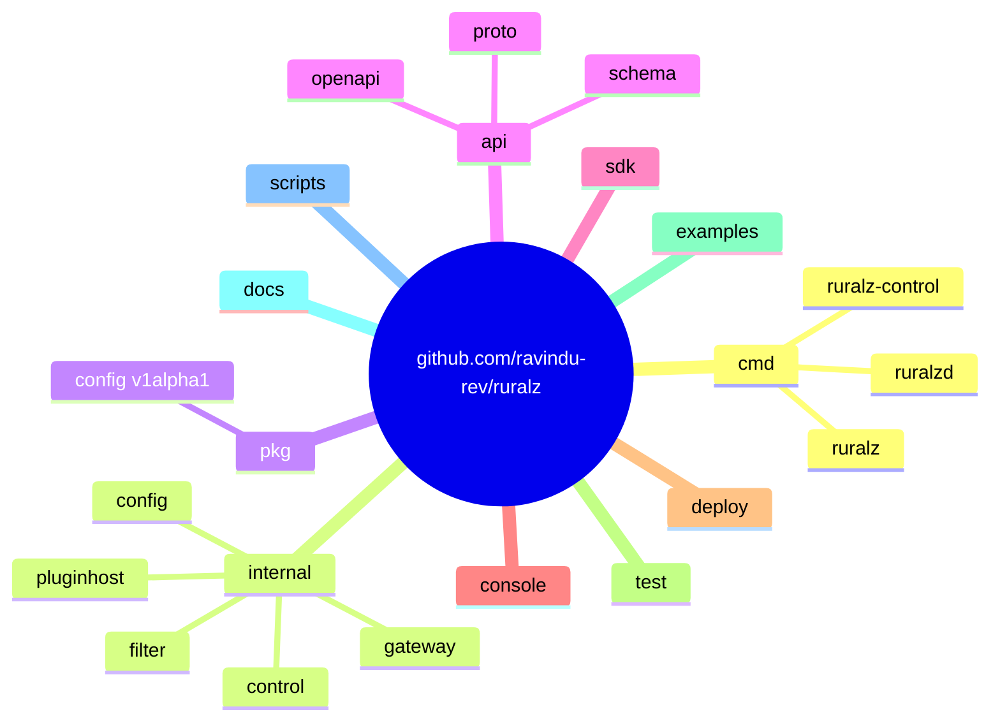
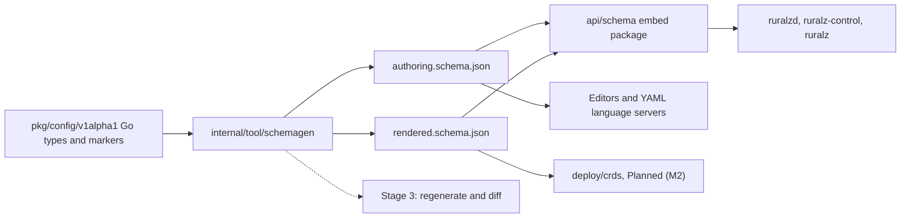
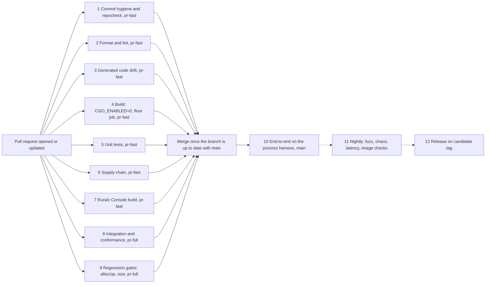

# Repository Layout and Conventions

## Summary

This document fixes how the monorepo `github.com/ravindu-rev/ruralz` is organized and how code enters it: the tree and import rules for `ruralzd` (Ruralz Gateway), `ruralz-control` (Ruralz Control) and the `ruralz` CLI; Go conventions and golangci-lint; protobuf layout and buf; JSON Schema generation from Go types; commit, DCO and pull request rules; CI stages; and documentation verification. Untagged conventions are Planned (M0).

## Scope and non-goals

In scope: the subjects the Summary lists, plus the Ruralz Console source location and frontend toolchain, which [Tech stack and libraries](01-tech-stack-and-libraries.md) assigns here; the toolchain waits for OQ-repository-layout-and-conventions-3.

Non-goals:

- Library selection, license admission and version floors, owned by [Tech stack and libraries](01-tech-stack-and-libraries.md); this document names no linked library without a catalog row there, and no CI tool without a CI tooling row.
- Test layers, thresholds and the pipelines `pr-fast`, `pr-full`, `main`, `nightly` and `release`, owned by [Testing and quality strategy](03-testing-and-quality-strategy.md).
- Versions, release artifacts, signing and SBOMs, owned by [Release, versioning and compatibility](04-release-versioning-and-compatibility.md).
- JSON Schema content (kinds, fields, defaults, `x-ruralz-*` values), owned by the [Configuration model](../architecture/02-configuration-model.md); this document owns the generation mechanism and paths.
- The CLI surface, owned by [CLI and API surface](../reference/01-cli-and-api-surface.md), and Control Stream message semantics, owned by [Control plane and GitOps](../architecture/04-control-plane-and-gitops.md).

## Monorepo tree

Ruralz is one Git repository and one root Go module, `github.com/ravindu-rev/ruralz`, with the top-level Go directories fixed by the [foundation pack](../_meta/foundation-pack.md) section 2: `cmd/ruralzd`, `cmd/ruralz-control`, `cmd/ruralz`, `internal/`, `pkg/`, `api/` and `sdk/`. The layout is Planned (M0) and grows with each milestone.

*Figure 1: top-level directories of the monorepo `github.com/ravindu-rev/ruralz`.*



Package names under `internal/` are proposals that owning documents MAY refine while the import rules hold.

```text
github.com/ravindu-rev/ruralz
├── cmd/
│   ├── ruralzd/                 main package of Ruralz Gateway
│   ├── ruralz-control/          main package of Ruralz Control
│   └── ruralz/                  main package of the CLI
├── internal/
│   ├── gateway/                 ruralzd supervisor; snapshot, handler, exchange, executor, router,
│   │                            listener, upstream, admin, reload, lkg, drain, handover (Package layers)
│   ├── control/                 api, rollout, drift, enroll, gitsource (M0 stub until Planned (M2))
│   ├── controlstore/            raft (default), postgres (Planned (M4))
│   ├── controlstream/           client (Node side), server (Ruralz Control side)
│   ├── cli/                     root, command, completion, adminclient; one package per noun
│   ├── config/                  diag, tree, hub, revision, stages loader to canonical, pipeline
│   ├── expr/, cel/              CEL contracts (stdlib only) and the cel-go implementation
│   ├── filter/                  Filter SPI; built-in Filters, one package per Policy type; builtin
│   ├── pluginhost/              wazero host, Host Functions, Capability gate (Planned (M2))
│   ├── statestore/              State Store API; breaker, keys, memory, redis, manager, postcommit
│   ├── secret/, identity/       secretRef contracts and resolver; Consumers and credential indexes
│   ├── signing/                 digest verification; Sigstore and OCI fetch Planned (M2)
│   ├── telemetry/               catalog, emit handles, aggregates, tracing, logs, OTLP runtime
│   ├── clock/, phase/, problem/ leaf contracts: clock, Phases and Filter classes, RFC 9457 writer
│   ├── errcode/                 RZ-<AREA>-<NNN> registry
│   ├── buildinfo/               version, commit and flavor set by -ldflags -X; floor guard file
│   ├── console/                 embed package; dist/ holds a committed placeholder
│   ├── gen/proto/               generated protobuf Go code (committed)
│   ├── testkit/                 test support: binaries, processes, PKI, fault proxy, mocks, load
│   └── tool/                    CI programs (Package layers); never linked into a binary
├── pkg/
│   └── config/v1alpha1/         public Go types of the ten kinds; schema source
├── api/
│   ├── proto/ruralz/control/v1/ package ruralz.control.v1
│   ├── proto/ruralz/plugin/v1/  package ruralz.plugin.v1
│   ├── schema/                  embed package; ruralz/v1alpha1/ holds the generated JSON Schema
│   └── openapi/                 REST API description for /api/v1/
├── sdk/                         Plugin PDKs: go/, rust/, typescript/, dotnet/
├── console/                     Ruralz Console TypeScript source
├── deploy/                      container/, systemd/, grafana/, benchhost/; helm/ chart, crds/ (generated)
├── test/                        conformance/, integration/, property/, e2e/, compose/, t5/, chaos/,
│                                bench/, fixtures/
├── examples/                    example Bundles, validated in CI
├── docs/                        documentation (see Docs as code)
├── scripts/                     install-tools.sh and CI helper scripts
├── .github/                     workflows/, CODEOWNERS, pull request template
├── .gitattributes, .gitignore, .golangci.yml, buf.yaml, buf.gen.yaml
├── go.mod, go.sum, Makefile
└── LICENSE, NOTICE, README.md, CONTRIBUTING.md, SECURITY.md, TRADEMARKS.md
```

### Directory responsibilities

| Path | Contents | Owning document | Milestone |
|---|---|---|---|
| `cmd/ruralzd` | `main` for Ruralz Gateway: wiring only; `internal/gateway/setting` parses `RURALZ_*` | [Data plane](../architecture/03-data-plane.md) | Planned (M1) |
| `cmd/ruralz-control` | `main` for Ruralz Control | [Control plane and GitOps](../architecture/04-control-plane-and-gitops.md) | Planned (M2) |
| `cmd/ruralz` | `main` for the CLI | [CLI and API surface](../reference/01-cli-and-api-surface.md) | Planned (M1) |
| `internal/` | Every non-public Go package; the default home for new code | Feature documents (content); this document (boundaries) | Planned (M0) |
| `pkg/` | Public Go API, only `pkg/config/v1alpha1` at first; product SemVer from `1.0.0` | [Release](04-release-versioning-and-compatibility.md) | Planned (M0) |
| `api/` | Protos, generated JSON Schema, OpenAPI; the importable `api/schema` package has the same promise as `pkg/` | This document (layout); contract owners (content) | Planned (M0) schema; Planned (M2) protos |
| `sdk/` | Plugin PDKs; the Go PDK is its own module, tagged `sdk/go/vX.Y.Z` on its own SemVer | [WASM plugin system](../architecture/05-wasm-plugin-system.md#sdk-matrix) | Planned (M2) Go and Rust; Planned (M3) TypeScript; Planned (M4) C# |
| `console/` | Ruralz Console source, a React and TypeScript SPA | [Control plane and GitOps](../architecture/04-control-plane-and-gitops.md) (content); this document (toolchain) | Planned (M2) |
| `deploy/` | Dockerfile, systemd unit and helper, alert rules and Grafana dashboards, the benchmark hosts' setup in `deploy/benchhost` (setup scripts, the RH-1, RH-3 and loopback inventories and the runbook, [Reference hardware](../architecture/12-performance-budgets-and-benchmarking.md#reference-hardware)); Helm chart, CRDs ([ADR-0016](../adr/0016-kubernetes-helm-and-crds.md), proposed) | [Deployment topologies](../operations/01-deployment-topologies.md) | Planned (M1); chart and CRDs Planned (M2) |
| `test/`, `examples/` | Suites needing built binaries or a State Store, fixtures; example Bundles | [Testing and quality strategy](03-testing-and-quality-strategy.md) | Planned (M1) |

### Where Go code goes

- New code starts in `internal/`. `pkg/` becomes a SemVer promise at `1.0.0` ([Release, versioning and compatibility](04-release-versioning-and-compatibility.md)), so a move to `pkg/` needs the owner's decision.
- `cmd/<binary>` holds only `main.go` with `func main`; flags and logic live under `internal/`, and repocheck fails on anything else.
- Built-in Filters map from the Policy `type` (foundation pack section 10) to a path: dots become slashes, hyphens are dropped (`auth.api-key` in `internal/filter/auth/apikey`). `headers` lives in `internal/filter/header` (Go packages are singular); `plugin` maps to `internal/pluginhost`.
- depguard confines each wrapped library to its package (tech stack criterion S7), as [Banned imports](#banned-imports) lists; rueidis stays in `internal/statestore/redis`, including the Semantic Cache vector client.
- The shared validation library in `internal/config` links into all three binaries, so `ruralz bundle validate`, Ruralz Control ingest and Node activation give identical offline diagnostics for the same overlay and variables; online checks can still fail later ([Configuration model](../architecture/02-configuration-model.md#validation-and-diff-semantics)).

### Ruralz Console assets

`internal/console` embeds `all:dist` with `go:embed`. Only a placeholder `internal/console/dist/index.html` is committed, so `go build ./...` compiles on a fresh clone without Node.js and `ruralz-control` serves it at `/console`, stating that Ruralz Console was not built; stages 7 and 12 overwrite it before building `ruralz-control`. The root `.gitignore` MUST anchor `/dist/` and add `internal/console/dist/*` and `!internal/console/dist/index.html`. Planned (M2).

### Package layers

M1 packages, Planned (M1), form layers L0 to L8. The rule is "acyclic, never upward": a package imports only packages of its own layer or a lower one. Test support and CI tools sit outside the layers and may import any production package; production code never imports them. The map lists every M1 package; paths are under `internal/` unless they start with `pkg/`, `api/`, `cmd/` or `test/`.

```text
L8    cmd/ruralzd -> gateway    cmd/ruralz -> cli    cmd/ruralz-control -> control (M0 stub)
L7    gateway (Run)    cli (root)    control (M0 stub)
L6    gateway/{reload,lkg,source}    cli/{bundle,launch,dev}
L5    config/pipeline    gateway/{handler,handover,compile}    filter/builtin    filter/builtin/checks    cli/node
L4    config/{loader,validate,diff,render}    gateway/{composition,drain,replay}    gateway/upstream/forward
      cli/adminclient
L3    cel    telemetry (Runtime)    config/{profile,schemaview,overlay,subst,defaults,convert,precedence,canonical}
      statestore/{memory,redis,manager,postcommit}
      gateway/{executor,exchange,retire,router,listener,reuseport,tap,readiness,admin,upstream}
      filter/auth/{jwt,jwt/jwks,apikey,basic,mtls,upstreamoauth2}    filter/authz/{ip,cel}    filter/cors
      filter/validation/jsonschema    filter/header    filter/transform{,/dotpath,/request,/response}
      filter/{ratelimit,quota,cache}    filter/cache/{revalidate,coalesce}
L2    config/{schemaidx,registry}    identity    filter/auth    filter/auth/jwt/check    filter/authz/geoip
      secret/resolver    cel/celtypes
      telemetry/{aggregate,tracing,logsink,accesslog}    statestore/{breaker,keys}    nodedir
      gateway/{setting,admission,body,sdnotify}    gateway/upstream/{balance,discovery,health,resilience}
      clientaddr    egress    tlsconf    adminauth    redact    signing    cli/{command,completion}
L1    expr    secret    config/{tree,hub}    telemetry/emit    statestore    filter    gateway/snapshot
L0    errcode    buildinfo    clock    phase    problem    adminapi    config/{diag,revision}    telemetry/catalog
      ulid    jsonval    httpfield    sfv    routematch    netaddr    pkg/config/v1alpha1    api/schema
test  clock/clocktest    filter/filtertest    cel/celtest    gateway/handler/handlertest
      statestore/statestoretest{,/redisserver,/respproxy}
      testkit/{binaries,proc,pki,faultproxy,canary,promtext,benchrecord,corpus}
      testkit/{mockup,mockidp,otlpsink,l4lb,loadgen,topology}
      test/{conformance/config,conformance/protocol,property,e2e,chaos,chaos/gameday,compose,t5}
      test/integration/{cel,telemetry,security,statestore}    test/bench/{harness,scenarios,gen,functional,labhost}
tool  tool/{repocheck,commitcheck,depgate,schemagen,telemetrygen,benchgate,sizegate,fuzzplan}
      tool/{releasekit,releasegate}    tool/modpin (temporary module pins, removed within M1)
```

Wiring injects what an import would climb for: the admin server's `/metrics`, `/config/dump` and `/debug/upstreams` handlers, the State Store drivers' openers, and the pipeline's offline Policy checks (`checks.Table()`) and CEL compiler.

`checks.Table()` links into all three binaries, so an offline check never imports a module that `cmd/ruralz` does not link ([Dependency graph](01-tech-stack-and-libraries.md#dependency-graph)). A Policy type's check lives in its Filter package unless that package links such a module, as `auth.jwt`'s links jwx; then it lives in a `check` package beside it, `filter/auth/jwt/check`, which the Filter's Build imports for the same rules. A type the schema admits whose Filter is not served yet keeps its check at its own path, as `filter/authz/geoip` does until the `authz.geoip` Filter ships, Planned (M2). depgate fails a `cmd/ruralz` build that links jwx.

### Import boundaries

| Rule | Reason | Enforced by |
|---|---|---|
| `internal/gateway/...` never imports `internal/control/...`, `internal/controlstore/...` or `internal/cli/...` | P2: the gateway stands alone ([Vision](../vision/01-vision-and-positioning.md#principles)); `ruralzd` never links Raft | depguard; the stage 6 Raft denylist over `go list -deps ./cmd/ruralzd` also catches transitive imports |
| `internal/control/...` never imports `internal/gateway/...` | Ruralz Control is never on the request path | depguard |
| `internal/config/...`, `internal/expr` and `internal/cel` never import `internal/gateway`, `internal/filter`, `internal/statestore` or `internal/cli` | Every binary runs one configuration pipeline; Policy checks are injected | depguard `config` |
| `internal/filter/...`, `internal/identity` and `internal/statestore/...` never import `internal/gateway` or `internal/cli` | The gateway implements their contracts | depguard `filter` |
| Only `ruralzd` imports `internal/secret/resolver` | Only Nodes resolve secret values | depguard `secretresolver` |
| Leaf contracts (`phase`, `expr`, `clock`, `problem`, `adminapi`, `telemetry/{catalog,emit}`, `config/{diag,revision}`) import only the standard library, `pkg/config/v1alpha1`, `phase`, `errcode` and `telemetry/catalog` | Every layer builds on them | depguard `contracts` (strict) |
| Production code never imports test support (`internal/testkit`, `*test` packages) or `internal/tool` | Nothing test-only ships | depguard `testsupport` and `tools`; stage 6 |
| Every third-party import is on the admitted list, which mirrors the catalog rows | Admission ([tech stack](01-tech-stack-and-libraries.md#admission)) | depguard `admitted` (strict) |
| `pkg/...` imports only the standard library and other `pkg/...` packages | No third-party or internal type leaks into public API (S7) | depguard; exported-API check in repocheck |
| `sdk/...` never imports the root module | PDKs compile to WASM guests with their own toolchains and versions | Separate modules; stage 3 builds each |
| No `import "C"` anywhere | `CGO_ENABLED=0` static binaries ([ADR-0001](../adr/0001-implementation-language-go.md)); a `CGO_ENABLED=0` build silently excludes such files | repocheck source scan; stage 4 cross-build |
| `internal/cli/...` never imports `internal/gateway/...` or a State Store driver | `ruralz dev run` launches a local `ruralzd` (foundation pack section 9) | depguard `cli` |
| No `plugin` standard package, no Lua | Custom code is a WASM Plugin or CEL (product non-goal 3) | depguard |

## Go conventions and linters

### Toolchain and modules

The root `go.mod` declares `go 1.26.0` and `toolchain go1.27.3`, as fixed by [ADR-0001](../adr/0001-implementation-language-go.md) and the [version floor](01-tech-stack-and-libraries.md#version-floor) rules; the floor job adds `GOTOOLCHAIN=local` and `GOEXPERIMENT=jsonv2`. It runs `make floor`, which takes `FLOOR_GOTOOLCHAIN` (default `local`, `go1.26.8` or a newer 1.26 patch elsewhere) and refuses a Go release other than 1.26. The guard file is `internal/buildinfo/floor_guard.go`, whose undefined identifier `floorBuildRequires_GOEXPERIMENT_jsonv2_see_make_floor` names the fix; every binary imports the package.

Binaries embed build metadata with `-ldflags -X` on three variables of `internal/buildinfo`: `version` (the tag without its `v`, default `0.0.0-dev`), `commit` (the full Git commit) and `flavor` (`default`; `fips` Planned (M5)). There is no build date, so a rebuilt tag reproduces identical binaries. Nested modules exist only under `sdk/`. The repository commits no `go.work` file, so CI builds each module the way its users consume it.

Build tools stay out of `go.mod`. Go 1.24 added `tool` directives that put executables into the module graph ([source](https://go.dev/doc/go1.24)), and golangci-lint is GPL-3.0 ([source](https://github.com/golangci/golangci-lint/blob/v2.15.0/LICENSE)), so the linter, buf and other CI tools run as pinned, checksum-verified binaries installed by `make tools`, never as `tool` directives ([license rules](01-tech-stack-and-libraries.md#license-rules)).

### Code conventions

| Area | Rule |
|---|---|
| Packages | Lower-case, singular, no underscores (foundation pack section 12); no `util`, `common` or `misc` |
| Files | Lower-case with underscores (`route_match.go`); tests beside code; golden files under `testdata/` |
| License header | Every hand-written Go, proto and TypeScript file starts with `Copyright <creation year> <copyright holder>` (Revington for Revington's work) and `SPDX-License-Identifier: Apache-2.0` ([ADR-0002](../adr/0002-apache-2-license-no-feature-gating.md)) |
| Generated files | First line `// Code generated by <tool>. DO NOT EDIT.`; no license header; excluded from lint; diffed in stage 3 |
| Line endings | `.gitattributes` pins LF on every OS |
| Build constraints | Platform, Go version and `goexperiment` constraints (such as the floor guard file), plus test-only tags `integration` (stage 8), `e2e` (stage 10), `t5` (the live T5 suite of `t5-systemd.yml`) and `compose` (the Compose suite of `image-checks.yml`) on `_test.go` files, and the test-only build tag `ruralz_testclock`, which `internal/testkit/binaries` sets for the controllable-clock `ruralzd` build, on the pair of `internal/clock` files that pick the process clock ([Hermetic rule scope](03-testing-and-quality-strategy.md#hermetic-rule-scope)). No feature tags (P1) |
| Context | First parameter of any function that blocks or calls the network or the State Store; never stored in a struct |
| Goroutines | Each has an owner that cancels and waits for it; every channel, queue and pool is bounded (System overview) |
| Errors | Wrap with `%w`; client-facing errors carry an `RZ-<AREA>-<NNN>` code registered in `internal/errcode`, map to a status through it and leave through `problem.Write` (RFC 9457) |
| Time | Code that measures or schedules time takes an `internal/clock.Clock`; only `clock.Real` calls `time.Now`; tests use `clocktest.Fake` |
| Logging | `log/slog` through `internal/telemetry` only ([ADR-0018](../adr/0018-telemetry-opentelemetry-prometheus-exporter.md)) |
| Telemetry names | Metrics `ruralz_<component>_<name>_<unit>`, counters ending in `_total`; spans `ruralz.filter.<name>`, `ruralz.upstream.<name>`, `ruralz.route.match` (foundation pack section 2) |
| State | No `init()` or mutable package-level variables, except tests, generated code, sentinel errors, `go:embed` variables and the build metadata the linker sets in `internal/buildinfo`; registries are explicit tables |
| `unsafe` | Only in packages listed in `.golangci.yml`, each with a reason |

### golangci-lint linter set

golangci-lint v2.15.x ([source](https://github.com/golangci/golangci-lint/releases/tag/v2.15.0)), a binary built with Go 1.27 or newer, runs every linter below in stage 2, Planned (M0). A finding blocks merge. A suppression MUST name the linter and give a reason (`//nolint:gosec // reason`).

| Linter | Purpose in Ruralz |
|---|---|
| `errcheck`, `govet`, `ineffassign`, `staticcheck`, `unused` | The standard set |
| `bodyclose`, `contextcheck`, `noctx` | Response bodies closed; context propagated to every network call |
| `depguard` | Import boundaries and banned imports |
| `errorlint`, `nilerr` | Wrapped `RZ` errors match through `errors.Is` and `errors.As` |
| `exhaustive` | Switches over enums (Rollout states, Phases, Filter classes) cover every value |
| `forbidigo` | Bans `fmt.Print*` outside `internal/cli` and the deprecated `x/net/http2` `Server` and `Transport` ([ADR-0009](../adr/0009-http-stack-net-http-quic-go.md)) |
| `gochecknoinits`, `gocritic`, `unparam`, `unconvert`, `usestdlibvars` | No `init()`; style, performance and simplification |
| `goheader` | Go license header: any holder, SPDX line required; repocheck covers proto and TypeScript |
| `gosec` | Security diagnostics |
| `misspell`, `revive`, `sloglint` | American English; documented exports; `slog` with no global logger, static messages and `snake_case` keys |
| `nolintlint` | Every suppression is specific and explained |
| `protogetter`, `spancheck` | Protobuf getters; spans ended with errors recorded |
| `tagliatelle` | `camelCase` JSON tags matching YAML keys, scoped to `pkg/config` and `internal/config`, because provider and OAuth2 wire formats (`max_tokens`, `access_token`) are snake_case |

Formatters are `gofumpt` and `goimports`, with `github.com/ravindu-rev/ruralz` as the local import prefix. An excerpt of `.golangci.yml` follows.

```yaml
# .golangci.yml (golangci-lint configuration, not a Ruralz Bundle)
version: "2"
run:
  go: "1.26"
  build-tags: [integration, e2e, t5, compose]
linters:
  default: standard
  enable: [bodyclose, contextcheck, depguard, errorlint, exhaustive, forbidigo,
           gochecknoinits, gocritic, goheader, gosec, misspell, nilerr, noctx,
           nolintlint, protogetter, revive, sloglint, spancheck, tagliatelle,
           unconvert, unparam, usestdlibvars]
  settings:
    misspell:
      locale: US
    nolintlint:
      require-specific: true
      require-explanation: true
    tagliatelle:
      case:
        rules:
          json: camel
  exclusions:
    rules:
      - linters: [tagliatelle]
        path-except: '^(pkg|internal)/config/'
formatters:
  enable: [gofumpt, goimports]
  settings:
    goimports:
      local-prefixes: [github.com/ravindu-rev/ruralz]
```

### Banned imports

| Import | Use instead | Reason |
|---|---|---|
| `github.com/google/cel-go` | `cel.dev/cel-go` | Read-only alias path (foundation pack section 7) |
| `log` (depguard rule `log$`) | `log/slog` via `internal/telemetry` | One structured logging path (ADR-0018) |
| `github.com/tetratelabs/wazero` outside `internal/pluginhost` | `internal/pluginhost` | S7 wrapping; `ruralz plugin test` runs Plugins through the same host package as `ruralzd` |
| `github.com/hashicorp/raft` outside `internal/controlstore/raft` | `internal/controlstore` interface | MPL-2.0 exception scoped to the Control Store ([license rules](01-tech-stack-and-libraries.md#license-rules)) |
| `github.com/goccy/go-yaml`, `go.yaml.in/yaml/v4`, `gopkg.in/yaml` | `internal/config/profile` | The restricted YAML profile is Ruralz code and the only YAML parser and emitter ([ADR-0003](../adr/0003-configuration-format.md)) |
| `go.yaml.in/yaml/v3` outside `internal/config/profile` tests | `internal/config/profile` | Only the profile's tests use it, as a differential oracle |
| `github.com/santhosh-tekuri/jsonschema` outside `internal/config/schemaview` and `internal/filter/validation/jsonschema` | Those two packages | S7 wrapping |
| `cel.dev/cel-go`, `cel.dev/expr` outside `internal/cel` | `internal/expr` contracts | Everything else codes against the contracts |
| `github.com/lestrrat-go/jwx` outside `internal/filter/auth/jwt`; its `jwt`, `jwe` and root packages anywhere | `jwk`, `jws` and `jwa` there | The others link `golang.org/x/crypto` (G3) |
| `go.opentelemetry.io`, `github.com/prometheus`, `google.golang.org/grpc` outside `internal/telemetry` and `internal/testkit/otlpsink` | `internal/telemetry` handles | [ADR-0018](../adr/0018-telemetry-opentelemetry-prometheus-exporter.md) confinement |
| `golang.org/x/sys` outside `internal/gateway/reuseport`, `internal/gateway/handover`, `internal/testkit/proc`; `golang.org/x/net` outside `test/conformance/protocol` | Standard library | Socket steering, peer credentials, test namespaces; the HTTP/2 `Framer` in tests |
| `github.com/testcontainers` outside tests and `internal/statestore/statestoretest/redisserver` | That launcher | Test tooling, never linked |
| `encoding/json/v2`, `encoding/json/jsontext` outside `//go:build go1.27` test oracles | `internal/jsonval` | Standard only from Go 1.27, above the [version floor](01-tech-stack-and-libraries.md#version-floor) |
| Any module without a catalog row | Add a row in the same pull request | [Dependency admission](01-tech-stack-and-libraries.md#admission) |

### Ruralz-specific checks

`internal/tool/repocheck`, a standard-library Go program run in stage 1, Planned (M0), checks what no linter covers: `cmd/` holds wiring only; metric and span names match foundation pack section 2; every `RZ-<AREA>-<NNN>` literal is registered; `pkg/` and `api/schema` expose no third-party types; proto and TypeScript license headers; no `import "C"`; the Ruralz Console placeholder is unchanged. It also runs the no-license-check scan of [ADR-0002](../adr/0002-apache-2-license-no-feature-gating.md) over every file in `cmd/`, `internal/`, `pkg/`, `sdk/` and `console/`: any denylisted identifier, string or hostname absent from the allowlist file blocks merge (P1). Terms match ignoring case and the separators `-`, `_` and spaces, so `licenseKey`, `license_key` and `LICENSE-KEY` all match; the allowlist is `internal/tool/repocheck/nolicensecheck.allow`, one `<path or directory/> <term> # <reason>` line per entry. From Planned (M1), it also checks `internal/telemetry/catalog` and every `ruralz_*` name under `docs/architecture/` against the [Observability](../architecture/10-observability.md#metrics-catalog) metrics and degraded-state tables; the Ruralz Console check starts with `internal/console`, Planned (M2).

Other standard-library programs: `internal/tool/commitcheck` checks DCO sign-off and `Deprecated:` footers on every non-merge commit of a range and the Conventional Commits title, and fails a range that changes or deletes a golden-corpus file the newest release tag holds ([Golden tests](03-testing-and-quality-strategy.md#golden-tests)); `internal/tool/depgate` runs G2, G3, the `ruralzd` Raft denylist, the `ruralz` jwx denylist and the advisory floors ([CI tooling](01-tech-stack-and-libraries.md#ci-tooling)), from M1 also denies test support and `internal/tool` in every binary and writes each artifact's `THIRD_PARTY_LICENSES` and `NOTICE` (`-notices`); `telemetrygen` generates alert rules and Grafana dashboards (stage 3 drift); `benchgate` and `sizegate` gate stage 9, `fuzzplan` shards nightly fuzzing, and `releasekit` and `releasegate` package and gate stage 12.

## API and protobuf definitions

All language-neutral contracts live under `api/`. Protobuf files are the source of truth for the Control Stream and for Plugin ABI v1 metadata; Go code generated from them is committed under `internal/gen/proto/`, so `go build` never needs buf. Proto packages are fixed by foundation pack section 12.

| Path | Proto package | Contents | Owner | Milestone |
|---|---|---|---|---|
| `api/proto/ruralz/control/v1/` | `ruralz.control.v1` | Service `ControlStream` with unary `Enroll` and bidirectional `Stream` ([ADR-0007](../adr/0007-control-stream-protocol.md)) | [Control plane and GitOps](../architecture/04-control-plane-and-gitops.md) | Planned (M2) |
| `api/proto/ruralz/plugin/v1/` | `ruralz.plugin.v1` | Plugin ABI v1 metadata, from which PDKs could generate constants ([ADR-0005](../adr/0005-plugin-abi-v1.md)); whether it exists and its contents are OQ-repository-layout-and-conventions-2 | [WASM plugin system](../architecture/05-wasm-plugin-system.md) | Planned (M2) |
| `api/openapi/` | None | REST API under `/api/v1/` on 8090; authoring is OQ-repository-layout-and-conventions-5 | [Control plane and GitOps](../architecture/04-control-plane-and-gitops.md) | Planned (M2) |
| `api/schema/ruralz/v1alpha1/` | None | Generated JSON Schema ([Schema generation from Go types](#schema-generation-from-go-types)) | [Configuration model](../architecture/02-configuration-model.md) | Planned (M0) |

The WASM import module `ruralz.plugin.v1` is the ABI contract; the proto package of the same name would only describe its constants and metadata, because the Plugin ABI passes raw buffers and canonical JSON ([WASM plugin system](../architecture/05-wasm-plugin-system.md)).

### buf rules

buf v1.73.x (Apache-2.0) ([source](https://github.com/bufbuild/buf/releases/tag/v1.73.0)) ([source](https://github.com/bufbuild/buf/blob/main/LICENSE)) is the only proto tool contributors run. One `buf.yaml` at the repository root declares `api/proto` as the module:

```yaml
# buf.yaml (buf configuration, not a Ruralz Bundle)
version: v2
modules:
  - path: api/proto
lint:
  use: [STANDARD, COMMENTS]
  # Foundation pack section 2 fixes the service name ControlStream.
  service_suffix: Stream
breaking:
  use: [FILE]
```

`service_suffix: Stream` keeps the pack's `ControlStream` name lint-clean. This document proposes `<RPC>Request` and `<RPC>Response` envelopes (`EnrollRequest`, `StreamRequest`, `StreamResponse`) to Control plane and GitOps, which owns the messages.

| Check | Command | Rule |
|---|---|---|
| Format | `buf format --diff --exit-code` | Canonical formatting |
| Lint | `buf lint` | Directory matches package; versioned package suffix; enum zero values end in `_UNSPECIFIED`; every message, field and RPC has a comment (`COMMENTS`) |
| Breaking | `buf breaking --against` the `main` branch and the last tag of each release line in support, as the Release document requires | No removed or renumbered field, no changed type, no renamed RPC within a `v1` package; a breaking change needs a new package (`v2`) and a Release document decision |
| Generate | `buf generate` | Writes committed Go code under `internal/gen/proto/` and, per OQ-repository-layout-and-conventions-2, PDK constants under `sdk/`; generator plugins wait for OQ-tech-stack-and-libraries-14 |

Proto style: files are `lower_snake_case.proto`, messages and services `PascalCase`, fields `lower_snake_case` (JSON mapping `lowerCamelCase`), and removed fields become `reserved` numbers and names. Compatibility windows belong to [Release, versioning and compatibility](04-release-versioning-and-compatibility.md).

## Schema generation from Go types

The Configuration model publishes one JSON Schema (draft 2020-12) in two views, authoring and rendered, "generated from one source" ([ADR-0003](../adr/0003-configuration-format.md), [schema keywords](../architecture/02-configuration-model.md#schema-keywords-that-drive-tooling)). This document fixes that source and the output, Planned (M0):

| Item | Value |
|---|---|
| Source package | `github.com/ravindu-rev/ruralz/pkg/config/v1alpha1` (directory `pkg/config/v1alpha1`): Go types for the envelope, the ten kinds and each Policy type's `config` |
| Generator | `internal/tool/schemagen`, invoked by a `//go:generate` directive in `pkg/config/v1alpha1/doc.go` |
| Output path | `api/schema/ruralz/v1alpha1/authoring.schema.json` and `api/schema/ruralz/v1alpha1/rendered.schema.json`, each holding one definition per kind; the served-feature table `internal/config/registry/planned_gen.go`, from the `+ruralz:planned` markers |
| Embedding | Package `api/schema` embeds both files with `go:embed`, so every source-loading path validates against identical bytes |
| Derived output | CRDs in `deploy/crds/`, generated from the rendered view with group `ruralz.io`, Planned (M2) ([ADR-0016](../adr/0016-kubernetes-helm-and-crds.md), proposed) |
| Published | Committed under `api/schema/` and embedded in every binary; the two files also ship with every release ([Release artifacts](04-release-versioning-and-compatibility.md)); their `$id` uses a Revington-owned domain, an identifier that no binary fetches ([apiVersion lifecycle](04-release-versioning-and-compatibility.md#apiversion-lifecycle-and-deprecation-windows)) |

A later apiVersion adds a sibling source package (`pkg/config/v1beta1`) and output directory. Hub types and conversions stay in `internal/config/hub` and `internal/config/convert`, because the hub is never public ([Configuration model](../architecture/02-configuration-model.md#hub-and-spoke-conversion)).

*Figure 2: one set of Go types generates both schema views and everything derived from them.*



### Normative artifact

The generated JSON Schema, not the Go types, is the contract every tool reads, keeping the Configuration model rule that "the JSON Schema is the single source of truth". Every source-loading path validates the parsed, substituted document against the embedded schema before decoding it into Go types ([Configuration model](../architecture/02-configuration-model.md#validation-and-diff-semantics)). Go types carry only `json` tags.

### Markers

Doc comments become `description`. Marker lines start with `+ruralz:`, are stripped from the description and emit schema keywords:

| Marker | Emits | Example |
|---|---|---|
| `+ruralz:required` | `required` in the parent object | On `PolicyRef.Name` |
| `+ruralz:ref=<Kind>` | `x-ruralz-ref` | `+ruralz:ref=Policy` |
| `+ruralz:secret` | `x-ruralz-secret` | On a `SecretValue` field |
| `+ruralz:cel=<variables>:<result type>` | `x-ruralz-cel` | On a `when` field |
| `+ruralz:list=<map, orderedMap, set or atomic>[,key=<field>]` | `x-ruralz-list` | `+ruralz:list=orderedMap,key=name` |
| `+ruralz:impact=<class>` | `x-ruralz-impact` | `+ruralz:impact=security` |
| `+ruralz:since=<level>` | `x-ruralz-since` | `+ruralz:since=2` |
| `+ruralz:validation=<CEL rule>` | `x-ruralz-validations` | Rule over `self` |
| `+ruralz:default=<value>` | `default` | `+ruralz:default=true` |
| `+ruralz:policyType=<type>` | The `config` definition selected by `Policy.spec.type` | `+ruralz:policyType=ratelimit` |
| `+ruralz:open` | Omits `additionalProperties: false` on a type | A Policy `config` whose feature fields are not all registered |
| `+ruralz:pattern=`, `minLength=`, `maxLength=`, `minimum=`, `maximum=`, `minItems=` | The standard keyword of the same name | `+ruralz:minItems=1` |
| `+ruralz:minProperties=<n>` | `minProperties` on a type or a map-typed field | On `RouteMatch` |
| `+ruralz:exactlyOneOf=`, `atMostOneOf=`, `atLeastOneOf=<fields>` | `oneOf`, `not` or `anyOf` over `required` of each field, on a type | `+ruralz:exactlyOneOf=exact,prefix,template,regex` |
| `+ruralz:requiredIf=<field>,<member>=<value>` | `if` (member `const` value, `required`) and `then` (`required` field), on a type; the value must belong to the member's enum | `+ruralz:requiredIf=url,driver=redis` on `StateStore` |
| `+ruralz:planned=<milestone>` | No schema keyword: an entry of the served-feature table, on a kind's spec type, a field or an enum `const` | `+ruralz:planned=M3` on a listener's `HTTP3` |

Markers on a type declaration apply to its definition; markers on a field apply to its property. A `+ruralz:planned` milestone later than the one the release serves, a constant of `internal/config/registry` (`M1` in this release), marks a kind, field or enum value the release does not serve: the Node's serve check refuses each occurrence present with a value other than its default with RZ-CFG-040 ([Error codes](../architecture/02-configuration-model.md#error-codes)), so a schema default such as `limits.maxPluginMemoryBytes` never refuses a Revision. Policy types take their milestones from the Policy type registry instead. schemagen rejects an unknown marker, a list field without `+ruralz:list`, a `SecretValue` or `SecretRef` field without `+ruralz:secret`, an optional bool or number that is not a pointer, an optional field without `omitempty`, a `+ruralz:secret` field without a `+ruralz:impact` that includes `security`, a `+ruralz:default` value that fails its field's own `pattern`, `minLength`, `maxLength`, `minimum` or `maximum`, a `+ruralz:default` on a `+ruralz:required` field, a second `+ruralz:impact` marker on one field, or impact classes not listed once each in ascending byte order, and a `+ruralz:planned` value that is not a milestone after the release's own, up to `M5`.

### Presence and defaults

A Go zero value cannot tell an absent field from an explicit `false` or `0`, so, Planned (M0):

- `required` comes only from `+ruralz:required`, never from a missing `omitempty`.
- Every optional bool and number, and every optional field whose default is not the Go zero value, is a pointer, so an authored `overridable: false` decodes as set.
- Stage G (`internal/config/defaults`) applies the embedded schema's `default` values only to nil pointers and absent fields; the loader (`internal/config/loader`, stages A to E) writes no default, so an absent field stays absent until then.
- The `ruralz.canonical.v1` encoder is schema-driven, never relying on `encoding/json` `omitempty`: it writes materialized defaults and omits a field with `x-ruralz-since` above 0 only when it equals its default ([canonical form](../architecture/02-configuration-model.md#canonical-form-and-revision)).
- A golden test proves that an explicit `overridable: false` survives canonicalization and changes the Revision.

A named string type with a `const` block becomes an `enum`; `Duration` and byte-size types get the syntax the Configuration model defines. The authoring view adds the `${VAR}` alternative to every substitutable non-string scalar and to every substitutable string constrained by an enum or a pattern. RZ-CFG-011 forbids substitution in keys, `apiVersion`, `kind`, `metadata.name` and `ref`, `secret` or `cel` fields; schemagen hard-codes the envelope fields and reads the markers for the rest.

The example uses only Configuration model fields; marker values are illustrative.

```go
// RouteSpec is the spec of a Route.
type RouteSpec struct {
    // Listeners names Gateway listeners; default all.
    // +ruralz:list=set
    Listeners []string `json:"listeners,omitempty"`

    // Policies attaches Route-scoped Policies in authored order.
    // +ruralz:list=orderedMap,key=name
    // +ruralz:impact=security
    Policies []PolicyRef `json:"policies,omitempty"`

    // Timeout is the whole-request deadline.
    Timeout *Duration `json:"timeout,omitempty"`
}

// PolicyRef names a Policy in the same rendered Bundle.
type PolicyRef struct {
    // +ruralz:required
    // +ruralz:ref=Policy
    Name string `json:"name"`
}

// PolicySpec (excerpt): a pointer keeps an explicit false.
type PolicySpec struct {
    // Overridable, when false on a Gateway Policy, forbids Route replace or exclude.
    // +ruralz:default=true
    // +ruralz:impact=security
    Overridable *bool `json:"overridable,omitempty"`
}
```

### Generator rules

- `schemagen` uses only the standard library (`reflect` for structure, `go/parser` and `go/doc` for comments and markers). Adopting a third-party generator needs a catalog row first (foundation pack section 7).
- Output is deterministic: keys sorted, two-space indentation, LF line endings, a trailing newline, no timestamps. Regenerating on any OS yields identical bytes, and stage 3 fails on any diff.
- A Go test in `internal/config/schemaview` meta-validates both files against draft 2020-12 with `santhosh-tekuri/jsonschema/v6`, Planned (M1). The example Bundle tests of the configuration conformance suite, in `test/conformance/config` ([Golden tests](03-testing-and-quality-strategy.md#golden-tests)), validate `examples/` through the configuration pipeline facade with `checks.Table()` and the CEL compiler, so every stage runs: every document of a Bundle or of `examples/control/` against the authoring view, and every Bundle rendered without `--env` and for each Environment of `examples/control/` with no diagnostic, warnings included. `examples/shop-bundle/` and `examples/control/` hold the Configuration model's [example Bundle](../architecture/02-configuration-model.md#complete-annotated-example-bundle), `examples/shop-rest-bundle/` its [REST example Bundle](../architecture/02-configuration-model.md#rest-example-bundle) and `examples/quickstart/` the [quickstart](../operations/01-deployment-topologies.md#quickstart) Bundle, each byte for byte, and the test fails when a file differs from its document or a configuration file is in none; it also checks that an M1 Node serves the REST example and quickstart Bundles.
- A Plugin `configSchema` is authored by the Plugin publisher and never generated.

## Commits and pull requests

### DCO sign-off

Ruralz uses the Developer Certificate of Origin, not a CLA ([ADR-0002](../adr/0002-apache-2-license-no-feature-gating.md)). Every commit MUST carry a `Signed-off-by:` trailer whose name and email match the commit author, which certifies DCO 1.1 ([source](https://developercertificate.org/)). `git commit -s` adds the trailer; `git rebase --signoff` repairs a branch. Stage 1 rejects a pull request with any commit lacking a matching sign-off. Dependabot, the weekly update bot ([Update policy](01-tech-stack-and-libraries.md#update-policy)), cannot sign off, so the check skips commits it authors.

The DCO keeps contributor paperwork low ([source](https://helm.sh/blog/helm-dco/)) but is not what keeps Ruralz free: Apache-2.0 lets a redistributor ship later derivative works under other terms ([source](https://www.apache.org/licenses/LICENSE-2.0)), so that commitment comes from P1 and ADR-0002. The DCO check is Planned (M0).

### Conventional Commits

Commit messages and pull request titles follow Conventional Commits: `<type>(<scope>): <subject>`, imperative mood, lower-case subject, no trailing period.

| Type | Use | Scope values |
|---|---|---|
| `feat` | New behavior | `gateway`, `control`, `cli`, `config`, `filter`, `plugin`, `ai`, `statestore`, `controlstream`, `console`, `sdk`, `api`, `deploy` |
| `fix` | Bug fix | Same as `feat` |
| `perf` | Performance change with benchmark evidence (P10) | Same as `feat` |
| `refactor` | No behavior change | Same as `feat` |
| `test` | Tests only | `feat` scopes, `e2e`, `conformance` |
| `docs` | Documentation only | Document slug, for example `docs(data-plane)` |
| `build`, `ci` | Build system, CI workflows | `deps`, `tools`, `workflows` |
| `chore`, `revert` | Maintenance, reverts | Any |

A breaking change adds `!` after the scope and a `BREAKING CHANGE:` footer. Footers also carry `Refs: OQ-<docslug>-<n>` or `Refs: ADR-NNNN` when a change implements a decision.

A change that deprecates a surface adds one footer per surface, `Deprecated: <surface>; removed in MAJOR.MINOR.0`, naming the surface as users meet it (a CLI flag, a Bundle field, an apiVersion, a metric) and the first release without it; the release notes list these footers. Stage 1 runs `commitcheck deprecations` over the pull request's commits: the token is spelled `Deprecated`, the value has that form, and the removing release lies at least two minor releases after the one that ships the commit, as [Release, versioning and compatibility](04-release-versioning-and-compatibility.md#migration-tooling) sets out.

A change spanning several scopes omits the scope. A document slug is the file name of a Markdown document under `docs/`, lower-cased, without its extension and numeric prefix: `docs/architecture/03-data-plane.md` is `data-plane` and `docs/glossary.md` is `glossary`. Stage 1 checks `docs` scopes against the files in `docs/`.

```text
fix(statestore): skip remaining calls once the request deadline expires

Later Policies now apply failureMode without waiting, as foundation pack
section 8.7 requires.

Signed-off-by: Jane Doe <jane@example.com>
```

### Pull request rules

| Rule | Detail |
|---|---|
| Merge method | Squash merge only; the title becomes the commit subject, and the repository's squash message setting MUST include commit details, so every `Signed-off-by:` survives |
| Same-PR duties | Tests, regenerated files, documentation, and a catalog row for any new dependency |
| Size | SHOULD stay under 400 changed lines, excluding generated files (target) |
| Up to date | A pull request merges only when its branch is up to date with `main`, so `pr-fast` and `pr-full` ran on the combined change |
| Target branch | Pull requests, Dependabot's included, target `main`; `release-X.Y` branches take cherry-picks of merged fixes by pull request ([Release cadence and support windows](04-release-versioning-and-compatibility.md#release-cadence-and-support-windows)) |
| Approvals | None required, and nobody, admins included, bypasses the rules; the required checks are `pr-fast`, `pr-full` and `pr-title` |

### Repository settings

`scripts/repo-settings.sh`, Planned (M1), applies the repository's GitHub settings through the GitHub CLI, idempotently; an admin runs it. With `--check`, it compares the live settings with the table below and exits 1 on any drift and 2 on an error. The weekly `repo-settings.yml` workflow runs `--check` with `REPO_SETTINGS_TOKEN`, a fine-grained, read-only token secret with Administration: read, and opens or updates a `settings-drift` issue on drift.

| Area | Setting |
|---|---|
| Merging | Squash merging only, its commit title the pull request title and its message the commit details; merge commits and rebase merging off; head branches deleted after merge |
| `main` and `release-*` | One ruleset: required status checks `pr-fast`, `pr-full` and `pr-title` from GitHub Actions; branches up to date before merging; squash only; 0 approvals; no bypass actors; deletion and force pushes blocked |
| `v*` tags | A tag ruleset: only admins create them, and nobody updates or deletes them; release tags are signed annotated tags ([Release pipeline](04-release-versioning-and-compatibility.md#release-pipeline)) |
| Actions | Only actions pinned to a full commit SHA; a read-only default `GITHUB_TOKEN`; Actions cannot create or approve pull requests; fork pull-request workflows of every outside contributor wait for approval, so `rh-1` never runs pull-request code |
| Security | Private vulnerability reporting, which `SECURITY.md` names; Dependabot alerts and security updates; secret scanning with push protection |
| Releases | Immutable releases: a published release's assets and tag never change |
| Environment | `release`: deployments from `v*` tags only, the owner as required reviewer ([Release pipeline](04-release-versioning-and-compatibility.md#release-pipeline)) |
| Variables | `RH1_PROVISIONED`, set to `true` once the `rh-1` runner is registered ([Reference hardware](../architecture/12-performance-budgets-and-benchmarking.md#reference-hardware)) |
| No API | The public visibility and repository link of the `ghcr.io/ravindu-rev/ruralzd` package, which the script prints as steps for after the first candidate push ([Release runbook](04-release-versioning-and-compatibility.md#release-runbook)) |

## CI stages

The numbered stages are jobs inside the pipelines that [Testing and quality strategy](03-testing-and-quality-strategy.md#test-pyramid) owns: `pr-fast` on every pull request, within 10 minutes (target); `pr-full` on Go, proto, schema, `examples/`, `test/` or `deploy/` changes, within 30 minutes (target); then `main`, `nightly` and `release`. Stages 1 to 11 each call one `make` target, runnable locally; stage 12 also needs signing credentials. The `pr-fast` workflow ends in a job named `pr-fast` that passes only when each stage passed or was skipped by its path filter; that job, the `pr-full` job, which aggregates stages 8 and 9 the same way, and the `pr-title` check are the required status checks ([Repository settings](#repository-settings)). Path filters skip stages whose inputs did not change; a pass-through job computes the changed paths itself and MUST report success for each skipped required check. *Go changes* means any `*.go` file, `go.mod`, `go.sum`, `.golangci.yml`, `Makefile` or `scripts/` file; any change under `.github/workflows/` runs every `pr-fast` and `pr-full` stage.

| Stage | Pipeline | What runs | Make target | Trigger | Blocks merge | Milestone |
|---|---|---|---|---|---|---|
| 1. Commit hygiene | `pr-fast` | DCO sign-off and `Deprecated:` footers on the pull request's own commits; Conventional Commits title; no change to a golden-corpus file the newest release tag holds; repocheck with the no-license-check scan | `make hygiene` | Every pull request | Yes | Planned (M0); `Deprecated:` footers and the golden-corpus check Planned (M1) |
| 2. Format and lint | `pr-fast` | `gofumpt`, `goimports`, golangci-lint, actionlint, `buf format`, `buf lint` | `make lint` | Go or proto changes | Yes | Planned (M0) |
| 3. Generated code drift | `pr-fast` | `go generate ./...` (schema, telemetrygen alert rules and Grafana dashboards, the benchmark record schema `test/bench/record.schema.json`) and `buf generate`, then `git diff --exit-code`; `buf breaking`; builds and license-gates each `sdk/` module's lockfile (G2) | `make generate` | Changes under `pkg/`, `api/`, `internal/gen/`, `internal/tool/`, `internal/telemetry/catalog/`, `internal/testkit/benchrecord/`, `sdk/`, `deploy/crds/` or `deploy/grafana/`, or to `test/bench/record.schema.json`, `buf.yaml`, `buf.gen.yaml` or `go.mod` | Yes | Planned (M0) schema; Planned (M1) telemetrygen; Planned (M2) protos and PDKs |
| 4. Build | `pr-fast` | Three binaries for linux/amd64 and linux/arm64 with `CGO_ENABLED=0`, `-trimpath`, `-ldflags -X` metadata (G1) and, from M1, `-s -w`; CLI for darwin/arm64, darwin/amd64 and windows/amd64; floor job; FIPS job with `GOFIPS140` | `make build` | Go changes | Yes | Planned (M0); FIPS job Planned (M5) |
| 5. Unit tests | `pr-fast` | `go test -race -shuffle=on ./...` with cgo and `netgo,osusergo`, plus the same tests under `CGO_ENABLED=0` without `-race`, in the release and floor jobs, with identical JSON golden files; CLI unit and golden tests, plus the untagged configuration conformance suite, also on darwin/arm64, darwin/amd64 and windows/amd64, with identical digests | `make test` | Go changes, `examples/`, `test/conformance/config/`, `test/bench/` (the scenario Bundles and their pinned digests), or the documents the examples tests read: the [Configuration model](../architecture/02-configuration-model.md) and [Deployment topologies](../operations/01-deployment-topologies.md) | Yes | Planned (M0) |
| 6. Supply chain | `pr-fast` | `go mod verify`, govulncheck, license gate (G2) over `go list -deps -test=false` per binary, crypto denylist (G3), `ruralzd` Raft denylist, `ruralz` jwx denylist | `make supply-chain` | Every pull request; nightly rescan | Yes | Planned (M0); jwx denylist Planned (M1) |
| 7. Ruralz Console | `pr-fast` | Type check, lint, unit tests, lockfile license gate (G2, ADR-0002), production build into `internal/console/dist`, then a `ruralz-control` build | `make console` | Changes under `console/` or `internal/console/` | Yes | Planned (M2) |
| 8. Integration and conformance | `pr-full` | `go test -race -tags integration ./...`: the three conformance suites; YAML Test Suite and JSON-Schema-Test-Suite (ADR-0003); State Store and Node integration suites; the benchmark scenario smoke run; `ruralz bundle validate` on `examples/`; `test/t5`'s `systemd-analyze verify` of the unit and `systemd-sysusers` check of its sysusers.d entry; promtool alert rule checks; Dockerfile check; `ruralz plugin test` on each PDK scaffold. Legs: linux/amd64 and native linux/arm64 with a local `redis-server`; a linux/amd64 container leg on testcontainers-go v0.44.x ([source](https://github.com/testcontainers/testcontainers-go)); a linux/amd64 floor leg that builds and runs `./test/conformance/protocol/...` on Go 1.26 (`GOTOOLCHAIN` at the floor toolchain, `GOEXPERIMENT=jsonv2`), since floor and release builds run different HTTP/2 code ([ADR-0009](../adr/0009-http-stack-net-http-quic-go.md)) | `make integration` | Go, proto, schema, `examples/`, `test/` or `deploy/` changes | Yes | Planned (M1) State Store matrix; Planned (M2) Plugin ABI suite and scaffolds; Planned (M4) Kafka, NATS and MQTT |
| 9. Regression gates | `pr-full` | alloc/op gate; `ruralzd` size and idle RSS gate on both architectures, at the testing document's thresholds | `make gates` | Go changes, or `test/bench/allocgate.json` | Yes | Planned (M1) |
| 10. End-to-end | `main` | `go test -tags e2e ./test/e2e/...` on the process harness, as root, kind from M2; secret leak tests; the quickstart on one clean runner per `ruralzd` archive ([Quickstart](../operations/01-deployment-topologies.md#quickstart)); on failure the job uploads the `RURALZ_TEST_ARTIFACT_DIR` evidence ([Process harness](03-testing-and-quality-strategy.md#process-harness)) | `make e2e` | Every merge to `main` | No; blocks the next release | Planned (M1); kind Planned (M2) |
| 11. Nightly | `nightly` | Fuzz, chaos, functional and latency jobs, scale from M2; the Chaos job runs as root and uploads the `RURALZ_TEST_ARTIFACT_DIR` evidence on failure; the RH-1 runner status check; supply chain rescan; Compose and air-gapped image checks | `make nightly` | Schedule | No; opens an issue and blocks the next release | Planned (M1), including the M1 chaos experiments; control-plane chaos and scale jobs Planned (M2) |
| 12. Release | `release` | Re-runs every other stage, then release gates, then build, sign, audit and air-gapped start, then publish ([Release](04-release-versioning-and-compatibility.md#release-pipeline)) | `make release` | Release candidate or release tag | Not applicable | Planned (M1) |

Stage 5 never passes `integration` or `e2e`, so it skips suites needing a State Store, Docker or built binaries. Race jobs enable cgo for test binaries only; the `CGO_ENABLED=0` job tests the shipped configuration. Shipped binaries come only from stage 12, with stage 4's flags, so the size gate measures them. `pr-fast`, `pr-full`, `main` and `nightly` accept `workflow_call` with `all: true`, disabling path filters; `t5-systemd.yml` (systemd as PID 1), `chaos-scale.yml` (`rh-1`, weekly, in the `rh-1` concurrency group it shares with nightly's Latency job, never cancelling a running job) and `image-checks.yml` (Docker) have their own triggers; stage 12 calls them too, and a failed scheduled or push run of `t5-systemd.yml` or `image-checks.yml`, or a failed scheduled run of `chaos-scale.yml`, opens or updates a `nightly-failure` issue ([Test pyramid](03-testing-and-quality-strategy.md#test-pyramid)). `make release-dry-run` also builds the `ruralzd` image when Docker is present, and `make image-checks` tests that image ([Packaging and audit](04-release-versioning-and-compatibility.md#packaging-and-audit)). Before opening a pull request, run `make hygiene lint generate build test supply-chain`, plus `make integration` with a local `redis-server`.

Stages 8 and 9 run their linux/arm64 legs on native `ubuntu-24.04-arm` runners; while those runners are unavailable, the arm64 legs run natively in `nightly` only.

*Figure 3: CI stages by pipeline; stages 1 to 9 start in parallel.*



## Docs as code

Documentation lives in `docs/` and changes in the same pull requests as code: `README.md` and `glossary.md` at the root, then `vision/`, `architecture/`, `engineering/`, `operations/`, `features/`, `reference/`, `roadmap/`, `adr/` (MADR 4.0 plus `Confirmation` ([source](https://github.com/adr/madr/releases/tag/4.0.0)), indexed by the [ADR index](../adr/README.md)) and `_meta/` (the foundation pack and the style guide).

### Rules

- Documents state the current design only, with no history.
- An Open questions section holds only open questions; an answered question becomes body text and leaves the table.
- The [style guide](../_meta/style-guide.md) holds the writing rules; the [foundation pack](../_meta/foundation-pack.md) fixes canonical names, kinds, registries and shared system rules.
- Diagrams are Mermaid source, never images, so diffs stay readable.
- Every vendor or library claim cites its source inline as `([source](https://...))`.
- Every `RZ-<AREA>-<NNN>` code a document names MUST be registered in `internal/errcode`, and every registered code MUST appear in a document; `TestMatchesDocs` fails otherwise. CI skips stage 5 on a docs-only change, so the local `make test` run before the pull request covers it.

## Open questions

| ID | Question | Options | Owner | Blocking? |
|---|---|---|---|---|
| OQ-repository-layout-and-conventions-2 | What does the proto package `ruralz.plugin.v1` contain? | (a) Host Function field identifiers, return codes and the artifact config message (proposed); (b) Artifact config only; (c) No proto file, which needs a foundation pack section 12 amendment (OQ-wasm-plugin-system-12) | wasm-plugin-system | Yes, for Planned (M2) |
| OQ-repository-layout-and-conventions-3 | Which toolchain builds Ruralz Console (package manager, bundler, type checker, test runner, linter)? | (a) Choose here and add the tech stack license and catalog rows (proposed); (b) The Control plane and GitOps owner chooses | repository-layout-and-conventions | Yes, for Ruralz Console, Planned (M2) |
| OQ-repository-layout-and-conventions-5 | Is the OpenAPI document hand-authored or generated from Go handlers? | (a) Hand-authored with a drift test (proposed); (b) Generated after a catalog row | control-plane-and-gitops | No |
