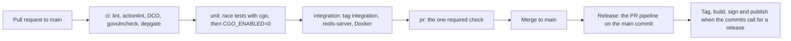
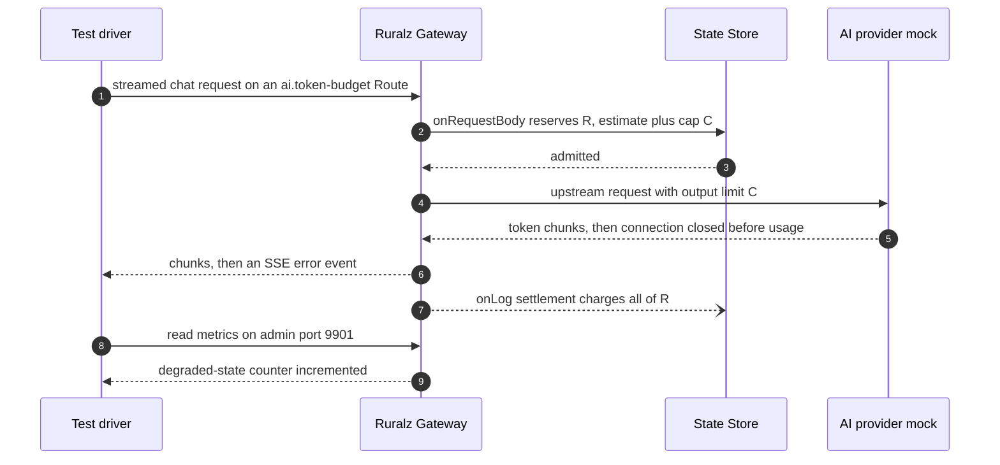

# Testing and Quality Strategy

## Summary

This document fixes how Ruralz proves code matches design: unit tests, property tests and fuzz seeds, the golden corpus, integration tests on real State Stores and built binaries, three conformance suites (configuration, Plugin ABI, protocol), security scanning, the Plugin SDK and AI provider harnesses, and the PR pipeline that runs them, which every release runs again. Each new package, Policy type, protocol or Host Function arrives with the tests required here.

## Scope and non-goals

In scope: tests for `ruralzd` (Ruralz Gateway), `ruralz-control` (Ruralz Control), the `ruralz` CLI, the Plugin Development Kits (PDKs) and the Bundle schema, and the pipeline jobs that run them, under the [foundation pack](../_meta/foundation-pack.md) and P10 ([Vision](../vision/01-vision-and-positioning.md#principles)).

Non-goals, owned elsewhere: limit values (their owning documents, such as [Bounded resources](../architecture/03-data-plane.md#bounded-resources)); signing and skew ([Release, versioning and compatibility](04-release-versioning-and-compatibility.md)); the CI jobs' make targets and the Ruralz Console toolchain ([Repository layout](02-repository-layout-and-conventions.md#ci-stages)); the threat model ([Security and identity](../architecture/08-security-and-identity.md)); the `ruralz test run` case format ([CLI and API surface](../reference/01-cli-and-api-surface.md)).

## Test pyramid

A defect found in a higher layer MUST add a regression test at the lowest layer that reproduces it.

| Layer | Tools | Coverage target | Job | Milestone |
|---|---|---|---|---|
| Unit | Go `testing`, race detector, injected clock | 80% statement coverage per `internal/` package; 90% for loader, validation, precedence, canonical form (target) | `unit` | Planned (M0) |
| Property | `testing.F`; model-based state machines | Every [required property](#required-properties): 100% (target) | `unit` | Planned (M1) |
| Golden | Checked-in expected files | 100% byte-exact (target) | `unit` | Planned (M1) |
| Fuzzing | Go native fuzzing, each target's seed corpus run as a test | 25 or more targets by M2 (target) | `unit` | Planned (M1) |
| Integration | Local `redis-server`; testcontainers-go v0.44.x; built binaries on the [process harness](#process-harness) | Every State Store Policy type and messaging protocol: 100% (target) | `integration` | Planned (M1) |
| Conformance | The three [suites](#conformance-suites) | 100% of cases (target) | `unit` for untagged cases; `integration` | Planned (M1) to Planned (M4) |
| Security scanning | `govulncheck`, depgate, golangci-lint, the no-license-check scan, `buf breaking` | Zero reachable vulnerabilities (target) | `ci`; the no-license-check scan in `unit` | Planned (M0); `buf breaking` Planned (M2) |

### PR pipeline

One workflow, the PR pipeline, runs on every pull request to `main`, with no path filter. Its jobs run in order, each once the one before passed: `ci` runs golangci-lint with the repository's `.golangci.yml`, actionlint on the workflows, the DCO sign-off check of the pull request's own non-merge commits, Dependabot's exempt, `go mod verify`, govulncheck and depgate; `unit` runs `go test -race -shuffle=on ./...` with cgo, then `CGO_ENABLED=0 go test -shuffle=on ./...`; `integration` runs `go test -race -tags integration ./...` on Ubuntu with a local `redis-server` and the runner's Docker for the testcontainers cases. A last job, `pr`, needs all three and is the one required status check. [CI stages](02-repository-layout-and-conventions.md#ci-stages) owns the workflow and its make targets.

Every push to `main` runs the same pipeline again on the merged commit, through `workflow_call`, and the release flow tags, builds and publishes that commit only after it passed and only when its commits call for a release ([Release pipeline](04-release-versioning-and-compatibility.md#release-pipeline)).

*Figure 1: the PR pipeline, and the release flow that runs it again on the merged commit.*



Shipped binaries come only from the release build, with `CGO_ENABLED=0` for every production platform ([tech stack](01-tech-stack-and-libraries.md#selection-criteria) gate G1, [ADR-0001](../adr/0001-implementation-language-go.md)). Tests of `internal/cli`, `internal/buildinfo` and `pkg/` MUST also pass on Windows and macOS, where the CLI ships.

## Unit and property tests

Unit tests are hermetic: time, randomness and the State Store arrive as failure-injecting fakes, and tests run shuffled under the race detector. The race run sets `CGO_ENABLED=1` for test binaries only, with the `netgo,osusergo` build tags; the `unit` job then runs the same tests without `-race` under `CGO_ENABLED=0`, so the shipped configuration is tested. The code stays within the Go 1.26 floor, and JSON golden output MUST be identical on the floor and release toolchains ([Version floor](01-tech-stack-and-libraries.md#version-floor)).

### Test conventions

- Every requirement and every bug gets a named test case that fails without the change.
- Tests import only what the code may import, so no assertion or diff library ([Import boundaries](02-repository-layout-and-conventions.md#import-boundaries)).
- The test build tags are `integration`, for the tests that need a State Store, Docker or built binaries, and `ruralz_testclock`, which builds the controllable-clock `ruralzd`; plain `go test ./...` runs every other test, seeds and golden tests included.
- A test that cannot get what it needs, such as a `redis-server`, a Docker daemon or a Linux-only facility, skips with a reason, except where `RURALZ_TEST_STATESTORE` selects its flavor ([Integration tests](#integration-tests)), and then fails.

### Hermetic rule scope

Suites that start processes keep the hermetic rule this way:

- **Correctness suites use a controllable clock.** This covers every suite that asserts correctness against a built `ruralzd`: the Node integration suites, the integration-tagged cases of the configuration and protocol conformance suites, and the integration tests of `internal/gateway` and `internal/cli/dev`.
  - They run a test-only `ruralzd` build whose clock the harness controls. `internal/testkit/binaries` builds it with the release flags and the test build tag `ruralz_testclock`, and it is never released.
  - Node timers, TTLs, refresh intervals, deadlines, backoffs and the Drain and handover timelines advance only when the test advances the clock. A bound such as "a 150 s half-life" or "within 10 s" is asserted in controlled time, with no real waiting.
- **External processes run in real time.** These are `redis-server`, sentinel and the mocks. The harness waits for them under deadlines with condition polls, never bare sleeps: a State Store conformance case that waits out a lease, an emission interval or a window waits until the store's own clock has moved that far, since a correction can slew the store host's wall clock behind a sleep.
- **Socket deadlines run in real time.** The protocol suite's timeout cases measure the deadlines the Go runtime enforces on sockets, below.
- **Load runs walk the clock with real time.** The telemetry suite's blocked-stdout case offers open-loop load from `internal/testkit/loadgen` for 60 s of real time (target) while the test advances the Node's clock with real time, so its batch interval and metric push go on as in production; it asserts counts and drops, never latencies.

The `ruralz_testclock` tag sits only on the pair of files in `internal/clock` that picks the process clock, and changes nothing else: the commanded clock it picks is ordinary code, tested in every build, and release tooling refuses every binary built with a tag. In that build the process clock waits for the harness's first command, `start <time>` with the time in RFC 3339 form, starts at that time, before the process reads it, and then moves only on the harness's commands, lines of at most 256 bytes on file descriptor 3, the first extra file the harness passes, which MUST be a socket. The harness starts every Node process at the topology's time, the first at the real time it starts, so a process started while the clock leads real time, such as a handover successor after a walk, reads no earlier time and arms no timer from one. A `ruralz_testclock` build started without that socket exits 2, and one whose stream ends, or begins with another command, before `start` exits 1.

`advance <duration>` (Go duration syntax) answers once every timer due by the new time has fired: timers fire in deadline order, equal deadlines in the order they were armed, each callback runs to its end before the next timer fires, and a timer armed meanwhile fires in the same advance when it is due. `now` answers the current time. All three answer the resulting time in UTC, in RFC 3339 form with nine fractional digits. A command the clock refuses, unknown, malformed, negative, longer than 256 bytes or a `start` once the clock started, answers `error <reason>` and leaves the clock where it is. When the command stream ends, the clock stays at its last time.

Deadlines the Go runtime enforces on sockets stay on real time in that build: `http.Server` `ReadHeaderTimeout` and `IdleTimeout`, and connection and `http.ResponseController` read and write deadlines, which the Node computes from the real clock; the protocol suite's timeout cases therefore run in real time ([Conformance suites](#conformance-suites)).

`internal/testkit/topology` keeps one clock for all its Nodes, handover successors included: a test advances and reads it, and waits on conditions under real-time deadlines. The first Node process sets the clock's time; a later one is brought forward to it, or, when it started later still, every running Node moves forward to its start, so all Nodes show one time that never goes back. A Node a test stops with SIGSTOP through the harness sits out advances and catches up on SIGCONT, and a Node that exits leaves the clock. A running Node that leaves a command unanswered within the ready timeout breaks the clock for the rest of the test, since its answers are out of step, and every later advance fails.

### Required properties

Each property is a `testing.F` target, with no property library, whose seeds the `unit` job runs. `test/property` holds one target per row due by the current milestone, driving the real packages end to end: the loader through `internal/config/pipeline` to the Revision; the CLI commands in process wherever a property names an exit code; the `ratelimit` Filter on N simulated Nodes over one shared State Store; and `internal/gateway/source`, `reload` and `lkg` together. The per-package targets stay as unit-level properties.

| Area | Property | Source | Milestone |
|---|---|---|---|
| Canonical form | Reordering files or `map` and `set` lists, or reformatting, keeps the Revision; YAML and JSON give one digest | [Canonical form](../architecture/02-configuration-model.md#canonical-form-and-revision) | Planned (M1) |
| Render | Rendering a rendered Bundle again yields the same Revision, including `$${` escapes | [Rendered Bundle](../architecture/02-configuration-model.md#rendered-bundle) | Planned (M1) |
| Conversion | Every field round-trips through the hub type; converting apiVersions keeps the Revision, also through a test-only spoke apiVersion that renames and moves fields both ways, so the property runs while one apiVersion is served | [Conversion](../architecture/02-configuration-model.md#hub-and-spoke-conversion) | Planned (M1) |
| Substitution | `${VAR}` never injects structure or appears in forbidden positions | [Substitution](../architecture/02-configuration-model.md#environment-substitution) | Planned (M1) |
| Precedence | One Policy per slot per scope; `overridable: false` Policies are never removed; order follows Filter class, scope and list position; response Phases reverse, `onLog` keeps request order | Pack section 8.12 | Planned (M1) |
| Effective chain | For random Bundles, the snapshot compiler's per-Phase arrays, per Route and leg, equal the rows `ruralz bundle render --effective` prints | [Bundle verbs in detail](../reference/01-cli-and-api-surface.md#bundle-verbs-in-detail), [Filter Chain execution](../architecture/03-data-plane.md#filter-chain-execution) | Planned (M1) |
| Diff | `diff(A, A)` is empty, exit 0; `diff(A, B)` is empty exactly when Revisions are equal; added and removed identities are set differences, mirrored in `diff(B, A)`; field ops turn A's canonical form into B's (`SecretValue` by reference); reordering `map` or `set` lists yields no op | [Diff semantics](../architecture/02-configuration-model.md#diff-semantics) | Planned (M1) |
| Rate Limit | With a deterministic clock and a healthy State Store, admission per key stays within `requests` + `burst` per window, except for `localOnly` Policies and first-seen keys on local-only entries, which stay within N × per-Node ceiling per window (target); while failing open, within N × per-Node ceiling per window (target), the ceiling being `perNodeCeiling` or, in file mode, the full limit | Pack section 8.8, [ADR-0008](../adr/0008-rate-limiting-local-bucket-and-gcra.md), [Decision path](../architecture/09-traffic-management-and-resilience.md#decision-path) | Planned (M1) |
| Token Budget | R is reserved only if the remaining budget covers it; settlement charges each attempt's reported usage once, plus all of R once per request when any attempt that reached the provider reported no usage, and releases the rest of R; overshoot stays within the sum of concurrent input-estimate errors (hypothesis; SM-10), plus (attempts - 1) x R per concurrent request (hypothesis), plus hidden reasoning above C on `gemini` and `ollama` (OQ-ai-llm-gateway-17). If OQ-ai-llm-gateway-15 closes, the property follows it | Pack section 8.9, [AI/LLM gateway](../architecture/06-ai-llm-gateway.md) | Planned (M3) |
| Rollout | Under random ACK, NACK, timeout and reconnect events, every transition is in the state table | Pack section 8.3 | Planned (M2) |
| Last-Known-Good, Control mode | A candidate is promoted exactly when the active digest equals the promoted digest, also after reconnect, Enrollment or scale-out; never after a failed canary | Pack section 8.2 | Planned (M2) |
| Last-Known-Good, file mode | Under random renders, failures at every gate step, failed or interrupted candidate writes, restarts and handovers: a Revision becomes the candidate and Last-Known-Good only by activation, only the lock holder writes, and boot takes a valid Bundle, else a verified Last-Known-Good, else stays not ready | Pack section 8.2, [Last-Known-Good files](../architecture/03-data-plane.md#last-known-good-files), [Validation gate](../operations/02-zero-downtime-upgrades-and-hot-reload.md#validation-gate) | Planned (M1) |

A registry in `test/property` maps each row's Area to its target. `TestRequiredProperties` reads the current milestone from the first milestone section of the [Roadmap](../roadmap/01-roadmap-and-milestones.md), and fails when a row due by that milestone has no registered target, when a registered target does not exist, or when a registered Area names no row.

The Token Budget target's seeds include the scenario of SM-10 ([Success metrics](../vision/01-vision-and-positioning.md#success-metrics)), on which it also checks that overshoot stays at or below 1% of B (hypothesis).

Illustrative, not final code:

```go
// Digest stability: reordering unordered lists or files never changes the Revision.
func FuzzRevisionStableUnderReorder(f *testing.F) {
    for _, bundle := range goldenCorpus(f) {
        f.Add(bundle, int64(1))
    }
    f.Fuzz(func(t *testing.T, bundle []byte, seed int64) {
        want, err := buildRevision(bundle)
        if err != nil {
            t.Skip("invalid input is covered by the negative corpus")
        }
        got, err := buildRevision(reorderUnordered(bundle, seed))
        if err != nil || got != want {
            t.Fatalf("digest changed under reordering: %v, %s != %s", err, got, want)
        }
    })
}
```

### Golden tests

The golden corpus, under `test/conformance/config/`, pins what the configuration pipeline produces: Revision digests and canonical bytes (including `shop-bundle`'s), rendered Bundles, diagnostics, `ruralz bundle render --effective` tables and `ruralz.diff.v1` documents. Every release MUST reproduce it byte for byte, deliberate changes excepted ([ADR-0003](../adr/0003-configuration-format.md)). It is the one golden corpus of pipeline outputs: a package keeps golden files only for its own internal forms, such as the canonical encoder's parse goldens, and holds no copy of an example Bundle or of its outputs. The example Bundle tests of [Generator rules](02-repository-layout-and-conventions.md#generator-rules) run here as well, through the configuration pipeline facade with `checks.Table()` and the CEL compiler, so they run every stage.

| Path under `test/conformance/config/` | Holds |
|---|---|
| `golden/<entry>/bundle/` | The entry's input Bundle, a frozen copy |
| `golden/<entry>/bundle-json/` | Optionally, the JSON twin of `bundle/`, which MUST render to the same digests and canonical bytes |
| `golden/<entry>/from/`, `golden/<entry>/to/` | A diff entry's two Bundles, in place of `bundle/` |
| `golden/<entry>/environments.yaml` | The Environments the entry renders, if any |
| `golden/<entry>/level-<n>/expected.json` | The digests at schema level `n`: `{"level": n, "digests": {"<render>": "sha256:<64 hex>"}}` |
| `golden/<entry>/level-<n>/` `canonical/<render>.json`, `rendered/<render>.yaml` and `.json`, `diagnostics/<render>.txt` and `.json`, `effective/<render>/<route>.txt` and `.json`, `diff/<from>.<to>.txt` and `.json` | The other outputs at level `n`, per render: `-`, the render without `--env` over an empty variable set, then each Environment |
| `json-subset/<case>/yaml/`, `json/` | JSON subset pairs, each pair rendering to one digest ([ADR-0003](../adr/0003-configuration-format.md)) |
| `negative/<code>-<slug>/` | Negative fixtures ([Conformance suites](#conformance-suites)) |
| `raw/` anywhere below | Fixtures that need CRLF or a byte order mark; `.gitattributes` marks `test/conformance/config/**/raw/**` `-text`, and every other golden file `eol=lf` for Windows checkouts |

Each entry renders `-` and every Environment of its `environments.yaml`, and pins every output above for each render: every Route's `--effective` table, and the diff between consecutive renders, `-` to the first Environment, then each Environment to the next in file order. A diff entry pins the diff from `from/` to `to/`. The Configuration model's [diff example](../architecture/02-configuration-model.md#diff-semantics) is such an entry, its `to/` the example Bundle and its `from/` the earlier state that example describes, both rendered for `prod`, and a test holds the example's text block equal to its text output and its JSON block, compacted, to its compacted JSON output.

Entries are append-only, and an entry's inputs never change: a changed example Bundle becomes a new entry, `<example>-<k>` with `k` counting from 1, and a test holds the highest-numbered entry of each example equal to its Bundle's files under `examples/`, its configuration and `.ruralzignore` files, so no other file beside them is an input. Outputs are kept per schema level ([Versioned surfaces](04-release-versioning-and-compatibility.md#versioned-surfaces)): a change that alters an output ships as a new level, whose `level-<n>/` directories are added beside the earlier levels' unchanged bytes, and the tests run every entry at every level inside the skew window. Only `go test ./test/conformance/config -run Golden -update` regenerates the corpus; it adds entries and levels, and refuses to rewrite or delete a file that the newest release tag holds; before the first release no file is held.

## Integration tests

Integration tests carry the `integration` tag and run in the `integration` job of the [PR pipeline](#pr-pipeline). `RURALZ_TEST_STATESTORE` selects the State Store flavors the suites run, one or both: `process`, a local `redis-server`, on every contributor machine; `container`, the images below through testcontainers-go, a test-only [catalog](01-tech-stack-and-libraries.md#library-catalog) module ([source](https://github.com/testcontainers/testcontainers-go)); or `process,container`, which the `integration` job sets, so every kind of both flavors runs there, on a local `redis-server` and on its runner's Docker. `internal/statestore/statestoretest/redisserver` launches both flavors; its cluster kinds are three primaries. A suite whose flavor the variable selects fails when that flavor cannot run (no `redis-server`, no Docker daemon, a cluster or sentinel container off Linux); otherwise a suite skips with a reason. The process harness starts a `redis-server` whenever one is found, without the variable. Images are pinned by digest ([CI tooling](01-tech-stack-and-libraries.md#ci-tooling)), never taken from module defaults ([source](https://golang.testcontainers.org/modules/)).

| Dependency | Container source | Used for | Milestone |
|---|---|---|---|
| Local `redis-server`, `process` flavor | None: `RURALZ_TEST_REDIS_SERVER` or `PATH` | Standalone, replica with scripted failover, TLS, ACL and three-primary cluster runs of the `redis` driver | Planned (M1) |
| Redis 8 | `modules/redis` ([source](https://golang.testcontainers.org/modules/)) | `redis` State Store driver: GCRA script, Quota, Response Cache, Token Budget; Vector Sets for the Semantic Cache | Planned (M1); Token Budget and Semantic Cache Planned (M3) |
| Valkey 9.0.1 or newer | `modules/valkey` ([source](https://golang.testcontainers.org/modules/)) | The same tests; valkey-search 1.2, and a server without it for the degraded path | Planned (M1); Token Budget and Semantic Cache Planned (M3) |
| Redis Cluster and Valkey cluster | Generic containers, three primaries, Linux runners only, since members announce container IPs ([source](https://github.com/testcontainers/testcontainers-go)) | Consumptive calls sharing a hash slot run as one script; others run sequentially, stop at the first deny and never hit `CROSSSLOT` (pack section 8.7) | Planned (M1); Token Budget Planned (M3) |
| Dragonfly | Generic container ([source](https://github.com/testcontainers/testcontainers-go)) | The same driver tests and scripts; the degraded Semantic Cache path (pack section 7) | Planned (M1); Semantic Cache Planned (M3) |
| Kafka | `modules/kafka`, KRaft, a CI-suitable image, not `confluent-local` ([source](https://golang.testcontainers.org/modules/kafka/)) | `kafka` Upstreams (franz-go) | Planned (M4) |
| NATS | `modules/nats` ([source](https://golang.testcontainers.org/modules/nats/)) | `nats` Upstreams (nats.go/jetstream) | Planned (M4) |
| MQTT | `modules/mosquitto` ([source](https://golang.testcontainers.org/modules/mosquitto/)) | `mqtt` Upstreams (paho.golang); embedded broker mode | Planned (M4) |
| OCI registry | `modules/registry` ([source](https://golang.testcontainers.org/modules/)) | Revision and Plugin pulls by digest with Sigstore verification | Planned (M2) |

Authentication tests replace Mosquitto's anonymous default ([source](https://golang.testcontainers.org/modules/mosquitto/)). Required State Store scenarios:

- After a script cache flush, `EVALSHA`, the cached form of pack section 8.8's GCRA `EVAL`, meets `NOSCRIPT`: that request applies the Policy's `failureMode` without a second round trip (pack section 8.7 rule 1), the Node reloads the script off the request path, and the next `EVALSHA` succeeds ([Traffic management and resilience](../architecture/09-traffic-management-and-resilience.md)).
- A full post-commit queue drops writes with a counter, never delaying the response: on a Route whose only State Store Policy is `cache`, the counting RESP proxy holds every reply to the scripts that write, by command name, so the eight writers wait on their batches; every unsafe request, which makes no request-path call and queues one generation bump, completes while the replies are held, `ruralz_state_writes_dropped_total{kind="cache_invalidate"}` counts once the invalidation class fills, no other class drops a write, and the queue drains once the replies pass. The stores class cannot fill this way: a store follows a lookup, which the State client pipelines on the connections whose replies the proxy holds, so the lookup waits behind them.
- A slow vector search never delays a rate-limit reply, Planned (M3).
- Without vector support, `ai.semantic-cache` behaves as a State Store failure under its `failureMode`; the Node reports a degraded state, Planned (M3).
- Under `topology: sentinel`, after `SENTINEL FAILOVER` the Node follows the promoted replica within 15 s (target), loading its scripts there, on the `redisserver` sentinel kinds: a primary, its replica and a sentinel, as local processes and as Redis 8 and Valkey 9 containers.

Node integration suites under `test/integration/`, Planned (M1), drive the [controllable-clock test build](#hermetic-rule-scope) of `ruralzd` over real sockets on the [process harness](#process-harness):

| Suite | Covers |
|---|---|
| `cel` | Every M1 [CEL place](../architecture/02-configuration-model.md#allowed-places) with each runtime-error kind reachable there under the Revision's input caps: an evaluation error and the 1,000,000-unit cost limit, reached in one call and inside a comprehension, the cost limit only for expressions the caps leave tracked. Each case asserts, with the clock standing still, the place's "On runtime error" behavior and its signal: `ruralz_filter_failures_total` for Policy fields, `RZ-RL-005` for a closed key, `RZ-AUTH-015` for `authz.cel`, `RZ-RT-011` and `RZ-RT-012` for `headers` and the transforms, `RZ-RT-006` for `match.when`, `RZ-RT-015` for composition steps, `ruralz_upstream_cel_errors_total` for the Upstream fields, and the written entry with `ruralz_telemetry_access_log_cel_errors_total` for `accessLog.when`. After a request that ran to its Route deadline, `accessLog.when` runs its comprehension to its result or to the cost limit, as no deadline stops an evaluation |
| `telemetry` | Hot Reload: counters carry over, the OTLP connection is kept, and a changed endpoint or `telemetry.otlp.tls` swaps it within 5 s (target). A blocked stdout: under load, the Node's stdout goes unread for 60 s (target); every request completes while it stays blocked, with zero failures, and the run records gateway-added p99 against an unblocked run; `ruralz_telemetry_logs_dropped_total{sink="stdout",reason="queue_full"}` counts for both streams; OTLP log export goes on, with no `sink="otlp"` loss; output resumes once stdout is read again; a SIGTERM sent while blocked exits within the 30 s exit bound (target). The 1,000-reload test of [Cardinality budget](../architecture/10-observability.md#cardinality-budget). The `internal/testkit/otlpsink` modes: Reject, Stall and Down raise and clear `telemetry_export_failing` and count `queue_full` and `export_error` while requests stay unaffected; metrics push every 15 s (target); at most 4 scrapes encode at once and a fifth waits 10 s, then gets 503 (target); an `http` endpoint raises `cleartext_hop` |
| `security` | JWKS rotation, every case in controlled time: a new key published and signing costs one `RZ-AUTH-005` and one refresh, then passes; at most one refresh per issuer per 30 s (target), honoring `Retry-After`; a failed prefetch at activation still activates; a key removed from the document stops verifying once the 150 s half-life of `max-age=300` passes, advanced on the test clock rather than waited. mTLS. The admin port, with a bearer token from a non-loopback peer refused without TLS: on Linux, a network namespace gives the client a non-loopback address on a dummy or veth device, inside a user namespace mapping the test's user to root unless it runs as root; the case skips with a reason without the privilege to create either, and the `integration` job grants it by lifting its runner's restriction of unprivileged user namespaces. Secret-to-destination binding. The State Store entry MAC: keyed and key-less Nodes on one State Store, in both directions. Secrets rules 5 and 6 of [Secrets](../architecture/08-security-and-identity.md#secrets): `RURALZ_SECRET_ROOT`, the `env` allowlist, a group-writable `file` secret (`RZ-CFG-026`), a root holding the data directory refusing start, the egress guard with `RURALZ_FETCH_ALLOW`, no `https` to `http` redirect and no `tokenUrl` redirect. Listener and Upstream certificate rotation by watch, a failed one counted in `ruralz_config_secret_rotation_failures_total`. The `auth.basic` throttle: `RZ-AUTH-007` and `ruralz_auth_basic_refusals_total`. The secret leak test: one Node holding every kind of secret M1 resolves, each a canary, under traffic on every credential path, which the [process harness](#process-harness) scans at teardown |
| `statestore` | Every kind `redisserver` selects, counting commands through the counting RESP proxy `internal/statestore/statestoretest/respproxy` on standalone kinds and process clusters, whose primaries announce counting proxies, and by `INFO commandstats` and `INFO errorstats` deltas per serial phase on sentinel kinds and container clusters, whose servers are reached at the addresses they announce; those deltas also count the commands a script calls, so a phase that runs scripts compares `EVALSHA` and the commands no script calls. The deltas leave out the commands a primary's replica and sentinel send it (`REPLCONF`, `PSYNC`, `SYNC`, `PUBLISH` and `SUBSCRIBE`), which no State client sends; no other client crosses the counting proxies. The scenarios above. The [ADR-0008](../adr/0008-rate-limiting-local-bucket-and-gcra.md) round trip for every M1 State Store Policy type under pack 8.7 rules 1 to 4, counting request-path commands only (connection setup, `HELLO`, `AUTH`, `CLIENT`, `SELECT` and a sentinel client's `ROLE`, and `INFO`, `PING`, `SCRIPT LOAD` and `CLUSTER` excluded): `ratelimit` local denials and over-limit hits send nothing, an admitted request one call per Policy, consumptive keys sharing a slot one script, and keys on other slots one call each, in order, stopping at the first deny, without a `CROSSSLOT` reply; a `quota` denial cached up to 60 s (target) sends nothing, and refunds follow the response; a `cache` lookup is one pipelined batch of the commands [Response caching](../architecture/09-traffic-management-and-resilience.md#response-caching) lists per server it reaches, since the generation key and the partition hash to different cluster slots, and stores follow the response. The State client behaviors a Node shows: a Hot Reload keeps the client, with no redial and its scripts kept; a changed URL, topology or TLS block opens a new client before the swap; a rotated `file` secret URL opens one at once; `stateStore.cache` carries the cache traffic; `READONLY` after a demotion; the 8,192-call ceiling (`RZ-STS-004`); `state_store_eviction_policy`, `state_store_unauthenticated` and `cleartext_hop`; `RZ-CFG-042` refusals; the `memory` fallback warning |

Other `integration`-tagged tests sit beside the code they test: the `redis` driver's suite in `internal/statestore/redis` and the server kinds of `redisserver` on every flavor the variable selects; the upstream cases of the configuration suite ([Conformance suites](#conformance-suites)); `ruralz dev run` with the controllable-clock `ruralzd` in `internal/cli/dev`; the release-flag build of `internal/testkit/binaries`; the built Node under a topology in `internal/gateway`; and the alert rule and dashboard expression checks of `internal/tool/telemetrygen` with the pinned promtool. `test/t5` holds the unit check of T5: `systemd-analyze verify` on a copy of the shipped unit and `systemd-sysusers` with its sysusers.d entry against a temporary root, each skipped with a reason on a host without systemd's tools ([Handover under systemd](../operations/02-zero-downtime-upgrades-and-hot-reload.md#handover-under-systemd)).

Container-free tests run three Ruralz Control replicas and Nodes in one process over loopback mutual TLS ([ADR-0007](../adr/0007-control-stream-protocol.md)), each instance with its own `RURALZ_DATA_DIR`, OpenTelemetry providers and `slog` logger: snapshot and delta delivery, ACK and NACK classification, promoted digests, backup then restore. Their fencing test, Planned (M2), proves a deposed leader's entry at a taken sequence commits but is never accepted or delivered, and a new leader proposes only after Barrier; its `postgres` Control Store variant, Planned (M4), proves the transaction rejects that entry ([ADR-0006](../adr/0006-control-store-raft-boltdb.md)).

### Process harness

`internal/testkit/topology` runs the Nodes and their dependencies of one test for the Node integration suites, the protocol conformance suite and the built-Node test of `internal/gateway`:

| Part | Design |
|---|---|
| Nodes | Each Node runs its own private test render, as `ruralz test run --bundle` does ([Local ruralzd launched by the CLI](../reference/01-cli-and-api-surface.md#local-ruralzd-launched-by-the-cli)): every listener `port` and `admin.port` is rewritten to a free port, kept when a reload re-renders, which on Linux the harness holds until the topology's teardown with a socket bound to it that never listens, so no other socket takes the port before the Node binds it or while the Node restarts, and every `secretRef`, a Consumer API key's included, becomes a `provider: file` reference, its `key` kept, to a per-run file under that Node's `RURALZ_SECRET_ROOT`, except the references a test keeps as authored to exercise the `env` provider and the secret root rules, whose values it supplies itself, each carrying a canary. Each Node reports its test digest and its port mapping beside the Revision digest, both digests computed as the configuration pipeline computes them. This is the only way several Nodes share one loopback host ([SO_REUSEPORT and listeners](../architecture/11-scalability-and-distributed-state.md#so_reuseport-and-listeners)); each binds its test render's `admin.port` from boot ([Admin endpoints](../architecture/03-data-plane.md#admin-endpoints)) |
| Runtime | With more than one Node, each runs with `GOMAXPROCS` max(1, CPUs / Nodes). The harness waits up to 30 s of real time for `/readyz` (target), as `ruralz dev run --ready-timeout` does. It stops a Node with SIGTERM and, on a controllable-clock topology, advances the clock through the Drain in 1 s steps (target), each followed by 50 ms of real time (target), until the Node exits or the clock has moved by the kill time; it sends SIGKILL to a Node still running 40 s of real time after the SIGTERM (target), as `TimeoutStopSec` does. A test may override each. Signal, reload (an atomic replacement of the test render) and handover (a successor process on the same directory, ports and clock) serve the Hot Reload, Drain and Zero-Downtime Upgrade cases |
| State Store | Any `redisserver` kind and flavor the test selects: standalone, replica with scripted failover, cluster or sentinel, as processes or containers. Each Node reaches it through fault proxies of its own, one per endpoint of the State Store URL (the server, each cluster seed or each sentinel), or through `respproxy` on request; a cluster's redirects and the primary a sentinel names reach the servers directly, except that with `respproxy` each primary of a process cluster announces a counting proxy of its own, which every Node shares, so every command crosses one. A scripted failover moves every Node's proxy to the new primary. The default is a standalone process `redis-server` |
| Transport | TLS from `internal/testkit/pki` and credentials on every hop the harness chooses: `rediss://` with an ACL user whose password is a canary, an `https` OTLP sink, and admin TLS through `RURALZ_ADMIN_TLS_DIR` with operator and metrics tokens; every Node trusts the harness's CA and each State Store's through `SSL_CERT_FILE`. Cleartext appears only where the scenario's Bundle declares it, which a test sets per hop, and where TLS cannot apply: a container State Store runs its image as it is, without TLS or an ACL user, and `respproxy` reads the commands, so a State Store behind it runs without TLS |
| Clock | One controllable clock for every Node, handover successors included ([Hermetic rule scope](#hermetic-rule-scope)). A topology over a build without it, such as a release build that `RURALZ_TEST_BIN_DIR` names, runs in real time and refuses clock commands |
| Secret leaks | Every secret value the harness supplies carries a canary from `internal/testkit/canary`: every `secretRef` file (TLS keys, the API key, the OAuth client secret, the State Store URL's password) and the admin token, metrics token and MAC key files. A value a test supplies MUST carry a canary the harness issued, and the harness refuses one that does not; a PEM file carries its canary on a line before its blocks, which PEM parsers skip. At teardown it scans every byte it captured for each canary, raw or base64, hex, URL or JSON encoded, and a finding fails the test: process and access logs; every admin response, `/config/dump`, `/tap`, `/metrics`, `/debug/snapshots`, `/debug/upstreams` and `/readyz` included; CLI output, diffs included, and client responses with their error bodies, which a test hands to the harness; OTLP traces, metrics and logs, as the exporter sent them; the mock Upstream's request log, where a dropped or cut request fails the scan as incomplete; the files under each Node's `RURALZ_DATA_DIR`; and the State Store keyspace. Designated destinations ([Secret-to-destination binding](../architecture/02-configuration-model.md#secret-to-destination-binding)), which are the State Store servers and the mock IdP's token endpoint, and `/debug/pprof` profiles are excluded ([Secrets](../architecture/02-configuration-model.md#secrets-and-environment-variables)) |
| Failure evidence | When a test fails, the harness copies each process's logs, a listing of each `RURALZ_DATA_DIR`, each running Node's `/debug/snapshots` and the OTLP records into a directory named after the test under `RURALZ_TEST_ARTIFACT_DIR` |

The harness's own tests run a stand-in Node: the test binary, re-executed as a fake `ruralzd`, reads `RURALZ_CONFIG` and its file secrets under `RURALZ_SECRET_ROOT`, staying unready while one is missing, binds the rendered ports, `proxyProtocol` listeners included, and serves `/healthz`, `/readyz`, `/metrics` and `/debug/snapshots` behind the admin authentication. It takes the data-directory lock, Hot Reloads on a file swap or SIGHUP, Drains on SIGTERM, hands over to a successor through the data directory's handover socket and follows the clock commands. So every part is tested before `ruralzd` serves, and the suites drive the built `ruralzd`.

## Conformance suites

Conformance suites test published contracts; each is versioned with its contract and also runs outside Ruralz CI.

| Suite | Contract under test | Cases | Runs against | Job | Milestone |
|---|---|---|---|---|---|
| Configuration | JSON Schema (both views), restricted YAML profile, `ruralz.canonical.v1`, `ruralz.diff.v1`, RZ-CFG registry | The [golden corpus](#golden-tests) and the example Bundle tests; one negative fixture per offline RZ-CFG code with file, line and column; JSON subset, loader conformance, hostile-input, CEL cost and overlay fixtures; the upstream suites | `ruralz` and `ruralz-control` MUST emit identical diagnostics; `ruralzd` MUST match for its stages (every stage but overlay selection in file mode, reference resolution onward in Control mode) | `unit` for the untagged cases; `integration` for the binary-driven and upstream cases | Planned (M1); `ruralz-control` and the CRD path Planned (M2) |
| Plugin ABI | `ruralz.plugin.v1`: Host Functions, memory conventions, Capabilities, limits, every Phase | Reference Plugins per Phase; denied Capabilities; trap, deadline and memory cases with `RZ-PLG` codes | The `ruralzd` and `ruralz plugin test` hosts, every Ruralz PDK, the proxy-wasm adapter | `integration` | Planned (M2); adapter Planned (M4) |
| Protocol | Per-protocol Phase mappings (P7) and wire behavior | HTTP/1.1, HTTP/2 and h2c, with Ruralz-written HTTP/2 frame cases; gRPC, gRPC-Web and Connect with trailers, deadlines and all stream types; WebSocket; SSE; GraphQL federation; AI dialects; event protocols | Ruralz Gateway through its listeners: the controllable-clock `ruralzd` build, or the build `RURALZ_TEST_BIN_DIR` names | `integration` | Planned (M1) HTTP; Planned (M3) streaming, gRPC, GraphQL, AI and HTTP/3; Planned (M4) events |

The codes of the checks that can fail after a green offline run ([Validation and diff semantics](../architecture/02-configuration-model.md#validation-and-diff-semantics)) may carry no source position; integration cases assert code and resource identity wherever raised: RZ-CFG-024 at Rollout, NACK or file-mode load; RZ-CFG-026 at NACK or load; RZ-CFG-027 at `ruralz bundle push`, OCI pull, Control Stream delivery and Last-Known-Good boot; RZ-CFG-028 and RZ-CFG-033 in `ruralz bundle build`, `validate --online`, Ruralz Control ingest and Node activation, RZ-CFG-033 also for Revision signatures at Node activation (pack sections 8.1 and 8.14); RZ-CFG-044 and RZ-CFG-045 at Node activation, naming no resource.

The configuration suite's untagged cases run in-process in the `unit` job: each Bundle goes through the CLI's path, `internal/cli/bundle`, and through `ruralzd`'s, the configuration pipeline facade and the snapshot compiler with the Node's wiring, and the two MUST report the same diagnostics for the stages both run. Its `integration`-tagged cases run the same Bundles through the built `ruralz` and the controllable-clock `ruralzd` build ([Hermetic rule scope](#hermetic-rule-scope)), both from `internal/testkit/binaries`; with `RURALZ_TEST_BIN_DIR` naming a release's binaries, the suite runs outside Ruralz CI. The built `ruralzd` loads each Bundle in file mode, in a process of its own whose environment holds only its settings, so `${VAR}` substitutes only defaults, as in the CLI's runs, and its diagnostics and digest come from the rejection and activation-warning records of its first boot attempt, which carry every diagnostic in its JSON form ([Activation](../architecture/03-data-plane.md#activation)). Those Nodes bind the loopback ports their Bundles name, which the corpus's digests fix, so the suite runs one of them at a time. `ruralz-control` joins with Ruralz Control, Planned (M2).

Each negative fixture is a directory `negative/<code>-<slug>/` holding `fixture.yaml`, its Bundle in `bundle/`, an optional `environments.yaml`, and its expected diagnostics in `expected.txt` and `expected.json`, the two forms of [Diagnostics and source map](../architecture/02-configuration-model.md#diagnostics-and-source-map). `fixture.yaml` names `code`, the RZ code; `stage`, its stage letter in Figure 3 of that document; `binaries`, those of `ruralz`, `ruralz-control` and `ruralzd` that MUST report it; and `source`, where its position maps: `base` (a base file), `overlay` (an overlay file), `substituted` (a value `${VAR}` wrote, at its expression) or `default` (the nearest authored ancestor of a default or missing field).

Every offline RZ-CFG code has at least one negative fixture. A code the shipped pipeline cannot raise yet is reached through test-only stand-ins that the suite links and no binary ships: a converter registry whose lifecycle table deprecates an apiVersion and a field (RZ-CFG-025), and a second, test-only served apiVersion that an overlay can mismatch (RZ-CFG-030); those fixtures name only the in-process paths in `binaries`. The suite's exempt list names each offline code whose machinery cannot be stubbed yet, with the milestone that makes it reachable: the `configSchema` half of RZ-CFG-021, Planned (M2). A test fails when a registered offline code has neither a fixture nor an exempt entry, and when an exempt code gains a fixture.

The other fixture sets:

| Fixtures | Cases |
|---|---|
| JSON subset | Tab indentation, `\/` and surrogate `\u` escapes, each pair yielding its YAML twin's digest ([ADR-0003](../adr/0003-configuration-format.md)) |
| Loader conformance | One fixture per rejection, RZ-CFG-001 to RZ-CFG-004, an alias-expansion fixture, and the plain scalars `yes`, `on`, `0777`, `0b1`, `1_000` and `2026-09-23` with ADR-0003's readings |
| Hostile input | Generated at test time, never committed: whole loads, stages A to E, at the 64 MiB source limit, the 20,000-resource limit and the 4,000,000-node budget, one at each and one at all three together, each growing the heap by at most 1,040 MiB (target), and one byte, resource or node past each limit failing with RZ-CFG-001; canonical re-entry at the resource limit within four times the canonical size (target). Tests assert heap growth only, never a time bound such as 2 s (target) for a 1 MiB input |
| CEL cost | The `authz-orders` rule of the example Bundle, which MUST pass RZ-CFG-015; expressions on both sides of the 10,000-unit ceiling; one RZ-CFG-014 fixture per variable rule of [Variables](../architecture/02-configuration-model.md#variables): a place's variables, `response` by first Phase, `upstream` by scope, `request.body`, `response.body` and `steps` where they are readable, and the sites of a Policy no Route runs |
| Overlay | Every row of the [Overlays](../architecture/02-configuration-model.md#overlays) merge table, each a base Bundle, an overlay and the expected rendered Bundle, plus a fixture per code stage D raises |

The configuration suite's upstream cases are the JSON-Schema-Test-Suite, whose results the validator self-reports ([source](https://github.com/santhosh-tekuri/jsonschema/blob/boon/README.md)), and the YAML Test Suite against the Ruralz parser, which fails only on a checked-in list of profile refusals ([ADR-0003](../adr/0003-configuration-format.md)); a change that loses a passing case fails. Their `integration`-tagged runners stay beside the code they test, in `internal/config/schemaview`, `internal/filter/validation/jsonschema` and `internal/config/profile`, and run in the `integration` job with the rest of the suite.

The Plugin ABI suite is the promise to Plugin authors ([ADR-0005](../adr/0005-plugin-abi-v1.md)): a PDK is maintained only while it passes, with wazero in compiler mode on production platforms.

The protocol suite is a Go test package under the `integration` tag, versioned with the Ruralz release: the suite at a tag states that release's contract, and each case names the document rule it checks. It drives `ruralzd` through `internal/testkit/binaries` and the [process harness](#process-harness), built from the commit as the controllable-clock build. Outside Ruralz CI, `RURALZ_TEST_BIN_DIR` names the build under test; with a release build there, only the cases that need no controllable clock run, and the rest skip with a reason.

Its M1 cases:

| Cases | Design |
|---|---|
| Wire rules | One case per rule that [Listeners and protocols](../architecture/03-data-plane.md#listeners-and-protocols), [Request hardening](../architecture/08-security-and-identity.md#request-hardening) and [HTTP intermediary behavior](../architecture/07-multi-protocol.md#http-intermediary-behavior) state, on every client protocol: HTTP/1.1, HTTP/1.1 over TLS, h2c and HTTP/2 over TLS. A case whose behavior crosses the hop (framing, trailers, hop-by-hop fields, 1xx) runs on every pairing with an `http` Upstream over HTTP/1.1, HTTP/1.1 over TLS and HTTP/2 over TLS |
| Phase mapping | The HTTP column of [Filter Chain applicability per protocol](../architecture/07-multi-protocol.md#filter-chain-applicability-per-protocol), read from the Phase and order of the `ruralz.filter.<name>` spans: `onRequestHeaders` and `onRequestBody` once, `onUpstreamRequest` and `onUpstreamResponseHeaders` per attempt with a retried attempt among them, `onUpstreamResponseBody` once, each upstream-scoped call under its attempt's `ruralz.upstream.<name>` span, `onResponse` once and `onChunk` never; `onLog`, which creates no span, runs once: the request's one access record. `onRoute`, which no M1 Policy type uses, joins with Plugins in M2 |
| HTTP/2 frames | Ruralz-written cases on the `x/net/http2` Framer for the HTTP/2 rows of [Bounded resources](../architecture/03-data-plane.md#bounded-resources) and the settings the Node advertises: the 251st concurrent stream refused, the receive buffers, 16 KiB frames, the header block (a plain 431 above the ceiling), SETTINGS, `RST_STREAM` on deadline expiry, one GOAWAY at Drain beside the HTTP/1.1 half of the shard shutdown (idle connections closed, `Connection: close` on a busy one's next response), and floods that stay within the Bounded resources ceilings while other connections keep being served: a CONTINUATION flood ends with the flooding connection closed by GOAWAY, and in a rapid-reset flood `net/http` runs at most 250 of the connection's handlers at once, never starts the handler of a stream reset while it waits, cancels a started one at its reset, and closes the connection with GOAWAY `ENHANCE_YOUR_CALM` only when more than 1,000 handlers wait to start ([source](https://github.com/golang/go/blob/release-branch.go1.27/src/net/http/internal/http2/server.go)) |
| Timeouts | `ReadHeaderTimeout` 10 s, `IdleTimeout` 120 s, the body read and response write deadlines 5 s past a 10 s Route `timeout`, the 504 `RZ-UP-003` an Upstream that never answers gets at the Route `timeout` on HTTP/1.1 and HTTP/2, and the 5 s pre-routing write deadline (target), in real time and in parallel, each expiry asserted between its value and its value plus 2 s (target) |

From M3 the protocol suite also runs the Autobahn cases, which the selected WebSocket library passes ([source](https://github.com/coder/websocket)), through Ruralz Gateway's listeners and a `websocket` Upstream. Its AI dialect fixtures verify Prompt Cache marker preservation in 100% of cases (target) (SM-11). Which external frame-level HTTP/2 and HTTP/3 suites join beside its own frame cases is OQ-testing-and-quality-strategy-6.

## Fuzzing

Go native fuzzing covers every surface parsing untrusted or operator-supplied bytes, seeded from the golden and negative corpora. Plain `go test` runs every target's seed corpus, so the `unit` job runs them on every pull request; fuzzing past the seeds runs locally with `go test -fuzz`, and each crasher becomes a committed seed before its fix merges. No target may panic, hang or crash the Node.

| Target family | Oracle | Milestone |
|---|---|---|
| Restricted YAML loader | Rejections carry RZ-CFG-001 to RZ-CFG-004; memory stays bounded under alias bombs, and an input of up to 1 MiB parses within 256 MiB of heap growth and 2 s (target); the parser and yaml.v3 agree on every input outside the checked-in deviation classes | Planned (M1) |
| Env substitution and overlay merge | Output validates or fails with a registered code | Planned (M1) |
| CEL compile and cost estimator | A finite estimate, or RZ-CFG-014 or RZ-CFG-015; at nominal input sizes, actual cost stays within the static estimate, and for inputs within a Revision's input caps, within the estimate at those caps ([Limits](../architecture/02-configuration-model.md#limits)); on any capped input, evaluation finishes or stops with a runtime error at 1,000,000 cost units ([ADR-0019](../adr/0019-expressions-authorization-comprehension-stop.md)), handled per its place's runtime-error rule ([Allowed places](../architecture/02-configuration-model.md#allowed-places)) | Planned (M1) |
| Canonicalization | Parse, canonicalize and parse again: identical bytes | Planned (M1) |
| Built-in Filter `config` of every served Policy type, through the configuration pipeline and the Factory table | A Bundle validation passes builds at every attachment with no refusal under an offline code ([Semantic validation](../architecture/02-configuration-model.md#semantic-validation)) | Planned (M1) |
| Router match and header handling | Matches equal those of a reference matcher | Planned (M1) |
| Control Stream decoding, one target per message type | Malformed messages NACK or close the stream | Planned (M2) |
| Plugin Host Functions, one target per Host Function group | Out-of-bounds guest pointers and lengths trap the guest, never the host | Planned (M2) |
| Rego and Cedar policy parsing for `authz.opa` and `authz.cedar` ([ADR-0019](../adr/0019-expressions-authorization-comprehension-stop.md)) | Malformed policies are rejected before activation; accepted ones stay within the per-Revision engine-memory cap (target) | Planned (M2) |
| GraphQL operation parser and normalizer ([ADR-0012](../adr/0012-graphql-engine-graphql-go-tools.md)) | Depth, alias, field-count and complexity limits hold after fragment expansion, before any upstream call | Planned (M3) |
| AI stream parsers, one target per dialect | Moving chunk boundaries: extracted usage equals the fixture's final usage; mutated content: correct usage or usage reported missing | Planned (M3) |

Property targets plus the per-message and per-group targets make 25 or more by M2 (target).

## Security scanning

Static checks run in the `ci` job, block merge and enforce the [tech stack](01-tech-stack-and-libraries.md#dependency-hygiene) admission rules.

| Check | What fails the build | Job | Milestone |
|---|---|---|---|
| `govulncheck` and `go mod verify` | A reachable vulnerability or checksum mismatch | `ci` | Planned (M0) |
| License gate (G2) | A linked package outside the allowlist and named MPL-2.0 exceptions | `ci`, in depgate | Planned (M0) |
| Crypto denylist (G3) | A crypto package off the allowlist; a FIPS job adds `GOFIPS140` builds and tests, HTTP/3 cases excepted | `ci`, in depgate | Planned (M0); FIPS job Planned (M5) |
| golangci-lint | A finding; a pinned binary, since it is GPL-3.0 ([source](https://github.com/golangci/golangci-lint/blob/v2.15.0/LICENSE)) | `ci` | Planned (M0) |
| `buf lint` and `buf breaking` | A breaking change to `ruralz.control.v1` or `ruralz.plugin.v1` ([source](https://github.com/bufbuild/buf)) | `ci` | Planned (M2) |
| No-license-check scan | A license-key or entitlement check, found by the [repocheck](02-repository-layout-and-conventions.md) source scan (P1; SM-1: 0 gated features, target) | `unit` | Planned (M0) |
| Redaction unit tests | A `secretRef` value in `/config/dump`, diff or log encoder output | `unit` | Planned (M1) |
| Secret leak tests | A run's canary appears in any output the [process harness](#process-harness) captured | `integration` | Planned (M1) |
| `ruralz bundle audit` | An unexpected finding on the golden corpus | `unit` | Planned (M2) |

The Plugin ABI suite and Host Function fuzzing hunt sandbox escapes (SM-13: none unpatched after 30 days, target). No image scanner is selected: `0.1.0` ships none, and `govulncheck` covers the binaries.

## Plugin SDK and AI provider harnesses

### Plugin SDK harness

`ruralz plugin test`, Planned (M2), runs Phase, limit and Capability cases on the same wazero host code and limits as `ruralzd`, with failure-injecting host fakes (State Store, clock, random source), per the [WASM plugin system](../architecture/05-wasm-plugin-system.md). In the `integration` job, every PDK's `ruralz plugin init` scaffold MUST pass `ruralz plugin test` unchanged. A case without host fakes that passes under one host and fails under the other is a release-blocking host bug.

### AI provider mock

The AI provider mock, a test-only Go HTTP server, speaks each `AIProvider` dialect; tests point `AIProvider.spec.baseUrl` at it, so the Node runs its production path ([ADR-0014](../adr/0014-ai-api-surface.md)). It is Planned (M3) and never ships.

| `dialect` | Streaming shape the mock emits | Usage it reports |
|---|---|---|
| `openai` | SSE `data:` chunks ending in `data: [DONE]` ([source](https://github.com/openai/openai-python/blob/main/src/openai/types/chat/chat_completion_stream_options_param.py)) | A `choices: []` usage chunk before `[DONE]`, only with `stream_options.include_usage`; otherwise `usage: null` |
| `anthropic` | Named events `message_start`, `content_block_*`, `message_delta`, `message_stop`, `ping` and `error` ([source](https://platform.claude.com/docs/en/build-with-claude/streaming)) | Input and cache fields in `message_start`; cumulative counts in `message_delta.usage` |
| `gemini` | SSE through `alt=sse` ([source](https://ai.google.dev/api/generate-content)) | `usageMetadata` with `cachedContentTokenCount` and `thoughtsTokenCount`; every chunk or only the last is unconfirmed, so the mock emits both |
| `bedrock` | An event stream ending with a `metadata` event ([source](https://docs.aws.amazon.com/bedrock/latest/APIReference/API_runtime_ConverseStream.html)); any SigV4 signature passes, as the signer is unselected (OQ-tech-stack-and-libraries-17) | Uncached `inputTokens`, `cacheReadInputTokens`, `cacheWriteInputTokens` ([source](https://docs.aws.amazon.com/bedrock/latest/userguide/prompt-caching.html)) |
| `mistral` | SSE ending in `data: [DONE]` ([source](https://docs.mistral.ai/api/)) | `usage` in the final message; its chunk placement is unconfirmed ([source](https://docs.mistral.ai/api/)) |
| `ollama` | NDJSON | A final `done: true` object with `prompt_eval_count` and `eval_count` ([source](https://docs.ollama.com/api/chat)) |

Unit cases script chunks, timing, token counts and at most one fault per stream; integration cases mix them across concurrent streams:

- **Missing usage.** The stream ends before its usage chunk, which OpenAI warns can happen on interruption ([source](https://github.com/openai/openai-python/blob/main/src/openai/types/chat/chat_completion_stream_options_param.py)); settlement MUST charge all of R and emit the degraded-state metric.
- **Cumulative usage.** `message_delta` counts grow; the extractor MUST take the last, never the sum ([source](https://platform.claude.com/docs/en/build-with-claude/streaming)).
- **Throttling.** 429 with and without `retry-after`, including Anthropic's spend-cap 429 ([source](https://platform.claude.com/docs/en/api/rate-limits)), and Bedrock `throttlingException` (429) ([source](https://docs.aws.amazon.com/bedrock/latest/APIReference/API_runtime_ConverseStream.html)).
- **Mid-stream error.** An error before the first content event (Anthropic `error` after `message_start`, Bedrock `modelStreamErrorException`) MUST cause Provider Fallback; after it, the Node ends the stream with `RZ-AI-009` and never falls back.
- **Overlong output.** More output tokens than C; the `onChunk` streaming guard MUST end the stream, and the local count is never billed.

Recorded request bodies show that C reached the upstream output-token limit, `cache_control` markers arrived byte for byte on native passthrough (SM-11), and, for `openai` Chat Completions, the Node set `stream_options.include_usage` and hid the usage chunk from clients that did not ask ([AI/LLM gateway](../architecture/06-ai-llm-gateway.md)). The `ollama` dialect also serves embeddings for air-gapped Semantic Cache tests.

*Figure 2: a Token Budget test against the AI provider mock, with a stream that loses its usage chunk.*



Fixtures follow provider documentation; unconfirmed placements and live checks are OQ-testing-and-quality-strategy-7.

## Open questions

| ID | Question | Options | Owner | Blocking? |
|---|---|---|---|---|
| OQ-testing-and-quality-strategy-6 | Which external frame-level HTTP/2 and HTTP/3 suites join the protocol suite beside its Ruralz-written frame cases? | (a) Research, then adoption; (b) None: Ruralz frame cases only | multi-protocol | Yes, for the M3 protocol suite |
| OQ-testing-and-quality-strategy-7 | Where does `usage` sit in `mistral` stream chunks, is `gemini` `usageMetadata` on every chunk, and should a job check the mock against live providers? | (a) Documentation fixtures only (current); (b) a scheduled job with Revington-funded keys; (c) community reports | ai-llm-gateway | Yes, for the M3 `mistral` and `gemini` fixtures |
| OQ-testing-and-quality-strategy-9 | Which tools and coverage target apply to Ruralz Console? | (a) Chosen with its toolchain; (b) browser end-to-end tests only | repository-layout-and-conventions | No |
