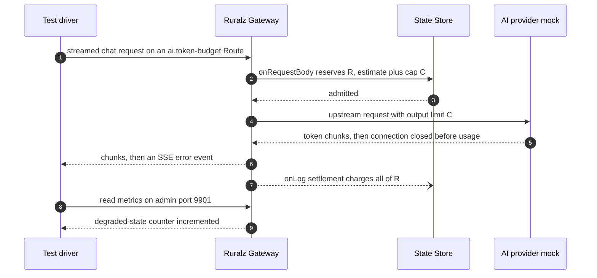

# Testing and Quality Strategy

## Summary

This document fixes how Ruralz proves code matches design: test layers and CI stages, three conformance suites (configuration, Plugin ABI, protocol), fuzzing, chaos, benchmark gates, security scanning, the Plugin SDK and AI provider harnesses, and release gates. Each new package, Policy type, protocol or Host Function arrives with the tests required here.

## Scope and non-goals

In scope: tests for `ruralzd` (Ruralz Gateway), `ruralz-control` (Ruralz Control), the `ruralz` CLI, the Plugin Development Kits (PDKs) and the Bundle schema, their CI stages and release evidence, under the [foundation pack](../_meta/foundation-pack.md) and P10 ([Vision](../vision/01-vision-and-positioning.md#principles)).

Non-goals, owned elsewhere: budget values and thresholds ([Performance budgets and benchmarking](../architecture/12-performance-budgets-and-benchmarking.md)); signing and skew ([Release, versioning and compatibility](04-release-versioning-and-compatibility.md)); numbered CI jobs and the Ruralz Console toolchain ([Repository layout](02-repository-layout-and-conventions.md)); the threat model ([Security and identity](../architecture/08-security-and-identity.md)); the `ruralz test run` case format ([CLI and API surface](../reference/01-cli-and-api-surface.md)).

## Test pyramid

A defect found in a higher layer MUST add a regression test at the lowest layer that reproduces it.

| Layer | Tools | Coverage target | CI stage | Milestone |
|---|---|---|---|---|
| Unit | Go `testing`, race detector, injected clock | 80% statement coverage per `internal/` package; 90% for loader, validation, precedence, canonical form (target) | `pr-fast` | Planned (M0) |
| Property | `testing.F`; model-based state machines | Every [required property](#required-properties): 100% (target) | `pr-fast` | Planned (M1) |
| Golden | Checked-in expected files | 100% byte-exact (target) | `pr-fast` | Planned (M1) |
| Integration | Local `redis-server`; testcontainers-go v0.44.x | Every State Store Policy type and messaging protocol: 100% (target) | `pr-full` | Planned (M1) |
| Conformance | The three [suites](#conformance-suites) | 100% of cases per production platform (target) | `pr-full` | Planned (M1) to Planned (M4) |
| Fuzzing | Go native fuzzing | 25 or more targets by M2; zero open crashers at release (target) | `pr-fast` seeds; `nightly` | Planned (M1) |
| End-to-end | Process harness; Docker Compose and kind; `ruralz test run` | Every pack section 9 command by its milestone: 100% (target) | `main`; Compose `nightly` | Planned (M1); kind Planned (M2) |
| Chaos | Signals, TCP fault proxy, `redis` commands | Every System overview failure row, Scalability chaos experiment, game day drill and failure catalog row by its milestone: 100% (target) | `nightly`; target scale weekly on RH-1 | Planned (M1); Ruralz Control, Plugin and signature rows Planned (M2) |
| Benchmarks | `go test -bench -benchmem`; open-loop load | Every seed budget item from its component's milestone: 100% (target) | `pr-full`; `nightly` | Planned (M1); Plugin Phase call Planned (M2) |
| Security scanning | `govulncheck`, license gate, golangci-lint, `buf breaking` | Zero reachable vulnerabilities (target) | `pr-fast`; secret leak tests in `main` | Planned (M0); `buf breaking` Planned (M2) |

| Stage | Trigger | Wall-clock budget |
|---|---|---|
| `pr-fast` | Every pull request | 10 minutes (target) |
| `pr-full` | Go, proto, schema, `examples/`, `test/` or `deploy/` changes | 30 minutes (target) |
| `main` | Every merge | 45 minutes (target) |
| `nightly` | Daily, parallel jobs | Longest job 3 hours (target) |
| `release` | A release candidate or release tag | Not bounded |

`nightly` keeps noisy work off the latency machine:

| `nightly` job | Runs on | Work |
|---|---|---|
| Fuzz | General runners, sharded | Each target 15 minutes, eight per shard (target) |
| Chaos | General runners | Every [chaos scenario](#chaos-testing), CE experiment, game day drill and failure catalog row at the `nightly` profile |
| Scale | Dedicated general runners | F1 (SM-9) and F2, Planned (M2); SM-10, Planned (M3) |
| Functional | General runners | The benchmark [functional variants](../architecture/12-performance-budgets-and-benchmarking.md#suite-layers): every M1 scenario and constants run at reduced scale on loopback, asserting only criteria that hold on any hardware |
| Latency | RH-1, alone | Macro latency gate; component benchmarks; S1 and S2 nightly, other scenarios in the [slot rotation](../architecture/12-performance-budgets-and-benchmarking.md#suite-layers), every slot when `release` passes `rotation-all`; it targets `rh-1` once the repository variable `RH1_PROVISIONED` is `true`, set after the runner registers, and until then fails with an "RH-1 not provisioned" annotation. A Latency job cancelled while queued, as GitHub does after 24 hours without a runner, counts as a failure titled "RH-1 runner offline" |
| Benchmark records | A GitHub-hosted runner | Commits the Latency job's `ruralz.bench.v1` records and next rotation state to the orphan `bench-records` branch, also after a failed night; the only nightly job holding `contents: write` ([Publication](../architecture/12-performance-budgets-and-benchmarking.md#publication)) |
| RH-1 runner status | A GitHub-hosted runner | Once `RH1_PROVISIONED` is `true`, reads the repository's runners through the API with a fine-grained read-only token (Administration: read) and opens or updates the "RH-1 runner offline" `nightly-failure` issue when no online runner carries the `rh-1` label |
| Image checks | `ubuntu-latest` and `ubuntu-24.04-arm`, with Docker | The [Compose suite](#compose-suite) and the air-gapped image start (`image-checks.yml`, on its own daily schedule) |

Weekly workflows: `chaos-scale.yml` runs every Sunday at 07:17 UTC (`17 7 * * 0`) on `rh-1` behind the same `RH1_PROVISIONED` check, for at most 180 minutes, serialized with the Latency job through the `rh-1` concurrency group that every `rh-1` job shares and that never cancels a running job; a failed scheduled run opens or updates a `nightly-failure` issue, which blocks the next release; `t5-systemd.yml` needs systemd as PID 1 and also runs on every push to `main` that changes `deploy/systemd/` or the handover, drain and sdnotify packages ([Handover under systemd](../operations/02-zero-downtime-upgrades-and-hot-reload.md#handover-under-systemd)); `release` calls both. `image-checks.yml` runs daily and on every push to `main` that changes `deploy/container/` or `test/compose/`, and `release` calls it with the release image's digest. Each of the three also runs on demand, and a failed scheduled or push run of `t5-systemd.yml` or `image-checks.yml` opens or updates a `nightly-failure` issue, which blocks the next release.

*Figure 1: the CI stages; `pr-fast` and `pr-full` block merge, while `main` and `nightly` failures block the next release.*

```mermaid
flowchart LR
    pr["Pull request"] --> fast["pr-fast: build matrix, unit, property, golden, fuzz seeds, security scanning"]
    fast --> full["pr-full: integration, conformance, alloc/op gate"]
    full --> up["Merge once the branch is up to date with main"]
    up --> main["main: end-to-end on the process harness, secret leak tests"]
    main --> nightly["nightly: fuzz, chaos, latency and image check jobs"]
    nightly --> rc["Release candidate tag"]
    rc --> rel["release: every stage re-run on the tag, then release gates"]
    rel --> pub["Signed artifacts published"]
```



`pr-fast` builds the three binaries with `CGO_ENABLED=0` for linux/amd64 and linux/arm64 ([tech stack](01-tech-stack-and-libraries.md#selection-criteria) gate G1, [ADR-0001](../adr/0001-implementation-language-go.md)); shipped binaries come only from `release`. CLI unit and golden tests also run on darwin/arm64, darwin/amd64 and windows/amd64, with identical digests.

## Unit and property tests

Unit tests are hermetic: time, randomness and the State Store arrive as failure-injecting fakes, and tests run shuffled under the race detector. Race jobs set `CGO_ENABLED=1` for test binaries only, with the `netgo,osusergo` build tags; a second `pr-fast` job runs the same tests without `-race` under `CGO_ENABLED=0`, so the shipped configuration is tested. A floor job repeats them on Go 1.26 (`GOTOOLCHAIN=local`, `GOEXPERIMENT=jsonv2`); its JSON golden output MUST match the release job ([tech stack](01-tech-stack-and-libraries.md#version-floor)).

### Hermetic rule scope

Suites that start processes keep the hermetic rule this way:

- **Correctness suites use a controllable clock.** This covers the suites that assert correctness against a built `ruralzd`: the stage 8 integration and conformance suites but the benchmark scenario smoke run, the stage 10 end-to-end suite, and the functional criteria of the nightly Chaos job.
  - They run a test-only `ruralzd` build whose clock the harness controls. `internal/testkit/binaries` builds it with the release flags and the test build tag `ruralz_testclock`, and it is never released.
  - Node timers, TTLs, refresh intervals, deadlines, backoffs and the Drain and handover timelines advance only when the test advances the clock. A bound such as "a 150 s half-life" or "within 10 s" is asserted in controlled time, with no real waiting.
- **External processes run in real time.** These are `redis-server`, sentinel, the L4 balancer and the mocks. The harness waits for them under deadlines with condition polls, never bare sleeps.
- **Shipped-artifact suites use real time.** T5, Compose and the quickstart test the release build or image, with condition waits.
- **Measurement runs use real time by design.** These are the benchmarks, the Latency job, chaos-scale, and the latency criteria of chaos experiments (such as CE-3's p99). They use the release build on reference hardware and gate only on RH-1.
- **Load-driven benchmark checks use real time.** These are the `pr-full` smoke run of every benchmark scenario in stage 8, the benchmark harness's own loopback run of `test/bench/harness` in stage 8, and the [functional variants](../architecture/12-performance-budgets-and-benchmarking.md#suite-layers) of the nightly Functional job. They drive sustained load through the release build, which needs rate limits that refill, so they wait on conditions under real-time deadlines and assert counts, plateaus and codes, never latencies.

The `ruralz_testclock` tag sits only on the pair of files in `internal/clock` that picks the process clock, and changes nothing else: the commanded clock it picks is ordinary code, tested in every build, and release tooling refuses every binary built with a tag. In that build the process clock starts at the real time the process starts and moves only on the harness's commands, lines of at most 256 bytes on file descriptor 3, the first extra file the harness passes, which MUST be a socket. A `ruralz_testclock` build started without that socket exits 2.

`advance <duration>` (Go duration syntax) answers once every timer due by the new time has fired: timers fire in deadline order, equal deadlines in the order they were armed, each callback runs to its end before the next timer fires, and a timer armed meanwhile fires in the same advance when it is due. `now` answers the current time. Both answer the resulting time in UTC, in RFC 3339 form with nine fractional digits. A command the clock refuses, unknown, malformed, negative or longer than 256 bytes, answers `error <reason>` and leaves the clock where it is. When the command stream ends, the clock stays at its last time.

Deadlines the Go runtime enforces on sockets stay on real time in that build: `http.Server` `ReadHeaderTimeout` and `IdleTimeout`, and connection and `http.ResponseController` read and write deadlines, which the Node computes from the real clock; the protocol suite's timeout cases therefore run in real time ([Conformance suites](#conformance-suites)).

`internal/testkit/topology` keeps one clock for all its Nodes, handover successors included: a test advances and reads it, and waits on conditions under real-time deadlines. The first Node process sets the clock's time; a later one is brought forward to it, or, when it started later still, every running Node moves forward to its start, so all Nodes show one time that never goes back. A Node a test stops with SIGSTOP through the harness sits out advances and catches up on SIGCONT, and a Node that exits leaves the clock. A running Node that leaves a command unanswered within the ready timeout breaks the clock for the rest of the test, since its answers are out of step, and every later advance fails.

### Required properties

Each property is a `testing.F` target, with no property library: seeds in `pr-fast`, longer fuzzing in `nightly`. `test/property` holds one target per row due by the current milestone, driving the real packages end to end: the loader through `internal/config/pipeline` to the Revision; the CLI commands in process wherever a property names an exit code; the `ratelimit` Filter on N simulated Nodes over one shared State Store; and `internal/gateway/source`, `reload` and `lkg` together. The per-package targets stay as unit-level properties.

| Area | Property | Source | Milestone |
|---|---|---|---|
| Canonical form | Reordering files or `map` and `set` lists, or reformatting, keeps the Revision; YAML and JSON give one digest | [Canonical form](../architecture/02-configuration-model.md#canonical-form-and-revision) | Planned (M1) |
| Render | Rendering a rendered Bundle again yields the same Revision, including `$${` escapes | [Rendered Bundle](../architecture/02-configuration-model.md#rendered-bundle) | Planned (M1) |
| Conversion | Every field round-trips through the hub type; converting apiVersions keeps the Revision, also through a test-only spoke apiVersion that renames and moves fields both ways, so the property runs while one apiVersion is served | [Conversion](../architecture/02-configuration-model.md#hub-and-spoke-conversion) | Planned (M1) |
| Substitution | `${VAR}` never injects structure or appears in forbidden positions | [Substitution](../architecture/02-configuration-model.md#environment-substitution) | Planned (M1) |
| Precedence | One Policy per slot per scope; `overridable: false` Policies are never removed; order follows Filter class, scope and list position; response Phases reverse, `onLog` keeps request order | Pack section 8.12 | Planned (M1) |
| Effective chain | For random Bundles, the snapshot compiler's per-Phase arrays, per Route and leg, equal the rows `ruralz bundle render --effective` prints | [Bundle verbs in detail](../reference/01-cli-and-api-surface.md#bundle-verbs-in-detail), [Filter Chain execution](../architecture/03-data-plane.md#filter-chain-execution) | Planned (M1) |
| Diff | `diff(A, A)` is empty, exit 0; `diff(A, B)` is empty exactly when Revisions are equal; added and removed identities are set differences, mirrored in `diff(B, A)`; field ops turn A's canonical form into B's (`SecretValue` by reference); reordering `map` or `set` lists yields no op | [Diff semantics](../architecture/02-configuration-model.md#diff-semantics) | Planned (M1) |
| Rate Limit | With a deterministic clock and a healthy State Store, admission per key stays within `requests` + `burst` per window, except for `localOnly` Policies and first-seen keys on local-only entries, which stay within N × per-Node ceiling per window (target); while failing open, within N × per-Node ceiling per window (target), the ceiling being `perNodeCeiling` or, in file mode, the full limit | Pack section 8.8, [ADR-0008](../adr/0008-rate-limiting-local-bucket-and-gcra.md), [Decision path](../architecture/09-traffic-management-and-resilience.md#decision-path) | Planned (M1) |
| Token Budget | R is reserved only if the remaining budget covers it; settlement charges each attempt's reported usage once, plus all of R once per request when any attempt that reached the provider reported no usage, and releases the rest of R; overshoot stays within the sum of concurrent input-estimate errors (hypothesis; SM-10), plus (attempts - 1) x R per concurrent request (hypothesis), plus hidden reasoning above C on `gemini` and `ollama` (OQ-ai-llm-gateway-17). If OQ-ai-llm-gateway-15 closes, the property follows it | Pack section 8.9, [AI/LLM gateway](../architecture/06-ai-llm-gateway.md) | Planned (M3) |
| Rollout | Under random ACK, NACK, timeout and reconnect events, every transition is in the state table | Pack section 8.3 | Planned (M2) |
| Last-Known-Good, Control mode | A candidate is promoted exactly when the active digest equals the promoted digest, also after reconnect, Enrollment or scale-out; never after a failed canary | Pack section 8.2 | Planned (M2) |
| Last-Known-Good, file mode | Under random renders, failures at every gate step, failed or interrupted candidate writes, restarts and handovers: a Revision becomes the candidate and Last-Known-Good only by activation, only the lock holder writes, and boot takes a valid Bundle, else a verified Last-Known-Good, else stays not ready | Pack section 8.2, [Last-Known-Good files](../architecture/03-data-plane.md#last-known-good-files), [Validation gate](../operations/02-zero-downtime-upgrades-and-hot-reload.md#validation-gate) | Planned (M1) |

A registry in `test/property` maps each row's Area to its target. `TestRequiredProperties` reads the current milestone from the first milestone section of the [Roadmap](../roadmap/01-roadmap-and-milestones.md), and fails when a row due by that milestone has no registered target, when a registered target does not exist, or when a registered Area names no row.

Illustrative, not final code:

```go
// Digest stability: reordering unordered lists or files never changes the Revision.
func FuzzRevisionStableUnderReorder(f *testing.F) {
    for _, bundle := range goldenCorpus(f) {
        f.Add(bundle, int64(1))
    }
    f.Fuzz(func(t *testing.T, bundle []byte, seed int64) {
        want, err := buildRevision(bundle)
        if err != nil {
            t.Skip("invalid input is covered by the negative corpus")
        }
        got, err := buildRevision(reorderUnordered(bundle, seed))
        if err != nil || got != want {
            t.Fatalf("digest changed under reordering: %v, %s != %s", err, got, want)
        }
    })
}
```

### Golden tests

The golden corpus, under `test/conformance/config/`, pins what the configuration pipeline produces: Revision digests and canonical bytes (including `shop-bundle`'s), rendered Bundles, diagnostics, `ruralz bundle render --effective` tables and `ruralz.diff.v1` documents. Every release MUST reproduce it byte for byte, deliberate changes excepted ([ADR-0003](../adr/0003-configuration-format.md)). It is the one golden corpus of pipeline outputs: a package keeps golden files only for its own internal forms, such as the canonical encoder's parse goldens, and holds no copy of an example Bundle or of its outputs. The example Bundle tests of [Generator rules](02-repository-layout-and-conventions.md#generator-rules) run here as well, through the configuration pipeline facade with `checks.Table()` and the CEL compiler, so they run every stage.

| Path under `test/conformance/config/` | Holds |
|---|---|
| `golden/<entry>/bundle/` | The entry's input Bundle, a frozen copy |
| `golden/<entry>/bundle-json/` | Optionally, the JSON twin of `bundle/`, which MUST render to the same digests and canonical bytes |
| `golden/<entry>/from/`, `golden/<entry>/to/` | A diff entry's two Bundles, in place of `bundle/` |
| `golden/<entry>/environments.yaml` | The Environments the entry renders, if any |
| `golden/<entry>/level-<n>/expected.json` | The digests at schema level `n`: `{"level": n, "digests": {"<render>": "sha256:<64 hex>"}}` |
| `golden/<entry>/level-<n>/` `canonical/<render>.json`, `rendered/<render>.yaml` and `.json`, `diagnostics/<render>.txt` and `.json`, `effective/<render>/<route>.txt` and `.json`, `diff/<from>.<to>.txt` and `.json` | The other outputs at level `n`, per render: `-`, the render without `--env` over an empty variable set, then each Environment |
| `json-subset/<case>/yaml/`, `json/` | JSON subset pairs, each pair rendering to one digest ([ADR-0003](../adr/0003-configuration-format.md)) |
| `negative/<code>-<slug>/` | Negative fixtures ([Conformance suites](#conformance-suites)) |
| `raw/` anywhere below | Fixtures that need CRLF or a byte order mark; `.gitattributes` marks `test/conformance/config/**/raw/**` `-text`, and every other golden file `eol=lf` for Windows checkouts |

Each entry renders `-` and every Environment of its `environments.yaml`, and pins every output above for each render: every Route's `--effective` table, and the diff between consecutive renders, `-` to the first Environment, then each Environment to the next in file order. A diff entry pins the diff from `from/` to `to/`. The Configuration model's [diff example](../architecture/02-configuration-model.md#diff-semantics) is such an entry, its `to/` the example Bundle and its `from/` the earlier state that example describes, both rendered for `prod`, and a test holds the example's text block equal to its text output and its JSON block, compacted, to its compacted JSON output.

Entries are append-only, and an entry's inputs never change: a changed example Bundle becomes a new entry, `<example>-<k>` with `k` counting from 1, and a test holds the highest-numbered entry of each example equal to its Bundle's files under `examples/`, its configuration and `.ruralzignore` files, so a script beside a Bundle, such as `quickstart.sh`, is no input. Outputs are kept per schema level ([Versioned surfaces](04-release-versioning-and-compatibility.md#versioned-surfaces)): a change that alters an output ships as a new level, whose `level-<n>/` directories are added beside the earlier levels' unchanged bytes, and CI runs every entry at every level inside the skew window. Only `go test ./test/conformance/config -run Golden -update` regenerates the corpus; it adds entries and levels, and refuses to rewrite a file that the newest release tag holds. In stage 1, `commitcheck` fails a pull request that changes or deletes such a file; before the first release no file is held.

## Integration tests

Integration tests carry the `integration` tag and run in stage 8 of `pr-full`. `RURALZ_TEST_STATESTORE` selects the State Store flavor: `process`, a local `redis-server`, on every leg and contributor machine; `container`, the images below through testcontainers-go, a test-only [catalog](01-tech-stack-and-libraries.md#library-catalog) module ([source](https://github.com/testcontainers/testcontainers-go)), on the linux/amd64 container leg. `internal/statestore/statestoretest/redisserver` launches both flavors; its cluster kinds give each of the three primaries one replica, and a cluster failover is a SIGKILL of a primary followed by its replica's promotion (`CLUSTER FAILOVER TAKEOVER`). A suite whose flavor the variable selects fails when that flavor cannot run (no `redis-server`, no Docker daemon, a cluster container off Linux); otherwise a suite skips with a reason. The process harness starts a `redis-server` whenever one is found, without the variable. Images are pinned by digest ([CI tooling](01-tech-stack-and-libraries.md#ci-tooling)), never taken from module defaults ([source](https://golang.testcontainers.org/modules/)).

| Dependency | Container source | Used for | Milestone |
|---|---|---|---|
| Local `redis-server`, `process` flavor | None: `RURALZ_TEST_REDIS_SERVER` or `PATH` | Standalone, replica with scripted failover, TLS, ACL and three-primary cluster runs of the `redis` driver, each cluster primary with one replica | Planned (M1) |
| Redis 8 | `modules/redis` ([source](https://golang.testcontainers.org/modules/)) | `redis` State Store driver: GCRA script, Quota, Response Cache, Token Budget; Vector Sets for the Semantic Cache | Planned (M1); Token Budget and Semantic Cache Planned (M3) |
| Valkey 9.0.1 or newer | `modules/valkey` ([source](https://golang.testcontainers.org/modules/)) | The same tests; valkey-search 1.2, and a server without it for the degraded path | Planned (M1); Token Budget and Semantic Cache Planned (M3) |
| Redis Cluster and Valkey cluster | Generic containers, three primaries with one replica each, Linux runners only, since members announce container IPs ([source](https://github.com/testcontainers/testcontainers-go)) | Consumptive calls sharing a hash slot run as one script; others run sequentially, stop at the first deny and never hit `CROSSSLOT` (pack section 8.7); a primary's failover | Planned (M1); Token Budget Planned (M3) |
| Dragonfly | Generic container ([source](https://github.com/testcontainers/testcontainers-go)) | The same driver tests and scripts; the degraded Semantic Cache path (pack section 7) | Planned (M1); Semantic Cache Planned (M3) |
| Kafka | `modules/kafka`, KRaft, a CI-suitable image, not `confluent-local` ([source](https://golang.testcontainers.org/modules/kafka/)) | `kafka` Upstreams (franz-go) | Planned (M4) |
| NATS | `modules/nats` ([source](https://golang.testcontainers.org/modules/nats/)) | `nats` Upstreams (nats.go/jetstream) | Planned (M4) |
| MQTT | `modules/mosquitto` ([source](https://golang.testcontainers.org/modules/mosquitto/)) | `mqtt` Upstreams (paho.golang); embedded broker mode | Planned (M4) |
| OCI registry | `modules/registry` ([source](https://golang.testcontainers.org/modules/)) | Revision and Plugin pulls by digest with Sigstore verification | Planned (M2) |

Authentication tests replace Mosquitto's anonymous default ([source](https://golang.testcontainers.org/modules/mosquitto/)). Required State Store scenarios:

- After a script cache flush, `EVALSHA`, the cached form of pack section 8.8's GCRA `EVAL`, meets `NOSCRIPT`: that request applies the Policy's `failureMode` without a second round trip (pack section 8.7 rule 1), the Node reloads the script off the request path, and the next `EVALSHA` succeeds ([Traffic management and resilience](../architecture/09-traffic-management-and-resilience.md)).
- A full post-commit queue drops writes with a counter, never delaying the response: on a Route whose only State Store Policy is `cache`, the counting RESP proxy holds every reply to the scripts that write, by command name, so the eight writers wait on their batches; every unsafe request, which makes no request-path call and queues one generation bump, completes while the replies are held, `ruralz_state_writes_dropped_total{kind="cache_invalidate"}` counts once the invalidation class fills, no other class drops a write, and the queue drains once the replies pass. The stores class cannot fill this way: a store follows a lookup, which the State client pipelines on the connections whose replies the proxy holds, so the lookup waits behind them.
- A slow vector search never delays a rate-limit reply, Planned (M3).
- Without vector support, `ai.semantic-cache` behaves as a State Store failure under its `failureMode`; the Node reports a degraded state, Planned (M3).
- Under `topology: sentinel`, after `SENTINEL FAILOVER` the Node follows the promoted replica within 15 s (target), loading its scripts there, on the `redisserver` sentinel kinds: a primary, its replica and a sentinel, as local processes and as Redis 8 and Valkey 9 containers.

Node integration suites under `test/integration/`, Planned (M1), drive the [controllable-clock test build](#hermetic-rule-scope) of `ruralzd` over real sockets:

| Suite | Covers |
|---|---|
| `cel` | Every M1 [CEL place](../architecture/02-configuration-model.md#allowed-places) with each runtime-error kind reachable there under the Revision's input caps: an evaluation error, the 1,000,000-unit cost limit and the 50 ms comprehension stop (target), the last two only for expressions the caps leave tracked. Each case asserts the place's "On runtime error" behavior and its signal: `ruralz_filter_failures_total` for Policy fields, `RZ-RL-005` for a closed key, `RZ-AUTH-015` for `authz.cel`, `RZ-RT-011` and `RZ-RT-012` for `headers` and the transforms, `RZ-RT-006` for `match.when`, `RZ-RT-015` for composition steps, `ruralz_upstream_cel_errors_total` for the Upstream fields, and the written entry with `ruralz_telemetry_access_log_cel_errors_total` for `accessLog.when`. On Routes whose `timeout` is shorter than 50 ms (target), a `match.when` and an `authz.cel` rule stop at the Route deadline instead, and `accessLog.when`, starting past it, stops at once |
| `telemetry` | Hot Reload: counters carry over, the OTLP connection is kept, and a changed endpoint or `telemetry.otlp.tls` swaps it within 5 s (target). A blocked stdout: under load, the Node's stdout goes unread for 60 s (target); every request completes while it stays blocked, with zero failures, and the run records gateway-added p99 against an unblocked run; `ruralz_telemetry_logs_dropped_total{sink="stdout",reason="queue_full"}` counts for both streams; OTLP log export goes on, with no `sink="otlp"` loss; output resumes once stdout is read again; a SIGTERM sent while blocked exits within the 30 s exit bound (target). The 1,000-reload test of [Cardinality budget](../architecture/10-observability.md#cardinality-budget). The `internal/testkit/otlpsink` modes: Reject, Stall and Down raise and clear `telemetry_export_failing` and count `queue_full` and `export_error` while requests stay unaffected; metrics push every 15 s (target); at most 4 scrapes encode at once and a fifth waits 10 s, then gets 503 (target); an `http` endpoint raises `cleartext_hop` |
| `security` | JWKS rotation, every case in controlled time: a new key published and signing costs one `RZ-AUTH-005` and one refresh, then passes; at most one refresh per issuer per 30 s (target), honoring `Retry-After`; a failed prefetch at activation still activates; a key removed from the document stops verifying once the 150 s half-life of `max-age=300` passes, advanced on the test clock rather than waited (the nightly Chaos job adds one real-clock run of this case beside FC-16). mTLS. The admin port, with a bearer token from a non-loopback peer refused without TLS: on Linux, a network namespace gives the client a non-loopback address on a dummy or veth device, inside a user namespace mapping the test's user to root unless it runs as root; the case skips with a reason without the privilege to create either, and stage 8 grants it by lifting its runners' restriction of unprivileged user namespaces. Secret-to-destination binding. The State Store entry MAC: keyed and key-less Nodes on one State Store, in both directions. Secrets rules 5 and 6 of [Secrets](../architecture/08-security-and-identity.md#secrets): `RURALZ_SECRET_ROOT`, the `env` allowlist, a group-writable `file` secret (`RZ-CFG-026`), a root holding the data directory refusing start, the egress guard with `RURALZ_FETCH_ALLOW`, no `https` to `http` redirect and no `tokenUrl` redirect. Listener and Upstream certificate rotation by watch, a failed one counted in `ruralz_config_secret_rotation_failures_total`. The `auth.basic` throttle: `RZ-AUTH-007` and `ruralz_auth_basic_refusals_total` |
| `statestore` | Every kind `redisserver` selects, counting commands through the counting RESP proxy `internal/statestore/statestoretest/respproxy` on standalone kinds and process clusters, whose primaries announce counting proxies, and by `INFO commandstats` and `INFO errorstats` deltas per serial phase on sentinel kinds and container clusters, whose servers are reached at the addresses they announce; those deltas also count the commands a script calls, so a phase that runs scripts compares `EVALSHA` and the commands no script calls, and they leave out the commands a primary's replica and sentinels send it (`REPLCONF`, `PSYNC`, `SYNC`, `PUBLISH` and `SUBSCRIBE`), which no State client sends. The scenarios above. The [ADR-0008](../adr/0008-rate-limiting-local-bucket-and-gcra.md) round trip for every M1 State Store Policy type under pack 8.7 rules 1 to 4, counting request-path commands only (connection setup, `HELLO`, `AUTH`, `CLIENT`, `SELECT` and a sentinel client's `ROLE`, and `INFO`, `PING`, `SCRIPT LOAD` and `CLUSTER` excluded): `ratelimit` local denials and over-limit hits send nothing, an admitted request one call per Policy, consumptive keys sharing a slot one script, and keys on other slots one call each, in order, stopping at the first deny, without a `CROSSSLOT` reply; a `quota` denial cached up to 60 s (target) sends nothing, and refunds follow the response; a `cache` lookup is one pipelined batch of the commands [Response caching](../architecture/09-traffic-management-and-resilience.md#response-caching) lists per server it reaches, since the generation key and the partition hash to different cluster slots, and stores follow the response. The State client behaviors a Node shows: a Hot Reload keeps the client, with no redial and its scripts kept; a changed URL, topology or TLS block opens a new client before the swap; a rotated `file` secret URL opens one at once; `stateStore.cache` carries the cache traffic; `READONLY` after a demotion; the 8,192-call ceiling (`RZ-STS-004`); `state_store_eviction_policy`, `state_store_unauthenticated` and `cleartext_hop`; `RZ-CFG-042` refusals; the `memory` fallback warning |

`test/t5` holds an `integration`-tagged test that runs `systemd-analyze verify` on a copy of the shipped unit and `systemd-sysusers` with its sysusers.d entry against a temporary root, and, under the test-only tag `t5`, which `t5-systemd.yml` runs, the `ExecReload=` helper checks and the live suite, which skips with a reason unless `RURALZ_TEST_T5=1` is set ([Handover under systemd](../operations/02-zero-downtime-upgrades-and-hot-reload.md#handover-under-systemd)).

Container-free tests run three Ruralz Control replicas and Nodes in one process over loopback mutual TLS ([ADR-0007](../adr/0007-control-stream-protocol.md)), each instance with its own `RURALZ_DATA_DIR`, OpenTelemetry providers and `slog` logger: snapshot and delta delivery, ACK and NACK classification, promoted digests, backup then restore. Their fencing test, Planned (M2), proves a deposed leader's entry at a taken sequence commits but is never accepted or delivered, and a new leader proposes only after Barrier; its `postgres` Control Store variant, Planned (M4), proves the transaction rejects that entry ([ADR-0006](../adr/0006-control-store-raft-boltdb.md)).

## End-to-end tests

End-to-end tests drive real binaries with `ruralz test run` (pack section 9). Until it lands in M2, a Go driver runs the same `ruralz.test.v1` case files ([Test case format](../reference/01-cli-and-api-surface.md#test-case-format)), using the request and expect members the CLI reference defines, from `test/e2e/testdata/`, so `ruralz test run` takes them unchanged. The process harness is the end-to-end implementation in every environment, since no Docker daemon is assumed; Docker Compose runs only in CI.

| Environment | Topology | What only it can show | Milestone |
|---|---|---|---|
| [Process harness](#process-harness) (`internal/testkit/topology`) | File mode on loopback: two Nodes, or 10 or more for chaos (target), each on its own test render, built with release flags as the [controllable-clock build](#hermetic-rule-scope); a State Store of any `redisserver` kind, which each Node reaches through its own fault proxies; in-process mock Upstreams, IdP and OTLP collector; an L4 balancer probing `/readyz` | Every M1 scenario but the quickstart, which needs a clean machine, and every M1 command; Hot Reload, Last-Known-Good, handover and Drain; secret leaks; the air-gapped start inside a loopback-only network namespace | Planned (M1) |
| Docker Compose, CI only (`image-checks.yml`: daily, on pushes that change its inputs, and in `release`); the [Compose suite](#compose-suite) | File mode: the `ruralzd` image built from the commit's binaries (daily, push and on-demand runs) or the release image by digest (stage 12), a Valkey 9 State Store, the test-only mock image (mock Upstream and IdP, DNS sink, probe client) and an OpenTelemetry Collector with a file exporter, and from M2 an OCI registry; Control mode adds three Ruralz Control replicas and the AI provider mock | The image serving the quickstart, `ruralz bundle render --effective --route`, `ruralz bundle diff` against `/config/dump` and a Zero-Downtime Upgrade; signals reaching a real Collector; the air-gapped image start on an `--internal` network; Rollouts and signed OCI pulls | Planned (M1) file mode; Planned (M2) Control mode and OCI pulls; mock Planned (M3) |
| kind | The Helm chart, CRDs and Ruralz Control | CRD ingestion, `provider: kubernetes` secrets, EndpointSlice discovery, rolling pod replacement with readiness gating and Drain | Planned (M2) |

Every process harness run, end-to-end, chaos, Node integration and benchmark runs alike, puts a canary in each secret value it supplies: every `secretRef` file (TLS keys, the API key, the OAuth client secret, the State Store URL's password) and the admin token, metrics token and MAC key files. A value a test supplies MUST carry a canary the harness issued, and the harness refuses one that does not; a PEM file carries its canary on a line before its blocks, which PEM parsers skip. At teardown it scans every byte it captured for each canary, raw or base64, hex, URL or JSON encoded, and a finding fails the test: process and access logs; every admin response, `/config/dump`, `/tap`, `/metrics`, `/debug/snapshots`, `/debug/upstreams` and `/readyz` included; CLI output, diffs included; OTLP traces, metrics and logs, as the exporter sent them; client responses and their error bodies; the mock Upstream's request log, where a dropped or cut request fails the scan as incomplete; the files under each Node's `RURALZ_DATA_DIR`; and the State Store keyspace. Designated destinations ([Secret-to-destination binding](../architecture/02-configuration-model.md#secret-to-destination-binding)), which are the State Store servers and the mock IdP's token endpoint, and `/debug/pprof` profiles are excluded, and a benchmark run scans after its measurement ([Secrets](../architecture/02-configuration-model.md#secrets-and-environment-variables)).

| Required scenario | Milestone |
|---|---|
| 1. The [scripted quickstart](../operations/01-deployment-topologies.md#quickstart) reaches a first proxied request in 10 minutes or less (target) on a clean machine (SM-7) | Planned (M1) |
| 2. The [REST example Bundle](../architecture/02-configuration-model.md#rest-example-bundle), `examples/shop-rest-bundle/`, serves its Routes with the Filter Chains `ruralz bundle render --effective --route` prints; from M3, so does `shop-bundle`, gRPC and AI Routes included | Planned (M1); `shop-bundle` Planned (M3) |
| 3. A canary Rollout with a deterministic NACK ends `rolled-back`, or `paused` with `autoRollback: false` until `ruralz rollout resume` | Planned (M2) |
| 4. With Ruralz Control stopped, Nodes keep serving and stay ready; a restarted Node boots Last-Known-Good after up to 5 s (target) | Planned (M2) |
| 5. A Hot Reload keeps open WebSocket and SSE streams on their starting snapshot | Planned (M3) |
| 6. `ruralz bundle diff` against a Node's `/config/dump` shows an injected difference | Planned (M1) |
| 7. A Zero-Downtime Upgrade under load fails zero requests on TCP listeners (target), for clients honoring `Connection: close` and GOAWAY | Planned (M1) |

The M1 scenarios check:

| Scenario | Checks |
|---|---|
| 1 | The `make quickstart` job of stage 10 on a fresh runner per `ruralzd` archive ([Quickstart](../operations/01-deployment-topologies.md#quickstart)); the process harness does not repeat it, and `test/quickstart` checks each step's exits and messages against stand-in tools in stage 5 |
| 2 | The harness serves a temporary copy of `examples/shop-rest-bundle/` with the test-owned `e2e` Environment and its overlay from `test/e2e/testdata/`, whose variables point the Bundle's DNS names, JWKS URL and token URL at the harness's mocks and whose overlay turns the Consumer's key hash into a canary `secretRef`; the example and its document blocks stay unchanged. Per Route, `ruralz bundle render --effective --route NAME --output json` equals the document's effective tables. Requests then exercise every row: allowed, each denial, a CORS preflight, the rate limits and the quota. The suite checks the `ruralz.filter.<name>` spans the OTLP sink receives, per Phase and leg in the printed order, sampled through `traceparent`, and each Policy's effect: CORS answers, `RZ-AUTH` codes, 429s, the quota charge, and the upstream token and headers at the mock Upstream |
| 6 | `ruralz bundle diff` compares the Node's own render, with one field changed, against `--admin` and against a saved `ruralz node dump` file: exit 1 and exactly that operation, with its path and impact class, in the human form and in `ruralz.diff.v1` JSON, secrets only by reference. The unchanged render exits 0 against both |
| 7 | A test Bundle with one plain Route to a mock Upstream on 8080 and 8443 behind the L4 balancer, under open-loop load of 1,000 requests per second for 60 s (target): HTTP/1.1 and h2c on 8080, HTTP/2 and HTTP/1.1 over TLS on 8443. 10 s in, one Node hands over to a new process inside a network namespace with `net.ipv4.tcp_migrate_req=1`, the test advancing the Node clock through the linger and the Drain. Any outcome but the mock's 200 fails the scenario |

`test/e2e` keeps scenario 7 as its only upgrade check; the Hot Reload, Last-Known-Good, handover and Drain lab gates run in the nightly Chaos job ([Chaos testing](#chaos-testing)).

Every M1 command of pack section 9 has end-to-end cases for each documented exit code and output form, on the process harness:

| Command | Cases |
|---|---|
| `ruralz bundle validate` | A clean and a failing Bundle, text and JSON |
| `ruralz bundle render` | YAML and JSON output, `--effective` in both forms, `--api-version` |
| `ruralz bundle diff` | Directory, file, saved dump and admin URL sources |
| `ruralz bundle build` | The printed digest, `--output-file` |
| `ruralz dev run` | `--ephemeral-ports`, `--secret-overrides`, a Hot Reload on a source edit |
| `ruralz dev tap` | Redacted events; exit 2 for the fifth subscriber |
| `ruralz node drain` | The Drain of a harness Node, on Linux |
| `ruralz node dump` | The saved Revision, secrets omitted |
| `ruralz version`, `ruralz completion` | The build metadata; a script for each of the four shells |

The suite checks this list against the documents: every command that pack section 9 or the CLI reference's [command table](../reference/01-cli-and-api-surface.md#command-table) plans for the milestone in progress, or an earlier one, maps to end-to-end tests that run it, and the suite maps no other command.

The air-gapped start runs inside a loopback-only network namespace: a Node on the REST example Bundle, with every dependency on loopback, becomes ready within the readiness wait, passes scenario 2's checks and shows only the expected degraded reasons, and every non-loopback dial fails without delaying readiness.

### Process harness

`internal/testkit/topology` runs the Nodes and their dependencies for the end-to-end, chaos, Node integration, conformance and in-process benchmark suites:

| Part | Design |
|---|---|
| Nodes | Each Node runs its own private test render, as `ruralz test run --bundle` does ([Local ruralzd launched by the CLI](../reference/01-cli-and-api-surface.md#local-ruralzd-launched-by-the-cli)): every listener `port` and `admin.port` is rewritten to a free port, kept when a reload re-renders, which on Linux the harness holds until the topology's teardown with a socket bound to it that never listens, so no other socket takes the port before the Node binds it or while the Node restarts, and every `secretRef`, a Consumer API key's included, becomes a `provider: file` reference, its `key` kept, to a per-run file under that Node's `RURALZ_SECRET_ROOT`, except the references a test keeps as authored to exercise the `env` provider and the secret root rules, whose values it supplies itself, each carrying a canary. Each Node reports its test digest and its port mapping beside the Revision digest, both digests computed as the configuration pipeline computes them. This is the only way several Nodes share one loopback host ([SO_REUSEPORT and listeners](../architecture/11-scalability-and-distributed-state.md#so_reuseport-and-listeners)); each binds its test render's `admin.port` from boot ([Admin endpoints](../architecture/03-data-plane.md#admin-endpoints)) |
| Runtime | With more than one Node, each runs with `GOMAXPROCS` max(1, CPUs / Nodes). The harness waits up to 30 s of real time for `/readyz` (target), as `ruralz dev run --ready-timeout` does. It stops a Node with SIGTERM and, on a controllable-clock topology, advances the clock through the Drain in 1 s steps (target), each followed by 50 ms of real time (target), until the Node exits or the clock has moved by the kill time; it sends SIGKILL to a Node still running 40 s of real time after the SIGTERM (target), as `TimeoutStopSec` does. A test may override each |
| State Store | Any `redisserver` kind and flavor the test selects: standalone, replica with scripted failover, cluster or sentinel, as processes or containers. Each Node reaches it through fault proxies of its own, one per endpoint of the State Store URL (the server, each cluster seed or each sentinel), or through `respproxy` on request; a cluster's redirects and the primary a sentinel names reach the servers directly, except that with `respproxy` each primary of a process cluster announces a counting proxy of its own, which every Node shares, so every command crosses one. A scripted failover moves every Node's proxy to the new primary. The default is a standalone process `redis-server` |
| Transport | TLS from `internal/testkit/pki` and credentials on every hop the harness chooses: `rediss://` with an ACL user whose password is a canary, an `https` OTLP sink, and admin TLS through `RURALZ_ADMIN_TLS_DIR` with operator and metrics tokens; every Node trusts the harness's CA and each State Store's through `SSL_CERT_FILE`. Cleartext appears only where the scenario's Bundle declares it, which a test sets per hop, and where TLS cannot apply: a container State Store runs its image as it is, without TLS or an ACL user, and `respproxy` reads the commands, so a State Store behind it runs without TLS |
| Clock | One controllable clock for every Node, handover successors included ([Hermetic rule scope](#hermetic-rule-scope)). A topology over a build without it, such as a release build that `RURALZ_TEST_BIN_DIR` names, runs in real time and refuses clock commands |
| Failure evidence | When a test fails, the harness copies each process's logs, a listing of each `RURALZ_DATA_DIR`, each running Node's `/debug/snapshots`, the OTLP records and each balancer's transition log into a directory named after the test under `RURALZ_TEST_ARTIFACT_DIR`, or under a directory the test names; the stage 10 job and the nightly Chaos job upload it |

The harness's own tests run a stand-in Node: the test binary, re-executed as a fake `ruralzd`, reads `RURALZ_CONFIG` and its file secrets under `RURALZ_SECRET_ROOT`, staying unready while one is missing, binds the rendered ports, `proxyProtocol` listeners included, and serves `/healthz`, `/readyz`, `/metrics` and `/debug/snapshots` behind the admin authentication. It takes the data-directory lock, Hot Reloads on a file swap or SIGHUP, Drains on SIGTERM, hands over to a successor through the data directory's handover socket and follows the clock commands. So every part is tested before `ruralzd` serves, and the suites drive the built `ruralzd`.

### Load generator and L4 balancer

The process harness offers load with the open-loop generator `internal/testkit/loadgen` and runs its Nodes behind the L4 balancer `internal/testkit/l4lb`, Planned (M1). Chaos experiments, scenario 7, G1's State client load, the benchmark functional variants and smoke run, and every Latency job scenario whose requests carry rotating keys or bearer tokens (S2, S3, S5, S5x, O1, O2, the PB-15 and PB-16 runs and their ladders) use loadgen; oha drives S1 and its ladder, and vegeta cross-checks S1 ([method](../architecture/12-performance-budgets-and-benchmarking.md#open-loop-load-and-coordinated-omission)). Both take an injected clock for every timer, so their own tests never depend on wall-clock time.

| Load generator part | Design |
|---|---|
| Schedule | Request i is due at start + i / rate, and its latency counts from that intended send time, so a stall shows as latency, never as fewer samples; a run ends after its measured duration or request count, at Stop, or when its context ends |
| Bounds | At most 4,096 requests in flight and 65,536 waiting (target); a request beyond both is Missed, counted but never sent; each request times out after 30 s (target), above the 25 s Drain deadline (target) |
| Outcomes | Status class, refused, reset, closed, timeout, TLS failure, missed or canceled; the `code` of each problem document is counted; the first 10,000 failures are kept with their connection (target) |
| Histograms | HdrHistogram's bucket layout and percentile rule at three significant digits, 1 µs to 1 h (target): p50, p90, p99, p99.9 and maximum per phase; HdrHistogram V2 interval logs are a result record's raw histograms; service times another tool recorded are back-filled |
| Phases | A warm-up discarded from the measured phase, extended in 30 s steps up to 180 s until the p99 of three consecutive 10 s windows spreads by 5% or less (target), the spread taken as (max − min) / min (target); a time series of 1 s windows by intended send time at two significant digits (target) |
| Validity | The achieved count within 0.5% of the offered count (target), `RZ-RT-005` counting as achieved in O1; the rate ladder of 5% steps from 50% to 110% of expected saturation (target) and the saturation rule |
| HTTP | HTTP/1.1 on 256 connections, h2c or HTTP/2 over TLS on 64 connections of up to 64 streams, as S1 and S3 set (target); rotating keys (a cycle, Zipf, rotation or one hot key) and bearer tokens; the client address of each request's connection. A scenario that needs per-client `source.ip` sends from distinct loopback source addresses, 127.0.0.1 up to 127.0.0.254, which Linux answers without aliases: request i leaves from address i mod n, over that address's even share of the connections |

| L4 balancer part | Design |
|---|---|
| Splicing | Each client connection is spliced to one backend, bytes unchanged both ways with half-closes, so TLS, ALPN and client certificates pass through; a reset on one side resets the other |
| PROXY protocol | Optionally, each backend connection starts with a PROXY protocol v2 header carrying the client's address and the balancer address it reached: command PROXY, TCP4 when both are IPv4, else TCP6 with IPv4-mapped addresses, and no TLVs. A header that cannot be written counts as a failed dial. The harness turns it on, with `proxyProtocol: true` on the balanced listeners, where a scenario needs per-client `source.ip` ([Client address](../architecture/08-security-and-identity.md#ip-filtering-and-geoip)); otherwise every request's `source.ip` is the balancer's loopback address |
| Readiness | Each backend's `/readyz` is probed every 1 s with a 1 s timeout (target), over one keep-alive connection or a new connection per probe; 3 failures in a row mark a backend unhealthy and 2 successes bring it back, the `healthCheck.active` defaults, so a Drain is seen within 3 s, inside the 5 s accept window (target); a new backend's first success makes it healthy |
| Balancing | Round robin with no stickiness; a backend returning from unhealthy, or added while another serves, ramps from 10% (target) to a full share over a 30 s slow start (target); the backends present at start join at full weight together |
| Limits | Connections idle for 150 s (target) close, after the Node's 120 s (target); at most 16,384 connections (target) and an optional cap per Node; a backend dial times out after 5 s (target), and a failed one moves to another healthy backend with redispatch, else the client connection is reset |
| Attribution | The backend of each open connection and of the last 16,384 closed ones (target), by client address, so a failed request is attributed to its Node (CE-1) |

### Compose suite

`test/compose`, Planned (M1), is the Docker Compose environment's suite, under the test-only tag `compose`. `make image-checks` runs it, driving `docker compose` from the runner image ([CI tooling](01-tech-stack-and-libraries.md#ci-tooling)). Since it tests a shipped image, it runs in real time and waits on conditions under deadlines, never on fixed sleeps.

| Compose suite part | Design |
|---|---|
| Legs and inputs | A linux/amd64 leg (`ubuntu-latest`) and a linux/arm64 leg (`ubuntu-24.04-arm`). A daily, push or on-demand run without an image runs `make release-dry-run`; `make image-checks` then builds the image for the leg's platform with `docker buildx build --load` from `deploy/container/Dockerfile` and the dry run's `dist/linux_<arch>/ruralzd` and notices, and the suite runs the dry run's `ruralz` CLI ([Packaging and audit](04-release-versioning-and-compatibility.md#packaging-and-audit)). `release` passes the release image's digest and the name of its run's artifact that holds the release directory, and the CLI comes from the release's linux `ruralz` archive of the leg's architecture. `make image-checks IMAGE=<ref>@<digest>` tests any image, with the CLI that `RURALZ_TEST_BIN_DIR` names or one built from the commit. The suite reads `RURALZ_TEST_IMAGE`, `RURALZ_TEST_PREVIOUS_IMAGE` and `RURALZ_TEST_BIN_DIR`: without an image every tagged test skips, and with one a missing Docker daemon, compose plugin or image fails the suite. A failed test leaves each project's containers, logs and Collector files under `RURALZ_TEST_ARTIFACT_DIR`, which the job uploads |
| Services | One test-only image, never published, built by the suite for the daemon's platform on a scratch base from a `test/compose` main over `internal/testkit/mockup` and `internal/testkit/mockidp`: it serves as the mock Upstream, the mock IdP and a DNS sink, which report what they received on a control port, and as a probe client that prints a JSON report. The State Store is the Valkey 9 image pinned in `internal/statestore/statestoretest/redisserver/images.go`, with a password, since RZ-CFG-042 refuses a non-loopback State Store URL without credentials. The suite builds the Collector image from the image pinned by digest in `test/compose/collector.Dockerfile` and its configuration: an OTLP/gRPC receiver over TLS and a file exporter per signal, writing OTLP JSON lines into a directory the test reads. It removes both images at the end |
| Bundles | The quickstart Bundle, unchanged: the mock Upstream service owns the network namespace that the `ruralzd` containers join (`network_mode: service:<mock Upstream>`), so its Endpoint 127.0.0.1:9000 answers. The REST example Bundle, unchanged, rendered by the CLI on the runner with the suite's `compose` Environment and overlay from `test/compose/testdata/`: the Environment points `OTEL_EXPORTER_OTLP_ENDPOINT` at the Collector service, and the overlay turns the Consumer's key hash into a canary `file` `secretRef`. Network aliases give the Bundle's JWKS and token host `auth.shop.example` to the mock IdP on 443 and its Upstream DNS names to the mock Upstream; its TLS files and secrets are mounted at the paths it names, `RURALZ_STATE_STORE_URL` carries the Valkey URL, and a test CA from `internal/testkit/pki` is mounted over the image's CA bundle |
| REST checks | Per Route, `ruralz bundle render --effective --route NAME --output json` of the Compose render equals the example's own. Traced requests on both Routes, over TLS with the API key and over cleartext with an IdP token and an `Origin`, reach the Collector as `ruralz.filter.<name>` spans in the printed order, per Phase and leg, and the mock Upstream sees the upstream token and headers. The denials (RZ-AUTH-001, RZ-AUTH-010, RZ-AUTH-002) and a CORS preflight answer as the chains print, and metrics and access records reach the Collector. `ruralz bundle diff` compares the render against `--admin` and against a saved `ruralz node dump` file: exit 0 unchanged, and exit 1 with exactly the one changed field in the human form and in `ruralz.diff.v1` JSON, secrets only by reference. No canary appears in the CLI output, the dump, the logs, the Collector's files or the mock Upstream's request log |
| Admin | Admin TLS from `internal/testkit/pki` through `RURALZ_ADMIN_TLS_DIR`, plus an operator token; the CLI on the runner calls `--admin https://…` with `--admin-token-file`, so `ruralz bundle diff` reads `/config/dump` over TLS |
| Zero-Downtime Upgrade | The old and the new `ruralzd` containers join the mock Upstream's network namespace, share one data volume and run as user 65532, so `SO_REUSEPORT` steering, the lock and `handover.sock` work across them ([Binary upgrades](../operations/02-zero-downtime-upgrades-and-hot-reload.md#binary-upgrades)); the old image is the previous release by digest once one exists, else the image under test. `image-checks.yml` resolves it as the newest published `vX.Y.Z` below the version under test, or the newest of all outside a release run, and passes its index digest to `make image-checks` as `PREVIOUS_IMAGE`. Under HTTP/1.1 and h2c load from the runner, the new container takes over: no request fails, the old process exits 0 after releasing the lock, and the new one serves `/readyz` and stops cleanly in its turn |
| Air-gapped start | On a network created with `--internal`, the image boots the quickstart Bundle with a `resolv.conf` that names only the DNS sink, on loopback in the network namespace the Node shares with the mock Upstream. A probe client container on that network gets 200 from `/readyz` over admin TLS and the proxied 200, looks a name up through the sink to prove that it answers and records, and reads the sink's record: no lookup of a name outside the network |
| Hardening | Every `ruralzd` container runs as user 65532 with `read_only: true`, `cap_drop: [ALL]` and `no-new-privileges`, its data directory on a named volume, every bind mount read-only, and `stop_grace_period: 40s`, above the 30 s Drain exit bound (target), so the suite proves the image needs nothing more: the untagged tests check the Compose files, the tagged tests each running container, and every stop exits 0 |

## Conformance suites

Conformance suites test published contracts; each is versioned with its contract and also runs outside Ruralz CI.

| Suite | Contract under test | Cases | Runs against | CI stage | Milestone |
|---|---|---|---|---|---|
| Configuration | JSON Schema (both views), restricted YAML profile, `ruralz.canonical.v1`, `ruralz.diff.v1`, RZ-CFG registry | The [golden corpus](#golden-tests) and the example Bundle tests; one negative fixture per offline RZ-CFG code with file, line and column; JSON subset, loader conformance, hostile-input, CEL cost and overlay fixtures; the upstream suites | `ruralz` and `ruralz-control` MUST emit identical diagnostics; `ruralzd` MUST match for its stages (every stage but overlay selection in file mode, reference resolution onward in Control mode) | `pr-fast` untagged cases on Linux, macOS and Windows; `pr-full` binary-driven and upstream cases | Planned (M1); `ruralz-control` and the CRD path Planned (M2) |
| Plugin ABI | `ruralz.plugin.v1`: Host Functions, memory conventions, Capabilities, limits, every Phase | Reference Plugins per Phase; denied Capabilities; trap, deadline and memory cases with `RZ-PLG` codes | The `ruralzd` and `ruralz plugin test` hosts, every Ruralz PDK, the proxy-wasm adapter | `pr-full` | Planned (M2); adapter Planned (M4) |
| Protocol | Per-protocol Phase mappings (P7) and wire behavior | HTTP/1.1, HTTP/2 and h2c, with Ruralz-written HTTP/2 frame cases; gRPC, gRPC-Web and Connect with trailers, deadlines and all stream types; WebSocket; SSE; GraphQL federation; AI dialects; event protocols | Ruralz Gateway through its listeners: the controllable-clock `ruralzd` build, or the build `RURALZ_TEST_BIN_DIR` names | `pr-full`, with a Go 1.26 floor leg | Planned (M1) HTTP; Planned (M3) streaming, gRPC, GraphQL, AI and HTTP/3; Planned (M4) events |

The codes of the checks that can fail after a green offline run ([Validation and diff semantics](../architecture/02-configuration-model.md#validation-and-diff-semantics)) may carry no source position; integration and end-to-end cases assert code and resource identity wherever raised: RZ-CFG-024 at Rollout, NACK or file-mode load; RZ-CFG-026 at NACK or load; RZ-CFG-027 at `ruralz bundle push`, OCI pull, Control Stream delivery and Last-Known-Good boot; RZ-CFG-028 and RZ-CFG-033 in `ruralz bundle build`, `validate --online`, Ruralz Control ingest and Node activation, RZ-CFG-033 also for Revision signatures at Node activation (pack sections 8.1 and 8.14); RZ-CFG-044 and RZ-CFG-045 at Node activation, naming no resource.

The configuration suite's untagged cases run in-process in `pr-fast` on Linux, macOS and Windows: each Bundle goes through the CLI's path, `internal/cli/bundle`, and through `ruralzd`'s, the configuration pipeline facade and the snapshot compiler with the Node's wiring, and the two MUST report the same diagnostics for the stages both run. Its `integration`-tagged cases in `pr-full` run the same Bundles through the built `ruralz` and the controllable-clock `ruralzd` build ([Hermetic rule scope](#hermetic-rule-scope)), both from `internal/testkit/binaries`; with `RURALZ_TEST_BIN_DIR` naming a release's binaries, the suite runs outside Ruralz CI. `ruralz-control` joins with Ruralz Control, Planned (M2).

Each negative fixture is a directory `negative/<code>-<slug>/` holding `fixture.yaml`, its Bundle in `bundle/`, an optional `environments.yaml`, and its expected diagnostics in `expected.txt` and `expected.json`, the two forms of [Diagnostics and source map](../architecture/02-configuration-model.md#diagnostics-and-source-map). `fixture.yaml` names `code`, the RZ code; `stage`, its stage letter in Figure 3 of that document; `binaries`, those of `ruralz`, `ruralz-control` and `ruralzd` that MUST report it; and `source`, where its position maps: `base` (a base file), `overlay` (an overlay file), `substituted` (a value `${VAR}` wrote, at its expression) or `default` (the nearest authored ancestor of a default or missing field).

Every offline RZ-CFG code has at least one negative fixture. A code the shipped pipeline cannot raise yet is reached through test-only stand-ins that the suite links and no binary ships: a converter registry whose lifecycle table deprecates an apiVersion and a field (RZ-CFG-025), and a second, test-only served apiVersion that an overlay can mismatch (RZ-CFG-030); those fixtures name only the in-process paths in `binaries`. The suite's exempt list names each offline code whose machinery cannot be stubbed yet, with the milestone that makes it reachable: the `configSchema` half of RZ-CFG-021, Planned (M2). A test fails when a registered offline code has neither a fixture nor an exempt entry, and when an exempt code gains a fixture.

The other fixture sets:

| Fixtures | Cases |
|---|---|
| JSON subset | Tab indentation, `\/` and surrogate `\u` escapes, each pair yielding its YAML twin's digest ([ADR-0003](../adr/0003-configuration-format.md)) |
| Loader conformance | One fixture per rejection, RZ-CFG-001 to RZ-CFG-004, an alias-expansion fixture, and the plain scalars `yes`, `on`, `0777`, `0b1`, `1_000` and `2026-09-23` with ADR-0003's readings |
| Hostile input | Generated at test time, never committed: whole loads, stages A to E, at the 64 MiB source limit, the 20,000-resource limit and the 4,000,000-node budget, one at each and one at all three together, each growing the heap by at most 1,040 MiB (target), and one byte, resource or node past each limit failing with RZ-CFG-001; canonical re-entry at the resource limit within four times the canonical size (target). Tests assert heap growth only; time bounds, such as 2 s (target) for a 1 MiB input, are checked by the `nightly` fuzz job, never by a plain test run |
| CEL cost | The `authz-orders` rule of the example Bundle, which MUST pass RZ-CFG-015; expressions on both sides of the 10,000-unit ceiling; one RZ-CFG-014 fixture per variable rule of [Variables](../architecture/02-configuration-model.md#variables): a place's variables, `response` by first Phase, `upstream` by scope, `request.body`, `response.body` and `steps` where they are readable, and the sites of a Policy no Route runs |
| Overlay | Every row of the [Overlays](../architecture/02-configuration-model.md#overlays) merge table, each a base Bundle, an overlay and the expected rendered Bundle, plus a fixture per code stage D raises |

The configuration suite's upstream cases are the JSON-Schema-Test-Suite, whose results the validator self-reports ([source](https://github.com/santhosh-tekuri/jsonschema/blob/boon/README.md)), and the YAML Test Suite against the Ruralz parser, which fails only on a checked-in list of profile refusals ([ADR-0003](../adr/0003-configuration-format.md)); a change that loses a passing case fails. Their `integration`-tagged runners stay beside the code they test, in `internal/config/schemaview`, `internal/filter/validation/jsonschema` and `internal/config/profile`, and run in stage 8 with the rest of the suite.

The Plugin ABI suite is the promise to Plugin authors ([ADR-0005](../adr/0005-plugin-abi-v1.md)): a PDK is maintained only while it passes, with wazero in compiler mode on production platforms.

The protocol suite is a Go test package under the `integration` tag, versioned with the Ruralz release: the suite at a tag states that release's contract, and each case names the document rule it checks. It drives `ruralzd` through `internal/testkit/binaries` and the [process harness](#process-harness), built from the commit as the controllable-clock build. Outside Ruralz CI, `RURALZ_TEST_BIN_DIR` names the build under test; with a release build there, only the cases that need no controllable clock run, and the rest skip with a reason. Stage 8 runs it on every leg, and a linux/amd64 floor leg builds and runs it on Go 1.26, since floor and release builds run different HTTP/2 code ([ADR-0009](../adr/0009-http-stack-net-http-quic-go.md)).

Its M1 cases:

| Cases | Design |
|---|---|
| Wire rules | One case per rule that [Listeners and protocols](../architecture/03-data-plane.md#listeners-and-protocols), [Request hardening](../architecture/08-security-and-identity.md#request-hardening) and [HTTP intermediary behavior](../architecture/07-multi-protocol.md#http-intermediary-behavior) state, on every client protocol: HTTP/1.1, HTTP/1.1 over TLS, h2c and HTTP/2 over TLS. A case whose behavior crosses the hop (framing, trailers, hop-by-hop fields, 1xx) runs on every pairing with an `http` Upstream over HTTP/1.1, HTTP/1.1 over TLS and HTTP/2 over TLS |
| Phase mapping | The HTTP column of [Filter Chain applicability per protocol](../architecture/07-multi-protocol.md#filter-chain-applicability-per-protocol), read from the Phase and order of the `ruralz.filter.<name>` spans: `onRequestHeaders` and `onRequestBody` once, `onUpstreamRequest` and `onUpstreamResponseHeaders` per attempt with a retried attempt among them, `onUpstreamResponseBody` once, each upstream-scoped call under its attempt's `ruralz.upstream.<name>` span, `onResponse` once and `onChunk` never; `onLog`, which creates no span, runs once: the request's one access record. `onRoute`, which no M1 Policy type uses, joins with Plugins in M2 |
| HTTP/2 frames | Ruralz-written cases on the `x/net/http2` Framer for the HTTP/2 rows of [Bounded resources](../architecture/03-data-plane.md#bounded-resources) and the settings the Node advertises: the 251st concurrent stream refused, the receive buffers, 16 KiB frames, the header block (a plain 431 above the ceiling), SETTINGS, `RST_STREAM` on deadline expiry, one GOAWAY at Drain beside the HTTP/1.1 half of the shard shutdown (idle connections closed, `Connection: close` on a busy one's next response), and floods that stay within the Bounded resources ceilings while other connections keep being served: a CONTINUATION flood ends with the flooding connection closed by GOAWAY, and in a rapid-reset flood `net/http` runs at most 250 of the connection's handlers at once, never starts the handler of a stream reset while it waits, cancels a started one at its reset, and closes the connection with GOAWAY `ENHANCE_YOUR_CALM` only when more than 1,000 handlers wait to start ([source](https://github.com/golang/go/blob/release-branch.go1.27/src/net/http/internal/http2/server.go)) |
| Timeouts | `ReadHeaderTimeout` 10 s, `IdleTimeout` 120 s, the 10 s body read and write deadlines and the 5 s pre-routing write deadline (target), in real time and in parallel, each expiry asserted between its value and its value plus 2 s (target) |

From M3 the protocol suite also runs the Autobahn cases, which the selected WebSocket library passes ([source](https://github.com/coder/websocket)), through Ruralz Gateway's listeners and a `websocket` Upstream. Its AI dialect fixtures verify Prompt Cache marker preservation in 100% of cases (target) (SM-11). Which external frame-level HTTP/2 and HTTP/3 suites join beside its own frame cases is OQ-testing-and-quality-strategy-6.

## Fuzzing

Go native fuzzing covers every surface parsing untrusted or operator-supplied bytes, seeded from the golden and negative corpora; each crasher becomes a committed seed before its fix merges. No target may panic, hang or crash the Node.

| Target family | Oracle | Milestone |
|---|---|---|
| Restricted YAML loader | Rejections carry RZ-CFG-001 to RZ-CFG-004; memory stays bounded under alias bombs, and an input of up to 1 MiB parses within 256 MiB of heap growth and 2 s (target); the parser and yaml.v3 agree on every input outside the checked-in deviation classes | Planned (M1) |
| Env substitution and overlay merge | Output validates or fails with a registered code | Planned (M1) |
| CEL compile and cost estimator | A finite estimate, or RZ-CFG-014 or RZ-CFG-015; at nominal input sizes, actual cost stays within the static estimate, and for inputs within a Revision's input caps, within the estimate at those caps ([Limits](../architecture/02-configuration-model.md#limits)); on any capped input, evaluation finishes or stops with a runtime error at 1,000,000 cost units or, for a comprehension, 50 ms (target) ([ADR-0019](../adr/0019-expressions-authorization-comprehension-stop.md)), handled per its place's runtime-error rule ([Allowed places](../architecture/02-configuration-model.md#allowed-places)) | Planned (M1) |
| Canonicalization | Parse, canonicalize and parse again: identical bytes | Planned (M1) |
| Built-in Filter `config` of every served Policy type, through the configuration pipeline and the Factory table | A Bundle validation passes builds at every attachment with no refusal under an offline code ([Semantic validation](../architecture/02-configuration-model.md#semantic-validation)) | Planned (M1) |
| Router match and header handling | Matches equal those of a reference matcher | Planned (M1) |
| Control Stream decoding, one target per message type | Malformed messages NACK or close the stream | Planned (M2) |
| Plugin Host Functions, one target per Host Function group | Out-of-bounds guest pointers and lengths trap the guest, never the host | Planned (M2) |
| Rego and Cedar policy parsing for `authz.opa` and `authz.cedar` ([ADR-0019](../adr/0019-expressions-authorization-comprehension-stop.md)) | Malformed policies are rejected before activation; accepted ones stay within the per-Revision engine-memory cap (target) | Planned (M2) |
| GraphQL operation parser and normalizer ([ADR-0012](../adr/0012-graphql-engine-graphql-go-tools.md)) | Depth, alias, field-count and complexity limits hold after fragment expansion, before any upstream call | Planned (M3) |
| AI stream parsers, one target per dialect | Moving chunk boundaries: extracted usage equals the fixture's final usage; mutated content: correct usage or usage reported missing | Planned (M3) |

Property targets plus the per-message and per-group targets make 25 or more by M2 (target). The `nightly` fuzz job keeps the grown corpus as a CI artifact, and a crasher opens a `fuzz-crasher` issue. Fuzzing runs in CI only.

## Chaos testing

Chaos tests prove P9: each [System overview failure table](../architecture/01-system-overview.md#failure-semantics-at-component-boundaries) row is injected under load, its declared behavior asserted through metrics and responses. The `nightly` chaos job also runs each [Scalability chaos experiment](../architecture/11-scalability-and-distributed-state.md#chaos-experiments) against 10 or more Nodes (target), under that document's pass criteria and timeline, in `test/chaos/`, and each [game day](../operations/04-high-availability-and-disaster-recovery.md#game-days) and [failure catalog](../operations/04-high-availability-and-disaster-recovery.md#failure-catalog) row of its milestone as an automated drill, in `test/chaos/gameday/` ([Drills and failure rows](#drills-and-failure-rows)); each gates its milestone: CE-1 to CE-6, CE-12, CE-15 and CE-16 Planned (M1); CE-7 to CE-10 Planned (M2); CE-13 and CE-14 Planned (M3); CE-11 and CE-17 Planned (M4).

| Injected failure | Assertion | Milestone |
|---|---|---|
| One Node killed at 50% load (target), or sent SIGTERM while holding connections (CE-1, CE-2) | Errors only on its in-flight requests; no Quota under-charge; zero failed new requests during Drain | Planned (M1); WebSocket and SSE Drain Planned (M3) |
| Ruralz Control replicas killed; Raft quorum lost | Nodes keep their active Revision and stay ready; zero outage-caused errors (target) | Planned (M2) |
| Node restarted during that outage | Boots Last-Known-Good after the boot wait, else stays not ready | Planned (M2) |
| State Store slower than `stateStoreTimeout`, then stopped two ways: SIGKILLed and restarted after 60 s (target), and in a second run frozen by SIGSTOP with its sockets open, resumed after 60 s (target) | At most one deadline per request, then `failureMode`; the breaker opens, on connect failures after the SIGKILL and on timeouts while frozen; admission within N × per-Node ceiling (target); `closed` Policies reject with `RZ-STS` (CE-3 to CE-5); after each stop the breakers close and admission returns to the healthy bound | Planned (M1) |
| Upstream Endpoints reset or slowed, in three phases on a three-Endpoint Upstream: one Endpoint resetting, one slowed past `perTryTimeout`, then all three resetting | The resetting Endpoint is ejected after `consecutiveErrors` failed attempts, and idempotent requests succeed on retries within the retry budget, max(3, 20% of in-flight originals) (target); the slowed Endpoint turns suspect within 1 s (target), new attempts skip it, attempts already on it end at `perTryTimeout` with `RZ-UP-003`, and that timeout ejects it; with all three resetting the breaker opens, requests get 503 `RZ-UP-005`, and half-open probes close it once the Endpoints recover; each phase shows in `ruralz_upstream_ejections_total`, `ruralz_upstream_retries_total` and `ruralz_upstream_breaker_state_info` | Planned (M1) |
| AI provider mock returns 429 before the first byte | Provider Fallback to the next `AIModel` candidate | Planned (M3) |
| Plugin traps, loops or reaches `limits.maxPluginMemoryBytes` | `RZ-PLG` under `failureMode`; the Node never crashes | Planned (M2) |
| Revision with a bad digest or signature | Rejected before any swap (NACK in Control mode) ([ADR-0017](../adr/0017-artifact-signing.md)) | Planned (M2) |
| Leader failover with every Node reconnecting | Jittered reconnects; each Node gets only its planned Revision | Planned (M2) |
| One Cell's State Store lost | Only that Cell degrades | Planned (M4) |

Faults come from process signals, `redis` commands and the Ruralz TCP fault proxy `internal/testkit/faultproxy`, wrapped by `respproxy`, which holds the replies to named commands (slow replies); container stop and kind pod deletion join in M2. A degraded state without a metric fails its scenario (P10). CE-5 at 100 Nodes, CE-15 at 100,000 new keys per second, CE-12 at full rate (target), and CE-3 and GD-2 for their latency and CPU criteria run weekly on RH-1 in `chaos-scale.yml` (`runs-on: [self-hosted, rh-1]`), on the four RH-1 hosts through the benchmark harness's inventory: Valkey on RH-1S is CE-12's shard and the load comes from RH-1L ([Reference hardware](../architecture/12-performance-budgets-and-benchmarking.md#reference-hardware)). GD-1 to GD-5 run as automated drills in the Chaos job, which meet their milestone gates; human game days follow once a staging environment exists ([Game days](../operations/04-high-availability-and-disaster-recovery.md#game-days)).

As the [hermetic rule scope](#hermetic-rule-scope) sets, the functional criteria of experiments, drills and rows run on the controllable-clock test build, with `redis-server`, sentinels, the L4 balancer and the mocks in real time; latency and CPU criteria, such as CE-3's p99 and GD-2's CPU share, are measurements on the release build, recorded at every profile and gating only at the `target` profile on RH-1. A failed experiment, drill or row fails its job, and nothing reruns automatically.

The Chaos job also runs the M1 lab gates of the [Verification runbook](../operations/02-zero-downtime-upgrades-and-hot-reload.md#verification-runbook) on the process harness, as root, so each handover sets `net.ipv4.tcp_migrate_req` in its own network namespace. These are V-1's gate half (each validation gate step failing, with nothing the Node serves changing, and a restart onto an invalid Bundle that boots Last-Known-Good under `lkg_boot`), V-3, V-4 as CE-2, V-6 against an N-1 variant that `internal/testkit/binaries` builds, and V-7 as CE-5. V-1's R1 reload ladder and its per-step budgets are a measurement: the R1 scenario of the Latency job.

### Scale profiles

`make chaos` sets `RURALZ_CHAOS_SCALE` to one profile. S is the topology's saturation, measured once per job at its start with the load generator's rate ladder and saturation rule; durations follow the [Chaos experiments](../architecture/11-scalability-and-distributed-state.md#chaos-experiments) timeline.

| Profile | Runs on | Runs | Nodes | Load (target) | Gates |
|---|---|---|---|---|---|
| `reduced` | `make chaos` on a contributor machine, the default | Every experiment, drill and row | 3, the smallest Cluster [Ruralz Gateway availability](../architecture/11-scalability-and-distributed-state.md#ruralz-gateway-availability) recommends | As `nightly` | Nothing: a smoke run |
| `nightly` | The nightly Chaos job on a general runner | Every experiment, drill and row | 10; GD-2 splits them 4, 3 and 3 over three zones | 50% of S, unless a row sets a load; CE-12 offers S to its hot key with `requests` at S / 40, the target's ratio of 1,000,000 to 25,000; CE-15 offers min(100,000, S) new keys per second | Every functional criterion; latency and CPU criteria recorded |
| `target` | `chaos-scale.yml` on RH-1 | CE-3, CE-5, CE-12, CE-15 and GD-2 | 10; 100 for CE-5 | CE-12 at 1,000,000 calls per second and CE-15 at 100,000 new keys per second; the others as `nightly` | Every criterion, latency and CPU included |

At the `target` profile each Node runs with `GOMAXPROCS=1` in one cpuset the Nodes share on RH-1; the mock Upstreams and the OTLP sink run on RH-1U, and RH-1S holds a Valkey 9 primary with its replica and sentinel for CE-5's `standalone` and `sentinel` runs, and three primaries with one replica each for its `cluster` run.

### Chaos Bundle

The experiments, drills and rows serve one chaos Bundle, `test/chaos/testdata/bundle/`, derived from the [REST example Bundle](../architecture/02-configuration-model.md#rest-example-bundle); the harness renders it for each run with the profile's Node count and loads.

| Resource | Content | Used by |
|---|---|---|
| `Gateway` | An `http` listener on 8080 (HTTP/1.1 and h2c), an `https` one on 8443 (HTTP/2 over TLS), a `redis` `stateStore` of the run's topology and, in CE-6, a `stateStore.cache` connection | Every run |
| `Upstream` `chaos-backend` | Three static Endpoints on mock Upstreams; default retries, breaker and passive health | Base load; the Upstream fault row |
| `Consumer`s | API keys, bound by an `auth.api-key` Policy on the Routes with a `quota`, and a `requests` quota whose limit no run reaches | Quota accounting (CE-1) |
| Route `/plain` | No Policy | Base load (CE-1, CE-2) |
| Route `/limited` | A `ratelimit` with `perNodeCeiling` and a `quota`, keyed so their keys sit in different hash slots, both `failureMode: open` | At most one deadline per request; the declared-ceiling bound |
| Route `/limited-closed` | The same two with `failureMode: closed` | `RZ-STS` in M1, in place of Token Budgets |
| Route `/undeclared` | A `ratelimit` without `perNodeCeiling` | The file-mode fail-open bound |
| Route `/cached` | A `cache` Policy; unsafe methods invalidate | CE-6, CE-16 |
| Routes `/hot` and `/hot-local` | Constant-key `ratelimit`s, one with a `perNodeCeiling` of `requests` / N_serving, one with `config.localOnly` | CE-12 |
| Route `/cotenant` | A low-rate `ratelimit` whose key sits on the hot key's shard | CE-12's co-tenant |
| Route `/flood` | A `ratelimit` keyed by a request header that changes on every request | CE-15 |

### Result records

Each experiment, drill and row writes one `ruralz.chaos.v1` JSON record, with the load generator's HdrHistogram V2 interval logs beside it, to the directory `RURALZ_CHAOS_RECORDS` names (`make chaos` passes `dist/chaos`). A record holds `format`, `experiment`, `profile`, `commit`, `nodes`, `phases` (name, start, end), `injections` (kind, target, time), `attribution` (failed requests per Node), `criteria` (name, value, bound, verdict) and `breakdowns`, ungated values such as `cmdstat_evalsha` microseconds per second. Both chaos jobs upload the directory as the `chaos-records` artifact, kept 90 days.

### Drills and failure rows

`test/chaos/gameday/` automates GD-1 to GD-5 as the [Game days](../operations/04-high-availability-and-disaster-recovery.md#game-days) rows define them and verifies every [failure catalog](../operations/04-high-availability-and-disaster-recovery.md#failure-catalog) row whose component is Planned (M1), asserting its Behavior and Detection columns. FC-1, FC-3, FC-10, FC-11, FC-12 and FC-13 assert on the runs of CE-1, GD-2, CE-4, GD-4, CE-5 and CE-6; FC-16, FC-19 and FC-20 run as drills of their own.

| Drill | Procedure and assertions |
|---|---|
| GD-2 zones | The Nodes split over zones a, b and c; the State Store primary sits in zone a, its replica in b and its sentinel in c. The drill runs twice: once SIGSTOPping zone a's Nodes and primary, once black-holing every path into zone a through fault proxies. Before the fault each Node runs at 53% of its `GOMAXPROCS`, the three-zone [scale-out threshold](../architecture/11-scalability-and-distributed-state.md#autoscaling-signals) |
| FC-16 | The mock IdP serves the issuer's keys with `Cache-Control: max-age=300`, then refuses every fetch: tokens keep passing on the cached keys while `jwks_stale` is raised and `ruralz_auth_jwks_age_seconds` grows, then get 401 `RZ-AUTH-006` once the keys expire. A second run, on the release build and the real clock, removes an old key from the document and sees tokens it signed fail once the 150 s half-life passes |
| FC-19 | A harness DNS server answers for the `dns` discovery Upstreams and the State Store host; `ruralzd` runs in a mount and network namespace whose `/etc/resolv.conf` names it (Linux, with the privilege to create them; skipped with a reason otherwise). The server fails, then answers NXDOMAIN and empty answers: each Upstream keeps its last set and raises `discovery_stale`, NXDOMAIN empties a set only once 3 refreshes repeat it (target), and failed State Store dials apply `failureMode` |
| FC-20 | Every Node rejects an invalid Revision in the watched directory with its code (`ruralz_config_activations_total{result="rejected"}`) while the previous one keeps serving; a valid Revision whose Route fails requests shows in the 5xx counters and is reverted by republishing the previous directory, the Nodes recovering in one Hot Reload |

## Benchmarks and regression gates

[Performance budgets and benchmarking](../architecture/12-performance-budgets-and-benchmarking.md) owns values, hardware, load tools and both thresholds; this document places the gates. Each seed budget gates from its component's milestone, the Plugin Phase call from M2 (SM-6); the M4 bench suite extends them.

**Regression policy.** A change fails when its alloc/op exceeds the merge base's by more than 3% (target), benchmarked interleaved with the head in one `pr-full` job, at least 10 runs each (target), on shared runners. Latency gates on RH-1, never on shared runners: a change fails when its median-of-runs p99 is more than 5% (target) above the same scenario's last valid passing run, re-run interleaved, with four of five pairs slower; `release` compares with the previous release on the same hosts. A maintainer accepts a deliberate macro regression through `nightly.yml`'s maintainer-only input ([Regression policy and gates](../architecture/12-performance-budgets-and-benchmarking.md#regression-policy-and-gates)). RH-2 (linux/arm64) results are reported once provisioned and gate from M2.

| Gate | Measures | Stage | Fails when | Milestone |
|---|---|---|---|---|
| Microbenchmarks | Every hot-path benchmark `test/bench/allocgate.json` lists: Router match, Filter Chain executor, exchange, Upstream leg, body, CEL, canonicalization, validation, built-in Filters and telemetry; from M2 the Plugin Phase call per Phase, pooled instance, deadline interruption enabled. PB-8's `testing.AllocsPerRun` covers one whole S1 request in `internal/gateway/handler`, with a pre-parsed HTTP/1.1 request, a canned Upstream transport and a discard `ResponseWriter` | `pr-full` | alloc/op above its 3% threshold, or above a cap of `allocgate.json` | Planned (M1); Plugin Phase call Planned (M2) (SM-6) |
| Scenario smoke run | Every M1 benchmark scenario on the loopback profile at 100 rps for 5 s (target): it starts, serves and writes a valid `ruralz.bench.v1` record | `pr-full` stage 8 | A scenario fails to start or serve, or writes an invalid record | Planned (M1) |
| Functional variants | Every M1 scenario and constants run at reduced scale on loopback ([Suite layers](../architecture/12-performance-budgets-and-benchmarking.md#suite-layers)) | `nightly` Functional job | A criterion that holds on any hardware missed | Planned (M1) |
| Macro latency | SM-4 and SM-5 reference scenario, open-loop; a same-zone GCRA round trip | `nightly` latency job, `release` | p99 above its threshold, or a seed budget exceeded | Planned (M1) |
| Component benchmarks | Loader ladder, JWT per algorithm, token bucket shards, `RZ-RT-005` rejection, metric aggregates and recording, CEL expressions, each call timed on RH-1 | `nightly` latency job, `release` | A target tied to the benchmark missed, or a median p99 more than 5% (target) above its baseline with four of five pairs slower | Planned (M1) |
| Soak | S2 at half saturation for 2 hours (target) on RH-1 | `release` soak job | The soak rule of [Suite layers](../architecture/12-performance-budgets-and-benchmarking.md#suite-layers) missed | Planned (M1) |
| SM-9 | 20 or more `all-at-once` Rollouts per run (target), Plugins cached, from Revision recorded to last ACK; 100 Nodes (target), three Ruralz Control replicas (OQ-testing-and-quality-strategy-10) | `nightly` scale job, `release` | Above 30 s at p95 (target) | Planned (M2) |
| SM-10 | AI provider mock: B = 1,000,000 tokens, 200 concurrent streams, 2,000-token prompts, `max_tokens` = 4,096; usage 2% above the estimate on every stream, dropped on 5% of streams (hypothesis) | `nightly` scale job, `release` | Overshoot above the sum of per-stream estimate error, or above 1% of B (hypothesis) | Planned (M3) |
| Size | Stripped `ruralzd` binary, the shipped one; idle `VmRSS` with no Revision loaded | `pr-full` | Above 160 MiB or 89 MiB respectively (target) ([Memory budget](../architecture/12-performance-budgets-and-benchmarking.md#memory-budget)) | Planned (M1) |

The alloc gate runs with `GOGC=off` and fixed `GOMAXPROCS`, so GC cycles cannot empty `sync.Pool` mid-run; at PB-8's 30 allocations (target), one extra allocation exceeds 3% (target). Macro runs use open-loop load, because closed-loop generators slow down with the system and hide latency ([source](https://grafana.com/docs/k6/latest/using-k6/scenarios/concepts/open-vs-closed/)) ([source](https://github.com/giltene/wrk2)).

Seeds from the [System overview](../architecture/01-system-overview.md#worked-example-a-rate-limited-route-in-a-brownout): gateway-added p50 of 150 µs or less, p99 of 1 ms or less, from M2 a WASM Plugin Phase call on a pooled instance, deadline interruption enabled, of 50 µs or less at p99 (target); a GCRA round trip of 1 ms or less at p99 and 30 or fewer Ruralz-owned allocations per pass-through HTTP/1.1 request, excluding `net/http` internals (target). From the [Configuration model](../architecture/02-configuration-model.md#limits): typical match and key expressions under 2 µs at p99 (target). Results publish with commit, hardware and raw histograms (P10); loadgen, oha and vegeta generate the load ([method](../architecture/12-performance-budgets-and-benchmarking.md#open-loop-load-and-coordinated-omission)).

## Security scanning

Static checks run in `pr-fast`, block merge and enforce the [tech stack](01-tech-stack-and-libraries.md#dependency-hygiene) admission rules.

| Check | What fails the build | Stage | Milestone |
|---|---|---|---|
| `govulncheck` and `go mod verify` | A reachable vulnerability or checksum mismatch | `pr-fast` | Planned (M0) |
| License gate (G2) | A linked package outside the allowlist and named MPL-2.0 exceptions | `pr-fast` | Planned (M0) |
| Crypto denylist (G3) | A crypto package off the allowlist; a FIPS job adds `GOFIPS140` builds and tests, HTTP/3 cases excepted | `pr-fast` | Planned (M0); FIPS job Planned (M5) |
| golangci-lint | A finding; a pinned binary, since it is GPL-3.0 ([source](https://github.com/golangci/golangci-lint/blob/v2.15.0/LICENSE)) | `pr-fast` | Planned (M0) |
| `buf lint` and `buf breaking` | A breaking change to `ruralz.control.v1` or `ruralz.plugin.v1` ([source](https://github.com/bufbuild/buf)) | `pr-fast` | Planned (M2) |
| No-license-check scan | A license-key or entitlement check, found by the [repocheck](02-repository-layout-and-conventions.md) source scan (P1; SM-1: 0 gated features, target) | `pr-fast` | Planned (M0) |
| Redaction unit tests | A `secretRef` value in `/config/dump`, diff or log encoder output | `pr-fast` | Planned (M1) |
| Secret leak tests | A run's canary appears in any output the [process harness](#end-to-end-tests) captured | `main`, `release` | Planned (M1) |
| `ruralz bundle audit` | An unexpected finding on the golden corpus | `pr-fast` | Planned (M2) |

The Plugin ABI suite and Host Function fuzzing hunt sandbox escapes (SM-13: none unpatched after 30 days, target). No image scanner is selected: `0.1.0` ships none, and `govulncheck` covers the binaries.

## Plugin SDK and AI provider harnesses

### Plugin SDK harness

`ruralz plugin test`, Planned (M2), runs Phase, limit and Capability cases on the same wazero host code and limits as `ruralzd`, with failure-injecting host fakes (State Store, clock, random source), per the [WASM plugin system](../architecture/05-wasm-plugin-system.md). In `pr-full`, every PDK's `ruralz plugin init` scaffold MUST pass `ruralz plugin test` unchanged. A case without host fakes that passes under one host and fails under the other is a release-blocking host bug.

### AI provider mock

The AI provider mock, a test-only Go HTTP server, speaks each `AIProvider` dialect; tests point `AIProvider.spec.baseUrl` at it, so the Node runs its production path ([ADR-0014](../adr/0014-ai-api-surface.md)). It is Planned (M3) and never ships.

| `dialect` | Streaming shape the mock emits | Usage it reports |
|---|---|---|
| `openai` | SSE `data:` chunks ending in `data: [DONE]` ([source](https://github.com/openai/openai-python/blob/main/src/openai/types/chat/chat_completion_stream_options_param.py)) | A `choices: []` usage chunk before `[DONE]`, only with `stream_options.include_usage`; otherwise `usage: null` |
| `anthropic` | Named events `message_start`, `content_block_*`, `message_delta`, `message_stop`, `ping` and `error` ([source](https://platform.claude.com/docs/en/build-with-claude/streaming)) | Input and cache fields in `message_start`; cumulative counts in `message_delta.usage` |
| `gemini` | SSE through `alt=sse` ([source](https://ai.google.dev/api/generate-content)) | `usageMetadata` with `cachedContentTokenCount` and `thoughtsTokenCount`; every chunk or only the last is unconfirmed, so the mock emits both |
| `bedrock` | An event stream ending with a `metadata` event ([source](https://docs.aws.amazon.com/bedrock/latest/APIReference/API_runtime_ConverseStream.html)); any SigV4 signature passes, as the signer is unselected (OQ-tech-stack-and-libraries-17) | Uncached `inputTokens`, `cacheReadInputTokens`, `cacheWriteInputTokens` ([source](https://docs.aws.amazon.com/bedrock/latest/userguide/prompt-caching.html)) |
| `mistral` | SSE ending in `data: [DONE]` ([source](https://docs.mistral.ai/api/)) | `usage` in the final message; its chunk placement is unconfirmed ([source](https://docs.mistral.ai/api/)) |
| `ollama` | NDJSON | A final `done: true` object with `prompt_eval_count` and `eval_count` ([source](https://docs.ollama.com/api/chat)) |

Unit cases script chunks, timing, token counts and at most one fault per stream; scale scenarios such as SM-10 mix faults:

- **Missing usage.** The stream ends before its usage chunk, which OpenAI warns can happen on interruption ([source](https://github.com/openai/openai-python/blob/main/src/openai/types/chat/chat_completion_stream_options_param.py)); settlement MUST charge all of R and emit the degraded-state metric.
- **Cumulative usage.** `message_delta` counts grow; the extractor MUST take the last, never the sum ([source](https://platform.claude.com/docs/en/build-with-claude/streaming)).
- **Throttling.** 429 with and without `retry-after`, including Anthropic's spend-cap 429 ([source](https://platform.claude.com/docs/en/api/rate-limits)), and Bedrock `throttlingException` (429) ([source](https://docs.aws.amazon.com/bedrock/latest/APIReference/API_runtime_ConverseStream.html)).
- **Mid-stream error.** An error before the first content event (Anthropic `error` after `message_start`, Bedrock `modelStreamErrorException`) MUST cause Provider Fallback; after it, the Node ends the stream with `RZ-AI-009` and never falls back.
- **Overlong output.** More output tokens than C; the `onChunk` streaming guard MUST end the stream, and the local count is never billed.

Recorded request bodies show that C reached the upstream output-token limit, `cache_control` markers arrived byte for byte on native passthrough (SM-11), and, for `openai` Chat Completions, the Node set `stream_options.include_usage` and hid the usage chunk from clients that did not ask ([AI/LLM gateway](../architecture/06-ai-llm-gateway.md)). The `ollama` dialect also serves embeddings for air-gapped Semantic Cache tests.

*Figure 2: a Token Budget test against the AI provider mock, with a stream that loses its usage chunk.*



Fixtures follow provider documentation; unconfirmed placements and live checks are OQ-testing-and-quality-strategy-7.

## Release gates

A release candidate becomes a release only when every gate below passes on its exact commit, where the `release` stage re-runs every other stage and `nightly` job; `internal/tool/releasegate` decides each gate from the evidence in the second table. A maintainer (repository role admin or maintain), the author included, may skip a gate with a release-notes entry, as a maintainer applies the `perf-override` label in `pr-full` ([Regression policy and gates](../architecture/12-performance-budgets-and-benchmarking.md#regression-policy-and-gates)):

- Each tag has a tracking issue titled with the tag, such as `v0.1.0-rc.1`, which releasegate opens when it is absent and updates on every run with each gate's outcome.
- To skip a gate, a maintainer applies the label `skip-gate:<gate>`, such as `skip-gate:Benchmarks`, and comments `skip-gate:<gate>: <reason>` on that issue.
- releasegate reads the label events and the comments through the GitHub API and checks the actor's repository role as `scripts/ci-approvals.sh` does; it counts a skip only when a maintainer both applied the label and wrote the reason.
- It writes each skip, with the gate, login, role and reason, into the `ruralz.skippedgates.v1` file of the release notes ([Packaging and audit](04-release-versioning-and-compatibility.md#packaging-and-audit)); re-running the gates job applies a skip added after a failure.

| Gate | Evidence | From |
|---|---|---|
| All CI stages green | Every stage re-run on the candidate commit, with floor and release jobs | Planned (M0) |
| Golden corpus | Byte-exact, except entries recording a deliberate change | Planned (M1) |
| Conformance | 100% of cases for shipped features (target); every PDK passes the Plugin ABI suite of every supported release line | Planned (M1) |
| Fuzzing | Zero open crashers; every fixed crasher has a regression seed | Planned (M1) |
| Chaos | Every chaos scenario, CE experiment, game day drill and failure catalog row shipped by the candidate's milestone passed on the candidate commit | Planned (M1) |
| Benchmarks | Within 5% p99 and 3% alloc/op of the previous release (target), or absolute budgets only for `0.1.0`; every seed budget met from the milestone introducing its component, read from the release run's summary records; the 2-hour S2 soak at half saturation under the [soak rule](../architecture/12-performance-budgets-and-benchmarking.md#suite-layers): RSS drift 2% or less and flat goroutines (target), S2's validity rules, zero telemetry drops, PB-2 and PB-3. For `0.1.0` no maintainer skips this gate: the release waits for RH-1 and passing budgets | Planned (M1) |
| Security scanning | Every check in [Security scanning](#security-scanning) green | Planned (M0) |
| Release candidate | For `vX.Y.0`, a `vX.Y.0-rc.N` tag on the same commit whose release run passed, published at least 14 days earlier (target); a patch `vX.Y.Z` needs no candidate ([Release cadence](04-release-versioning-and-compatibility.md#release-cadence-and-support-windows)) | Planned (M1) |
| Compatibility | `buf breaking` against the last tag of each supported release line; a previous-release Node gets a skew-checked Revision (RZ-CFG-024); a Zero-Downtime Upgrade from it fails no requests (target) | Planned (M2) |
| FIPS build | The same tests pass on the `GOFIPS140` artifacts, except HTTP/3 cases, which assert `http3: true` is refused, never ignored (deterministic NACK or file-mode load failure), and UDP 8443 is never bound (foundation pack section 8.4, OQ-tech-stack-and-libraries-9) | Planned (M5) |

| Gate | What `releasegate` reads |
|---|---|
| All CI stages green | The result of every job the release run re-ran (`pr-fast`, `pr-full`, `main`, `nightly`, `t5-systemd.yml` and `chaos-scale.yml`), the floor jobs included, and no open `nightly-failure` issue |
| Golden corpus | Stage 5's untagged configuration conformance suite on linux, darwin and windows and in the floor job, and stage 8's configuration suite |
| Conformance | Stage 8 on every leg: the configuration and protocol conformance suites |
| Fuzzing | Every `11. Fuzz shard` job; no open `fuzz-crasher` issue; for each closed `fuzz-crasher` issue, the seed file its body names present at the tag |
| Chaos | The `11. Chaos` job and `chaos-scale.yml` |
| Benchmarks | Every `ruralz.bench.v1` verdict of the release's Latency and soak jobs passing ([Release pipeline](04-release-versioning-and-compatibility.md#release-pipeline)), and stage 9's alloc/op, size and idle RSS gates |
| Security scanning | Stage 6, the stage 1 no-license-check scan, stage 5's redaction unit tests and the secret leak tests of `main`'s `10. End-to-end` job |
| Release candidate | The repository's tags and the release runs of the candidate tags |

Signing and SBOM follow [Release, versioning and compatibility](04-release-versioning-and-compatibility.md); the tested commit MUST be the signed commit.

## Open questions

| ID | Question | Options | Owner | Blocking? |
|---|---|---|---|---|
| OQ-testing-and-quality-strategy-6 | Which external frame-level HTTP/2 and HTTP/3 suites join the protocol suite beside its Ruralz-written frame cases? | (a) Research, then adoption; (b) None: Ruralz frame cases only | multi-protocol | Yes, for the M3 protocol suite |
| OQ-testing-and-quality-strategy-7 | Where does `usage` sit in `mistral` stream chunks, is `gemini` `usageMetadata` on every chunk, and should a job check the mock against live providers? | (a) Documentation fixtures only (current); (b) a scheduled job with Revington-funded keys; (c) community reports | ai-llm-gateway | Yes, for the M3 `mistral` and `gemini` fixtures |
| OQ-testing-and-quality-strategy-9 | Which tools and coverage target apply to Ruralz Console? | (a) Chosen with its toolchain; (b) browser end-to-end tests only | repository-layout-and-conventions | No |
| OQ-testing-and-quality-strategy-10 | Where does the 100-Node SM-9 scenario run? | (a) 100 `ruralzd` processes on dedicated runners; (b) a cloud Kubernetes cluster per run; (c) kind | performance-budgets-and-benchmarking | Yes, for the M2 SM-9 gate |
