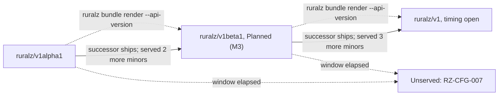
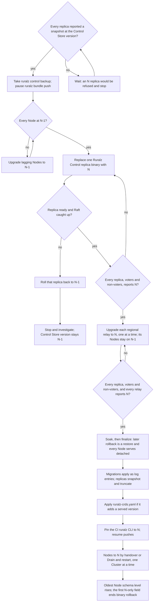

# Release, Versioning and Compatibility

## Summary

This document fixes how Ruralz is versioned, released and kept compatible: one Semantic Versioning scheme for every binary and the Helm chart; own identifiers and change rules for the Bundle apiVersion, Plugin ABI v1 and the Control Stream; N and N-1 skew between Ruralz Control, Ruralz Gateway and the CLI, with a finalize step for Raft upgrades; an automatic release on every push to `main` that carries a feature, fix, dependency update or breaking change, with fixes for the newest release only; security fixes by severity, public to everyone at once; and signed artifacts with SBOM and provenance. Contributors, operators and plugin authors should read it.

## Scope and non-goals

In scope: versions, versioned interfaces, deprecation, skew, upgrade order, cadence, support, security fixes and artifacts. "Pack 8.14" names a section of the binding [foundation pack](../_meta/foundation-pack.md).

Non-goals:

- Revision and Plugin signing ([ADR-0017](../adr/0017-artifact-signing.md)); supply-chain requirements come from [Security and identity](../architecture/08-security-and-identity.md#release-supply-chain).
- Kinds, fields, schema levels and conversion ([Configuration model](../architecture/02-configuration-model.md#apiversion-versioning-and-migration)).
- Upgrade procedures ([Zero-downtime upgrades and hot reload](../operations/02-zero-downtime-upgrades-and-hot-reload.md)), tests ([Testing and quality strategy](03-testing-and-quality-strategy.md)), libraries ([Tech stack and libraries](01-tech-stack-and-libraries.md)) and dates ([Roadmap and milestones](../roadmap/01-roadmap-and-milestones.md)).

## Semantic versioning

### One product version

`ruralzd`, `ruralz-control`, the `ruralz` CLI, the Helm chart and the published JSON Schema share one product version, `MAJOR.MINOR.PATCH` in Semantic Versioning 2.0.0 syntax, tagged `vMAJOR.MINOR.PATCH` on `github.com/ravindu-rev/ruralz`; one tag builds every artifact. Binaries embed version, commit and build flavor through `-ldflags -X` ([Tech stack and libraries](01-tech-stack-and-libraries.md#static-builds)), printed by `ruralz version`. Milestones are feature sets, not versions; the first release is `0.1.0`. The release pipeline derives every version from the Conventional Commits titles and footers of the commits it releases ([Release pipeline](#release-pipeline)), so a change the table below allows only from a minor release is a `feat` or a breaking change, and a patch carries only `fix`, `perf` and `build(deps)` changes besides commits that release nothing; a `Release-As` footer can only raise the version those commits make.

| Change | Patch `x.y.Z` | Minor `x.Y.0` | Major `X.0.0` |
|---|---|---|---|
| Security fix, dependency or toolchain bump, bug fix changing no Revision | Yes | Yes | Yes |
| `ruralz/v1alpha1` default change or digest-changing render fix, shipped as a new schema level with a golden-corpus entry; new feature, Policy type, CLI verb or flag, metric, error code, field, Host Function or Control Stream field | No | Yes | Yes |
| Deprecation, or removal after its window in a surface that is not stable | No | Yes | Yes |
| Removal or incompatible change in a stable surface | No | No | Yes, with a new surface identifier |

Every change that alters a digest, whether a default change or a render or canonicalization fix, is gated by a schema level or a format identifier, never shipped bare. In `ruralz/v1alpha1` it ships as a new schema level, so rendering at a level reproduces that level's output byte for byte. In `ruralz/v1beta1` and `ruralz/v1`, a fix that would change a digest ships only behind a new opt-in field or a new format identifier (for example `ruralz.canonical.v2`), per the [Configuration model](../architecture/02-configuration-model.md#canonical-form-and-revision); CI runs the golden corpus at every schema level inside the skew window. Whether the Configuration model's golden-corpus exception covers a `ruralz/v1alpha1` render fix, and not only a default change, is OQ-release-versioning-and-compatibility-13.

Patches never raise a level or change a digest, so they never matter for skew. Stable surfaces are `ruralz/v1`, `ruralz.canonical.v1`, `ruralz.diff.v1`, a frozen `ruralz.plugin.v1`, `ruralz.control.v1`, `/api/v1/`, exit codes and error codes; `ruralz/v1alpha1`, `ruralz/v1beta1`, preview ABI levels and the rest retire by their windows. `1.0.0` needs `ruralz/v1` served, Plugin ABI v1 frozen and two consecutive minors without a stable-surface deprecation (OQ-release-versioning-and-compatibility-1); a `Release-As: 1.0.0` footer cuts it ([Release pipeline](#release-pipeline)).

### Versioned surfaces

| Surface | Identifier | Compatibility rule | Owner |
|---|---|---|---|
| Bundle schema, CRDs | `ruralz/v1alpha1` to `ruralz/v1`; `ruralz.io/v1alpha1` | Lifecycle below; additions raise `x-ruralz-since` ([ADR-0016](../adr/0016-kubernetes-helm-and-crds.md), proposed) | [Configuration model](../architecture/02-configuration-model.md#version-skew) |
| Revision serialization | `ruralz.canonical.v1` | Every release reproduces the golden corpus byte for byte at every schema level inside the skew window, except entries recording a change shipped as a new `ruralz/v1alpha1` schema level, whose outputs are added beside the earlier levels'; a corpus file the newest release tag holds never changes ([Golden tests](03-testing-and-quality-strategy.md#golden-tests)); any other serialization change needs a new format identifier | Configuration model |
| Diff JSON | `ruralz.diff.v1` | Additive fields only | [CLI and API surface](../reference/01-cli-and-api-surface.md) |
| Plugin ABI | `ruralz.plugin.v1` | [Plugin ABI versioning](#plugin-abi-versioning) | [WASM plugin system](../architecture/05-wasm-plugin-system.md#contract) |
| Control Stream | `ruralz.control.v1` | [Control Stream versioning](#control-stream-versioning) | [Control plane and GitOps](../architecture/04-control-plane-and-gitops.md#control-stream) |
| Control Store Raft state | Control Store version | [Ruralz Control upgrades](#ruralz-control-upgrades) | Control plane and GitOps |
| Control Store content: Revision content, diffs, plans, sealed audit segments | Format marker per object | Immutable, never re-encoded; every release decodes every format still referenced or retained | Control plane and GitOps |
| REST API | `/api/v1/` | Additive; a `/api/v2/` runs beside it for 4 minor releases (target) | Control plane and GitOps |
| CLI | Pack 9 registry, flags, exit codes | Flags and added verbs are deprecated for 2 minor releases before removal (target); pack 9 commands are fixed by the registry; exit codes never change | CLI and API surface |
| Error codes, metrics | `RZ-<AREA>-<NNN>`, `ruralz_<component>_<name>_<unit>` | Codes never change meaning or get reused; a renamed metric keeps its old name for 2 minor releases (target) | Pack 8.6 registries; [Observability](../architecture/10-observability.md) |
| Node handover and identity | `${RURALZ_DATA_DIR}` file lock, candidate, Unix-socket readiness message; under `${RURALZ_DATA_DIR}/identity/`, the persisted (`storeEpoch`, `assignmentSeq`) pair, last accepted `promotionSeq` and anchor-set `version` | Hand over from N-1 and N, the minors of the skew window, and back within the [binary rollback limit](#binary-rollback-limit); format changes are additive or version-marked | [Data plane](../architecture/03-data-plane.md); [Control plane and GitOps](../architecture/04-control-plane-and-gitops.md#fencing-stale-replicas); Zero-downtime upgrades |

## apiVersion lifecycle and deprecation windows

The first served version is `ruralz/v1alpha1` ([ADR-0003](../adr/0003-configuration-format.md)); its schema `$id` will use a Revington-owned domain, because release asset URLs change per release, and is absent from `0.1.0`.

| Stage | Promise (Configuration model) | Served after the successor ships | Planned |
|---|---|---|---|
| `ruralz/v1alpha1` | Fields and defaults may change with one milestone of notice, each a new schema level | At least 2 minor releases (target) | |
| `ruralz/v1beta1` | Deprecation, not removal; defaults never change | At least 3 minor releases (target) | Planned (M3) |
| `ruralz/v1` | Additive only; defaults never change | Within a product major, always; a `ruralz/v2` serves it alongside for 4 minor releases (target) | OQ-release-versioning-and-compatibility-1 |

Inside `ruralz/v1alpha1`, a change announced in minor N with a deprecation warning (OQ-release-versioning-and-compatibility-7) takes effect no earlier than the later of minor N+2 and the next milestone's first release. Deprecated fields work until their apiVersion stops being served; an unserved version fails with RZ-CFG-007.

`ruralz/v1beta1` ships in the first minor after both the first CRD release, Planned (M2), and two consecutive minors without a breaking `ruralz/v1alpha1` change, targeting Planned (M3).

*Figure 1: Bundle apiVersion progression, served windows and conversion.*

### Migration tooling

- `ruralz bundle render --api-version` converts through the hub and drops comments.
- Conversion MUST yield the same Revision and an empty `ruralz bundle diff` ([Hub-and-spoke conversion](../architecture/02-configuration-model.md#hub-and-spoke-conversion)); round-trip property tests check it, and golden-corpus conversion runs from Planned (M3).
- `ruralz bundle validate` reports deprecated fields and apiVersions as RZ-CFG-025 with the removing release; release notes list every deprecation with its removal release.
- The commit that deprecates a surface announces it in a `Deprecated: <surface>; removed in MAJOR.MINOR.0` footer, one per surface; the release notes read these footers. Review holds the removing release to a minor or major release at least two minor releases after the one that ships the deprecation, the next minor after the newest `vX.Y.Z` tag reachable from the commit, or `0.1.0` before the first release. Two minor releases is the shortest window of this policy; a surface with a longer window, or one removed only in a major release, is held to its own.
- From `ruralz.io/v1beta1`, Planned (M3), CRDs serve every served version through Ruralz Control's conversion webhook, so non-storage versions depend on its availability; while only `ruralz.io/v1alpha1` is served, `conversion.strategy: None` needs none. Before dropping a version, Ruralz Control rewrites stored objects and prunes `status.storedVersions`, needing cluster-scoped RBAC on CRD status.

## Plugin ABI versioning

Plugin ABI v1, `ruralz.plugin.v1` ([ADR-0005](../adr/0005-plugin-abi-v1.md)), freezes when the Plugin system ships, Planned (M2); preview Plugins need rebuilds. After it, a compiled Plugin runs on every release serving v1, whatever Go toolchain built `ruralzd`, because the contract is WASM imports, not Go linkage.

Only new Host Functions count as additions ([WASM plugin system](../architecture/05-wasm-plugin-system.md#contract)):

| Change | Within `ruralz.plugin.v1` | Needs `ruralz.plugin.v2` |
|---|---|---|
| New Host Function, guarded by a new or existing Capability | Allowed; raises the ABI level | No |
| Existing Host Function valid in more Phases | Only as a new name | No |
| New optional fields in guest JSON | Pending OQ-release-versioning-and-compatibility-10 | No |
| Removing, renaming or re-typing a Host Function; changing result codes, Phase results, memory conventions or required exports; fewer Phases or a broader Capability | Never | Yes |

1. Each addition raises an integer ABI level; `rz_abi_version()` still returns 1. A Plugin's level follows from its imports, so no `Plugin` field is needed.
2. A Node at level L, implied by its product version, accepts v1 Plugins at L or below. Ruralz Control reads each Node's product version from the `binaryVersion` of its `Hello` ([Control Stream versioning](#control-stream-versioning)) and refuses a Rollout whose Plugins exceed the oldest target Node's level; a Node that reconnects on an older binary during the Rollout NACKs with RZ-CFG-028.
3. The proposed OCI media types `application/vnd.ruralz.plugin.v1` and `application/vnd.ruralz.plugin.config.v1+json` evolve additively.

Rules 1 and 2 propose option (c) for OQ-wasm-plugin-system-13, levels implied by reported product versions, and a missing-import NACK that pauses the Rollout instead of quarantining, since retries never succeed.

A major creates the import namespace `ruralz.plugin.v2` and a new `abi` value; Nodes serve v1 and v2 for 4 minor releases (target), and `ruralz bundle validate` warns on v1 Plugins. The proxy-wasm compatibility adapter, Planned (M4), is identified per OQ-wasm-plugin-system-8.

## Control Stream versioning

The Control Stream is the gRPC package `ruralz.control.v1`, service `ControlStream`, RPCs `Enroll` and `Stream` ([ADR-0007](../adr/0007-control-stream-protocol.md)). From Planned (M2), `buf breaking` checks every pull request against the newest release tag of N-1 and of N, covering the skew window. Revision content follows the apiVersion rules.

| Change | Within `ruralz.control.v1` | Needs `ruralz.control.v2` |
|---|---|---|
| New field with a new number | Allowed; receivers ignore unknown fields | No |
| New `oneof` message or enum value | Allowed; receivers ignore and count unknown ones; one carrying a Revision gets a transient NACK with an `RZ-CP` code that Control plane and GitOps registers | No |
| Removed field, either direction | Only as `reserved`, after at least 2 minor releases (target) in which no in-policy version reads or requires it, while the sender keeps populating it | No |
| Renumbering, re-typing or changing a field's meaning; ACK meaning, digest encoding, dial direction | Never | Yes |

Ruralz Control upgrades first and MUST NOT depend on an older Node understanding additions. `EnrollRequest` carries the Node's binary `version`, and every `Hello` its `binaryVersion` beside the anchor set's `version`, so Ruralz Control knows each connected Node's product version on the current stream, also after an upgrade or rollback. It sends a new `oneof` member or enum value only to Nodes whose `binaryVersion` serves it, and treats a Node whose `Hello` lacks a valid one as the first `ruralz.control.v1` release, Planned (M2).

A `ruralz.control.v2` uses distinct gRPC paths, so 8091 serves both for 4 minor releases (target); Nodes fall back on `Unimplemented`.

## Control plane and data plane version skew

Here N is the newest Ruralz Control binary minor; the Control Store version stays N-1 until finalize. [Zero-downtime upgrades and hot reload](../operations/02-zero-downtime-upgrades-and-hot-reload.md) and [High availability and disaster recovery](../operations/04-high-availability-and-disaster-recovery.md) follow it. Skew checks other than the file-mode checks are Planned (M2).

| Pair | In policy | Outside policy | Enforcement |
|---|---|---|---|
| Ruralz Control and Ruralz Gateway Nodes | N-1; N once the Control Store version is N | N-2 or older; newer than the Control Store version | Every enrolled Node's stream is accepted, so in-policy skew costs no active Revision (P9) within the [binary rollback limit](#binary-rollback-limit); Ruralz Control flags an out-of-policy Node by the `binaryVersion` of its `Hello` |
| Ruralz Control replicas, voters and non-voters | N-1 and N while the Control Store version is N-1 | N-2; N-1 after finalize; more than one minor above the Control Store version, or one above it before every replica reported its post-finalize snapshot | The binary halts, or its status report is rejected and it stops (rule 4 of [Ruralz Control upgrades](#ruralz-control-upgrades)) |
| Regional Ruralz Control relay, Planned (M4) | N-1 and N while the Control Store version is N-1; N after finalize; upgrades after every replica reports N and before finalize | N-2; N-1 after finalize; newer than the replicas | Reports its binary version like a replica and counts toward finalize (rules 1 and 3); same halt rule. Form: the read-only relay of [Control plane and GitOps](../architecture/04-control-plane-and-gitops.md#relay-feed) (OQ-system-overview-16) |
| `ruralz` CLI and REST API | CLI at N or N-1 | N-2; newer than Ruralz Control | Unknown Bundle field: RZ-CFG-006; other unknown request fields: an `RZ-CP` code |
| `ruralz bundle push` to Ruralz Control | CLI at the Control Store version; one minor older only if N added no schema level | Other versions | Re-render mismatch: RZ-CFG-027 |
| CLI and Nodes (`ruralz dev tap`, `ruralz node dump`, file-mode Revisions) | Oldest Node's minor or one newer | Two or more newer | File-mode Node: RZ-CFG-024; admin calls: the CLI warns on standard error from the Node's `ruralz-version` response header ([Admin API conventions](../reference/01-cli-and-api-surface.md#admin-api-conventions)) |
| Nodes within one Cluster | Any mix of N and N-1 | N-2 or older; newer than the Control Store version | Rollouts with fields newer than the oldest Node are refused (RZ-CFG-024) |
| `ruralzd` upgrade handover | From N-1 or N; back within the binary rollback limit | From N-2 or older | An unknown format marker refuses the handover; the old process keeps serving |
| Plugin and Node | ABI level at or below the Node's | Above it | RZ-CFG-028, or earlier refusal (rule 2 of [Plugin ABI versioning](#plugin-abi-versioning)) |
| Last-Known-Good and Node | Written by N-1 or N, booted by N; written by N without newer fields, booted by N-1 | Newer field, booted by N-1 | RZ-CFG-024; the Node waits for the Control Stream or stays not ready (pack 8.2) |
| Helm chart and CRDs | `ruralz-control` at the chart version; `ruralzd` at N or N-1; CRDs serve every apiVersion N-1 served; a newly served version appears only once every replica runs N, and becomes the storage version no earlier than the next minor | A served version that some replica's conversion webhook cannot convert; a storage version that N-1 cannot read | The chart deploys both Ruralz Control, as a StatefulSet, and Nodes, with separate image tags and upgrades ([Upgrade order](#upgrade-order)); CRD order in [Release artifacts](#release-artifacts) |

### State Store layout changes

State Store changes add no blocking round trips (pack 8.7 rule 1, P3). A Cluster may mix N and N-1 Nodes indefinitely, so each state class has one allowed path; [Scalability and distributed state](../architecture/11-scalability-and-distributed-state.md) owns layouts and bounds.

| State class | Allowed layout change | Extra admission |
|---|---|---|
| GCRA, Quota and Token Budget counters | Keep the old key's hash tag; while N-1 Nodes can serve, the N script reads and writes both keys in one `EVAL`, then, once the minimum Node version is N (OQ-release-versioning-and-compatibility-9), migrates lazily (read old, write new, delete old) | None (hypothesis) |
| Quota counters, alternatively | The minimum-Node-version signal carries an absolute switch boundary, a window start published at least one full window ahead; every Node holding the signal switches at that boundary | Up to 2x for one window per Node that has not received the signal by the boundary, for example while detached (P9) (hypothesis); Scalability and distributed state owns the bound |
| Response Cache, Semantic Cache | N Nodes keep the N-1 layout until the minimum Node version is N | None; misses only (hypothesis) |

Token Budget counters take only the first path: a split key would let a Node admit a reservation that the remaining budget does not cover, which pack 8.9 and P8 forbid.

A Node rolled back to N-1 after lazy migration began sees an empty old key, so its limit may admit up to 2x for that window (hypothesis).

### Ruralz Control upgrades

For the `raft` Control Store, Planned (M2):

1. The Control Store holds a replicated Control Store version. Each replica, voter or non-voter, and each regional relay, Planned (M4), reports its binary version to the leader over the status-forwarding class on 8092 (OQ-control-plane-and-gitops-15); a relay reports through the replica serving its [relay feed](../architecture/04-control-plane-and-gitops.md#relay-feed).
2. N binaries MUST decode every N-1 entry, record and snapshot. While the Control Store version is N-1, every replica, whichever leads, writes only N-1 formats in all persisted state (log entries, bbolt records, snapshots, content objects, audit segments) and on 8092, relay feed included. It also renders Revisions at N-1's schema levels and defaults: the renderer takes the Control Store version's schema levels as input, so every replica, whichever binary it runs, renders one digest per commit. This works because every digest-changing change, default or render fix, ships as a new schema level or format identifier ([One product version](#one-product-version)), so rendering at a level reproduces that level's output byte for byte.
3. Once every replica and every relay reports N and a 24-hour soak (target) has passed, an operator finalizes through the REST API action or its `ruralz control` verb, or an optional timed soak finalizes once those conditions have held for its configured healthy time ([Finalizing an upgrade](../architecture/04-control-plane-and-gitops.md#finalizing-an-upgrade)), and the leader commits a version-advance entry. Migrations, new record types and N defaults apply only after it, as deterministic log entries, never at startup; recorded Revisions are never re-rendered. Every replica then forces a snapshot past that index, truncates its log and reports to the leader. Until all have, the leader refuses the next upgrade as rule 4 describes.
4. A replica or relay meeting a Control Store version above its binary's, or an unknown entry type, stops before serving, exports a metric and never skips the entry; it checks the snapshot and log at startup too. A replica or relay whose binary minor is more than one above the Control Store version, or whose local snapshot predates the last version-advance entry, also stops before serving and exports a metric. The leader rejects the status report of a binary newer than the Control Store version, with an `RZ-CP` code that Control plane and GitOps registers, until every replica has reported its snapshot past the last version-advance entry; a replica or relay whose report is rejected stops before serving. That is how the leader refuses the next upgrade, and why a skipped minor never serves.
5. Before finalize, returning a replica or relay to N-1 is a rolling step. After it, rollback is `ruralz control restore` of the pre-upgrade backup into an empty N-1 deployment ([Backup, restore and `postgres`](../architecture/04-control-plane-and-gitops.md#backup-restore-and-postgres)). It loses later writes (Rollouts, audit entries, Enrollments, revocations), needs a root-signed anchor set with a new online key and a higher `storeEpoch`, and invalidates sessions and API tokens. Every Node serves detached until the operator supplies a revocation list, and Nodes enrolled after the backup re-enroll; hence the soak before finalize.
6. If Nodes have already moved to N, rollback after finalize follows a fixed order. First, while still on the N deployment, roll out to every Cluster a Revision without N-only fields and let it reach `complete`, so Last-Known-Good is promoted. Next, return every Node to N-1 by handover, which the [binary rollback limit](#binary-rollback-limit) now allows; N-1 Nodes stay in policy against the N Ruralz Control. Only then restore, redeploying relays at N-1 with the restored deployment and, on Kubernetes, first re-applying N-1's `ruralz-crds.yaml` ([Release artifacts](#release-artifacts)). No Node runs newer than the restored Control Store version, so the skew table needs no exception. [Zero-downtime upgrades and hot reload](../operations/02-zero-downtime-upgrades-and-hot-reload.md) owns the Rollout and handover steps; [High availability and disaster recovery](../operations/04-high-availability-and-disaster-recovery.md) owns the restore.

With `postgres`, Planned (M4), replicas use the N-1 schema until finalize, and the version advance and migrations are transactions.

### Binary rollback limit

Once a Revision uses a field above N-1's levels, a Node restarted on N-1 (a Kubernetes image rollback, systemd) boots Last-Known-Good, gets RZ-CFG-024, NACKs and stays not ready; a handover to N-1 is refused. Binary rollback holds only while the active Revision and Last-Known-Good use no N-only field; otherwise first roll out a Revision without one. Ruralz Control flags such Clusters, Planned (M2), and operators SHOULD soak N before adopting new fields; Zero-downtime upgrades and hot reload owns the procedure.

### Upgrade order

Ruralz Control moves one minor at a time (rules 3 and 4), replicas one at a time, leadership moved off each first. Skipping a minor is refused. Once every replica reports N, relays move to N one at a time, before finalize, and their Nodes stay on N-1 until after it. After finalize, Nodes move from N-1 to N by handover or, on Kubernetes, Drain and restart ([Zero-downtime upgrades and hot reload](../operations/02-zero-downtime-upgrades-and-hot-reload.md), [ADR-0015](../adr/0015-zero-downtime-upgrades-so-reuseport.md)). Pushes pause from the backup, the one rule 5 restores, until finalize, then resume from a CI CLI at N.

The Helm chart deploys both Ruralz Control, as a StatefulSet, and Nodes, with separate image tags, so it takes two upgrades, Ruralz Control first: the chart rolls its replicas one at a time through StatefulSet partitions, each step gated on the previous replica's readiness and on leadership moving off the next.

*Figure 2: upgrading one deployment from N-1 to N without leaving the skew window.*

## SDK versioning

PDK package names are [WASM plugin system](../architecture/05-wasm-plugin-system.md#sdk-matrix) proposals, Apache-2.0 under `sdk/` ([ADR-0002](../adr/0002-apache-2-license-no-feature-gating.md)).

| SDK | Package (proposed) | Version scheme | Planned |
|---|---|---|---|
| Rust PDK | `ruralz-pdk` crate | Own SemVer; major 1 targets `ruralz.plugin.v1` | Planned (M2) |
| Go PDK | `github.com/ravindu-rev/ruralz/sdk/go`, tags `sdk/go/vX.Y.Z` | Own SemVer; major 1 targets `ruralz.plugin.v1` | Planned (M2) |
| TypeScript PDK | `@ruralz/pdk` | Own SemVer; major 1 targets `ruralz.plugin.v1` | Planned (M3) |
| C# PDK | `Ruralz.Pdk` | Own SemVer; major 1 targets `ruralz.plugin.v1` | Planned (M4) |
| JSON Schema; OpenAPI for `/api/v1/` | One file per apiVersion and view; one description | Product version; `x-ruralz-since` marks levels | Schema published and attached to releases; OpenAPI Planned (M2) |

- A PDK minor adds wrappers for a newer ABI level, never raising a Plugin's level by itself; the two newest PDK minors get fixes (target), tested against the ABI conformance suites of N and N-1.
- `pkg/` follows SemVer from `1.0.0`, `internal/` never. Since `pkg/` is in the root module, a product `2.0.0` also moves the module path to `github.com/ravindu-rev/ruralz/v2`. Generated REST clients are Not planned: users generate them from OpenAPI.

## Release cadence and support windows

One cadence and support policy covers every artifact. No payment buys support for an older release or an earlier fix; commercial support buys help only, and the FIPS build follows the same policy (P1).

- A release ships on every push to `main` whose commits since the previous release include a feature, a fix, a performance change, a dependency update or a breaking change, at the version those commits make ([Release pipeline](#release-pipeline)): the first `feat` merged after a release ships the next minor, a `fix`, `perf` or `build(deps)` alone the next patch. A release follows its push at once, on no fixed date, and a push of only commits that release nothing, such as documentation, tests or Dependabot's action updates, ships nothing.
- Release builds pin the newest Go patch through the `toolchain` directive ([ADR-0001](../adr/0001-implementation-language-go.md)). Every toolchain or dependency update is a `build(deps)` commit, Dependabot's included, and releases a patch, so a Go or module security release reachable per `govulncheck` ships as soon as its update merges, within the time of its severity row.
- Only the newest release is supported. Every fix, security fixes included, lands on `main` and ships in its next release, and a deployment gets it by upgrading to that release; no older release receives a patch, so there are no release branches. Embargoed security fixes merge to `main` at disclosure.

| Release | Receives |
|---|---|
| The newest release, of the latest minor | Bug and security fixes, in the next release |
| Every older release | Nothing: its fixes ship in newer releases only |

Staying supported means upgrading to the newest release. Ruralz Control moves one minor at a time, each step with its own 24-hour soak (target) and Node upgrades ([Upgrade order](#upgrade-order)), so the number of minors released since the running one sets how long an upgrade takes. A long-term line is OQ-release-versioning-and-compatibility-2.

## Security fix policy

Open source releases receive security fixes immediately: every user gets a fix at once, through the public signed release, with no embargoed, private or paid early channel; severity sets how soon. Ruralz Cloud runs the public images with no private patches ([Managed cloud](../vision/01-vision-and-positioning.md#managed-cloud)), and commercial support MUST NOT deliver a private fix (P1).

1. A reporter uses the private channel in `SECURITY.md`; the security response team acknowledges within 2 business days (target).
2. The team rates severity and privately prepares the fix and a regression test, for the newest release only ([Release cadence and support windows](#release-cadence-and-support-windows)).
3. At disclosure, the fix merges publicly to `main` with a `fix` title, whose push releases it with its signatures and SBOMs ([Release pipeline](#release-pipeline)), and an advisory with a CVE identifier, affected and fixed versions and workarounds publishes with that release the same day.

| Severity | Examples | Fixed release |
|---|---|---|
| Critical | Plugin sandbox escape (default rating); authentication bypass; Revision or Plugin signature bypass | Within 7 days of triage (target) |
| High | Unauthenticated traffic crashing a Node; secret disclosure on the admin port | Within 30 days (target); SM-13 bounds a sandbox escape rated High to 30 days |
| Medium | Denial of service needing admin credentials; bounded information leaks | Within 90 days (target) |
| Low | Hardening gaps without a practical exploit | Within 180 days (target) |

Reachable `govulncheck` findings in linked modules or the Go toolchain follow the same table ([Tech stack and libraries](01-tech-stack-and-libraries.md#update-policy)); redistributor notice is OQ-release-versioning-and-compatibility-5. Whether EU Cyber Resilience Act reporting, from 2026-09-11 ([source](https://digital-strategy.ec.europa.eu/en/policies/cra-reporting)), binds Revington is OQ-vision-and-positioning-6.

## Release artifacts

The release pipeline builds, signs and publishes every artifact of a release from the commit its tag names, on the pinned toolchain ([Release pipeline](#release-pipeline)).

| Artifact | Name and location | Platforms | Planned |
|---|---|---|---|
| Binaries | `ruralzd_<version>_<os>_<arch>.tar.gz`, likewise `ruralz-control` and `ruralz` (`.zip` on Windows), each with the binary, `LICENSE`, `NOTICE`, `README.md` and its own `THIRD_PARTY_LICENSES`; linux `ruralzd` archives add `deploy/systemd/` | Servers: linux/amd64, linux/arm64, darwin for development; `ruralz`: linux, darwin, windows/amd64 | `ruralz-control` Planned (M2) |
| Checksums | `SHA256SUMS`, `sha256sum` format, for every other file of the release directory: the archives and their SBOMs, the image SBOM, the schema files, `release-manifest.json` and `NOTES.md`, so its one signature covers every asset | All | |
| Release manifest | `release-manifest.json` (format `ruralz.release.v1`): every archive's platform, support level, digest and members, the schema files, and the image plan with the image digests ([Packaging and audit](#packaging-and-audit)) | All | |
| Container images | `ghcr.io/ravindu-rev/ruralzd`, `ghcr.io/ravindu-rev/ruralz-control`, built from the released binaries on an empty base with a CA bundle ([Static builds](01-tech-stack-and-libraries.md#static-builds)), pushed untagged by digest at build and tagged only by the publish job once the release is published; tags `X.Y.Z`, never re-pushed, and `X.Y`, which names the newest published release of its line; no `latest`; deployments SHOULD pin by digest | linux/amd64, linux/arm64 | `ruralz-control` Planned (M2) |
| FIPS build | `-fips` images and archives with the same feature set except HTTP/3, off per OQ-tech-stack-and-libraries-9 (pack 8.4) | linux/amd64, linux/arm64 | Planned (M5) |
| Helm chart | `oci://ghcr.io/ravindu-rev/charts/ruralz` at the product version, deploying Ruralz Control and Nodes with separate image tags ([Upgrade order](#upgrade-order)); `ruralz-crds.yaml`, applied in the order below | Kubernetes | Planned (M2) |
| SBOM | CycloneDX 1.7 per archive (`<archive>.cdx.json`) and for the image (`ruralzd_<version>_image.cdx.json`), each also an attestation; no SPDX in `0.1.0` | All | |
| Signatures | Sigstore bundles: `SHA256SUMS.sigstore.json`, image signatures as OCI referrers; the chart from M2. Sigstore only: no Apple notarization or Authenticode, and the release notes explain that a `curl` download is not quarantined and how to clear the macOS quarantine flag of a browser download | All | |
| Provenance | SLSA Build Level 3 attestation per archive and image | All | |
| JSON Schema, OpenAPI | `ruralz-v1alpha1-authoring.schema.json` and `ruralz-v1alpha1-rendered.schema.json`, byte copies of `api/schema/`; `/api/v1/` OpenAPI | All | OpenAPI Planned (M2) |
| Release notes | `NOTES.md`, the GitHub Release's body, from the commits since the previous release: features, fixes, performance changes, dependency updates, deprecations, upgrade notes, schema, ABI and Control Stream changes, and verification steps ([Packaging and audit](#packaging-and-audit)) | All | |

- Signing is keyless Sigstore, bound to the OIDC identity of the reusable workflow `release-build.yml` at `refs/heads/main`, the ref of every release run, and logged in Rekor v2, generally available since 2025-10-10 ([source](https://blog.sigstore.dev/rekor-v2-ga/)). Verification instructions using cosign MUST require 3.1.3 or newer on 3.x, or 2.6.5 or newer on 2.x, which fix a verification bypass (GHSA-fx35-mq7g-6g98) ([source](https://github.com/sigstore/cosign/releases)).
- SBOMs use CycloneDX 1.7, standardized as ECMA-424 2nd edition ([source](https://cyclonedx.org/news/cyclonedx-v1.7-released/)) ([source](https://ecma-international.org/publications-and-standards/standards/ecma-424/)); SPDX 3.0.1 ([source](https://spdx.github.io/spdx-spec/latest/)) may join later.
- SLSA Build L3 needs a hardened platform protecting signing material ([source](https://slsa.dev/spec/v1.1/levels)); GitHub artifact attestations reach it with reusable workflows ([source](https://docs.github.com/en/actions/concepts/security/artifact-attestations)).
- SM-12 targets an OpenSSF Scorecard of 8.0 or higher, including Signed-Releases, from Planned (M2) (hypothesis) ([source](https://github.com/ossf/scorecard)).
- No image scanner runs in `0.1.0`; `govulncheck` covers the binaries ([Security scanning](03-testing-and-quality-strategy.md#security-scanning)).
- A `ruralz-crds.yaml` that changes only the schemas of served versions applies before the chart; one that adds a served version, such as `ruralz.io/v1beta1`, Planned (M3), applies after finalize (Figure 2), since an N-1 conversion webhook cannot convert to it. Storage versions follow the skew table, so a restore to N-1 (rule 6 of [Ruralz Control upgrades](#ruralz-control-upgrades)) never meets one N-1 cannot convert.

### Packaging and audit

`make release-dry-run` runs the release tooling without signing; `make release` adds the signatures. Both run steps 1 and 2 (the binaries with `make build`'s flags, the notices and the image) and then steps 3 to 5, or one of these halves with `RELEASE_PART=image` or `RELEASE_PART=package`, which the image and package jobs of `release-build.yml` run:

1. `internal/tool/depgate -notices dist/notices` runs depgate's checks, as `make supply-chain` does, then writes each artifact's `NOTICE` and `THIRD_PARTY_LICENSES` into `dist/notices/<binary>_<os>_<arch>/` ([CI tooling](01-tech-stack-and-libraries.md#ci-tooling)).
2. When Docker is present, `docker buildx` builds the `ruralzd` image for linux/amd64 and linux/arm64 with `SOURCE_DATE_EPOCH` set to the commit time, timestamps rewritten, and BuildKit's own provenance and SBOM off, into the OCI layout `dist/image/`; `releasekit image` checks that the layout holds one image index of one image manifest per platform, each blob matching its digest. `make release` also pushes the same build untagged by digest, checks that the digest buildx recorded and the registry holds is the layout's index digest, so the audited image is the published one, and signs that digest with cosign. The layout records the index digest and each platform's manifest digest. Without Docker the dry run prints a skip line and records no image, which `package` refuses for a release.
3. `internal/tool/releasekit package` writes into `dist/release/` one archive per artifact, the schema files and `release-manifest.json` with the image digests.
4. Syft writes each archive's SBOM and scans each platform image of the layout; `releasekit sbom` merges those scans into the image SBOM `ruralzd_<version>_image.cdx.json`, one CycloneDX 1.7 document whose subject is the image index and whose components are each platform image, holding that image's packages, after checking that each scan's subject is that platform's manifest digest. `releasekit notes` then writes `NOTES.md`, and `releasekit checksums` writes `SHA256SUMS` over every other file of the directory.
5. `releasekit verify` audits the directory and the image, and `sha256sum -c` checks `SHA256SUMS`; `make release` then signs `SHA256SUMS` with cosign, as step 2 signed the image digest, and audits again.

| Item | Rule |
|---|---|
| Archive members | Flat: the binary (`ruralz.exe` on Windows), `LICENSE` and `README.md` from the repository, `NOTICE` and `THIRD_PARTY_LICENSES` from `dist/notices/`; linux `ruralzd` archives add `deploy/`, `deploy/systemd/` and the files of the [T5 table](../operations/01-deployment-topologies.md#t5-and-t6-vms-with-systemd-and-edge-sites): `ruralzd.service`, `ruralzd-handover`, `ruralzd.sysusers`, `ruralzd.env` and `99-ruralzd.conf`, which are exactly the repository's `deploy/systemd/` |
| Determinism | Members sorted by path bytes, each dated the commit's committer time, owner and group 0 without names, USTAR headers; gzip and Deflate at the default level, a gzip header without name or time; mode 0755 for the binary, directories and files starting with `#!`, 0644 otherwise |
| Binary admission | `package` and the audit refuse a binary whose Go build information shows another main package or platform, a toolchain other than the `go.mod` `toolchain` line, a `GOEXPERIMENT`, cgo, no `-trimpath`, build tags, a symbol table or DWARF (no `-s -w`), or another commit; a release also needs a clean checkout whose module version is its tag ([source](https://go.dev/doc/go1.24)). With `-trimpath` the go command records no `-ldflags` ([source](https://github.com/golang/go/blob/release-branch.go1.27/src/cmd/go/internal/load/pkg.go)), so the `-X` metadata is checked through the commit and module version that Go stamps from Git |
| `THIRD_PARTY_LICENSES` | The Go standard library and runtime, then each linked module by path, each with its license, its source address (the module proxy's zip, kept for every published version) and its license and patent texts. A linked package in a directory with its own license text is governed by that text, which G2 checks and the file reproduces. MPL-2.0 modules are stated as used unmodified, with that address as their Source Code Form |
| `NOTICE` | The repository `NOTICE`, then the `NOTICE` texts of the linked modules (Apache-2.0 section 4(d)) and the license elections, such as EDL-1.0 for paho.golang |
| `release-manifest.json` | Format `ruralz.release.v1`, published with the release and listed in `SHA256SUMS`: version, commit, commit time, toolchain; every archive with its platform, support level (production or development), size, SHA-256, SBOM name and members; the schema files with their sources; the image plan with the index digest, each platform's manifest digest and the image SBOM's name; the names of `SHA256SUMS`, `SHA256SUMS.sigstore.json` and `NOTES.md` |
| Audit | Each archive's size and digest; members, modes, times and owners as packaged; `LICENSE`, `README.md` and the `deploy/systemd/` files equal to the repository's; `NOTICE` starting with the repository `NOTICE`; a `THIRD_PARTY_LICENSES` section and an SBOM component, with the module's `pkg:golang` package URL and version, for every module the binary's build information lists; the binary admission rules; byte-identical schema files; `SHA256SUMS` covering every other file of the directory, its manifest line included; the notes title; the image plan and the image digests; the image SBOM's subject, the image index, and its one component per platform image, each naming every module that platform's `ruralzd` links; per platform, the image's exported filesystem: `LICENSE`, `NOTICE` and `THIRD_PARTY_LICENSES` as built, `/usr/local/bin/ruralzd` byte-equal to that linux archive's binary, the CA bundle, `/var/lib/ruralz` at mode 0700 owned by 65532, every directory above them at mode 0755 owned by root, `USER 65532:65532`, ports 8080, 8443 and 9901, the OCI labels and no other file; a Sigstore bundle when present; no other file. It reads at most 1 GiB of content per archive |

Step 2 builds the image from `deploy/container/Dockerfile`, final stage `ruralzd`, at the repository root once `make build` left `dist/linux_<arch>/ruralzd` and step 1 `dist/notices/`; `Dockerfile.dockerignore` admits only those and `LICENSE`, and nothing runs on the target platform, so a multi-platform build needs no emulation. Every file of the image is newer than the commit, the CA bundle copied anew rather than kept with the base image's time, which differs between its platform variants, so the rewritten timestamps make a rebuild of the commit on either build platform give the same image digest. On `scratch` it holds `/usr/local/bin/ruralzd`, the CA bundle `/etc/ssl/certs/ca-certificates.crt` from the digest-pinned `golang:1.27.2-bookworm` stage, an owner-only `/var/lib/ruralz`, and `LICENSE`, `NOTICE` and `THIRD_PARTY_LICENSES` under `/usr/share/doc/ruralzd/`, every other directory at mode 0755 owned by root, made before any file is copied in, since a `COPY --chmod` gives a directory it creates the file's mode; its `THIRD_PARTY_LICENSES` appends the CA bundle's Debian copyright and MPL-2.0 source address. It runs as user and group 65532 and exposes 8080, 8443 and 9901. It needs nothing beyond a read-only root filesystem, no capabilities and no new privileges, with its data directory on a volume, and a container stop grace period above the 30 s Drain exit bound (target), such as 40 s. The manifest's image plan carries the tags: `X.Y.Z` and `X.Y` for a release, none for any other build.

`releasekit notes` reads the Conventional Commits titles of the non-merge commits after the previous release, the highest `vX.Y.Z` tag the release commit contains besides its own, or from the root for the first release: the same range from which `releasekit next` computes the version ([Release pipeline](#release-pipeline)). The notes list the artifacts with their support level and image tags; features (`feat`), fixes (`fix`), performance (`perf`) and dependency updates (`build(deps)`); deprecations from the `Deprecated:` footers ([Migration tooling](#migration-tooling)), each naming the surface and its removal release; upgrade notes from breaking titles and `BREAKING CHANGE:` footers; per apiVersion the authoring schema's changes (kinds, definitions, properties, enum values, defaults, schema levels, required members) and whether `ruralz.plugin.v1` and `ruralz.control.v1` are served or changed; verification steps with cosign and the GitHub CLI against the signer identity, `https://github.com/ravindu-rev/ruralz/.github/workflows/release-build.yml@refs/heads/main`: `cosign verify-blob` and `cosign verify` with `--certificate-identity` and `--certificate-oidc-issuer`, each also as its cosign 2.x variant with `--new-bundle-format`, which 2.x needs to read the bundles cosign 3 writes, and `gh attestation verify` with `--signer-workflow ravindu-rev/ruralz/.github/workflows/release-build.yml`, for provenance and with `--predicate-type https://cyclonedx.org/bom` for the SBOM; and how to clear the macOS quarantine flag of a browser download, which a `curl` download never carries.

### Release pipeline

`release.yml` runs on every push to `main`, with no approval step. Its runs share the concurrency group `ruralz-release`, which never cancels a running release: a push while a release runs waits, and a newer push replaces a waiting one, whose commits the newer run then releases with its own. Each job holds only the permissions it needs, and only the tag and publish jobs hold `contents: write`. The workflow signs with cosign, generates SBOMs with Syft ([CI tooling](01-tech-stack-and-libraries.md#ci-tooling)) and attests provenance with GitHub artifact attestations.

1. **Version.** `releasekit next` reads the Conventional Commits titles and footers of the non-merge commits that the pushed commit contains and the previous release does not; the previous release is the highest `vX.Y.Z` tag the pushed commit contains besides its own.
   - A breaking change, a title with `!` or a `BREAKING CHANGE:` footer in a commit of any type, moves the minor while the major is 0 and the major from `1.0.0`; `feat` moves the minor; `fix`, `perf` and `build(deps)`, the dependency and toolchain updates that change what ships, Dependabot's included, move the patch. The highest change of the commits wins, and the first release, with no previous tag, is `0.1.0`.
   - Any other commit releases nothing: `docs`, `test`, `ci`, `chore`, `refactor` and `revert` titles, `build` titles of any other scope, Dependabot's `ci(deps)` action updates, which ship in no artifact, and a title that is no Conventional Commits title. Without a releasing commit the run ends here, successfully, with nothing released.
   - A `Release-As: X.Y.Z` footer in a non-merge commit raises the next version to `X.Y.Z` when that is above the version the commits make, or when they make none; of several footers the highest counts. A footer at or below the version the commits make sets nothing, so a release never carries a change its version does not allow. That is how `1.0.0` is cut, since the computation never leaves major 0 by itself. A footer whose value is no version `X.Y.Z`, or that is not above the previous release, stops the run with a finding, unless a later commit of the range carries a valid footer: merging such a commit replaces it.
   - A commit that a release tag already names, which a failed run left behind, resumes that release; a commit that a later release tag contains releases nothing; and a release tag of the version due that names any other commit stops the run, so no tag is ever created twice. The job reads the whole history and every tag, and refuses a shallow clone.
2. **PR pipeline.** `release.yml` calls the PR pipeline, `pr.yml` ([Repository layout and conventions](02-repository-layout-and-conventions.md)), on the pushed commit through `workflow_call`; a failure stops the release before anything is built.
3. **Build.** The reusable `release-build.yml` builds the pushed commit with `make build`'s flags, `-s -w` included. Its image job first gives the commit the tag `vX.Y.Z` in its own checkout, or finds the pushed one on a re-run, so Go stamps the tag as the module version.
   - Its image job builds the image and pushes it untagged by digest.
   - Its package job then writes the deterministic archives (sorted entries, commit-time timestamps), the schema files and `release-manifest.json` with the image digests. It also generates every SBOM, the image's included, writes `NOTES.md` and `SHA256SUMS`, signs `SHA256SUMS`, and runs `releasekit verify` on the directory and the image before and after signing ([Packaging and audit](#packaging-and-audit)).
   - The image job signs the image digest with cosign, and the attest jobs attest provenance and SBOMs for every archive and for the image, pushing the image's attestations to the registry as OCI referrers.
   - The image and package jobs hold `id-token: write` for keyless signing, the image job adding `packages: write`; the attest jobs hold `id-token: write` and `attestations: write`, the image's attest job adding `packages: write` to push its attestations.
4. **Tag.** Once the build passed, the tag job decides again from the tags as they are then and pushes the annotated, unsigned tag `vX.Y.Z` on the commit with the run's own `GITHUB_TOKEN`, as GitHub Actions (`github-actions[bot]`). Creating a `v*` tag needs no bypass; the `v* tag updates and deletion` ruleset, which nobody bypasses, the release workflow included, keeps every `v*` tag where it was pushed ([Repository settings](02-repository-layout-and-conventions.md#repository-settings)). Since no tag can be deleted, a commit whose build fails leaves none behind: its fix releases from the next push. A tag that an earlier attempt of the run pushed is kept; a decision that changed since the version job stops the run.
5. **Publish.** The publish job holds `contents: write` and `packages: write`.
   - It checks that the image's `X.Y.Z` tag is absent or already names the built digest, creates the GitHub Release as a draft, uploads every file of the release directory, checks the uploaded digests against `SHA256SUMS`, and publishes it with `NOTES.md` as its body, marked latest only when it is the highest published release, so a release that a re-run publishes after a higher one never becomes latest.
   - It then tags the image digest `X.Y.Z`, which is never pushed again, and `X.Y` when the release is the newest published release of its line.
   - A re-run after publishing, which immutable releases make final, only tags the image, once the built digest is the one the published `release-manifest.json` records.

A failed run is safe to re-run from its Actions page. Re-running its failed jobs keeps the version job's decision, which the tag job checks again, and every step finds what an earlier attempt made and goes on: the pushed tag, which it keeps, a draft release, which it replaces, a published release, which it keeps, and an image tag that names the built digest.

### Release runbook

A release needs no maintainer step besides merging to `main`; these rules keep it right:

1. **Commit titles.** The version comes from the Conventional Commits titles and footers of the commits a pull request brings to `main` ([Conventional Commits](02-repository-layout-and-conventions.md#conventional-commits)), merged with a merge commit so each keeps its own title. A new behavior is `feat`, a bug fix `fix`, a dependency or toolchain update `build(deps)`, and a breaking change carries `!` or a `BREAKING CHANGE:` footer; each of these releases. A `Release-As: X.Y.Z` footer raises the version to `X.Y.Z`, as for `1.0.0`.
2. **Preconditions.**
   - A milestone's other exit criteria hold before the push to `main` whose release exits it ([Roadmap and milestones](../roadmap/01-roadmap-and-milestones.md)).
   - The `go.mod` `toolchain` line names the newest Go patch ([Release cadence and support windows](#release-cadence-and-support-windows)).
   - `README.md`, which every archive ships byte for byte, and `SECURITY.md` describe the release: the Install and status sections, and the supported minor.
3. **Failed run.** A run that fails before its tag is pushed is fixed by the next push to `main` when the cause is in the commit, or re-run when it is not; a run that fails after is re-run ([Release pipeline](#release-pipeline)).
4. **Manual settings.** After the first release's image push, the maintainer makes the `ghcr.io/ravindu-rev/ruralzd` package public and links it to the repository, which no API covers ([Repository settings](02-repository-layout-and-conventions.md#repository-settings)).
5. **Milestone exit.** Once the release that exits a milestone ships, one pass removes that milestone's `Planned (Mx)` tags from the documents: a shipped capability carries no tag, and its design text states it. The [Feature Catalog](../features/01-feature-catalog.md#how-to-read-this-catalog) records the release that shipped each capability ([style guide](../_meta/style-guide.md) section 4). The roadmap deletes the milestone's section and fills the steps table for the next milestone.

## Open questions

| ID | Question | Options | Owner | Blocking? |
|---|---|---|---|---|
| OQ-release-versioning-and-compatibility-1 | When do `ruralz/v1` and `1.0.0` ship? | (a) First release meeting the criteria; (b) At Planned (M5); (c) After M5 | release-versioning-and-compatibility | No |
| OQ-release-versioning-and-compatibility-2 | Should a long-term line exist after `1.0.0`? | (a) No (current); (b) One free yearly line with 24 months of security fixes; (c) Longer windows for all | release-versioning-and-compatibility | No |
| OQ-release-versioning-and-compatibility-5 | May redistributors get advance notice of a fix? | (a) No (current); (b) Up to 5 days, free, never binaries | security-and-identity | No |
| OQ-release-versioning-and-compatibility-6 | Should `ruralz version` print schema, ABI and Control Stream levels? | (a) Yes, with `--output json`; (b) A separate verb | cli-and-api-surface | No |
| OQ-release-versioning-and-compatibility-7 | How are announced default changes and deprecated field values, such as an old `abi`, reported? | (a) Widen RZ-CFG-025; (b) A new warning code (recommended, since codes never change meaning) | configuration-model | No |
| OQ-release-versioning-and-compatibility-9 | How do Nodes learn the Cluster's minimum Node version, which starts lazy migration, and a Quota layout switch's boundary, published a window ahead? | (a) A new Control Stream field, operator-set in file mode; (b) Operator-set everywhere | scalability-and-distributed-state | Yes, for the first layout change |
| OQ-release-versioning-and-compatibility-10 | May `ruralz.plugin.v1` add more than Host Functions, such as optional guest JSON fields? | (a) No (current); (b) Also record a required level in the OCI config and take the maximum with imports | wasm-plugin-system | No |
| OQ-release-versioning-and-compatibility-13 | Does the Configuration model's golden-corpus exception cover a digest-changing render or canonicalization fix shipped as a new `ruralz/v1alpha1` schema level, or only a default change? | (a) Amend it to cover any such level (proposed); (b) Keep it narrow: such a fix needs a new format identifier | configuration-model | Yes, for the first digest-changing fix |
| OQ-release-versioning-and-compatibility-14 | Which `ruralz control` verb finalizes a Ruralz Control upgrade, and which process configuration setting holds the timed soak's healthy time? | (a) `ruralz control finalize`, calling `POST /api/v1/control-store/finalize` with step-up TOTP; `controlStore.finalizeAfter`, a duration, unset meaning no timed soak, applied on reload (proposed); (b) `ruralz control upgrade`, printing `GET /api/v1/control-store` and finalizing with `--finalize`; `upgrade.autoFinalize` with `upgrade.healthyFor` | control-plane-and-gitops | Yes, for Planned (M2) finalize |
