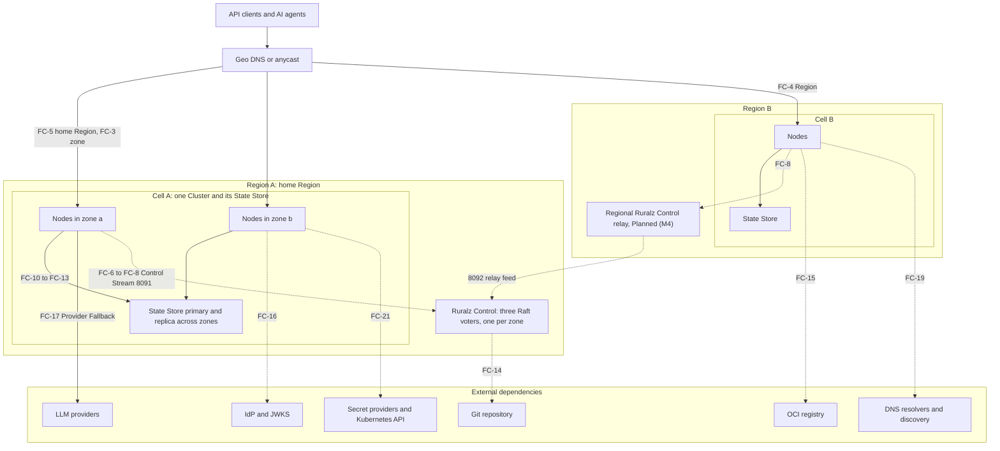

# High Availability and Disaster Recovery

## Summary

This document tells operators what fails, what keeps working and how to recover: degraded modes (Last-Known-Good, local rate-limit fallback, `failureMode`), recovery objectives, backups, runbooks and game days. Nodes never wait on Ruralz Control, so its failures cost requests nothing; State Store and Region losses have their own traffic RTOs. Ruralz Control and backups are Planned (M2), multi-region Planned (M4). For operators and architects.

## Scope and non-goals

In scope: failure behavior at component boundaries, degraded modes, recovery objectives, backup practice, runbooks and game days. "Pack 8.2" names a [foundation pack](../_meta/foundation-pack.md) section.

Non-goals, with owners: accuracy bounds ([Scalability](../architecture/11-scalability-and-distributed-state.md)); Control Store, fencing and backup internals ([Control plane](../architecture/04-control-plane-and-gitops.md)); upgrade rollback ([Release](../engineering/04-release-versioning-and-compatibility.md), [Zero-downtime upgrades](02-zero-downtime-upgrades-and-hot-reload.md)); layouts ([Deployment topologies](01-deployment-topologies.md)); per-Node limits ([Data plane](../architecture/03-data-plane.md#bounded-resources), [Scalability](../architecture/11-scalability-and-distributed-state.md#per-node-limits)); State Store product operations beyond the rules below.

## Failure catalog

*Figure 1: failure domains and external dependencies; edge labels name catalog rows; dashed edges are off the request path.*



Symbols follow [Scalability](../architecture/11-scalability-and-distributed-state.md#consistency-and-accuracy-bounds):

```text
R              active Regions
N              Nodes per Ruralz Control deployment
N_serving      a Cell's serving Nodes
N_published    the published Node count; N_frozen the last count each Node keeps while an
               outage freezes it or a restored or rebuilt deployment withholds it
list-less      a restore without the Node revocation list, after which every Node re-enrolls
ceiling        a limits[] entry's per-Node ceiling; requests its Cell-wide limit per window
```

Rows are Planned in their component's milestone. "Traffic" means request handling; "management" means Rollouts, Enrollment, Drift, Ruralz Console and the REST API.

| ID | Failure | Blast radius | Behavior during the failure | Detection | Recovery |
|---|---|---|---|---|---|
| FC-1 | Node process or host lost | Its in-flight requests and connections (SG-3) | Survivors serve; at most one extra ceiling per key per restarted Node (target) | `/readyz` on 9901; missed heartbeats | Replacement boots Last-Known-Good or its Bundle, or re-enrolls if `${RURALZ_DATA_DIR}` is lost; Kubernetes: force-delete the pod or taint the host `node.kubernetes.io/out-of-service` ([stranded pods](#stranded-pods-on-kubernetes)) |
| FC-2 | Node restarted while Ruralz Control is down | One Node | Boots Last-Known-Good, detached, after up to 5 s (target); without it, not ready | Readiness | Automatic |
| FC-3 | Availability zone lost | Its Nodes, a zonal State Store primary, one voter, often Vault or the Kubernetes API (FC-21) | Survivors under 80% CPU when [sized](../architecture/11-scalability-and-distributed-state.md#high-availability) (target); State Store failover; quorum holds | Balancer health; failover | [Force-delete stranded pods](#stranded-pods-on-kubernetes) (T4); [replace the voter](#raft-quorum-loss-and-replica-replacement) |
| FC-4 | Non-home Region lost | Its Cells | Clients move, counters empty; survivors count alone, up to R × each limit (target), absorbing its State Store calls and TLS handshakes | Geo health checks; survivor script CPU | [Region loss](#region-loss) |
| FC-5 | Home Region lost | Its Cells and every voter | Other Regions serve; Rollouts, Enrollment and Drift stop (`RZ-CP-004`); new Nodes stay not ready | Relays stale; REST API unreachable | [Region loss](#region-loss) |
| FC-6 | Ruralz Control leader lost | Management only | New leader in about 1 to 2 s plus election round trips (hypothesis); Rollouts resume; zero request errors | `ruralz_control_leader_info` | Automatic |
| FC-7 | Raft quorum lost | Management of every Cell served | Writes, logins, Enrollment stop (`RZ-CP-004`); stale replicas serve only Nodes without an active digest; the Node count freezes | `ruralz_control_leader_contact_age_seconds` | [Raft quorum loss](#raft-quorum-loss-and-replica-replacement) |
| FC-8 | Control Stream ([ADR-0007](../adr/0007-control-stream-protocol.md)) partition | Cut-off Nodes | Detached, `/readyz` 200; jittered redial, base 1 s, cap 60 s (target); revocations and promotions wait | Three missed heartbeats (target) | Automatic: `Hello` presents the active digest |
| FC-9 | Ruralz Control replica overloaded or restarted | Its Control Streams | `Reconnect` (`shed`, `rebalance`); all Nodes back within 5 minutes of a full restart (target) | `RZ-CP-010` | ceil(N / 5,000) + 1 replicas (hypothesis) |
| FC-10 | State Store unreachable or black-holed | One Cell | One deadline per request at most, none once the breaker opens; [fail-open rules](#fail-open-and-fail-closed-behavior) | Reason `state_store_breaker_open`; `ruralz_state_ops_total`; `RZ-STS` codes only under `closed` | Automatic; [rebuild](#state-store-rebuild) if data is lost |
| FC-11 | State Store partition: some Nodes, or one shard | Cut-off Nodes or the shard's keys | Cut-off Nodes admit per the fail-open rows, connected ones per the healthy GCRA row | Breaker state differs across Nodes | Fix the path |
| FC-12 | State Store primary failover | One Cell | `failureMode` about 15 s (hypothesis); lag × rate extra per key (hypothesis) | `SCRIPT LOAD` from every Node on the promoted primary, at the failover or before it on a connection a Node already held there; any `NOSCRIPT`, then `SCRIPT LOAD` | Automatic within 15 s (target) (CE-5) |
| FC-13 | State Store full or evicting | One Cell | Stores skip above 70% of `maxmemory` (target); full: limits open, `closed` Token Budgets 503; eviction resets counters | Reason `state_store_eviction_policy` | Add shards; `noeviction` MUST be set |
| FC-14 | Git repository unavailable | Changes only | No new Revisions (`RZ-CP-011`); recorded Revisions, Rollouts and reverts work | `RZ-CP-011` | Forge recovery, or a mirror |
| FC-15 | OCI registry unavailable | Changes; Plugins not yet cached | File-mode Nodes keep serving; Plugin fetches NACK transient, then quarantine | Transient NACKs | A mirror above 100 Nodes per Region (hypothesis) |
| FC-16 | IdP or JWKS unreachable | `auth.jwt` Routes for that issuer | Cached keys serve until expiry (`max-age` clamped to 5 minutes to 6 hours, default 1 hour (target)), then 401 `RZ-AUTH-006` | Reason `jwks_stale`; `ruralz_auth_jwks_age_seconds` | Closed by design (P9) |
| FC-17 | LLM provider outage or throttling | One `AIModel` candidate | Provider Fallback before commit, inside the residency class; after commit `RZ-AI-009`; exhausted `RZ-AI-005` | Cooldowns: one failed attempt each per Node (hypothesis) | Automatic, Planned (M3) |
| FC-18 | Plugin crash: trap, timeout or memory cap | That Plugin's Routes | Instance discarded; `failureMode` decides (closed only for auth and authz); the Node survives; the memory cap refuses new instances | `RZ-PLG` counters; canary gate | Before `complete`, `ruralz rollout rollback`; after, `ruralz rollout start` of the replaced Revision (step-up TOTP; `RZ-CP-006` if `security`); file mode: CI pushes the old Revision again, signed at a new sequence; or roll forward |
| FC-19 | DNS failure | Discovery Upstreams; Nodes resolving Ruralz Control or the State Store | Discovery keeps its last set, counting NXDOMAIN after 3 refreshes (target); failed dials detach or apply `failureMode` | Reason `discovery_stale` | Fix resolvers; short TTLs |
| FC-20 | Bad Revision | Canary Nodes of one Cluster; all Nodes of a file-mode source | Gates fail: `rolled-back` or `paused` per `autoRollback` | Deterministic NACK; 5xx gate | As FC-18 |
| FC-21 | Secret provider (`vault`, `kubernetes`) or Kubernetes API down | Restarting and new Nodes using them; `kubernetes` discovery | Running Nodes keep values; cold starts stay not ready; discovery keeps its last set | `/readyz` reason; `ruralz_upstream_degraded_info` | Recovery; TLS keys and `stateStore.url` on `file` or `env` |

## Degraded modes

Every degraded mode is a metric (P10, SG-8) named by [Observability](../architecture/10-observability.md); [Control plane](../architecture/04-control-plane-and-gitops.md#behavior-during-a-ruralz-control-outage) and [Scalability](../architecture/11-scalability-and-distributed-state.md#consistency-and-accuracy-bounds) win on conflict.

### Detached Nodes and Last-Known-Good

A detached Node serves its active Revision and stays ready indefinitely (pack 8.5): failing `/readyz` on staleness would evacuate a Cell's Nodes during the incident it signals.

| Situation | Behavior | Operator consequence |
|---|---|---|
| Node restarts while detached | Pack 8.2 boot order: upgrade handover, then Last-Known-Good after up to 5 s (target) | Restarts boot Last-Known-Good within 30 s (target) |
| Last-Known-Good boot with unresolvable `secretRef` | Not ready until every reference resolves; secrets are never on disk (FC-21) | Keep TLS keys and the State Store URL on `file` or `env` |
| Last-Known-Good uses a field newer than the binary | `RZ-CFG-024`; not ready ([rollback limit](../engineering/04-release-versioning-and-compatibility.md#binary-rollback-limit)) | Never roll back a binary during a Ruralz Control outage |
| Last-Known-Good accepted from a removed signing key after `compromisedSince` | Refused at boot until the Control Stream delivers | Emergency key removal costs restarts during an outage |
| New Node, no Last-Known-Good | Not ready until it enrolls (pack 8.11) | Autoscaling adds nothing: hold 30% headroom (target); reschedulable Nodes MUST keep `${RURALZ_DATA_DIR}` persistent |
| Detached beyond the 30-day certificate lifetime (target) | Keeps serving; on return `RZ-CP-003`, then re-enrolls in the background, still serving | Supply a fresh token; a T4 pod presents its projected token ([re-enrollment](#re-enrollment-after-a-restore-or-rebuild)) |
| Restarted while detached | Keeps the revocation entries persisted in its data directory (pack 8.11); newer entries wait for the Control Stream | Rotate urgent revocations at the credential's source (IdP key, API key) |

In the new-Node row, headroom is a SHOULD; OCI seeding and Last-Known-Good in images are open in [OQ-high-availability-and-disaster-recovery-1](#open-questions).

### Local rate-limit fallback

While the State Store fails, local token buckets at per-Node ceilings are the only limiter ([ADR-0008](../adr/0008-rate-limiting-local-bucket-and-gcra.md)); the breaker opens when 50% of at least 20 calls in 5 s fail (target) and half-opens after 1 to 3 s (target).

Admission per key and window, at most:

```text
Declared per-Node ceiling                      N_serving × ceiling                                (target)
Derived ceiling, current Node count            N_serving × max(1, 2 × requests / N_published)     (target)
Count frozen by a Ruralz Control outage        N_serving × max(1, 2 × requests / N_frozen)        (target)
                                               20 × requests after a 10 to 100 scale-out          (hypothesis)
Count withheld after a restore or rebuild      N_serving × max(1, 2 × requests / N_frozen)        (target)
Control-mode Node restarted without a count    clamp max(1, requests / 100) per such Node         (target)
File mode without a declared ceiling           N_serving × requests                               (target)
```

Autoscaled Control-mode Clusters SHOULD declare per-Node ceilings in advance, since outages and scale-out combine the worst cases and the [restore hold](#holding-deliveries-during-recovery) delivers no new ceiling.

### Fail-open and fail-closed behavior

`failureMode` follows pack 8.10: registry defaults apply unless a Policy overrides them, and security types are closed only (RZ-CFG-029).

| Policy type | Default | During a State Store or dependency failure |
|---|---|---|
| `auth.*`, `authz.*`, auth or authz `plugin` | Closed only | 401 or 403; JWKS keys serve until expiry first (FC-16) |
| `ratelimit` | Open | Local buckets only |
| `quota` | Open | Unmetered; such Routes SHOULD also carry a `ratelimit` |
| `cache`, `ai.semantic-cache` | Open | Bypassed; origin or provider load rises |
| `ai.token-budget` | Closed | 503 `RZ-STS-001` to `RZ-STS-004`: a State Store outage is an AI outage in that Cell |
| Other `plugin` Policies | Closed | Per the Policy; a trap discards the instance only |

Upstream failures follow the [failure matrix](../architecture/09-traffic-management-and-resilience.md#failure-matrix), Token Budgets [ADR-0014](../adr/0014-ai-api-surface.md).

## RPO and RTO

Recovery point (RPO) and time (RTO) objectives bound lost data and time to recovery, for traffic and management separately; management recovers when Ruralz Control accepts writes, Rollouts up to one ACK timeout, 60 s (target), later. Counters are never restored ([bounds](../architecture/11-scalability-and-distributed-state.md#consistency-and-accuracy-bounds)).

| Component and failure | Data at risk | RPO | Traffic RTO | Management RTO |
|---|---|---|---|---|
| Node lost | In-flight requests only | No configuration lost (target) | Survivors at once; replacement ready 30 s after pod release (target), which on Kubernetes the [stranded pod runbook](#stranded-pods-on-kubernetes) performs within 5 minutes (target) | Not affected (target) |
| Node disk lost | Identity, Last-Known-Good | Re-derived from Ruralz Control (target) | Survivors at once (target) | One Enrollment (target) |
| Availability zone lost | State Store writes within replication lag | Lag, 1 s or less (target) | 30 s or less on survivors (target); State Store 15 s or less (target) | Unchanged with voters in three zones (target) |
| Non-home Region lost | That Region's counters and caches | Not recovered: one extra limit per open window (target) | About 2 minutes, at most 5 (target), below | Unchanged (target) |
| Ruralz Control leader lost | None committed | Zero committed writes (target) | Zero request errors (target) | 10 s or less (target) |
| Raft quorum lost, replicas recoverable | None committed | Zero committed writes (target) | Zero request errors (target) | 30 minutes or less (target) |
| Control Store lost with its Region, or a voter majority lost for good | Writes after the newest backup in the second Region | 75 minutes or less: hourly, copied within 10 minutes (target) | Zero request errors (target); Nodes keep their count until qualification catches up ([hold](#holding-deliveries-during-recovery)) | 4 hours or less with relay rebuild, excluding post-backup Nodes' re-enrollment (target) |
| Control Store and every backup lost | Rollout history, audit log, users, Enrollments | Configuration: none, Git holds it (target); records: all | Zero request errors (target): the [hold](#holding-deliveries-during-recovery) adopts served digests, and Nodes keep their count until qualification catches up | 8 hours or less, re-enrollment excluded (target) |
| Re-enrollment of every Node | Enrollment identities | None (target) | Zero request errors: Nodes re-enroll in the background while serving (target); Drain and restart drains one zone's capacity at a time (target) | 30 minutes or less for 10,000 Nodes (target), below |
| State Store primary lost | Writes within replication lag | Lag, 1 s or less (target) | `failureMode` for 15 s or less (target) | Not affected (target) |
| State Store deployment lost | Every counter and cache entry | All, unless persistence is on (target) | `failureMode` until rebuilt, 30 minutes or less (target), plus a zonal Drain if a `stateStore.url` from an `env` secret changes | Not affected (target) |
| Bad Revision in Control mode | None | None (target) | Canary bake or 200-request sample, then a revert within three ACK timeouts per Node (target) | Not affected (target) |

```text
Regional failover   3 missed geo checks × 10 s + API hostname TTL ≤ 60 s + client retry  (target)
                    ≈ 2 minutes; caches past the TTL extend it; anycast: route withdrawal (target)
Re-enrollment       N / min(20 per s per leader, L_src × A), every Node serving throughout   (hypothesis)
                    L_src the Enroll limit per source and Cluster, A egress addresses
                    10,000 Nodes: 10,000 / 20 per s ≈ 8.3 minutes                           (hypothesis)
Drain and restart   Z × (t_drain + (N / Z) / min(20 per s per leader, L_src × A) + t_slow)  (hypothesis)
                    Z zones, t_drain about 30 s (target), t_slow the 30 to 60 s slow start  (target)
                    10,000 Nodes, 3 zones: 3 × (30 s + 167 s + 60 s) ≈ 13 minutes           (hypothesis)
```

`Enroll` limits are keyed by source address plus the token's Cluster ([Enrollment per topology](01-deployment-topologies.md#enrollment-per-topology)); behind shared egress, each Cluster's limit MUST let L_src × A reach 20 per second (hypothesis).

## Backups

`ruralz control backup` and `ruralz control restore` are Planned (M2) ([ADR-0006](../adr/0006-control-store-raft-boltdb.md)). A backup is a Raft snapshot plus referenced content, consistent at one index, encrypted to one or more operator public keys and signed; downloads need `admin` and are audited ([backup internals](../architecture/04-control-plane-and-gitops.md#backup-restore-and-postgres)).

### What to protect

| Asset | Source of truth | Protection | Frequency |
|---|---|---|---|
| Bundle and `control/` directory | Git | Forge replication or a fetchable mirror | Continuous |
| Control Store, with Revision content, plans, audit segments, encrypted keys and CAs | Ruralz Control | `ruralz control backup`, copied off-cluster and to a second Region | Hourly (target) and before each upgrade |
| Node revocation list | Control Store | `--revocation-list-file`, copied with the backup | With each backup |
| Backup private keys, matching the operator public keys backups are encrypted to, which a restore supplies; offline trust-root key; SHOULD: CA keys and key-encryption key, so a rebuild keeps the 8091 server CA | Operator custody | Offline, never with backups | On rotation |
| Audit log | Control Store | Export (OQ-control-plane-and-gitops-12) to a separate system; MUST for multi-region, holding revocations after the newest backup | Continuous |
| Signed Revisions and Plugins in OCI | Registry | Replication or a mirror, by digest | Continuous |
| State Store data | State Store | Persistence for Quota or Token Budget windows over one day (SHOULD); never restore an old snapshot, which rewinds counters | Server setting |
| `${RURALZ_DATA_DIR}` on Nodes | Node | Persistent volume; not backed up | Not applicable |
| Secrets behind `secretRef` | Secret providers | The provider's own backup | Provider's |

Keep hourly backups 7 days and daily ones 90 days (target). The Control Store holds 50 Revisions per Environment (target); older ones re-render from Git to the same digest only at the schema levels that built them, which the renderer takes as input ([Ruralz Control upgrades](../engineering/04-release-versioning-and-compatibility.md#ruralz-control-upgrades)), and `ruralz bundle push` or CRD sources live only in backups.

### Taking and checking backups

An external scheduler runs the backup with an `admin` API token (built-in scheduling: [OQ-high-availability-and-disaster-recovery-7](#open-questions)):

```bash
ruralz control backup \
  --control https://control.shop.example:8090 \
  --token-file /run/secrets/ruralz-backup-token \
  --output-file /backups/ruralz-control-2026-09-25T10.bak \
  --revocation-list-file /backups/ruralz-control-2026-09-25T10.revoked
```

Rules:

1. Copy each backup and its `.revoked` file to a second Region within 10 minutes of its start (hypothesis), as [RA-3](01-deployment-topologies.md#ra-3-multi-region-active-active-with-cells) requires for multi-region.
2. Before a Ruralz Control upgrade, back up and pause `ruralz bundle push` until finalize ([upgrades](../engineering/04-release-versioning-and-compatibility.md#ruralz-control-upgrades)); after finalize, rollback restores that backup.
3. Restore with the binary minor that wrote the backup ([OQ-high-availability-and-disaster-recovery-8](#open-questions)).
4. Verify each backup's signature at creation, as the private keys that decrypt it stay offline; monthly, restore the newest into an isolated scratch deployment with GD-9 (target), as an unrestored backup is unverified.
5. Measure freshness in the second Region, whose newest verified copy sets the Region-loss RPO: alert above 75 minutes, page at 2 hours (target).

## Runbooks

Ruralz Control runbooks are Planned (M2), and relay and multi-region runbooks Planned (M4). First confirm request traffic is healthy; most failures here are management-only.

### Holding deliveries during recovery

A restored or rebuilt deployment starts in the restore hold (entry and confirmation: OQ-high-availability-and-disaster-recovery-11): it adopts the digests its Nodes report and delivers nothing new until an operator confirms. Each Cluster's assignments follow the active digests its Nodes present in `Hello`, so no Snapshot, delta, promotion or new plan reaches a Node; Revisions built from Git only queue promotion records, and restored Rollouts dispatch nothing. The deployment also withholds `clusterNodeCount` from `HeartbeatReply` until qualification catches up, so each Node keeps its last count (pack 8.8) and derived ceilings keep the [frozen-count bound](#local-rate-limit-fallback).

Outside the hold, a plan with far fewer members than its Cluster's Node count, even none, stays `pending` or `paused` until its Nodes return or an `operator` resumes it with `ruralz rollout resume` ([Rollout plan](../architecture/04-control-plane-and-gitops.md#rollout-plan-batches-and-gates); reference count: OQ-high-availability-and-disaster-recovery-14), so returning Nodes meet the canary first.

Before confirming the hold:

1. Let every zone of every Cluster reconnect or [re-enroll](#re-enrollment-after-a-restore-or-rebuild), then check with `ruralz node list --cluster NAME` that each Cluster's Nodes report one active digest. Escalate a Cluster whose Nodes report several, or none, and confirm only once the escalation settles which Revision it serves, since aligning it needs a delivery.
2. Pause each restored Rollout still `canary` or `progressing` (`ruralz rollout pause`), and escalate one whose Revision differs from its Cluster's adopted digest: resuming or rolling it back delivers its plan's Revisions.
3. Find what confirmation starts: with the `ruralz` CLI at the deployment's minor, render the tracked branch head for each Environment against a Node of each Cluster, passing the head's own `control/environments.yaml`, never the Control Store's variables. Exit 0 means the head is served and its Cluster gets no Rollout; otherwise the head promotes through `promotion.from`, `requireApproval` and the Cluster's canary.

   ```bash
   git -C repo checkout <tracked branch head>
   ruralz bundle diff repo/bundle https://node-a.shop.example:9901 --env prod \
     --environments repo/control/environments.yaml \
     --admin-token-file /run/secrets/ruralz-admin-token   # exit 0: the head is served
   ```

4. Confirm the hold, then check with `ruralz node list` that no active digest changed, and with `ruralz rollout status <cluster>` that each new Rollout starts with its canary.

### Region loss

*Figure 2: regional failover; the alt branch covers losing the home Region, Region A in Figure 1.*

```mermaid
sequenceDiagram
    autonumber
    participant C as Clients
    participant G as Geo DNS or anycast
    participant NS as Surviving Region Nodes
    participant SS as Surviving Region State Store
    participant CT as Ruralz Control in the home Region
    participant CR as Restored Ruralz Control
    participant Op as Operator
    Note over NS,SS: the lost Region stops answering health checks
    G->>G: three missed checks, weight for the lost Region drops to zero
    C->>G: resolve the API hostname after its TTL
    G-->>C: surviving Region addresses only
    C->>NS: requests on pre-provisioned capacity
    NS->>SS: GCRA and Quota calls, moved clients start empty counters
    Op->>SS: check shard script CPU, client limit and handshake CPU
    alt the lost Region was the home Region
        Note over CT: lost with every voter, surviving Nodes detached and ready
        Op->>Op: restore --prepare, offline root signs the new anchor set and a retirement record
        Op->>CR: ruralz control restore with the revocation list, starting the restore hold
        Op->>CR: API tokens and audited revocations
        Op->>CR: join two replicas, re-join relays
        Op->>G: repoint the Ruralz Control name
        NS->>CR: Control Stream redial, Hello with active digest
        CR-->>NS: new storeEpoch anchor set; the hold adopts the active digest
        Op->>CR: confirm the hold after its checks
    else a non-home Region
        CT->>CT: the lost Region's Nodes miss three heartbeats
        CT->>CT: plans into its Clusters stay pending until their Nodes return
    end
    Note over G,NS: before return, check pending plans, then ramp weight back slowly
```

Non-home Region lost (FC-4):

1. Confirm geo steering removed the Region within the [failover parameters](#rpo-and-rto); if checks lag, zero its weight by hand.
2. Check survivor Cell resources at the moved load ([Capacity planning](03-capacity-planning.md)). Keep Nodes within the shard-derived `maxReplicas` ([Sizing defaults](01-deployment-topologies.md#sizing-defaults)) and 1,000 per Cell (target); add shards first.

   ```text
   Nodes             R / (R − 1) of peak                                  (target)
   Script CPU        under 70% (target), from 50% provisioned             (hypothesis)
   Client limit      above 10 × N_serving                                 (target)
   Reconnect storm   λ_storm × c_hs within 10% of CPU                     (target)
   ```

3. Expect up to R × each regional limit, plus one extra per open window for spend-bearing Quotas unless tenants are Region-pinned or quotas divided ([topologies](../architecture/11-scalability-and-distributed-state.md#topologies)).
4. A running Rollout into the lost Cluster lags, then ends `rolled-back` or `paused` per `autoRollback`. A later promotion's plan for the lost Cluster stays `pending` until its Nodes return, then re-plans with them, canary first ([hold](#holding-deliveries-during-recovery)). While the Region is lost, never resume such a plan with `ruralz rollout resume`: it would complete without those Nodes, which would then activate its Revision without a canary.
5. Before the Region returns or its weight rises, check its Clusters with `ruralz rollout status <cluster>`, and revert any Rollout resumed during the loss (`ruralz rollout start` of the replaced Revision) unless it passed a canary elsewhere. Returning Nodes get their assigned Revision and an empty State Store; ramp weight back gradually, slow-starting 30 to 60 s (target).

Home Region lost (FC-5), Planned (M4) for multi-region, or a single-Region total loss:

1. Run non-home steps 1 to 3 and 5 for the home Region's Cells. Restore only if Rollouts, Enrollment, revocations or scale-out cannot wait.
2. Keep the old replicas, a second, older deployment, from serving when their Region returns: scale their StatefulSet to zero or block 8090 to 8092 at the network or DNS until they hold the retirement record of step 3. Every Node and replica honors that record and refuses the deployment it names, so the old replicas need no wipe (issuance and delivery: OQ-high-availability-and-disaster-recovery-13).
3. In the surviving Region, prepare a new online key; the offline trust-root holder signs an anchor set holding it, and a retirement record naming the old deployment.
4. Before any Node reconnects, restore the newest copy with its revocation list, which starts the [restore hold](#holding-deliveries-during-recovery). Its higher `storeEpoch` makes Nodes reject older assignments ([fencing](../architecture/04-control-plane-and-gitops.md#fencing-stale-replicas)), and they verify every signature ([ADR-0017](../adr/0017-artifact-signing.md)); it resets Raft membership to this voter and drops old peer certificates, cutting relays' 8092 feed.

   ```bash
   ruralz control restore --prepare --data-dir /var/lib/ruralz-control          # step 3
   ruralz control restore /backups/ruralz-control-2026-09-25T10.bak \
     --data-dir /var/lib/ruralz-control \
     --advertise control-b1.shop.example:8092 --anchor-set anchors.signed \
     --backup-key-file /run/secrets/backup-key \
     --revocation-list /backups/ruralz-control-2026-09-25T10.revoked
   ```

5. Recreate API tokens, then re-issue `ruralz node revoke` for each post-backup revocation in the external audit export; without it, those certificates stay valid until expiry.
6. Add two voters (`ruralz control join`, then `ruralz control serve`); repoint forge webhooks, and make the host in Nodes' `RURALZ_CONFIG=ruralz-control://HOST:8091` resolve to the restored replicas. Re-join each relay from an empty data directory with a new relay-role token (OQ-control-plane-and-gitops-15), or point its Nodes at the restored replicas.
7. Nodes enrolled after the backup lack Enrollment records, so `Hello` refuses them with `RZ-CP-003`, and they [re-enroll](#re-enrollment-after-a-restore-or-rebuild) in the background while serving.
8. Run the [hold](#holding-deliveries-during-recovery) checks, then confirm it.

### Ruralz Control rebuild from Git

For when every backup is lost or unusable. Git keeps configuration; Rollout history, users, bindings, Enrollments, unexported audit entries and `ruralz bundle push` or CRD Revisions are lost.

1. Use the `ruralz-control` minor that built the served Revisions, per release and deployment records, so the tracked branch renders the digests Nodes serve. Start one replica with `ruralz control serve` on an empty data directory in the [restore hold](#holding-deliveries-during-recovery), with escrowed CAs or new ones; create the first `admin` and `security-admin` at `POST /api/v1/access` with the [bootstrap credential](../architecture/04-control-plane-and-gitops.md#bootstrap-credential).
2. Upload an anchor set signed by the existing offline trust-root key, keeping one root chain; its higher `storeEpoch` lets Nodes accept the new, low sequences.
3. An `admin` creates at least two `approver` accounts with TOTP, bound per Environment, and registers commit-signing keys; an unsigned commit needs two approvers.
4. Join two more replicas.
5. [Re-enroll](#re-enrollment-after-a-restore-or-rebuild) every Node: holding no Enrollment record, the rebuilt deployment refuses each kept identity with `RZ-CP-003`, and each Node re-enrolls in the background while serving, keeping its count until qualification catches up.
6. Run the [hold](#holding-deliveries-during-recovery) checks and confirm it, then take a backup at once.

### Re-enrollment after a restore or rebuild

A Node refused with `RZ-CP-003` keeps serving its active Revision, detached, and re-enrolls in the background. That covers every Node after a rebuild or list-less restore, Nodes enrolled after the restored backup, and Nodes back from beyond their certificate lifetime. The Node reads `RURALZ_ENROLLMENT_TOKEN_FILE` again and enrolls under a new `node.id` and key pair, as `Enroll` refuses an enrolled `node.id` (`RZ-CP-002`); it then switches to the new identity, keeping Last-Known-Good and its Node count.

1. In T4 each pod presents its projected service account token, so nothing is minted. Elsewhere a `security-admin`, or a provisioning job with a Cluster-scoped API token, mints one-time tokens per Cluster with `ruralz node token`, under the minting quota and Node cap, and writes one into each Node's token file, in batches small enough to redeem within a token's 1-hour life (target).
2. `Enroll` limits are keyed by source address plus the token's Cluster, so each Cluster's batch behind shared egress gets its own limit; the leader enrolls about 20 Nodes per second (hypothesis) ([RPO and RTO](#rpo-and-rto)).
3. Follow progress with `ruralz node list --cluster NAME`: each Node appears under its new `node.id` with its active digest unchanged.

A kept identity that pins a replaced 8091 server CA, after a rebuild without escrowed CAs, never reaches the rebuilt deployment to be refused (OQ-high-availability-and-disaster-recovery-12). Re-enroll those Nodes by Drain and restart, Cluster by Cluster and one zone at a time; traffic changes by the draining zone's capacity (target):

```bash
CONTROL="--control https://control.shop.example:8090 --token-file ${HOME}/.ruralz/token"
ruralz node drain --data-dir /var/lib/ruralz                   # each Node of the zone
mv /var/lib/ruralz/identity /var/lib/ruralz/identity.old       # keep lkg/
ruralz node token $CONTROL --cluster prod-eu-west --output-file /run/secrets/ruralz-enroll-token
# restart ruralzd with that token; before the next zone:
ruralz node list $CONTROL --cluster prod-eu-west               # each Node keeps its active digest
```

### State Store rebuild

Use when a Cell's State Store deployment is lost, corrupted or configured with eviction.

1. Confirm the scope: reason `state_store_breaker_open` and failing `ruralz_state_ops_total` on the Cell's Nodes only. Rate Limits run on local buckets; `closed` Token Budgets return 503.
2. If spend-bearing AI traffic cannot wait, shift the Cell's weight to other Cells, which admit one extra limit per open window (target).
3. Provision the replacement per [availability](../architecture/11-scalability-and-distributed-state.md#state-store-availability):

   ```text
   Topology         a primary and replica with automatic failover across zones
   Memory           maxmemory-policy noeviction
   Access           TLS and authentication
   Persistence      for Quota or Token Budget windows over one day
   Clients          a client limit above 10 × N_serving                       (target)
   ```

4. Prefer a replacement at the same `stateStore.url` value (same DNS name or service), so no secret changes. Otherwise use the new-Cell row of [upgrades](02-zero-downtime-upgrades-and-hot-reload.md#state-store-upgrades), or rotate the value: Nodes open a client to a rotated `file` secret's URL at once, and from M2 to a `kubernetes` or `vault` one ([State client](../architecture/11-scalability-and-distributed-state.md#state-client-and-rz-sts-error-codes)), while an `env` value changes only with a Drain and restart, zone by zone.
5. Nodes redial with full jitter, base 100 ms, cap 5 s (target), run `SCRIPT LOAD` and close breakers after 3 successful probes (target).
6. Expect empty counters (one extra limit per open window, Quota windows up to 720 h (target)) and cold caches: watch origin and provider load.
7. Restore geo weight, then confirm `ruralz_state_writes_dropped_total` returns to baseline.

### Raft quorum loss and replica replacement

1. If a majority of voters can return, restart them; the Control Store resumes with zero committed writes lost (target).
2. To replace one voter after volume or zone loss, an `admin` runs `DELETE /api/v1/replicas/{serverId}` (step-up TOTP; refused for the leader, `RZ-CP-019`), mints a join token at `/api/v1/replicas`, and the new host runs `ruralz control join` then `ruralz control serve`; it votes after catch-up. On Kubernetes the chart's replacement Job makes both calls for a pod waiting on an empty volume, which then joins and serves ([T4](01-deployment-topologies.md#t4-kubernetes-with-helm-hpa-and-crds)).
3. If no majority can return, restore the newest backup as in home Region steps 2 to 8, discarding committed writes a surviving minority still holds; the retirement record retires that minority.

### Stranded pods on Kubernetes

Kubernetes never deletes a pod on an unreachable node by itself ([source](https://kubernetes.io/docs/tasks/run-application/force-delete-stateful-set-pod/#delete-pods)): its StatefulSet makes no replacement, its zonal volume stays attached, and the HorizontalPodAutoscaler reads it as idle (T4). For each lost Kubernetes node:

1. Confirm it is shut down or powered off, not restarting or partitioned: a force-deleted pod that still runs would serve beside its replacement under one identity.
2. Taint it with key `node.kubernetes.io/out-of-service` and effect `NoExecute`, which force-deletes its pods and detaches their volumes at once ([source](https://kubernetes.io/docs/concepts/cluster-administration/node-shutdown/#non-graceful-node-shutdown)), or force-delete each pod with `kubectl delete pods <pod> --grace-period=0 --force` ([source](https://kubernetes.io/docs/tasks/run-application/force-delete-stateful-set-pod/#force-deletion)).
3. A replacement whose zonal volume cannot follow it to a surviving zone stays pending: delete its PersistentVolumeClaim too, so it starts on an empty volume. A Node pod then enrolls with its projected token; a `ruralz-control` pod waits until the replacement Job removes its old voter and mints its join token, as in [replica replacement](#raft-quorum-loss-and-replica-replacement) step 2.
4. Remove the taint once the node has recovered or been deleted; Kubernetes leaves that to whoever added it.

## Game days

Game days rehearse the runbooks of this document. An operator runs each procedure on a staging Cluster under representative traffic, quarterly (target) and GD-9 monthly (target), from the game day's milestone, and compares what the Cluster shows through the metrics, degraded reasons, readiness and error codes the runbooks name with the expected behavior below; no pipeline runs them.

| ID | Game day | Procedure | Expected behavior | Milestone |
|---|---|---|---|---|
| GD-1 | Node loss | SIGKILL one Node at 50% load (target), then restart it at once, three times: with its data directory, with a wiped one, and with an unreadable Bundle, so it boots Last-Known-Good; on Kubernetes, Planned (M2), power off a host and run the [stranded pod runbook](#stranded-pods-on-kubernetes) | Errors only on its in-flight requests; no Quota under-charge; each restart ready within 30 s of its start (target), admitting at most one extra ceiling per key (FC-1), the unreadable Bundle under degraded reason `lkg_boot`; on Kubernetes, the replacement ready 30 s after the runbook releases the pod (target) | M1 |
| GD-2 | Zone loss | Freeze one zone's Nodes and its State Store primary with SIGSTOP, or block every path into them with firewall rules, with the Nodes at the three-zone scale-out threshold, 53% CPU (target), and the cut zone holding the fewest Nodes | Survivors under 80% CPU (target); State Store `failureMode` 15 s or less (target) until the replica in another zone is promoted; the balancer's health checks take the cut zone's Nodes out (FC-3) | M1 |
| GD-3 | State Store outage | Black-hole the State Store for 60 s (target) | Admission within fail-open bounds; `closed` `ratelimit` and `quota` Policies get `RZ-STS-001`, then `RZ-STS-003`, as `closed` Token Budgets do from M3 | M1 |
| GD-4 | State Store partition | Cut half the Nodes from the State Store: black-holed for 60 s, then refused for 60 s (target) | Per key, the cut-off Nodes admit within the declared-ceiling or file-mode fail-open rows and the connected Nodes within the healthy GCRA row (target); only the cut-off Nodes raise `state_store_breaker_open` (FC-11) | M1 |
| GD-5 | State Store rebuild | Delete the deployment with its data, keep it gone 60 s (target), then run the runbook: a `noeviction` replacement at the same URL; then rotate a `file` secret's URL to a second replacement in place, and change an `env` URL by a zone-by-zone Drain and restart | Traffic RTO met: `failureMode` throughout the outage, every Node serving GCRA within 10 s of the replacement accepting connections (target); counters start empty; `ruralz_state_writes_dropped_total` returns to baseline; no `state_store_eviction_policy` reason afterward | M1 |
| GD-6 | Leader loss | Kill the leader mid-Rollout | Zero request errors; the Rollout resumes | Planned (M2) |
| GD-7 | Quorum loss with restarts | Remove quorum, restart 10% of Nodes (target) | Restarts boot Last-Known-Good within 30 s (target) | Planned (M2) |
| GD-8 | Replica replacement | Delete one voter's volume; on Kubernetes, its pod and PersistentVolumeClaim | Replaced with no quorum loss; on Kubernetes the replacement Job removes the old voter and mints the join token | Planned (M2) |
| GD-9 | Restore drill | Restore the newest backup into a scratch deployment production Nodes cannot resolve, then confirm its restore hold; anchor set per OQ-high-availability-and-disaster-recovery-10 | RPO and management RTO met; revocation list accepted; as GD-10 | Planned (M2) |
| GD-10 | Rebuild from Git | Rebuild a staging Ruralz Control without backup, let every Node re-enroll in the background, then run the hold checks and confirm | Zero request errors; each Cluster adopts its Nodes' active digests, and no active digest changes before confirmation; no `HeartbeatReply` carries a count until qualification catches up, after which the published count drops at most 10% (target); no State client breaker opens | Planned (M2) |
| GD-11 | External dependencies | Git, OCI registry and JWKS unreachable for 1 hour (target) | No request errors until cached keys expire, then `RZ-AUTH-006`; changes resume | Planned (M2) |
| GD-12 | LLM provider outage | Primary candidate returns 429 and 5xx | Provider Fallback before commit; no residency violation | Planned (M3) |
| GD-13 | Plugin crash | Plugin traps on every call | Node stays up; `failureMode` per Policy; canary rolls back | Planned (M2) |
| GD-14 | Region evacuation | Cut a Region off with its State Store and relay | No cross-Region State Store dial; survivors serve full peak, 99% of requests within 5 minutes (target), script CPU under 70% (target), no breaker open, TLS handshake p99 at most 1 s in `ruralz_listener_tls_handshake_duration_seconds` (target) | Planned (M4) |
| GD-15 | Secret provider down | Stop Vault or the Kubernetes API with one zone | Nodes with only `file` or `env` references boot within 30 s (target); others stay not ready | Planned (M2) |
| GD-16 | Rebuild with derived ceilings | GD-10 on Clusters with derived ceilings only, with traffic on one hot key | Digests and count as GD-10; per key at most N_serving × max(1, 2 × `requests` / N_frozen) per window (target), the frozen-count bound | Planned (M2) |

## Open questions

| ID | Question | Options | Owner | Blocking? |
|---|---|---|---|---|
| OQ-high-availability-and-disaster-recovery-1 | Carries OQ-system-overview-12: how are break-glass changes made and new Nodes seeded during a Ruralz Control outage? | (a) None (current); (b) seed from a signed OCI Revision, amending pack 8.2 and 8.11 (proposed); (c) an admin override; (d) Last-Known-Good in images | high-availability-and-disaster-recovery | No |
| OQ-high-availability-and-disaster-recovery-7 | Should Ruralz Control schedule backups itself? | (a) External scheduler (current); (b) process configuration | control-plane-and-gitops | No |
| OQ-high-availability-and-disaster-recovery-8 | May a newer binary minor restore an older backup? | (a) Same minor only (proposed); (b) N restores N-1, then finalize | release-versioning-and-compatibility | No |
| OQ-high-availability-and-disaster-recovery-10 | May a restore drill sign with a drill-only root no production Node trusts? | (a) Yes (proposed); (b) offline root each drill | control-plane-and-gitops | No |
| OQ-high-availability-and-disaster-recovery-11 | How does a rebuild enter the restore hold, and how does an operator confirm it? | (a) `ruralz control restore` always enters it, and a first `serve` on an empty Control Store enters it when process configuration sets `bootstrap.restoreHold: true`; an `admin` with step-up TOTP confirms with `POST /api/v1/control-store/confirm`, Confirm in Ruralz Console Settings or `ruralz control confirm`, audited, and `GET /api/v1/control-store` shows the hold with each Cluster's adopted digests (proposed); (b) every first `serve` on an empty Control Store enters it, and `ruralz rollout approve` of each Environment's adopted digest confirms it one Environment at a time | control-plane-and-gitops | Yes, for Planned (M2) restore |
| OQ-high-availability-and-disaster-recovery-12 | How does a serving Node whose kept identity pins a replaced 8091 server CA, after a rebuild without escrowed CAs, re-enroll in the background, when it never reaches the deployment that would refuse it with `RZ-CP-003`? | (a) It also re-enrolls when its token file holds a token whose server CA fingerprint differs from its identity's pin under the same trust root (proposed); (b) Drain and restart with the identity moved aside (current) | control-plane-and-gitops | No |
| OQ-high-availability-and-disaster-recovery-13 | How is a retirement record issued and delivered: what names the retired deployment, which command prepares it, and how does it reach Nodes and the returning replicas? | (a) `ruralz control restore --prepare` also prints a record naming the old deployment's `storeEpoch` and 8091 server CA fingerprint, which the offline root signs with the anchor set; `ruralz control restore --retirement-record PATH` stores it, and the restored deployment sends it to every Node with the anchor set; Nodes refuse the named deployment and present the record in `Hello`, and a replica or relay given a record naming its own deployment stops serving and exports a metric (proposed); (b) the same record, copied by an operator into each old replica's data directory and checked at start | control-plane-and-gitops | Yes, for Planned (M2) restore |
| OQ-high-availability-and-disaster-recovery-14 | Which Node count sets the under-populated plan threshold, so that a Cluster whose Nodes all left holds its plan until they return, when the last committed `clusterNodeCount` falls to zero once those qualified Nodes miss three heartbeats? | (a) Half the count committed when the Cluster's last Rollout reached `complete` (proposed); (b) half the highest count committed in the last 24 hours (target) | control-plane-and-gitops | Yes, for Planned (M2) Rollouts |
