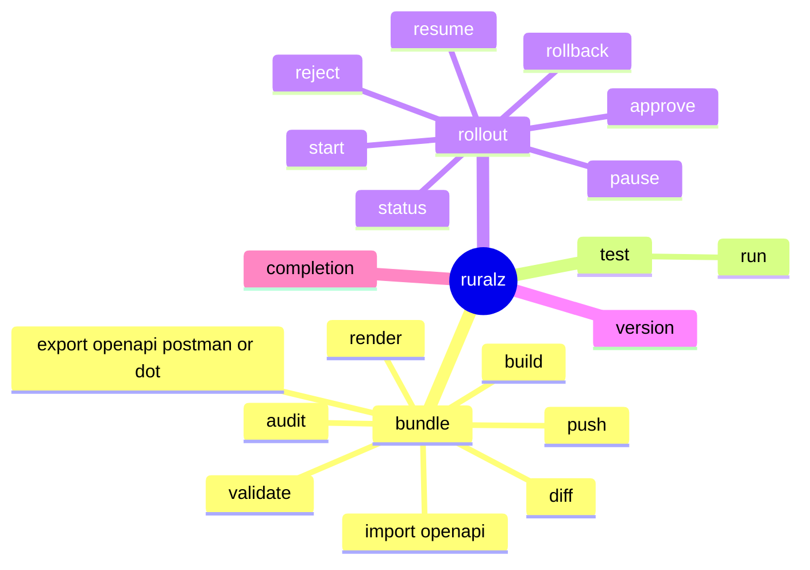
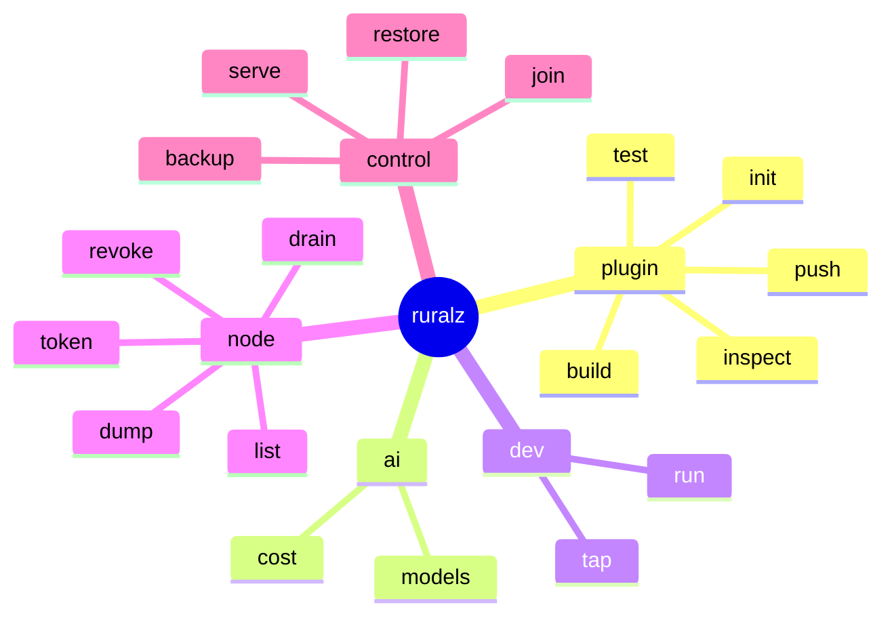
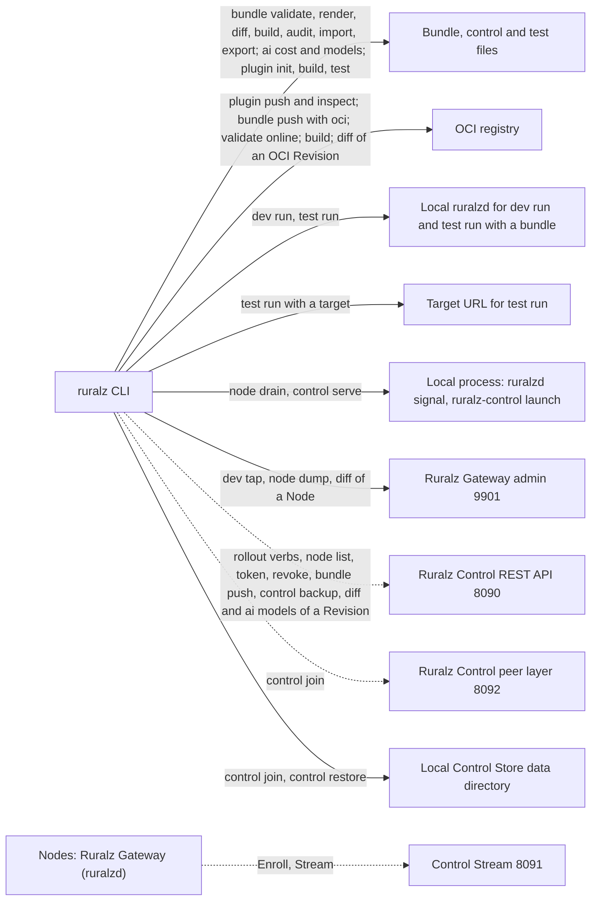

# CLI and API Surface

## Summary

Reference for every operator-facing interface: `ruralz` commands and flags, admin APIs on 9901 (Ruralz Gateway) and 9902 (Ruralz Control), the REST API on 8090, the gRPC service `ruralz.control.v1.ControlStream` on 8091, authentication, output formats and exit codes. It adds verbs and flags and defines the `ruralz test run` case format. Readers: operators, CI authors, contributors, Plugin authors.

## Scope and non-goals

In scope: the Summary's list, plus platforms. The [CLI command registry](../_meta/foundation-pack.md#9-cli-command-registry) of the binding [foundation pack](../_meta/foundation-pack.md) ("pack 9") fixes the nouns `bundle`, `rollout`, `plugin`, `ai`, `dev`, `node`, `control` and `test`; this document adds verbs and flags. [Tech stack and libraries](../engineering/01-tech-stack-and-libraries.md) picks a CLI framework with nested nouns, generated completions and no global state.

Non-goals, with owners:

- Kinds, fields, diagnostics and the diff model: [Configuration model](../architecture/02-configuration-model.md), which wins on conflict ([ADR-0003](../adr/0003-configuration-format.md)).
- Admin path semantics: [Data plane](../architecture/03-data-plane.md#admin-endpoints).
- REST resources, roles, Control Stream messages and `RZ-CP` codes: [Control plane and GitOps](../architecture/04-control-plane-and-gitops.md#api-summary) ([ADR-0007](../adr/0007-control-stream-protocol.md)).
- Plugin packaging: [WASM plugin system](../architecture/05-wasm-plugin-system.md#plugin-commands); credential settings: [Security and identity](../architecture/08-security-and-identity.md#admin-ports).
- Client traffic on 8080 and 8443, declared as Routes.

## CLI command tree

`ruralz` is one static `CGO_ENABLED=0` binary for Linux, macOS and Windows; commands that start or signal a server run only where that server is built ([Platform support](#platform-support)). Commands take the form `ruralz <noun> <verb>`, formats such as `openapi` being arguments, except `ruralz version` and `ruralz completion`. Flags and verbs stay deprecated for 2 minor releases (target) before removal ([Release, versioning and compatibility](../engineering/04-release-versioning-and-compatibility.md)).

*Figure 1: CLI command tree, part 1: configuration, testing and delivery.*



*Figure 2: CLI command tree, part 2: Plugin, AI, development, Node and control.*



### Command table

Every command from pack 9 and other documents, plus `ruralz rollout reject`; Figure 3 shows what each calls. `[DIR]` defaults to `.`, and for `ruralz bundle validate`, `render` and `build` it may be `-`, a one-file Bundle read from standard input ([Bundle verbs in detail](#bundle-verbs-in-detail)); "Bundle flags" are `--env` and `--environments`; `--output` formats are [below](#output-formats-and-exit-codes).

| Command | Purpose | Arguments and command flags | Planned |
|---|---|---|---|
| `ruralz bundle validate` | Offline validation, source-mapped diagnostics | `[DIR]`, Bundle flags, `--online` (Plugin artifact check) | Planned (M1) |
| `ruralz bundle render` | Render one Environment's one-file Bundle | `[DIR]`, Bundle flags, `--effective` (resolved Filter Chains of every Route, or with `--route NAME` of one), `--api-version VERSION --output-dir DIR` (conversion), `--output-file` | Planned (M1) |
| `ruralz bundle diff` | Compare FROM with TO | `FROM TO` (forms below), Bundle flags, `--from-env`, `--to-env`, per-side admin credentials `--from-admin-token-file PATH`, `--to-admin-token-file PATH`, `--from-client-cert PATH`, `--from-client-key PATH`, `--to-client-cert PATH`, `--to-client-key PATH`, `--timeout DURATION` (default 5m (target)) | Planned (M1); Revision sources Planned (M2) |
| `ruralz bundle build` | Build a Revision, print its digest | `[DIR]`, Bundle flags, `--offline` (no Plugin check), `--output-file` (`ruralz.canonical.v1`) | Planned (M1) |
| `ruralz bundle push` | Send source to Ruralz Control, or a signed Revision to OCI | `[DIR]`, `--env` (required), `--oci REFERENCE`, `--key PATH` (else Sigstore keyless) | Planned (M2) |
| `ruralz bundle import openapi` | Routes and Upstreams from OpenAPI 3.x | `FILE`, `--output-dir DIR` | Planned (M2) |
| `ruralz bundle export openapi` | OpenAPI 3.x for HTTP Routes | `[DIR]`, Bundle flags, `--output-file` | Planned (M2) |
| `ruralz bundle export postman` | Postman collection of those Routes | `[DIR]`, Bundle flags, `--output-file` | Planned (M2) |
| `ruralz bundle export dot` | DOT graph of Routes, Policies, Upstreams | `[DIR]`, Bundle flags, `--route NAME`, `--output-file` | Planned (M2) |
| `ruralz bundle audit` | Security and best-practice findings | `[DIR]`, Bundle flags | Planned (M2) |
| `ruralz test run` | Run request and expected-response cases | `CASES`, `--bundle DIR` or `--target URL`, Bundle flags, `--secret-overrides FILE`, `--ready-timeout DURATION`, `--ruralzd PATH` | Planned (M2) |
| `ruralz rollout start` | Start a revert Rollout, print its ID | `--cluster NAME`, `--revision sha256:DIGEST` | Planned (M2) |
| `ruralz rollout status` | State, batches, ACKs, NACKs, lagging Nodes | `CLUSTER` or `ROLLOUT_ID`, `--wait`, `--timeout DURATION` (default 60m (target)) | Planned (M2) |
| `ruralz rollout pause` | Enter `paused` | `ROLLOUT_ID` | Planned (M2) |
| `ruralz rollout resume` | Continue its persisted plan | `ROLLOUT_ID` | Planned (M2) |
| `ruralz rollout rollback` | Re-deliver the previous Revision | `ROLLOUT_ID` | Planned (M2) |
| `ruralz rollout approve` | Approve a queued promotion or held revert | `--env NAME` or `--rollout ROLLOUT_ID`, `--digest sha256:DIGEST` | Planned (M2) |
| `ruralz rollout reject` | Discard a queued promotion or held revert | `--env NAME` or `--rollout ROLLOUT_ID`, `--digest sha256:DIGEST`, `--reason TEXT` | Planned (M2) |
| `ruralz plugin init` | Scaffold a Plugin with tests (plugin generator) | `NAME`, `--language rust`, `go`, `typescript` or `csharp` | Planned (M2); TypeScript Planned (M3); C# Planned (M4) |
| `ruralz plugin build` | Compile to WASM, derive Capabilities, generate shims | `[DIR]` | Planned (M2) |
| `ruralz plugin test` | Test on `ruralzd`'s wazero host | `[DIR]` | Planned (M2) |
| `ruralz plugin push` | Publish to OCI and sign | `REFERENCE`, `--key PATH` (else keyless) | Planned (M2) |
| `ruralz plugin inspect` | ABI, Phases, Capabilities, digest, signatures | `REFERENCE` | Planned (M2) |
| `ruralz ai cost` | Cost attribution from provider-reported usage | `FILE...` or standard input, `--group-by` | Planned (M3) |
| `ruralz ai models` | List `AIModel` candidates | `[DIR]` with Bundle flags, or `--revision sha256:DIGEST` | Planned (M3) |
| `ruralz dev run` | Local `ruralzd` with Hot Reload | `[DIR]`, Bundle flags, `--secret-overrides FILE`, `--ephemeral-ports`, `--memory-state-store`, `--ready-timeout DURATION` (default 30s (target)), `--ruralzd PATH` | Planned (M1) |
| `ruralz dev tap` | Stream redacted `/tap` metadata | `--route NAME` (client-side filter), `--sample RATE` (in (0, 1], default 1) | Planned (M1) |
| `ruralz node list` | Nodes with active and Last-Known-Good digests | `--cluster NAME` | Planned (M2) |
| `ruralz node drain` | Drain the local `ruralzd` | `--data-dir PATH` (default `RURALZ_DATA_DIR`, else `/var/lib/ruralz`), `--timeout DURATION` (default 5m (target)) | Planned (M1) |
| `ruralz node dump` | Save `/config/dump`, secrets omitted | `--output-file`, `--timeout DURATION` (default 5m (target)) | Planned (M1) |
| `ruralz node token` | One-time Enrollment token | `--cluster NAME`, `--output-file` (owner-only permissions) | Planned (M2) |
| `ruralz node revoke` | Revoke an enrollment identity | `NODE_ID` | Planned (M2) |
| `ruralz control serve` | Launch a `ruralz-control` replica | `--data-dir PATH`; arguments after `--` pass through | Planned (M2) |
| `ruralz control join` | Get a new replica's peer certificate | `--data-dir PATH`, `--peer HOST:8092`, `--advertise HOST:8092` (required), `--join-token-file PATH` | Planned (M2) |
| `ruralz control backup` | Snapshot the Control Store and Node revocation list | `--output-file` (required), `--revocation-list-file PATH` | Planned (M2) |
| `ruralz control restore` | Restore into an empty deployment | `--data-dir PATH` with `--prepare`, or with `FILE`, `--advertise HOST:8092`, `--anchor-set PATH`, `--backup-key-file PATH`, `--revocation-list PATH` | Planned (M2) |
| `ruralz version` | Version, commit, flavor, levels | None | Planned (M1) |
| `ruralz completion` | Shell completion script | `bash`, `zsh`, `fish` or `powershell` | Planned (M1) |

### Platform support

Launched or signaled binaries follow [Static builds](../engineering/01-tech-stack-and-libraries.md#static-builds); on a Not planned platform the command exits 2, naming it.

| Commands | Linux | macOS | Windows |
|---|---|---|---|
| All others | As tagged | As tagged | As tagged |
| `ruralz dev run`, `ruralz test run --bundle` | As tagged | Development only, like `ruralzd` | Not planned: no `ruralzd` build; use `--target URL` or WSL |
| `ruralz node drain` | Planned (M1) | Not planned: needs `/proc/locks` | Not planned: no `ruralzd`, no SIGTERM |
| `ruralz control serve`, `ruralz control join`, `ruralz control restore` | Planned (M2) | Development only, like `ruralz-control` | Not planned: no `ruralz-control` build |

### Global flags

Flags mean the same everywhere; tokens come only from files, staying out of shell history.

| Flag | Meaning | Accepted by |
|---|---|---|
| `--output FORMAT` | `text`, `json`, and per command `yaml` or `csv`; per-command defaults [below](#output-formats-and-exit-codes) | Commands that print data |
| `--output-file PATH` | Write data to a file | Document emitters |
| `--env NAME` | Render with that Environment's `spec.overlay` and `spec.variables`; without it and without `--environments`, the process environment supplies `${VAR}` and no overlay applies | Bundle readers |
| `--environments FILE` | Local `Environment` resources; without it, `--env` fetches from Ruralz Control (Planned (M2)) | Same |
| `--control URL` | REST API base, such as `https://control.shop.example:8090` | REST callers |
| `--token-file PATH` | REST API token only | Same |
| `--admin URL` | A Node's admin base, such as `https://node-a.shop.example:9901` ([forms](#admin-api-conventions)); default `RURALZ_ADMIN_URL`, else `http://127.0.0.1:9901` | `ruralz dev tap`, `ruralz node dump` |
| `--admin-token-file PATH` | Operator admin token; default `RURALZ_ADMIN_TOKEN_FILE` | `ruralz dev tap`, `ruralz node dump`, the admin sides of `ruralz bundle diff` |
| `--ca-file PATH` | Extra trust anchors for 8090 or 9901, added to the system roots | Commands that call 8090 or 9901 |
| `--client-cert PATH`, `--client-key PATH` | Client certificate for admin mTLS | Same as `--admin-token-file` |

With `--environments` and no `--env`, `ruralz bundle validate` and `ruralz bundle audit` run once per Environment in the file, in file order, as forge CI expects, exiting with the worst code. Findings of stages A to C, which every Environment shares, print once and name no Environment; findings of stages D to M print once per Environment and name it: in the `environment` member of a JSON entry, and as a last word `[environment=<name>]` on a text line. Other Bundle readers exit 2 there, except `ruralz bundle diff`, whose sides take `--from-env` and `--to-env`, and `ruralz bundle render --api-version`, which checks every Environment ([Bundle verbs in detail](#bundle-verbs-in-detail)). Every command that reads an `--environments` file exits 2 with `no Environment in FILE` when the file declares no `Environment`.

`RURALZ_ADMIN_URL` and `RURALZ_ADMIN_TOKEN_FILE` ([pack section 2](../_meta/foundation-pack.md#2-canonical-names)) stand in for an absent `--admin` and `--admin-token-file`; a flag always wins. `--control` and `--token-file` come only from flags.

### Bundle verbs in detail

`--online` fetches each Plugin artifact by digest, checks it against `Plugin.spec` and verifies signatures (RZ-CFG-028, RZ-CFG-033); CI SHOULD gate merges on `ruralz bundle build` or `ruralz bundle validate --online` ([Validation and diff semantics](../architecture/02-configuration-model.md#validation-and-diff-semantics)). The fetch is Planned (M2): until it ships, the online stage reports RZ-CFG-028 at each `Plugin` resource, saying that the online Plugin check is Planned (M2), so `ruralz bundle build` without `--offline` and `ruralz bundle validate --online` exit 1 for a Bundle that holds a Plugin, while a Bundle without Plugins passes the stage. Bundle readers enforce the default 64 MiB of source and 20,000 resources (target), and the loader's other limits ([Restricted YAML profile](../architecture/02-configuration-model.md#restricted-yaml-profile)), as RZ-CFG-001; no flag raises them until OQ-control-plane-and-gitops-25 decides. A directory without `ruralz.yaml` is RZ-CFG-016, while a source that is missing, unreadable or neither a directory nor a regular file exits 2.

`-` as the source of `ruralz bundle validate`, `render` or `build`, or as one side of `ruralz bundle diff`, reads standard input to its end as a one-file Bundle, or for `diff` also as a saved dump, within the same limits; its diagnostics name the file `-`. At most one `diff` side reads standard input, `--api-version` refuses it, and `ruralz dev run`, which watches its source, takes only a directory or a file.

`ruralz bundle diff FROM TO` resolves each source to canonical form, then runs it through the pipeline, so both sides compare as validated states. The JSON member names the source in the side's `from` or `to` object:

| Source form | Meaning | JSON member | Planned |
|---|---|---|---|
| Directory, such as `./shop-bundle` | A source Bundle rendered with `--env`, or per side with `--from-env` and `--to-env` | `bundle` | Planned (M1) |
| File | A rendered Bundle, or saved `ruralz node dump` output | `bundle`, or `dump` | Planned (M1) |
| Admin URL, such as `https://node-a.shop.example:9901` | A live Node's `/config/dump`, compared by hand | `admin` | Planned (M1) |
| `rev-<12 hex>` or `sha256:<64 hex>` | A Revision fetched from `revisions` | None | Planned (M2) |
| `oci://REPOSITORY@sha256:<64 hex>` | A Revision from `ruralz bundle push --oci`, verified by digest and signature | None | Planned (M2) |

Read commands resolve `rev-<12 hex>` via `GET /api/v1/revisions?digestPrefix=<12 hex>&environment=NAME&limit=2` (proposed, OQ-cli-and-api-surface-3), passing `--env` when given; zero or two matches exit 2. `ruralz rollout start`, `ruralz rollout approve` and `ruralz rollout reject` require full digests, so a prefix collision never acts on the wrong Revision.

A FROM or TO that starts with `http://` or `https://` is an admin URL and one that starts with `oci://` an OCI Revision; a bare `rev-<12 hex>` or `sha256:<64 hex>` is a Revision, which exits 2 as Planned (M2) until Revision sources ship; anything else is a path, so `./rev-162af81f5de4` names a directory. A file that holds a `/config/dump` document is a dump, any other file a rendered Bundle. `--from-env` and `--to-env` stand in for `--env` on their side, and `--env` with either is a usage error. Environment flags apply to directory and rendered-file sides, where a rendered file substitutes nothing new but names its Environment, and are a usage error on a dump or admin side; with `--environments`, every directory or rendered-file side needs an Environment, else exit 2. An admin side authenticates with `--from-admin-token-file` or `--to-admin-token-file`, and with `--from-client-cert` and `--from-client-key` or their `--to-` forms, falling back to the shared `--admin-token-file`, `--client-cert` and `--client-key`, so two Nodes with different credentials compare in one run; `--ca-file` and `--timeout` serve both sides.

Without `--oci`, `ruralz bundle push` uploads the source Bundle with the CLI's digest; Ruralz Control re-renders it, rejects a mismatch (RZ-CFG-027) and refuses it under `requireApproval` unless process configuration allows it. With `--oci` it publishes the rendered, Sigstore-signed Revision for file-mode Nodes ([ADR-0017](../adr/0017-artifact-signing.md)); registry credentials are OQ-cli-and-api-surface-7.

`ruralz bundle render` writes the [Rendered Bundle](../architecture/02-configuration-model.md#rendered-bundle) of one Environment as YAML; `--output json` writes the same resources as one JSON array, a form for tooling rather than a Bundle file. A secret field that holds anything but a reference fails the render with RZ-CFG-012 and exit 1, and nothing is written.

`--effective --route NAME` prints that Route's effective Filter Chain instead, from the chain the data plane builds its Phases from: a table with the columns `PHASE`, `LEG`, `POLICY`, `FROM` and `REASON`, each two spaces wider than its widest cell, with one row per Policy and Phase in execution order, the client leg before each upstream leg, then the Gateway Policies the Route removed, with Phase and Leg `none`. `LEG` is `client` or the Upstream name, and `FROM` is `Gateway`, `Route` or `Upstream <name>`. `REASON` is `own slot`, `slot <slot>`, `slot <slot>, replaces <Policy>`, `slot <slot>, inherited` or `leg <Upstream> only`, a Gateway Policy's ending in `, not overridable` when it is, and `replaced in slot <slot> by <Policy>` or `excluded by Route` for a removed one. `--output json` prints the rows as one array of objects with `phase`, `leg`, `policy`, `type`, `filterClass`, `slot`, `from` and `reason`, `[]` for a Route that runs no Policy. A `NAME` that is no Route of the Bundle exits 2 with the nearest Route name as a hint. Without `--route`, `--effective` prints the chains of every Route, in canonical order by name: the table gains a first column `ROUTE` and each JSON row a first member `route`, a Route that runs no Policy adds no row, and a Bundle without a Route prints the header alone, or `[]`.

Flag combinations: `--route` needs `--effective`; `--api-version` needs `--output-dir` and `--environments`, and excludes `--effective` and `--route`; `--output-dir` needs `--api-version`; `--output-file` receives the YAML or JSON Bundle, the `--effective` output or the `--api-version` report. Any other combination is a usage error, exit 2.

`ruralz bundle render --api-version VERSION --output-dir DIR` converts sources instead, VERSION being a full apiVersion such as `ruralz/v1alpha1`: each base and overlay file is rewritten under VERSION into DIR at its own path and in its own format, keeping `overlays/<env>/`, `$patch` entries and `${VAR}` expressions, unmerged and unsubstituted. Comments are lost; conversion is rare. An unserved VERSION is RZ-CFG-007 and exits 2; a source document whose `apiVersion` is not served is RZ-CFG-007 and exits 1, as any invalid Bundle does; neither writes anything. DIR MUST NOT exist or MUST be empty, and MUST lie outside the source Bundle; the files are written into a hidden directory beside DIR and renamed into place, so DIR holds all of them or none.

The command then builds both trees for every Environment of the required `--environments`, or only for `--env` when it is given, offline, and compares their Revisions, exiting 1 unless all are equal, which is exactly when every diff is empty; a file without an Environment exits 2. It prints one line per Environment, in file order, the source Revision before the converted one, such as `prod: rev-162af81f5de4 -> rev-162af81f5de4 equal`, ending in `differs` when the Revisions differ or `invalid` when a tree fails to build, with `-` for the Revision it lacks and its diagnostics on standard error; then the [human diff](../architecture/02-configuration-model.md#diff-semantics) of each Environment whose Revisions differ. `--output json` prints one array of `{"environment", "source": {"revision", "digest"}, "converted": {"revision", "digest"}, "equal", "diff"}`, with full `sha256:<64 hex>` digests, the `ruralz.diff.v1` document as `diff` only when the Revisions differ, and `diagnostics` in place of `revision` and `digest` on a side that failed to build.

### Rollout, promotion and Node verbs

`ruralz rollout start` serves reverts, needing an `operator` with step-up TOTP ([Rollout states](../architecture/04-control-plane-and-gitops.md#rollout-states)), and prints the Rollout ID. A revert to an older target, or with `security` impact or a Capability grant, gets `RZ-CP-006` until another `approver` approves, and exits 3. The held revert waits as a `pending` Rollout whose ID is printed (proposed, OQ-cli-and-api-surface-8). Under option (a) it is the Cluster's active Rollout for `RZ-CP-009` until `ruralz rollout approve --rollout ROLLOUT_ID --digest sha256:DIGEST` (`POST /api/v1/rollouts/{id}/approve`) releases it or `ruralz rollout reject` with the same flags (`/reject`) discards it. Under option (b), exit 3 prints the promotion record ID for `ruralz rollout approve --env`.

`ruralz rollout status` reads a ULID as a Rollout ID, anything else as a Cluster, following its active, else latest, Rollout. `--wait` polls every 5 s, backing off to 30 s (target), honors `Retry-After` on `RZ-CP-010`, and stops at `complete` (exit 0), `rolled-back` or `failed` (1), `paused` (3, with the reason; it awaits a person) or `--timeout` (2).

`ruralz rollout approve --env prod` shows the queued record's source, digest and diff impact, then approves it for every Cluster of the Environment, sending the displayed digest on a terminal, else `--digest`, so a record a newer commit replaced is never approved. `ruralz rollout reject` follows the same rules; the server enforces separation of duties (`RZ-CP-007`).

For Planned (M1), `ruralz node drain` sends a local SIGTERM that starts a Drain, like a process manager ([ADR-0015](../adr/0015-zero-downtime-upgrades-so-reuseport.md)). The process holding the `flock` on `${RURALZ_DATA_DIR}/lock` writes `holder.json` beside it atomically on taking it; readers ignore unknown members:

| Member | Contents |
|---|---|
| `format` | `ruralz.holder.v1` |
| `pid` | Process ID in the holder's PID namespace |
| `startTime` | Field 22 of `/proc/<pid>/stat`, clock ticks since boot, so a reused PID never matches |
| `nodeId` | The Node's `node.id` |
| `version` | The holder's build version |
| `pidNamespace` | `readlink /proc/self/ns/pid`, such as `pid:[4026531836]`; omitted without `/proc` |

The CLI checks the record's `format`, opens a pidfd for the recorded PID (Linux 5.4 or newer; on an older kernel it keeps the PID), then checks, in order, its own `pidNamespace`, a live process with that `startTime` and the holder's `FLOCK` `WRITE` line on the `lock` inode in `/proc/locks`. It signals SIGTERM through the pidfd, so a process that took the PID after the checks is never signaled, and polls every 100 ms (target) until the process has exited, a zombie its parent has not reaped included, up to `--timeout`. No holder, a stale record, another PID namespace or a denied signal exits 2. When `--timeout` passes first, the CLI exits 2 naming the PID that still runs and sends no second signal, leaving the Node to its own Drain deadline.

On success `ruralz node drain` prints `drained Node <nodeId> (pid <pid>) in <seconds> s`, seconds with one decimal, to standard error and nothing to standard output. With `--output json`, once it has signaled, it prints one object to standard output, `{"nodeId", "pid", "seconds", "result"}`, where `seconds` counts from the signal with millisecond precision and `result` is `drained`, or `timeout` beside exit 2; a refusal before the signal prints no object.

`ruralz node dump` checks the `/config/dump` document before it writes anything: its content must hash to its digest (RZ-CFG-027) and decode at schema levels the CLI serves (RZ-CFG-024). A failed check, or 503 `RZ-RT-024` from a Node with no active Revision, exits 2 and writes nothing. A dump that passes is written exactly as received, so the file is a `ruralz bundle diff` source; standard output then holds only the document, and with `--output-file` one line on standard error names its `rev-<12 hex>`, its full digest and its Last-Known-Good digest.

During a Zero-Downtime Upgrade the lock moves at Drain start; the CLI still awaits the signaled process. Under Kubernetes, delete the Pod; under systemd, `systemctl stop`. A remote drain is OQ-cli-and-api-surface-4. `ruralz node token` output is a secret, never in a Bundle.

### Ruralz Control replica verbs

`ruralz control serve` runs `ruralz-control` on the Control Store in `--data-dir` (default `RURALZ_DATA_DIR`; layout: OQ-cli-and-api-surface-9).

`ruralz control join` runs on the new replica's host before `ruralz control serve`. It generates a key pair in `--data-dir` and dials `--peer` pinned to the 8092 server CA's SHA-256 fingerprint from the join token, as with Enrollment tokens (proposed, OQ-cli-and-api-surface-9), never unpinned. It redeems the one-time `admin` token from `--join-token-file`, issued by `/api/v1/replicas`, in `Join` with a certificate request whose SAN is `--advertise`, the replica's own peer address, then stores the certificate chain and peer CA beside the key, which stays local.

`Join` only issues the certificate and records a pending member; no voter set changes. When `ruralz control serve` on that directory first connects over 8092, the leader adds it as a non-voter, promoting it to voter once it reaches the leader's commit index, so quorum never counts a stopped replica ([Control plane and GitOps](../architecture/04-control-plane-and-gitops.md#certificates-and-replica-join)). `serve` bootstraps a cluster and creates or loads CAs only on an empty Control Store, never on a directory `join` or `restore` wrote.

`ruralz control backup --revocation-list-file PATH` also writes the Node revocation list, revoked `node.id`s and certificate serials, signed with the backup's key.

`ruralz control restore` runs only on the host of an empty Control Store, never through REST ([ADR-0006](../adr/0006-control-store-raft-boltdb.md), proposed):

1. `--prepare --data-dir PATH` generates the new online key there, encrypted under the key-encryption key, and prints its public half for offline root signing.
2. `FILE --data-dir PATH --advertise HOST:8092 --anchor-set PATH --backup-key-file PATH` verifies and decrypts the backup, requires a root-signed anchor set holding the prepared key, and opens a higher `storeEpoch` before any delivery. It resets the snapshot's Raft membership to one voter, this replica at `--advertise` under a new server ID, and drops old peer certificates, so it elects itself; others then run `ruralz control join`. With a verified `--revocation-list PATH`, earlier Node certificates stay valid unless listed; without it, every Node re-enrolls. The backup key's source is OQ-cli-and-api-surface-9.

### Local ruralzd launched by the CLI

`ruralz dev run` and `ruralz test run --bundle` launch a local `ruralzd`. File-mode `ruralzd` selects no overlay, so the CLI renders for it:

| Concern | Rule |
|---|---|
| Binary | `--ruralzd PATH` names it and skips the search; otherwise the `ruralzd` beside `ruralz`, else the first on `PATH`, and none exits 2 naming both places. Once it runs, a `holder.json` `version` other than the CLI's own exits 2 |
| Rendering | DIR is rendered for `--env`, or from the process environment, into a private temporary directory of mode 0700. `ruralz dev run` polls every 500 ms (target) DIR, its overlays and `.ruralzignore` files included, the `--environments` file, the `--secret-overrides` file and every file it names, and re-renders once a change has settled for 250 ms (target), swapping the file by atomic rename; `ruralzd` Hot Reloads it. A render that fails prints its diagnostics to standard error: `ruralzd` keeps its active Revision, and before the first valid render `ruralz dev run` keeps watching and launches `ruralzd` only at the first valid one, while `ruralz test run --bundle` exits 1 |
| Ports | `ruralz test run --bundle`, and `ruralz dev run --ephemeral-ports`, rewrite every listener `port` and `admin.port` to free loopback ports, so parallel CI jobs never collide; a port keeps its replacement across re-renders, and an added listener gets a new one. The child binds the rewritten `admin.port` from boot, since a booting Node takes the admin port of the Bundle it loads ([Admin endpoints](../architecture/03-data-plane.md#admin-endpoints)). The mapping prints at readiness and whenever it changes, one line per rewritten port: `<listener>: <port> -> <port>`, then `admin: <port> -> <port>`. Without the rewrite, the CLI test-binds every port before the launch and exits 2 naming a busy one |
| Secrets | `--secret-overrides FILE` is a YAML or JSON object, read under the [Restricted YAML profile](../architecture/02-configuration-model.md#restricted-yaml-profile), whose keys are `secretRef` `provider:name` pairs and whose values are local file paths, relative to FILE. Each file is copied, mode 0600, into a private `RURALZ_SECRET_ROOT` inside the private directory, and every reference it overrides becomes `provider: file` there ([Secrets](../architecture/08-security-and-identity.md#secrets) rule 5); a reference with `key` keeps it, so its file is a JSON object holding that key, and one without reads the whole file. With overrides, every `file` reference must be overridden: one without an entry fails the render with RZ-CFG-026 at the reference, as a render with an error diagnostic does; an entry that no reference uses warns, and an overrides file that cannot be read or does not have this form exits 2 at start and fails a later render. Without overrides, the CLI's own `RURALZ_SECRET_ROOT` applies. Any other unresolvable reference keeps `/readyz` at 503: exit 2, RZ-CFG-026 |
| State Store | `ruralz dev run --memory-state-store` replaces the Gateway's `stateStore` with `driver: memory`, so a Bundle that names a `redis` State Store runs on one workstation without its URL or server |
| Digest | A rewritten file is a test render, reported as `testDigest` beside the unmodified Revision digest; `testDigest` is reported even when nothing was rewritten, equal to it |
| Environment | The child inherits the CLI's environment, with `RURALZ_CONFIG`, `RURALZ_DATA_DIR`, `RURALZ_ADMIN_TOKEN_FILE` and `RURALZ_BIND_LOOPBACK` set, `RURALZ_SECRET_ROOT` set when overrides exist, `RURALZ_FETCH_ALLOW` set to `127.0.0.0/8,::1` for local mocks when the CLI's environment leaves it unset, and `RURALZ_ADMIN_TLS_DIR` and `RURALZ_ADMIN_METRICS_TOKEN_FILE` removed. `RURALZ_LOG_LEVEL`, `RURALZ_SECRET_*`, `RURALZ_STATE_STORE_URL` and `RURALZ_STATE_STORE_MAC_KEY_FILE` pass through |
| Bind address | `RURALZ_BIND_LOOPBACK=true` ([pack section 2](../_meta/foundation-pack.md#2-canonical-names)): every listener and the admin port bind 127.0.0.1 and ::1 only |
| Node state | A temporary `RURALZ_DATA_DIR`, removed once the child has exited, and a generated operator token in the file that `RURALZ_ADMIN_TOKEN_FILE` names, its path printed for `ruralz dev tap`; admin is plain HTTP on loopback, where the token works |
| Readiness | The CLI polls the admin port's `/readyz` every 0.5 s (target) until it answers 200. When `--ready-timeout`, default 30 s (target), counted from the launch, passes first, it prints the last answer's reasons and exits 2; a child that exits before it is ready exits 2 at once, and so does one that answers 200 without having written `holder.json` |
| Activation | After each swap the CLI polls `/readyz` until its `revision` names the new test render and prints `active rev-<12 hex>`, that render's Revision; when `--ready-timeout` passes first, it prints `rejected, still serving rev-<12 hex>`, the Revision the child still serves, the cause being in the child's log. The CLI keeps polling its sources meanwhile, and a swap that a newer one replaces before `/readyz` names it prints neither, as the Node keeps only its newest pending Revision |
| Logs | The child's standard output and standard error reach the CLI's standard error, a whole line at a time. When that is a terminal and `--output json` is not set, each JSON log line becomes one short line: its time, level and message, then its other members as `key=value` in record order, without the Node, Revision, trace and span IDs, a string value bare unless it is empty or holds a space, a quote, an equals sign or an unprintable character, which print it quoted; a line that is not JSON passes unchanged. Otherwise both streams pass unchanged |
| Stopping | The child runs in its own process group. Ctrl-C sends it SIGTERM, which starts a Drain, and a second Ctrl-C a second SIGTERM, which jumps the Drain to its deadline; SIGKILL follows if the child outlives the 30 s exit bound (target), counted from the first SIGTERM. The CLI forwards a SIGTERM it receives the same way. It removes the private directory once the child has exited, then exits 130, or 143 after SIGTERM, by the first signal; a child that exits on its own ends the command with exit 2, printing its exit status, and an exit 2 after the launch, such as a readiness timeout, stops the child the same way first |

### Plugin, AI and development verbs

`ruralz dev run` loads Plugins only by digest from a registry, possibly local, since `Plugin.spec.image` requires a digest (RZ-CFG-021) and one fetch path keeps development like production. Only `ruralz dev run` verifies signatures under `warn`.

`ruralz ai cost` reads access log records' `ai` object, as metrics carry no Consumer label. `--group-by` takes `consumer`, `tier`, `route`, `aimodel` or `provider`. Totals are per currency, unconverted and `approximate`, listing unpriced requests apart; records an errors-only `accessLog.when` skipped are missing (OQ-cli-and-api-surface-6).

`/tap` admits at most 4 subscribers with 1 MiB buffers, costing about 2 µs per sampled event (target) whatever `--route` filters. `ruralz dev tap` subscribes with `?sample=` set to `--sample RATE`, in (0, 1] and 1 by default, another value being a usage error; it exits 2 when refused (503 `RZ-RT-019`, or 401) and warns on standard error on each `{"dropped":N}` line. `--route NAME` keeps the events whose `route` equals NAME.

The text form prints one line per event, `<time> <status> <method> <host><path> route=<route> upstream=<upstream> code=<code> <durationMs>ms`, leaving out members that are empty, and, when the event carries headers, one line per value indented by two spaces, in name order: `> <name>: <value>` for a request header and `< <name>: <value>` for a response header, redacted as `/tap` gives them. Control characters in the Node's text print as U+FFFD, so a line cannot break the form or drive a terminal, and a line that is no event warns on standard error. `--output json` re-emits every line as received, `{"dropped":N}` lines included.

When the Node ends the stream, as at a Drain or shutdown, an admin port move or a missed write deadline, `ruralz dev tap` says so on standard error and subscribes again with backoff from 1 s, doubling to 30 s (target) and starting over once a subscription is accepted, reading the token file again each time, until Ctrl-C. The first subscription must succeed, else exit 2. A Node that cannot be reached, a refused or reset connection or a missed connection or header deadline, only lengthens the backoff, while a later subscription the Node refuses, with 401, 503 `RZ-RT-019` or any other problem document, redirect or unexpected status, exits 2.

### Test case format

`ruralz test run` reads YAML files marked `format: ruralz.test.v1`. They are not Bundle resources (no `apiVersion` or `kind`) and live outside the Bundle, such as in `tests/`. Before `ruralz test run` lands, the [end-to-end suite](../engineering/03-testing-and-quality-strategy.md#end-to-end-tests)'s Go driver reads the same files, so its cases move to the command unchanged. Registration is OQ-cli-and-api-surface-1; streaming and multi-request cases, OQ-cli-and-api-surface-13.

```yaml
format: ruralz.test.v1
name: orders-summary
cases:
  - name: rejects a request without credentials
    request:
      method: GET
      path: /v1/orders/42/summary
      headers:
        host: api.shop.example
    expect:
      status: 401
      headers:
        content-type: application/problem+json
  - name: serves a token with orders:read
    request:
      method: GET
      path: /v1/orders/42/summary
      headers:
        host: api.shop.example
        # "Bearer <JWT>" for jwt-default, scope orders:read; read at run time, never inlined
        authorization: {file: ./secrets/partner-jwt}
    expect:
      status: 200
      json:                                          # subset match on the decoded body
        order: {id: "42"}                            # aggregate steps merge under `group`
```

| Field | Meaning |
|---|---|
| `format` | Required, `ruralz.test.v1`; unknown top-level fields rejected |
| `name`, `cases[].name` | Required; reported in results |
| `cases[].request` | `method`, `path`, `headers` (a string or `{file: PATH}`), optional `body` (string) or `json` |
| `cases[].expect` | Any of `status`, `headers` (exact), `json` (subset match), `bodyContains` |

`--target URL` needs no admin access.

### Worked example: pull request and promotion

```bash
# Pull request CI, per Environment (Planned (M1); diff against a Revision and ruralz test run Planned (M2)).
CONTROL="--control https://control.shop.example:8090 --token-file /run/secrets/ruralz-ci-token"
ruralz bundle validate --environments control/environments.yaml --output json ./bundle   # every Environment
ruralz bundle build --env prod --environments control/environments.yaml ./bundle
# diff exits 1 when there are changes, as in every useful pull request; only 2 fails the job.
ruralz bundle diff $CONTROL rev-162af81f5de4 ./bundle --env prod \
  --environments control/environments.yaml --output json > diff.json || test $? -eq 1
ruralz test run --bundle ./bundle --env staging --environments control/environments.yaml ./tests

# After merge (Planned (M2)): run by a human approver at a terminal, not by the pipeline,
# because approval needs step-up TOTP (OQ-cli-and-api-surface-5).
ruralz rollout approve --control https://control.shop.example:8090 --token-file ~/.ruralz/token \
  --env prod --digest sha256:68f782530463d5c1f0e2b9a7c4d8e6f1a3b5c7d9e0f2a4b6c8d0e2f4a6b8c0d2
ruralz rollout status --control https://control.shop.example:8090 --token-file ~/.ruralz/token \
  prod-eu-west --wait --timeout 30m   # 0 complete, 1 rolled-back or failed, 3 paused
```

## Ruralz Gateway admin API

`ruralzd` serves admin on `Gateway.spec.admin.port`, default 9901. This table matches Data plane's [Admin endpoints](../architecture/03-data-plane.md#admin-endpoints), which owns the semantics.

| Path on 9901 | Method | Returns | Authentication | Used by | Planned |
|---|---|---|---|---|---|
| `/healthz` | GET | 200 while the process responds | MAY be open | Liveness probes | Planned (M1) |
| `/readyz` | GET | 200 when ready, else 503 with reasons; never fails for a lost Control Stream | MAY be open | Probes, local `ruralzd` launcher | Planned (M1) |
| `/metrics` | GET | `ruralz_<component>_<name>_<unit>` metrics (exporter: [ADR-0018](../adr/0018-telemetry-opentelemetry-prometheus-exporter.md)) | Metrics token, operator token or client certificate | Scrapers | Planned (M1) |
| `/debug/*`: `/debug/pprof/` | GET | Go runtime profiles; mutex and block only during a `?seconds=` request | Operator token or client certificate | Profiling | Planned (M1) |
| `/debug/snapshots` | GET | Snapshots with digests and pin counts | Same | Hot Reload debugging | Planned (M1) |
| `/debug/upstreams` | GET | Endpoint sets, health, ejections and breaker states | Same | Incident response | Planned (M1) |
| `/config/dump` | GET | Active Revision in `ruralz.canonical.v1` form with its full digest and Last-Known-Good digest; secrets omitted; 503 `RZ-RT-024` before the first activation | Same | `ruralz node dump`, `ruralz bundle diff` | Planned (M1) |
| `/tap` | GET, streaming | Sampled request and response metadata, credentials redacted | Same | `ruralz dev tap` | Planned (M1) |

Admin paths never change configuration or Node state: a leaked admin token cannot alter routing or drain a Node, but can load a Node via profiles and `/tap`, and heap profiles can hold resolved secrets: guard it like a TLS key.

### Ruralz Control admin API on 9902

`ruralz-control` serves `/healthz`, `/readyz`, `/metrics` and `/debug/*` (`/debug/pprof/`) on 9902 under 9901 rules, Planned (M2). Its `/readyz` needs a loaded Control Store, bound 8090 and 8091 and no draining, never failing on quorum loss or staleness ([Control plane and GitOps](../architecture/04-control-plane-and-gitops.md#readiness-on-port-9902)).

### Admin API conventions

Responses are JSON except `/metrics` and `/debug/pprof/`, with bodies fixed by [Admin endpoints](../architecture/03-data-plane.md#admin-endpoints); the CLI ignores unknown members. Errors are RFC 9457 problem documents with `code` and `requestId`; an admin 404 carries `RZ-RT-020`, a 405 `RZ-RT-021`, an invalid `/tap` `?sample=` 400 `RZ-RT-022`, and `/config/dump` on a Node with no active Revision 503 `RZ-RT-024`.

The CLI's admin client follows these rules, whichever command calls it:

| Concern | Rule |
|---|---|
| Base URL | `--admin` and an admin FROM or TO are `http` or `https` URLs with a host; the port defaults by scheme; userinfo, a query or a fragment exits 2. A path prefix is kept, for a reverse proxy, and admin paths are appended to it |
| Deadlines | 10 s to connect and finish TLS, and 30 s to the response headers (target). A call that does not stream must complete within 5 min (target), a deadline that `--timeout DURATION` replaces, 0 meaning none; a stream such as `/tap` has no body deadline. An expired deadline exits 2, and Ctrl-C ends any wait |
| Transport | Direct connections only: proxy variables are ignored, so the loopback test of [Admin API](#admin-api) sees the real peer and no proxy sees a token. No redirect is followed, a 3xx exiting 2 with its `Location`, and no call is retried |
| Bounds | At most 256 MiB of `/config/dump` and 64 KiB of a problem document or `/readyz` body (target), and 1 MiB per `/tap` line, the size of the Node's per-subscriber buffer; a larger body or line exits 2 |
| Identity | Each request carries `User-Agent: ruralz/<version>` and a fresh `traceparent` that is not sampled, so the `requestId` of a problem document names the CLI's request |
| Problems | A problem document prints as one line, `<status> <code> <title>[: <detail>] (requestId <id>)`, and exits 2; with `--output json` the document also goes to standard output as received |
| Skew | A Node's authenticated responses carry `ruralz-version`, its build version; when the CLI is two or more minor releases newer, outside [version skew](../engineering/04-release-versioning-and-compatibility.md#control-plane-and-data-plane-version-skew) policy, it warns once on standard error |

## Ruralz Control REST and gRPC APIs

Besides [9902](#ruralz-control-admin-api-on-9902), Ruralz Control serves the REST API and Ruralz Console on 8090, the Control Stream on 8091 (never used by the CLI) and the peer layer on 8092.

*Figure 3: surfaces commands call; dashed edges need Ruralz Control; version and completion are local.*



### REST API on 8090

The REST API lives under `/api/v1/`, published as OpenAPI and additive within `v1`, for Ruralz Console (`/console`), the CLI, CI and provisioning. [Control plane and GitOps](../architecture/04-control-plane-and-gitops.md#api-summary) owns the resource set; subpaths are proposed here (authoring: OQ-repository-layout-and-conventions-5). Reads need `viewer` unless noted. Everything is Planned (M2).

| Path | Methods | Contents and actions | Write role |
|---|---|---|---|
| `/api/v1/environments`, `/api/v1/environments/{name}` | GET | `Environment` resources, promotion chain, conditions | Read only |
| `/api/v1/clusters`, `/api/v1/clusters/{name}` | GET | `Cluster` resources, promoted digest, Node count, Rollout history | Read only |
| `/api/v1/promotions`, `/api/v1/promotions/{id}` with `/approve`, `/reject`, `/retry` | GET, POST | Queued promotion records (source, Environment, digest) | `approver`; retry: `operator` |
| `/api/v1/revisions`, `/api/v1/revisions/{digest}` with `/content`, `/diff` | GET, POST | Metadata, `ruralz.canonical.v1` content, `ruralz.diff.v1` diff; `?digestPrefix=<12 hex>&environment=NAME&limit=2` lookup (proposed, OQ-cli-and-api-surface-3); POST pushes a source Bundle | `editor` |
| `/api/v1/revisions/{digest}/resources`, `/api/v1/revisions/{digest}/resources/{kind}/{name}` | GET | Bundle kinds inside a Revision (proposed, OQ-cli-and-api-surface-3) | Read only |
| `/api/v1/rollouts`, `/api/v1/rollouts/{id}` with `/pause`, `/resume`, `/rollback`, `/approve`, `/reject` | GET, POST | State, plan, batches, ACK and NACK codes, lagging Nodes; `/approve` releases and `/reject` discards a held revert (OQ-cli-and-api-surface-8) | `operator`; approve: `approver` with step-up |
| `/api/v1/nodes`, `/api/v1/nodes/{nodeId}` with `/revoke` | GET, POST | Digests, version, schema levels, readiness | `security-admin` |
| `/api/v1/enrollment-tokens` | POST | One-time Enrollment token for one Cluster | `security-admin`, or a Cluster-scoped API token |
| `/api/v1/trust` | GET, POST | Anchor sets, online key rotation | `admin`; anchor sets: `security-admin` |
| `/api/v1/drift` | GET, POST | Drift records; re-deliver, quarantine | `operator` |
| `/api/v1/audit` | GET | Entries, chain verification, export | `auditor`, also for reads |
| `/api/v1/changes` | POST | Ruralz Console write-back to Git | `editor` |
| `/api/v1/replicas`, `/api/v1/replicas/{serverId}` | GET, POST, DELETE | Replica health; one-time join token; voter removal | `admin`; DELETE: step-up |
| `/api/v1/revocations`, `/api/v1/revocations/{entryId}` | GET, POST, DELETE | Revocation entries, pending OQ-security-and-identity-4 | `security-admin`, also for reads; writes: step-up |
| `/api/v1/access` | GET, POST, DELETE | Users, role bindings, API tokens | `admin`, also for reads |
| `/api/v1/backup` | GET, POST | Encrypted, signed backups; downloads audited | `admin`, also for reads |
| `/api/v1/hooks/git` | POST | Forge webhook; triggers an authenticated fetch only | Per-source HMAC |

The ten [Configuration model](../architecture/02-configuration-model.md#kind-catalog) kinds map onto these resources; Git stays the source of truth (P5): no path edits Bundle resources.

| Resource | REST representation | Write path |
|---|---|---|
| `Gateway`, `Route`, `Upstream`, `Policy`, `Plugin`, `Consumer`, `AIProvider`, `AIModel` | `/api/v1/revisions/{digest}/resources/{kind}/{name}`, canonical, with conditions `Accepted`, `ResolvedRefs`, `Programmed` | Git, `changes`, or a `revisions` push |
| `Environment` | `/api/v1/environments/{name}` | Git `control/`, or an opted-in CRD |
| `Cluster` | `/api/v1/clusters/{name}` | Same |
| Revision | `/api/v1/revisions/{digest}` | Built from Git, a push or CRDs; never uploaded pre-rendered |
| Rollout | `/api/v1/rollouts/{id}` | A promotion or `ruralz rollout start` |

Conventions:

- Errors are RFC 9457 problem documents with `requestId` and an `RZ-CP` or `RZ-CFG` `code`.
- Digests in paths and bodies are full `sha256:<64 hex>` values; only `digestPrefix` takes 12 hex characters. Unknown request fields are rejected: RZ-CFG-006 for Bundle fields, else 400 (code: OQ-cli-and-api-surface-12).
- Collections list newest first, with a `next` cursor; Rollout, promotion and Node IDs are ULIDs.

### gRPC on 8091: `ruralz.control.v1.ControlStream`

Nodes dial 8091 and speak `ruralz.control.v1.ControlStream`, a snapshot plus delta protocol with xDS-style ACK/NACK, not xDS ([ADR-0007](../adr/0007-control-stream-protocol.md)), built with connect in gRPC mode on both ends ([source](https://github.com/connectrpc/connect-go/blob/main/README.md)); `buf breaking` gates its protos. It has two RPCs:

| RPC | Shape | Messages | Credential | Planned |
|---|---|---|---|---|
| `Enroll` | Unary | `EnrollRequest` (token, `nodeId`, CSR, version, schema levels) to `EnrollResponse` (certificate chain, server CA, trust root, anchor set, Cluster, Environment) | One-time token over TLS with a pinned server CA | Planned (M2) |
| `Stream` | Bidirectional | Down: `Snapshot`, `Delta`, `HeartbeatReply`, `TrustUpdate`, `RevocationUpdate`, `Reconnect`, `RenewResponse`. Up: `Hello`, `Ack`, `Nack`, `Heartbeat`, `RenewRequest` (forwarded to the leader) | Node certificate (mTLS) | Planned (M2) |

Semantics are in [Control Stream](../architecture/04-control-plane-and-gitops.md#control-stream); a regional relay serves the same service, Planned (M4).

### Peer layer on 8092

8092 is not public: it admits only replicas, relays (Planned (M4)) and the token `Join` of `ruralz control join` ([API authentication](#api-authentication)), authorizing by certificate role and rejecting Node certificates. The `postgres` Control Store, Planned (M4), leaves it unused.

## API authentication

Every surface denies by default; only `/healthz` and `/readyz` MAY be open (pack section 8.4; [Trust boundaries](../architecture/01-system-overview.md#trust-boundaries) TB-5, TB-6, TB-9, TB-11).

| Surface | Port | Credential | Authorization | On failure | Planned |
|---|---|---|---|---|---|
| Admin `/healthz`, `/readyz` | 9901, 9902 | None | None | Not applicable | Planned (M1); 9902 Planned (M2) |
| Admin `/metrics` | 9901, 9902 | Metrics or operator token, or client certificate, on every interface including loopback | Read-only | 401 RZ-AUTH-001 or RZ-AUTH-002 | Planned (M1); 9902 Planned (M2) |
| Admin `/debug/*`, `/config/dump`, `/tap` | 9901 (`/debug/*` also 9902) | Operator token or client certificate; off without an operator token | Read-only | Same | Planned (M1); 9902 Planned (M2) |
| REST API | 8090 | Session cookie (Ruralz Console) or API token, TLS 1.3 by default | Roles bound globally, per Environment or per Cluster; step-up TOTP for approvals, reverts, trust uploads and Access changes | 401 for failed authentication (code: OQ-cli-and-api-surface-12); `RZ-CP-007` for RBAC or separation-of-duties denials; audited | Planned (M2) |
| Forge webhook | 8090 `/api/v1/hooks/git` | Per-source HMAC | Triggers an authenticated fetch only | `RZ-CP-018` | Planned (M2) |
| Control Stream `Enroll` | 8091 | One-time token, pinned server CA (OQ-security-and-identity-31) | One Cluster; token consumed | `RZ-CP-001` (token rejected), `RZ-CP-002` (`node.id` already enrolled); lockout per [Enrollment and mTLS](../architecture/04-control-plane-and-gitops.md#enrollment-and-mtls) | Planned (M2) |
| Control Stream `Stream` (including renewal) | 8091 | Per-Node certificate (mTLS), the only source of `node.id` | That Node and its Cluster | `RZ-CP-002`, `RZ-CP-003` | Planned (M2) |
| Peer layer | 8092 | Peer or relay certificate (mTLS); one-time `admin` token for `Join` (OQ-control-plane-and-gitops-15, OQ-security-and-identity-31) | Class by certificate role | Connection refused | Planned (M2); relay Planned (M4) |

### Admin API

Admin credentials are Node process settings, never Bundle fields ([Admin ports](../architecture/08-security-and-identity.md#admin-ports)); admin ports bind all interfaces for kubelet probes (OQ-system-overview-6), or loopback only under `RURALZ_BIND_LOOPBACK`. The CLI sends the token of `--admin-token-file` as a bearer token, or presents `--client-cert` and `--client-key`.

The CLI never sends a token in cleartext beyond loopback. Holding a token over `http`, it tests the connected peer address by the Node's rule, 127.0.0.0/8, ::1 or an IPv4-mapped loopback address, so `localhost` works, and exits 2 before sending a byte to any other peer. A token file follows the Node's rule: a regular file holding 22 to 4,096 RFC 6750 `b64token` characters once trailing whitespace is trimmed, else exit 2 before any request. `--client-cert` and `--client-key` come together and only with `https`, as unencrypted PEM; anything else is a usage error, exit 2.

### REST API

Ruralz Console uses local accounts, TOTP and same-site, CSRF-protected session cookies, Planned (M2); OIDC and SAML SSO is Planned (M5), in the one build (P1). The CLI and CI send scoped, expiring API tokens an `admin` issues under Access. Approvers never approve a change they authored, committed, wrote back, pushed, started or requested, and nobody edits their own bindings. On step-up the CLI prompts for TOTP on a terminal, else exits 2 (OQ-cli-and-api-surface-5).

### Control Stream

`ruralz node token` mints the one-time token, stored hashed, embedding fingerprints that pin the first dial; `ruralz node revoke` closes the stream and refuses renewal ([Enrollment and mTLS](../architecture/04-control-plane-and-gitops.md#enrollment-and-mtls)).

## Output formats and exit codes

Data goes to standard output; progress, warnings and prompts to standard error. Timestamps are RFC 3339 UTC. Human output shows Revisions as `rev-<12 hex>`; JSON always carries the full `sha256:<64 hex>` digest.

| Command | Default output | `--output json` |
|---|---|---|
| `ruralz bundle validate` | One diagnostic per line: `file:line:column severity code Kind/name path: message` | Array of Configuration model diagnostics; `[]` when clean |
| `ruralz bundle diff` | The Configuration model's human diff form | `ruralz.diff.v1` |
| `ruralz bundle render` | YAML (`--output yaml`); a table with `--effective` (`--output text`), led by a `ROUTE` column without `--route`; with `--api-version`, files and one line per Environment | Same resources as one JSON array; with `--effective`, the rows as one array; with `--api-version`, one result per Environment |
| `ruralz bundle build` | One line: `rev-<12 hex>`, a space and the full digest | `digest`, `revision`, `environment` (only with `--env`), `diagnostics`; a failed build omits `digest` and `revision` |
| `ruralz bundle audit` | One finding per line | Findings with `severity`, `rule`, `resource`, `message` |
| `ruralz bundle export` | OpenAPI 3.x YAML, Postman JSON or DOT text | OpenAPI as JSON |
| `ruralz test run`, `ruralz plugin test` | One line per case | Cases with `name`, `passed`, `failures`; `ruralz test run --bundle` adds `revision` and `testDigest` |
| `ruralz plugin inspect`, commands reading REST | Tables | The inspected artifact or REST resource |
| `ruralz ai cost` | Table per currency; also `--output csv` | Rows with `currency` and `approximate` |
| `ruralz dev run` | At readiness, one block: `revision` (`rev-<12 hex>` and the full digest), `testDigest`, `admin` (the URL), `adminTokenFile`, one `listener <name>: <URL>` line per listener, the port mapping, and a `ruralz dev tap` command line to paste; after each reload, `active rev-<12 hex>` or `rejected, still serving rev-<12 hex>` | One NDJSON object per event: `event` (`ready`, `active` or `rejected`), `revision`, `digest`, `testDigest`, `admin`, `adminTokenFile`, `listeners` (`name`, `url`), `ports` (`name`, `port`, `testPort`; `[]` without a rewrite), describing the test render the Node serves after the event: the new one for `ready` and `active`, the one it still serves for `rejected` |
| `ruralz dev tap` | One line per event, its headers on indented lines | Every `/tap` line as received, `{"dropped":N}` included |
| `ruralz node drain` | One line on standard error; nothing on standard output | `nodeId`, `pid`, `seconds`, `result` (`drained` or `timeout`) |
| `ruralz node dump` | The `/config/dump` document exactly as received | Not applicable |
| `ruralz version` | Text | `version`, `commit`, `flavor`, `apiVersions`, `schemaLevels`, `pluginAbi`, `controlStream` |

`pluginAbi` and `controlStream` name contracts the binary serves, so a build omits them until Plugin ABI v1 and the Control Stream are served, Planned (M2); `apiVersions` lists the configuration apiVersions it serves, and `schemaLevels` maps each to the highest schema level the binary serves, such as `{"ruralz/v1alpha1": 0}`, which the text form prints as `schemaLevels: ruralz/v1alpha1=0`.

`ruralz bundle validate` prints its diagnostics as its data. `ruralz bundle render`, `build` and `diff` print theirs, errors and warnings alike, as text lines on standard error in every mode, `diff` prefixing each line with `from:` or `to:` for its side. With `--output json`, a `render` or `diff` that fails on diagnostics also prints them as one array on standard output, each `diff` entry carrying `side` (`from` or `to`), and exits as an invalid Bundle does: 1 for `render`, 2 for `diff`; `build`'s object carries them in `diagnostics`.

Human output is colored only when its stream is a terminal that takes ANSI color (`TERM` is not `dumb`; on Windows, a console with virtual terminal processing) and `NO_COLOR` is unset or empty: in the human diff, `+` lines green, `-` lines red, `~` and `>` lines yellow; diagnostic severities, `error` red and `warning` yellow; and `ruralz dev tap` statuses, 2xx and 3xx green, 4xx yellow and 5xx red. JSON, files and pipes are never colored.

### Diff JSON compatibility

This document owns compatibility of `ruralz.diff.v1`, shaped by the [Configuration model](../architecture/02-configuration-model.md#diff-semantics): changes are additive only, and consumers MUST ignore unknown members. Field operations stay `add`, `remove`, `replace` and `move`, with zero-based positions; a changed meaning needs `ruralz.diff.v2`. `from` and `to` carry `digest`, the full `sha256:<64 hex>`, beside `revision`, so automation never trusts a 12-character prefix.

| Member | Contents |
|---|---|
| `format` | `ruralz.diff.v1` |
| `from`, `to` | `revision`, the source's JSON member (`bundle`, `dump` or `admin`; none for a Revision), `digest`, and `environment` when the sides name two Environments |
| `environment` | The one Environment either side names; absent when they name none or two |
| `resources` | Changed resources: `kind`, `name`, `change` (`modified`, `added`, `removed`), `source` when known, `impact`, `flags` when set (`capabilityGrant`), and `ops` for a modified one; `[]` without changes |
| `resources[].ops` | `op`, `path` (strings, integers and single-member objects such as `{"name": "x"}` or `{"item": "GET"}`), `from` and `to`: the values of `remove`, `replace` and `add`, or the positions of `move` |
| `effective` | `route`, `phase`, `leg` for an upstream leg, `op` (`add`, `remove`, `move`), `policy`, `filterClass`, and `after` unless the Policy is first; `[]` without changes |
| `summary` | `changed`, `added`, `removed`, `modified`, `routeChainsChanged`, `impact` |

### Exit codes

Exit codes never change once released. `ruralz bundle validate` and `ruralz bundle diff` both support `--output json`; `ruralz bundle diff` keeps the Configuration model rule (0 no changes, 1 changes, 2 errors).

| Code | Meaning | Examples |
|---|---|---|
| 0 | Success with nothing to report | Valid Bundle, warnings included; no diff; every case passed; `--wait` reached `complete`; `rollout start` created a Rollout |
| 1 | A negative result | Diff with changes; error diagnostic or audit finding; failed case; `--wait` ended `rolled-back` or `failed`; `plugin build` compile error; `--api-version` conversion that changed a Revision |
| 2 | No result | Usage error, unreadable input or diff source, `no Environment in FILE`, unresolved `rev-<12 hex>`, authentication or RBAC denial, `RZ-CP` error or admin problem document, an expired admin deadline, missing step-up, `--wait` timeout, `node drain` `--timeout`, unsupported platform, local `ruralzd` not ready or exited, no verified lock holder |
| 3 | Waiting on a person | `--wait` reached `paused`; `rollout start` held for approval (`RZ-CP-006`) |
| 130 | Interrupted by SIGINT, 128 plus its number | Ctrl-C during `ruralz dev run`, `ruralz dev tap` or `--wait` |
| 143 | Ended by SIGTERM, 128 plus its number | A process manager or `kill` stopping `ruralz dev run`, `ruralz dev tap` or `--wait` |

An invalid Bundle is 1 for `validate`, `render`, `build` and `audit`, whose result is validity, and 2 for `diff`, whose result is a difference; `ruralz dev run` keeps watching an invalid first render instead. Warnings never change the code; with `--output json`, server errors print their problem document.

## Open questions

| ID | Question | Options | Owner | Blocking? |
|---|---|---|---|---|
| OQ-cli-and-api-surface-1 | Should pack section 12 register `ruralz.test.v1`? | (a) Register it (proposed); (b) Keep the format defined by this document alone | cli-and-api-surface | No |
| OQ-cli-and-api-surface-3 | Should the API summary add `revisions/{digest}/resources` and a `digestPrefix` lookup returning at most 2 matches? | (a) Both (proposed); (b) Clients parse `/content`; Revision sources take full digests only | control-plane-and-gitops | Yes, for the M2 OpenAPI description |
| OQ-cli-and-api-surface-4 | How does `ruralz node drain` reach a remote Control-mode Node? | (a) A Control Stream drain message behind a `nodes/{nodeId}/drain` action; (b) Local SIGTERM only (current); (c) Pod deletion only | control-plane-and-gitops | No |
| OQ-cli-and-api-surface-5 | May an API token satisfy step-up, so pipelines can approve? | (a) No (current); (b) A short-lived approval token per record | security-and-identity | No |
| OQ-cli-and-api-surface-6 | Which records does `ruralz ai cost` read? | (a) JSON access log records (proposed); (b) OpenTelemetry log exports; (c) Either, logging AI usage whatever `accessLog.when` selects | observability | No, until OQ-observability-3 decides |
| OQ-cli-and-api-surface-7 | Where does the CLI read OCI registry credentials? Nodes share the gap (OQ-wasm-plugin-system-6). | (a) The standard container credential file; (b) A flag naming a file | cli-and-api-surface | Yes, for Planned (M2) |
| OQ-cli-and-api-surface-8 | How is a revert held by `RZ-CP-006` recorded, when a Rollout exists only after approval? | (a) A `pending` Rollout, active for `RZ-CP-009`, released by `/approve` or discarded by `/reject` (proposed); (b) A promotion record whose ID exit 3 prints | control-plane-and-gitops | Yes, for Planned (M2) |
| OQ-cli-and-api-surface-9 | What is the `ruralz-control` data directory layout, which key protects backups, and does the join token pin the 8092 server CA? | (a) `RURALZ_DATA_DIR`; a configured backup key with an offline copy; a pinned fingerprint (proposed); (b) Backups encrypted to an operator key | control-plane-and-gitops | Yes, for Planned (M2) |
| OQ-cli-and-api-surface-12 | Which codes cover an invalid REST request and failed authentication? | (a) Two new `RZ-CP` codes (proposed); (b) Plain 400 and 401 | control-plane-and-gitops | No |
| OQ-cli-and-api-surface-13 | How does `ruralz.test.v1` express gRPC, WebSocket, SSE, repeated requests and TLS or SNI targets? | (a) Additive `protocol`, `repeat`, `tls` members (proposed); (b) `ruralz.test.v2` | cli-and-api-surface | No |
