# Roadmap and Milestones

## Summary

This document orders milestones `M2` to `M5` without dates, giving each its scope and measurable exit criteria; [Steps](02-steps.md) lists the work left in the current milestone. Readers: evaluators and contributors.

## Scope and non-goals

In scope: the [foundation pack](../_meta/foundation-pack.md) section 2 milestones not yet exited, `M2` to `M5`, and every item tagged `Planned (M2)` to `Planned (M5)`.

Non-goals: designs; moving a tag (only its owning document does); the capability-by-capability list ([Feature Catalog](../features/01-feature-catalog.md), which wins on conflict); release numbering ([Release](../engineering/04-release-versioning-and-compatibility.md)); calendar dates (OQ-roadmap-and-milestones-2).

Codes by owner:

| Code | Owner |
|---|---|
| SM-n success metrics; P1 to P10 principles | [Vision](../vision/01-vision-and-positioning.md#success-metrics) |
| TB-n trust boundaries | [System overview](../architecture/01-system-overview.md#trust-boundaries) |
| Topology T1 to T10 | [Deployment topologies](../operations/01-deployment-topologies.md#topology-catalog) |
| Threat T13, T20 | [Security and identity](../architecture/08-security-and-identity.md#threat-model-and-trust-boundaries) |
| Objective O8 | [Observability](../architecture/10-observability.md#observability-principles) |
| Gate G1 to G3 | [Tech stack](../engineering/01-tech-stack-and-libraries.md#selection-criteria) |

## M2 WASM and Control with GitOps

Pack name: **M2** WASM + Control/GitOps. M2 delivers differentiators (1) and (3), Kubernetes packaging and Bundle tooling commands. Serves: Plugin author, Platform engineer running many Clusters.

### M2 scope

| Area | Planned (M2) items |
|---|---|
| Ruralz Control | `cmd/ruralz-control` replicas; Control Store on Raft ([ADR-0006](../adr/0006-control-store-raft-boltdb.md), proposed): interface, consensus, snapshots, transport, content store, membership, telemetry; Rollouts with canary, gates (OQ-system-overview-9), `autoRollback`, promotions, skew checks; Drift; REST API with its `/api/v1/` OpenAPI description in `api/openapi/`, Revision resources and digest-prefix lookup; RBAC; audit log; published Node count; OTLP export like a Node; skew checks from each Node's `binaryVersion` in `Hello`; rendering at the Control Store version's schema levels while replicas run mixed binaries; finalizing an upgrade by REST action, `ruralz control` verb or timed soak |
| Control Stream | Control mode, Nodes enrolled with Ruralz Control ([ADR-0007](../adr/0007-control-stream-protocol.md)): service, delivery, ACK/NACK, flow control, reconnect, heartbeat, trust, evolution; `Enroll`; `Stream` with renewal; peer layer; forge webhook; TCP 8090 (TB-6), 8091 (TB-5), 8092 (TB-11); `ruralz-control` admin 9902: `/healthz`, `/readyz`, `/metrics`, `/debug/pprof/`; protobuf runtime and code generation; `buf lint`, `buf breaking` |
| Ruralz Console | Control plane with web console at `/console`, built from `console/` and embedded in `ruralz-control`: local accounts, TOTP, roles |
| WASM Plugins | `Plugin` kind and `plugin` Policy; WASM runtime wazero; Plugin ABI v1 and PDK conventions ([ADR-0005](../adr/0005-plugin-abi-v1.md)); Capabilities, Host Functions, limits; Plugin ABI conformance suite; Rust and Go (TinyGo) PDKs in `sdk/`; `api/proto/ruralz/plugin/v1/` with the Host Function field identifiers, return codes and artifact config message every PDK generates its constants from; `rzplg:` State Store keys |
| CLI | `ruralz bundle` verbs `push`, `import openapi`, `export openapi`, `export postman`, `export dot`, `audit`; `ruralz test run`; `ruralz rollout` verbs `start`, `status`, `pause`, `resume`, `rollback`, `approve`, `reject`; `ruralz node` verbs `list`, `token`, `revoke`; `ruralz control` verbs `serve`, `join`, `backup`, `restore`; `ruralz plugin` verbs `init`, `build`, `test`, `push`, `inspect`; `--env` without `--environments FILE` fetches from Ruralz Control; `rev-<12 hex>` and `sha256:<64 hex>` Revision sources; registry credentials from the standard container credential file or a named credential file |
| Signing and file mode | Topology T2 with OCI pull by `oci://REPOSITORY@sha256:<64 hex>`; signed Plugin artifact; signed Revision in Control mode ([ADR-0017](../adr/0017-artifact-signing.md)); OCI registry integration tests and interoperability job |
| Security | `authz.opa`, `authz.cedar` (authorization engines, engine configuration, engine memory; no Lua), `authz.geoip` refusing clients by country (MaxMind-format reader), `auth.upstream-sigv4`, `secretRef` `kubernetes` and `vault`, JWT signing, GCP authentication; signed revocation list and bloom filter: JWT by jti, subject's older tokens, IdP key, API key hash or `auth.basic` username, client certificate by issuer and serial; also revoked: API key in Control mode, Enrollment identity, operator session or token, Plugin publisher |
| Traffic | Built-in client redirects, `Route.spec.redirect`; `Route` mirroring, `Route.spec.mirrors`; `kubernetes` discovery |
| Kubernetes | Topology T4 Kubernetes (Helm, HPA, CRDs): CRD mirror in `ruralz.io/v1alpha1`, CRDs serve every served version ([ADR-0016](../adr/0016-kubernetes-helm-and-crds.md), proposed); `Cluster`; Ruralz Control, including the CRD path (OQ-system-overview-8); `x-ruralz-validations[].rule`; Helm chart in `deploy/`, deploying Ruralz Control and Nodes, with a values JSON Schema; only Ruralz Control watches CRDs (OQ-configuration-model-2, option (a)); no Gateway API conformance (deferred) |
| Operations | Topologies T3 Cluster with Ruralz Control, T5 in Control mode, T6 edge, T7 per-team, T8 multi-cluster, T10 hybrid; degraded states `detached`, `plugin_pool_degraded`, `plugin_parked_bound_low`, `revision_signature_off`, `plugin_signature_off`, `revocation_sequence_gap`, `state_store_memory_multi_node`, `node_count_unknown` |
| Observability | Metrics `ruralz_plugin_*`, `ruralz_node_detached_seconds`, `ruralz_node_revocation_mark_age_seconds` and `ruralz_node_control_stream_reconnects_total` |
| Quality | Container-free integration tests; fencing test; fuzzing of Control Stream decoding and Plugin Host Functions; non-Go license gate |

### M2 exit criteria

1. `ruralz bundle import openapi` imports 90% or more of the SM-8 OpenAPI corpus without manual edits (target).
2. OpenSSF Scorecard is 8.0 or higher (hypothesis), per SM-12; no Plugin sandbox escape stays unpatched past 30 days (target), per SM-13.
3. Every Open question blocking an M2 feature is closed: every row whose Blocking column names M2.
4. 100% of Feature Catalog rows tagged Planned (M2) are implemented (target), per SM-3.

## M3 AI gateway, gRPC, GraphQL, WebSocket and SSE

Pack name: **M3** AI gateway + gRPC/GraphQL/WS/SSE + HTTP/3. M3 delivers differentiator (2) and most of (4); it is the largest milestone (risk R-1). Serves: AI platform engineer.

### M3 scope

| Area | Planned (M3) items |
|---|---|
| AI/LLM gateway | `AIProvider`, `AIModel`, `protocol: ai`; OpenAI-compatible façade (Chat Completions, embeddings, models) and native passthrough, streaming ([ADR-0014](../adr/0014-ai-api-surface.md)): surface decoder, native edits, usage, credentials; model routing, Provider Fallback and load balancing; `AIModel.spec.candidates[].when` |
| AI Policies and tools | Token accounting, Token Budgets (`ai.token-budget`), Rate Limits and Quotas, token-based limits in LLM input plus output tokens; `ai.semantic-cache`; Prompt Cache; `ai.guardrail` guardrail hooks; cost tracking and attribution with `ruralz ai cost` and `ruralz ai models`; MCP gateway and MCP Server with tools generated from existing Routes; A2A proxy as plain HTTP and SSE; `gen_ai` telemetry; data residency routing; tokenizer estimates |
| Protocols | gRPC ingress and gRPC proxying: `match.grpc` or `path` match to a `grpc` Upstream, gRPC-Web and Connect; GraphQL query and mutation, GraphQL subscription, `match.graphql`, other requests to a `graphql` Upstream, federation; `Upgrade: websocket`, direct and multiplexer; Server-Sent Events; REST and plain HTTP over HTTP/3 (HTTP/3 downstream, client UDP 8443), losing QUIC connections on upgrade (OQ-system-overview-18); the Route fixed by header match for every protocol; GraphQL module, limits and transport in `ruralzd`, `ruralz-control` and `ruralz`; TypeScript PDK in `sdk/` |
| Operations | QUIC handshakes in `ruralz_listener_tls_handshake_duration_seconds`; Kubernetes Node Service with UDP 8443; `ruralz/v1beta1`, and `ruralz-crds.yaml` changes serving `ruralz.io/v1beta1` with its conversion webhook (OQ-deployment-topologies-13); `ruralz_http_session_duration_seconds`, `ruralz_sse_buffered_total`; degraded reason `semantic_cache_unsupported`; traceparent injection into gRPC legs; threats T13 (cross-tenant cache leakage) and T20 (prompt injection) |
| Quality | AI stream parsers fuzzing, one target per dialect; AI dialect protocol conformance suite; Token Budget property test, SM-10's scenario among its seeds; AI provider mock |

Currency budgets are unscheduled until OQ-ai-llm-gateway-7 is decided; M3 offers token budgets plus cost reporting through `ruralz ai cost`.

### M3 exit criteria

1. Token Budget overshoot is 1% of B or less (hypothesis) in SM-10's scenario of the Token Budget property test.
2. Prompt Cache markers survive native passthrough in 100% of test cases (target), per SM-11.
3. Protocol conformance passes 100% of cases (target) for gRPC, GraphQL, WebSocket, SSE and HTTP/3.
4. The Open questions blocking M3 features are closed: 12 in AI/LLM gateway, 10 in Multi-protocol, OQ-tech-stack-and-libraries-21, OQ-system-overview-5 with OQ-multi-protocol-3, OQ-testing-and-quality-strategy-6 and -7, OQ-capacity-planning-1, and OQ-deployment-topologies-13 (conversion webhook port, pack 8.4 amendment).
5. 100% of Feature Catalog rows tagged Planned (M3) are implemented (target), per SM-3.

Measured and published at exit, not gating: SM-14 (hypothesis).

## M4 Event protocols and multi-region

Pack name: **M4** Event protocols + multi-region. M4 completes differentiator (4) and spreads Cells across Regions.

### M4 scope

| Area | Planned (M4) items |
|---|---|
| Event protocols | `kafka`, `nats` and `mqtt` Upstreams ([ADR-0013](../adr/0013-messaging-client-libraries.md)) with MQTT client and integration tests; `Upstream.spec.messaging.key`; topic ingress (OQ-configuration-model-11) and async agents; embedded MQTT broker; event rows of the Multi-protocol milestone table; `ruralz_ingress_paused_partitions`, `ruralz_ingress_hold_expiries_total`; traceparent injection into Kafka, NATS and MQTT 5; no Kafka wire proxying |
| Multi-region | Cells across Regions; relay (TB-13): a read-only regional Ruralz Control, peer CA role relay on 8092, server CA on 8091; relay version skew; regional (default), divided and home Region Quota patterns; topology T9 multi-region with Cells |
| Other | Optional `postgres` Control Store; proxy-wasm adapter on the same host ([ADR-0005](../adr/0005-plugin-abi-v1.md)); C# PDK in `sdk/`; `surface: openai` Responses API; `surface: native` Bedrock `POST /model/{modelId}/invoke` and `/invoke-with-response-stream`, Claude-family bodies only (OQ-ai-llm-gateway-3); request hedging (Traffic management) |

Not planned: OQ-scalability-and-distributed-state-1 (GCRA leases; current: per request); Gateway API conformance, deferred beyond M5 by Deployment topologies (OQ-vision-and-positioning-4).

### M4 exit criteria

1. Messaging integration tests pass 100% of cases (target).
2. OQ-wasm-plugin-system-8 and -17, OQ-multi-protocol-7, -8, -9, -10 and -18, OQ-control-plane-and-gitops-22, OQ-deployment-topologies-17 (Region relay loss), OQ-system-overview-16 (regional Ruralz Control) and OQ-traffic-management-and-resilience-5 (M4 part: hedging) are closed.
3. 100% of Feature Catalog rows tagged Planned (M4) are implemented (target), per SM-3.

Measured and published at exit, not gating: SM-15 (hypothesis).

## M5 Enterprise hardening

Pack name: **M5** Enterprise hardening (SSO/SAML for Ruralz Console, FIPS build, monetization hooks). M5 closes the remaining Feature Catalog rows; the FIPS build keeps the same features and license (P1).

### M5 scope

| Area | Planned (M5) items |
|---|---|
| FIPS build | FIPS variant and build flavors from `GOFIPS140`; a FIPS job fails if quic-go appears; FIPS mode does not cover Wasm, so Plugin cryptography goes through `crypto.use`; OPA v1 gate G3 evidence; UDP 8443 off; the same OpenTelemetry signals (objective O8) |
| Console and product | Ruralz Console OIDC and SAML SSO (TB-6), `sso.config.changed`; monetization hooks, no full API management suite; A2A-aware gateway; no feature or edition tiers |
| Remaining catalog rows | OpenAPI server (OQ-vision-and-positioning-11), faster JSON decoding, gzip compression, JSON Schema response validation, static web server, SOAP integration, intermediary web proxy, OpenTelemetry SaaS authentication, exporter override, advanced logging: each implemented or marked Not planned |

Not planned today: produce-only Kafka proxying (M5 is option (b) of OQ-multi-protocol-11); `1.0.0` timing (OQ-release-versioning-and-compatibility-1).

### M5 exit criteria

1. The same tests pass on `GOFIPS140` artifacts except HTTP/3 cases.
2. 100% of Feature Catalog rows not marked `Not planned` are implemented (target), per SM-3.
3. Ruralz Console signs in through OIDC and SAML in the one build, and SSO changes reach the audit log.
4. The Open questions blocking M5 features are closed: OQ-tech-stack-and-libraries-9 and every Feature Catalog Open question whose Blocking column names M5.

## Sequencing

Milestones exit in order; spikes and PDKs MAY start early. A slipping item blocks its milestone's exit unless its owning document moves it.

*Figure 1: relative milestone sequencing M2 to M5 with parallel tracks; axis ticks count relative effort units, not calendar dates.*

```mermaid
gantt
    title Relative sequencing of M2 to M5
    dateFormat X
    axisFormat %j
    todayMarker off
    section Milestones
    M2 WASM + Control/GitOps                        :m2, 0, 8d
    M3 AI gateway + gRPC/GraphQL/WS/SSE + HTTP/3    :m3, after m2, 9d
    M4 Event protocols + multi-region               :m4, after m3, 6d
    M5 Enterprise hardening                         :m5, after m4, 5d
    section Parallel tracks
    Plugin ABI and wazero spikes                    :t1, 0, 4d
    gRPC and GraphQL spikes only (R-1)              :t3, 0, 4d
    FIPS G3 evidence                                :t4, 0, 10d
    SAML library research                           :t6, after m3, 4d
```

## Risks

| ID | Risk | Likelihood | Impact | Mitigation |
|---|---|---|---|---|
| R-1 | M3 bundles AI, four protocols and HTTP/3, and slips whole | High | High | gRPC and GraphQL spikes during M2; per-track exit (OQ-roadmap-and-milestones-3) |
| R-2 | gRPC waits for M3, so earlier evaluations needing it exclude Ruralz | High | Medium | As R-1 |
| R-3 | Go garbage collection breaks the 1 ms p99 of SLO-GW-2 (target) | Medium | High | `GOMEMLIMIT` guidance ([Capacity planning](../operations/03-capacity-planning.md)); SLO-GW-2's burn-rate alerts ([Observability](../architecture/10-observability.md#slo-definitions)) |
| R-6 | wazero has no fuel metering ([source](https://github.com/wazero/wazero/issues/422)); deadline interruption (`WithCloseOnContextDone`) costs 10 to 20x on loop-heavy guests ([source](https://github.com/wazero/wazero/issues/2466)), threatening the 50 µs pooled Phase call (target) of the [WASM plugin system](../architecture/05-wasm-plugin-system.md) | Medium | High | Deadlines and Host Function call budgets (WASM plugin system's answer to OQ-tech-stack-and-libraries-8); revisit per [ADR-0004](../adr/0004-wasm-runtime-wazero.md) |
| R-7 | Non-OpenAI token estimates miss SM-10 | Medium | Medium | Provider-reported usage stays authoritative; calibration (OQ-ai-llm-gateway-2) |
| R-8 | Thin maintenance: paho.golang last tagged 2025-09-06 ([source](https://github.com/eclipse-paho/paho.golang)), mochi-mqtt 2025-03-01 ([source](https://github.com/mochi-mqtt/server)); cedar-go has no default-branch commit since 2026-06-01 ([source](https://github.com/cedar-policy/cedar-go)) | Medium | Medium | Internal interfaces; replace or fork if still stale |
| R-10 | Few outside contributors; no Plugin ecosystem yet | Medium | Medium | Contribution surface; PDKs and example Plugins in M2 |

## Contribution surface

Contributors sign off under the DCO.

| Milestone | Where outside contributors can help |
|---|---|
| M2 | PDKs, example Plugins, SM-8 OpenAPI corpus, Ruralz Console pages, Helm chart |
| M3 | Dialect adapters, guardrail Plugins, TypeScript PDK, protocol conformance cases |
| M4 | Messaging tests, C# PDK, proxy-wasm adapter tests |
| M5 | FIPS test runs, SSO interoperability, monetization integrations, remaining Feature Catalog rows |

## Open questions

| ID | Question | Options | Owner | Blocking? |
|---|---|---|---|---|
| OQ-roadmap-and-milestones-2 | Should milestones carry dates, which the vision Summary places here? | (a) Relative order only (current), amending the vision; (b) target quarters; (c) dates per release only | ruralz-core | No |
| OQ-roadmap-and-milestones-3 | Should M3 exit per track (AI, gRPC and GraphQL, WebSocket and SSE, HTTP/3)? | (a) One exit (current); (b) per-track exits, amending pack section 2; (c) HTTP/3 to M4 | ruralz-core | No |
